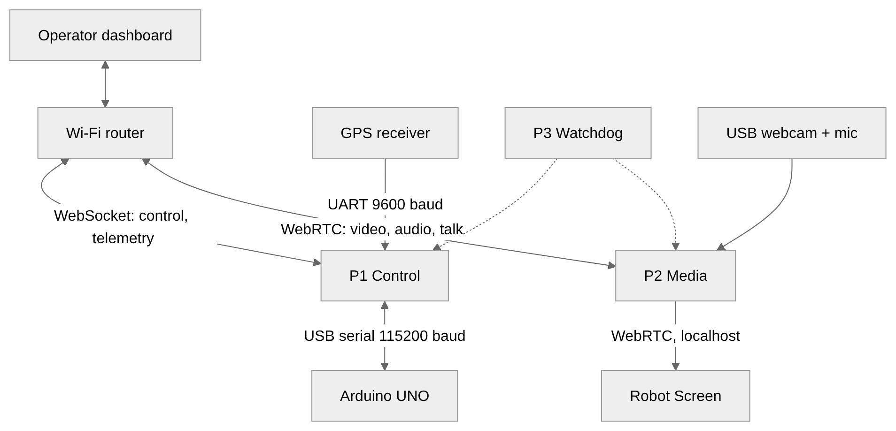
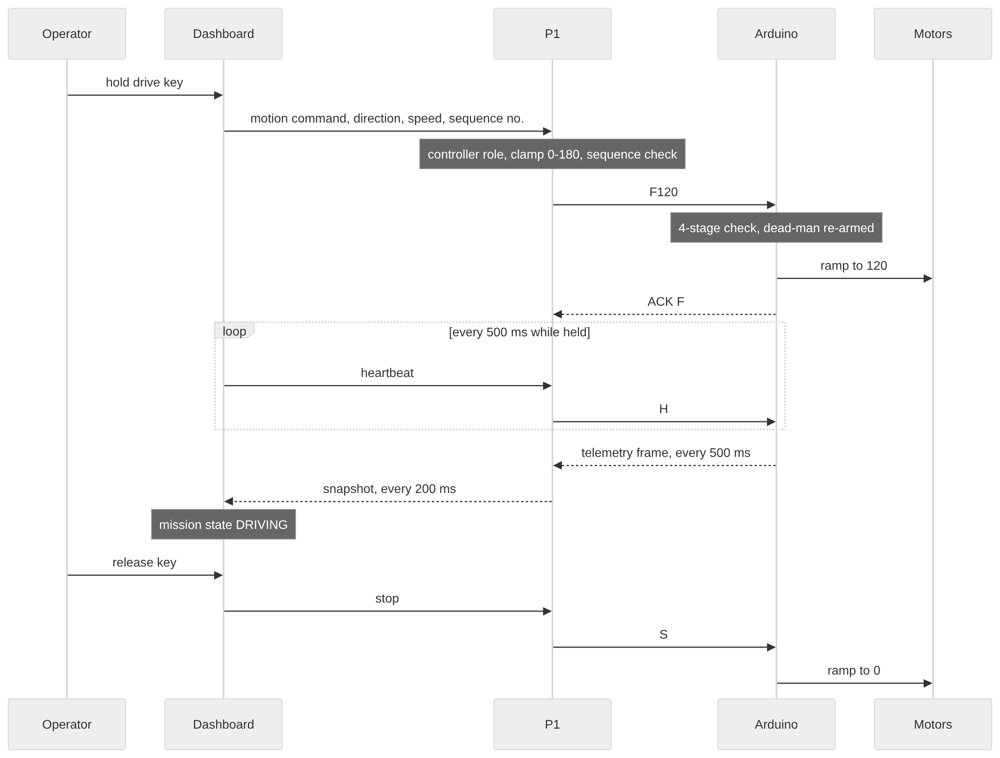
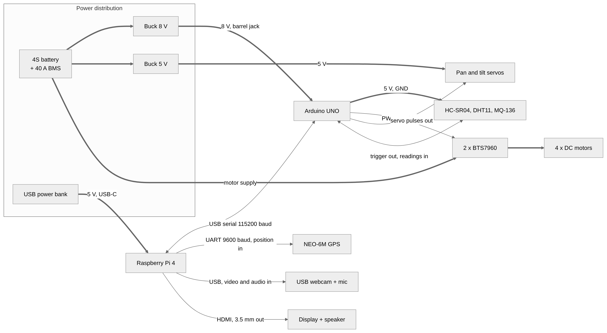
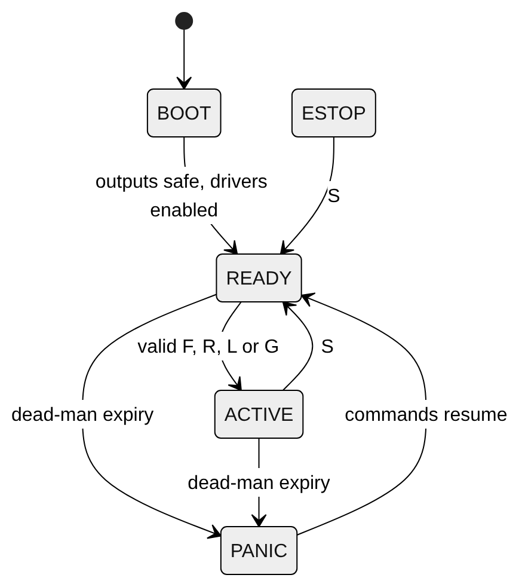
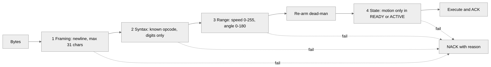
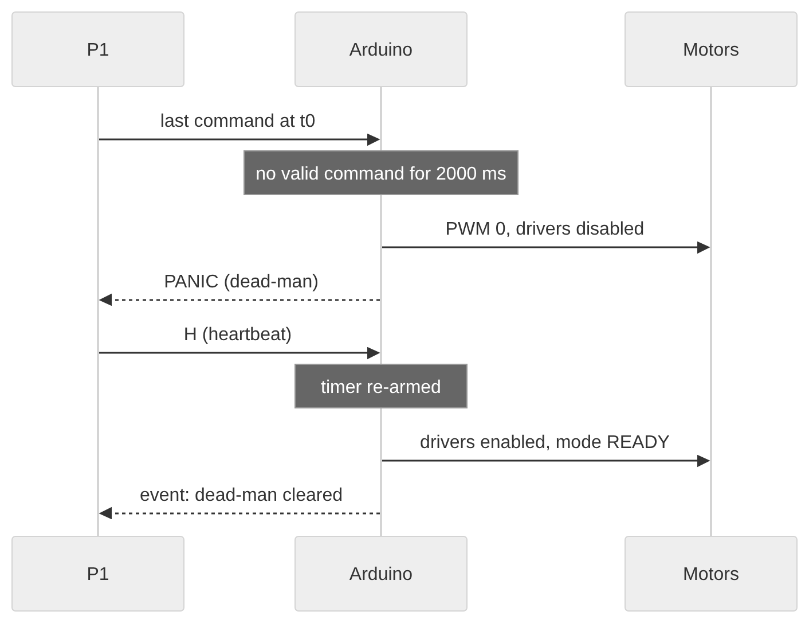
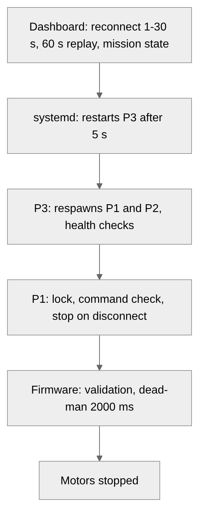
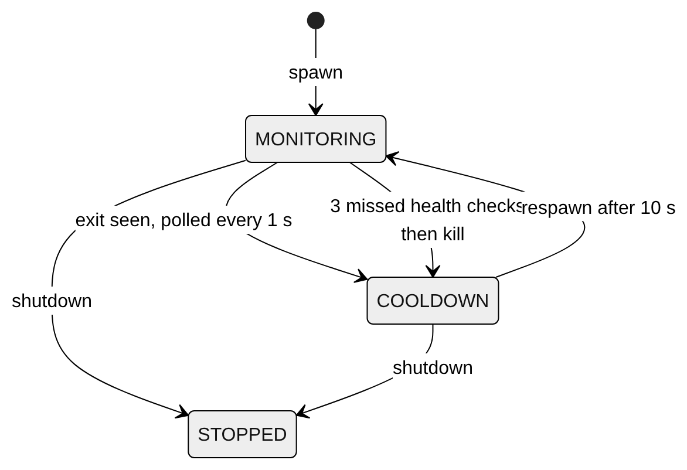
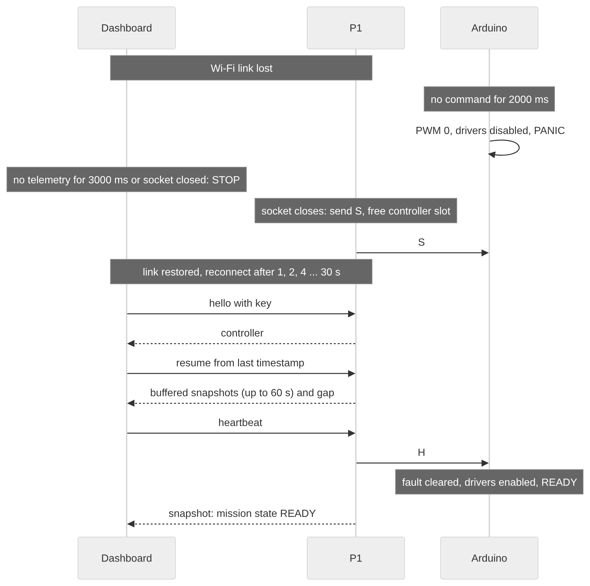
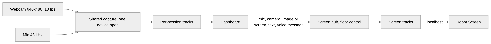

# A Low-Cost Fail-Safe Teleoperated Rescue Robot with Two-Way Victim Audio and Video: Firmware-Bounded Stop, Supervised Recovery and Measured Resource Cost

Chinmoy Sarkar, Sadman Adib, Sadia Sultana

[AUTHOR INPUT REQUIRED: confirm author-name spelling and order; affiliations; corresponding author and e-mail; ORCID iDs.]

## Abstract

Rescue robots are usually teleoperated over radio links that fail, and low-cost platforms rarely report how their stop behaviour or victim communication performs on their own hardware. We present a teleoperated rescue robot built from commodity parts and evaluate three of its properties. An Arduino UNO runs the motor firmware, and a Raspberry Pi 4 runs three isolated processes for control, two-way WebRTC audio and video, and supervision, on a local Wi-Fi network with no Internet uplink. A dead-man timer in the firmware removes motor drive when valid commands stop arriving, independently of the Pi and the link. Timed on the control process's event log, drive was removed within 2042 ms of the last command in 30 of 30 trials (mean 2022.5 ms), below an analytical bound of about 2060 ms. The watchdog restored service with a new process identifier in 30 of 30 SIGKILL trials (95% Wilson lower bound 88.6%), with mean recovery times of 12.8 to 16.0 s. One operator media session used 62.9% of one core on the media process while the control process stayed below 4%, provided the Pi had an adequate supply; the original power bank under-volted under the same load. The itemized parts cost about USD 310 (37,158 BDT). The stop figure is the time at which drive is removed, not a wheel-stop time or a stopping distance. Control latency over Wi-Fi, media delay and quality, a field trial and control-media isolation are not yet measured; usability is future work.

## Index Terms

Dead-man timer, edge computing, fail-safe control, fault tolerance, Raspberry Pi, search and rescue robotics, teleoperation, WebRTC.

## I. INTRODUCTION

In 2025 the Emergency Events Database recorded 358 natural-hazard disasters, which caused 16,607 deaths and affected 110.2 million people [1]. After such events the communications infrastructure that rescue teams rely on cannot be assumed to work [2]. Robots have been used in urban search and rescue (SAR) since the collapse of the World Trade Center in 2001 [3], and in actual disasters they are typically teleoperated [4]; teleoperation is expected to remain an important default mode even for autonomous systems [5]. The radio link between operator and robot is the weak point of that arrangement. At Fukushima Daiichi, tests indicated that reliable wireless communication would not be possible inside the reactor buildings, and the robot sent there was fitted with a wired communication device [6]. A robot driven over a radio link therefore has to decide for itself what to do when commands stop arriving.

A second requirement appears once the robot reaches a trapped person. A SAR robot should provide audio-visual communication between the operator and the victim, so that a responder can make a basic diagnosis [7], and on average four to ten hours pass between discovery and extrication [8]. Two-way voice is a fundamental function of most mine-rescue robots reviewed in [9], but those are specialized, costly platforms. Among the recent low-cost platforms compared in Section II, none reports two-way audio and video with the victim, or how much of a small computer that channel consumes while the same computer also drives and supervises the robot.

### A. Problem Statement and Challenges

The design problem is to build a teleoperated rescue robot on hardware cheap enough to be replaced, in which the stop behaviour does not depend on the weakest part of that hardware. Four challenges follow, and the rest of the paper uses the same labels.

*C1, a bounded stop time on a non-real-time software stack.* A stop decision taken by a Linux process inherits the scheduling and crash behaviour of that process. If the process stalls or dies while the robot is driving, the last drive command stays in force. Link-loss failsafes and watchdog timers are established techniques [10], [11]; the open questions for a low-cost rescue robot are where the decision runs and what time it achieves.

*C2, single points of failure on one board.* If control, video and supervision share one process, a crash in any of them can end the mission. Recovery by restart, with several lines of defence because recovery can itself fail, is an established dependability strategy [12]. The challenge is to keep the robot either controllable or stopped when any one process fails, and to restore service without anyone going to the robot.

*C3, two-way victim audio and video under CPU, power and bandwidth limits.* Capturing, encoding and decoding media competes with the control path for processor time, supply current and the one Wi-Fi cell. The challenge is to carry the victim channel on the same board without weakening the stop path, and to report what it costs.

*C4, affordability.* Recent platforms are often described as low-cost, but none of those compared in Section II states a build cost.

Each challenge has prior work taken alone. What the platforms in Table I do not report together is a stop time bounded independently of the higher-level software, supervised recovery of the robot's processes, and two-way audio and video with the victim together with its resource cost, on low-cost hardware. The contribution of this paper is that combination with its measurements; no single part is claimed as new.

### B. Research Questions and Contributions

- RQ1 (C1): Can firmware on the motor controller bound the time at which drive is removed after the last command, whatever the state of the Pi and the operator link?
- RQ2: What latency does the control path add inside the robot, and over what distance does the link remain usable?
- RQ3 (C2): Does a watchdog restore service after a process is killed, without leaving the motors driven?
- RQ4 (C3): What does the two-way victim audio and video path cost the board, and how precise is the GPS position that the operator's map relies on, when both run on the same single-board computer?

The contributions are:

1. A firmware dead-man timer on the motor controller that removes drive without help from the Pi (C1, Section III-E). Drive was removed within 2042 ms of the last command in 30 of 30 logged trials (mean 2022.5 ms), against an analytical bound of about 2060 ms (Section V-A).
2. A three-process split on the Pi with a watchdog process and a single serial writer (C2, Sections III-F and III-G). The watchdog restored service with a new process identifier (PID) in 30 of 30 SIGKILL trials, a 95% Wilson lower bound of 88.6% on the recovery probability [13] (Section V-C).
3. A two-way WebRTC audio and video path to the victim, isolated in its own process (C3, Section III-I). One operator session used about 63% of one core on the media process while the control process stayed near 4% (Section V-D).
4. An itemized bill of materials of about USD 310 from procurement receipts (C4, Section V-G and Appendix A).

Every figure in Section V carries an evidence class (measured, calculated, simulated, software test or pending), and hand-entered data were cross-checked against the robot's own machine logs before use; three of the four hand-entered data sets (stopping distance, ultrasonic range and the temperature-error figures) failed that check and support no claim.

The claims are limited. All results come from one robot, one operator and one access point, indoors or in an open outdoor area. The stop time in contribution 1 is the time at which drive is removed, not the time the wheels stop and not a stopping distance. Control latency over Wi-Fi, media delay and quality, the end-to-end rescue run and the test of whether a media-process stall can delay control were not measured; each has a pass criterion fixed in advance (Table XVII). No usability study was run. The firmware stop behaves like a category-0 stop in IEC 60204-1 [14] but is not a safety-rated implementation, and no compliance is claimed.

Section II reviews related work. Section III describes the system from the firmware upward, Section IV the experimental setup, and Section V the results. Section VI discusses them with their limitations and threats to validity, Section VII sets out future work, and Section VIII concludes.

## II. RELATED WORK

This section places the system against the four challenges of Section I-A. The search was not systematic, and no PRISMA flow is claimed. In October 2026 we queried OpenAlex for records from 2022 onward on low-cost and Raspberry Pi rescue robots, rescue-robot victim communication, WebRTC teleoperation, link-loss failsafes, watchdog timers and software fault recovery in mobile robots, and selected candidates from the relevance-ranked results by title and abstract and by backward citation from the reviews below. Table I includes peer-reviewed platforms from 2022 onward that present a built or simulated SAR robot and whose full text was read, with one earlier exception noted below.

### A. Reviews and Levels of Operator Involvement

Reviews organize SAR robotics along different axes: a domain theory of robot-assisted search [15], the control perspective [16], multi-robot coordination and perception [17], and readiness for deployment, where Delmerico et al. observe that field-deployable rescue technology has requirements for speed, versatility and ease of use that current systems may not meet [18]. Schneider and Wildermuth set out SAR requirements for each component of a robot [7]. More recent reviews organize the field by system architecture, from 74 papers of 2016-2024 [19]; by platform class, from more than 190 studies of unmanned ground vehicles (UGVs) [20]; by perception deficiencies [21]; by ethical and design issues [22]; and, for mines, by design requirements [9]. The open problems they name include multi-robot coordination, real-time decision-making, energy and standardized benchmarks [19], [20]. Neither the timing of the stop path nor the on-board cost of victim interaction is an axis along which they organize the field.

Levels of autonomy range from teleoperation to full autonomy [23], and SAR robots are in practice teleoperated or semi-autonomous [7]. The system presented here is a teleoperation system, because rescue robots are typically teleoperated in actual disasters [4]. In the Urban Circuit of the DARPA Subterranean Challenge, where communication constraints make underground search harder, one team used teleoperation as the baseline against which autonomous solutions were compared [24].

### B. Field Deployments, Benchmarks and Recent Platforms

The World Trade Center response in 2001 is the first known use of robots for urban search and rescue [3]; its post-hoc analysis called for perceptual and assistive interfaces and formal models of the robot's state [25]. At Fukushima Daiichi in 2011 the robot was fitted with a wired link because wireless communication was not expected to work inside the reactor buildings [6], and organization, operation scheme and systemization were the major lessons [26]. After the 2016 Amatrice earthquake, ground and aerial robots collected data for 3D models of damaged churches [27]. We therefore treat link loss as an expected operating condition rather than a rare fault. Standard test methods for response robots have been refined through competitions [28], and the DARPA Subterranean Challenge evaluated integrated systems underground [29]. Section V does not use standardized apparatus, so its results are not comparable with benchmark scores.

The recent platforms in Table I concentrate on mobility, detection or communication range rather than on the control path. They range from a tracked robot with flippers and a manipulator scored at the World Robot Summit 2020 [30] to commodity designs: TXRob streams camera, microphone and gas data from a Raspberry Pi 4 over local Wi-Fi [31]; Pramono et al. combine ESP32 controllers, Bluetooth control and Internet-connected video [32]; and a Raspberry Pi 4B quadruped reports a 200 m control range over Wi-Fi [33]. Others extend range with a LoRa network that needs no infrastructure [34], use a LoRa command link with Wi-Fi video and a cloud dashboard [35], add voice control and person tracking through a cloud-connected controller [36], or change the mobility class [37], [38]. Detection-oriented work locates survivors with a thermal infrared array [39], a YOLOv8 detector on a Jetson Nano [40], multimodal fusion validated in simulation [41], or Bluetooth Low Energy wearables [42]. Five of these designs are described as low-cost, affordable, cost-effective or built from inexpensive parts [31], [32], [39], [40], [33], yet none states a numeric build cost. The earlier Survivor Buddy head does, at USD 3,600 for version 1.0 and USD 1,800 for version 2.0 [43].

### C. Fail-Safe and Fault-Tolerant Architectures

IEC 60204-1 defines stop categories for machinery, of which category 0 is stopping by immediate removal of power to the actuators [14]. Industrial practice is moving safety functions from relays and interlock circuits into software [44], which makes the placement of the stop decision a design choice. Pont presents patterns for time-triggered embedded systems whose task timing can be predicted [45]; the firmware of Section III-E follows that style. Watchdog timers detect a stalled controller: a hardware watchdog designed for drone processors resets the processor when it is not serviced in time [11]. That mechanism detects a hung processor, not the absence of operator commands. For loss of the operator link, the ArduPilot Rover documentation describes a radio failsafe with a configurable timeout (default 1 s) and a ground-station heartbeat failsafe (default 5 s) [10]; these are configurable timeouts in general-purpose vehicle software, not measured stop times on a rescue robot. A run-time monitor for networked robots under delayed observations [46] addresses late information, which is complementary to a stop on missing commands.

For process supervision, Candea et al. argue that systems built to recover fast may be more productive than systems built never to fail [12]. Schrick et al. use microservices and a hierarchical state machine to increase the interruptibility of a delivery robot [47], Ramesh et al. estimate robot health at run time so that a supervisor can intervene [48], and failure mode and effects analysis combined with simulation has been used to assess how rover software mitigates sensor and actuator hardware failures [49]. None of these targets a single-board rescue robot, and no platform in Table I reports a firmware-level stop or supervised process recovery.

### D. Human-Robot Interaction (HRI): Operator and Victim

On the operator side, situation awareness [50] is the recurring concern. Limited video bandwidth, time lags and low frame rates degrade teleoperation performance [5], network latency affects operators' perception and decisions in vehicle teleoperation [51], and even small latencies can raise workload in planetary exploration [52]. For mine rescue, interface principles have been mapped from cognitive load, situational awareness and trust [53], and rescue personnel report a need for real-time situational data [54]. Semantic indicators can signal when a scene needs the operator's attention [55], and LED-based affective expressions improved participants' situational awareness in an online study [56].

On the victim side, Bethel and Murphy applied non-verbal affective expression to victim assessment within about three metres [57]. Survivor Buddy, a four-degree-of-freedom head with a touch-screen face, was built to study robots as a social medium between trapped survivors and the outside world [58]; its second version was 50% less expensive and 78% lighter [43], and its reported evaluations are a quasi-experimental study that the authors describe as neither statistically significant nor rigorously controlled [58] and two simulated scenario studies [8]. Among recent low-cost platforms the trapped person is mainly an object of detection [40], [41], [39], [42], [33]; one cloud-connected design analyses the robot's video and audio to detect survivors [59]. Where speech toward the person is mentioned, it is described rather than tested [36], [38]. TXRob's microphone relays sound to the operator only [31], SERR provisions a speaker and microphone that are not yet implemented [41], and Rescuer gives the operator a push-to-talk walkie-talkie while its camera video is recorded on the robot rather than streamed [34].

### E. Real-Time Media and Computing on Edge Hardware

WebRTC has been used for teleoperation with strict latency targets: a remote dental-surgery robot on Amazon Kinesis Video Streams WebRTC reports end-to-end latency below 50 ms [60], and a multi-operator platform for a mobile manipulator uses dedicated web and signalling servers and public STUN servers [61]. Both depend on servers outside the robot's network; the robot described here runs both WebRTC endpoints and signalling on the local network. Opus supports frame sizes from 2.5 ms to 60 ms, with 20 ms described as a good choice for most applications [62], and Bachhuber and Steinbach present a glass-to-glass delay measurement system [63]. The cloud-to-edge continuum has been proposed for the low-delay requirements of SAR, though building it remains an open challenge [64], and several recent platforms send alerts or streams through the cloud [40], [36], presuming infrastructure that a collapsed site may not provide.

### F. Research Gap

Table I compares representative platforms against C1-C4. Field studies, benchmarks and surveys are not tabulated. Survivor Buddy is included, although it predates 2022, as the most developed academic work on the robot as a communication medium for the victim; fielded mine-rescue robots with two-way voice [9] are outside the table's low-cost, post-2022 scope.

**TABLE I.** Representative rescue platforms against challenges C1-C4. Cells for other platforms are taken from the cited papers and not re-measured. NR means not reported in the text read; it does not mean the feature is absent. No cited paper states that it lacks a bounded stop (C1) or process supervision (C2), so every C1 and C2 cell for another platform is NR or describes an operator-commanded stop. The evidence column shows that rows differ in kind of evidence, so they are not comparable as performance results.

| Platform | Platform, control and link | C1 / C2 | C3: two-way victim audio/video | C4: reported cost | Evidence |
|---|---|---|---|---|---|
| Survivor Buddy 1.0/2.0 [58], [43] | 4-DoF robot head with touch-screen face, mounted on a teleoperated base; link NR | NR / NR | Design goal: survivor videoconferences with responders; two-way link not evaluated | USD 3,600 (v1.0), USD 1,800 (v2.0), head only | Design case study; small quasi-experimental and simulated studies |
| Paripreksya 2.0 [30] | Tracked UGV, flippers, manipulator, ROS; joystick over Wi-Fi | NR / NR | NR | NR | Competition (WRS 2020) |
| TXRob [31] | Tracked UGV, Raspberry Pi 4, local Wi-Fi | NR / NR | One-way: video and microphone audio to the operator (stated) | "Low-cost", no figure | Physical prototype |
| IoT robot [32] | 3D-printed UGV, ESP32; Bluetooth control, Wi-Fi or cellular video | NR / NR | NR (video to operator only) | "Affordable", no figure | Lab and field tests |
| SERR [41] | Arduino robot, smartphone control | NR / NR | Speaker and microphone provisioned, not implemented (stated) | NR | Simulation |
| Rescuer [34] | Pioneer P3-DX; LoRa link, no infrastructure | Operator E-stop bit only / NR | Push-to-talk walkie-talkie; video recorded on the robot, not streamed (stated) | Walkie-talkie "low-cost"; no total | Simulation and indoor lab test |
| Universal Platform [36] | Add-on controller for a drone and a quadruped; Wi-Fi, cable or cellular | NR / NR | Speech synthesis described, not tested; victim-to-operator audio NR | NR | Physical tests of other functions |
| Active scope camera [38] | Tethered continuum robot with distributed microphones and speakers | NR / NR | Speakers stated as used to talk to survivors; no video to the victim | NR | Simulated rubble with a mannequin |
| SAR assistant [39] | Arduino Mega, thermal IR array; autonomous approach | NR / NR | NR | "Inexpensive parts", no figure | Physical prototype |
| Caged UAV [37] | Ground-air UAV, handheld remote | NR / NR | NR | NR | Flight and endurance tests |
| ERS [40] | Manually driven vehicle, Jetson Nano, YOLOv8 | NR / NR | NR (one-way detection alerts) | "Low-cost" processor, no total | Dataset evaluation |
| QUADRESCUE [33] | ROS quadruped, Raspberry Pi 4B; joystick over Wi-Fi | NR / NR | NR | "Cost-effective", no figure | Field evaluation to 200 m |
| LoRa robot [35] | Arduino Uno and ESP32-CAM; LoRa commands, Wi-Fi video, cloud dashboard | Operator stop command; link-loss stop NR / NR | NR | NR | Pilot tests described qualitatively |
| This work | 4WD UGV, Arduino UNO and Raspberry Pi 4; local Wi-Fi, no Internet | Firmware dead-man: drive removed within 2042 ms in 30/30 trials / Watchdog: 30/30 SIGKILL recoveries | Two-way WebRTC video and audio plus text; processor cost measured | About USD 310 from receipts (37,158 BDT) | Laboratory measurements on the robot as built |

The gap that Table I shows is a combination rather than a missing feature, and it rests on what each paper reports, which is weaker than what each robot lacks. Stop categories are standardized [14] and recovery by restart is established [12], yet no recent platform in the table reports a stop time bounded independently of its higher-level software (C1) or supervised recovery of its processes (C2). Two-way communication with the trapped person is a stated requirement [7], a feature of fielded mine-rescue robots [9] and the subject of an HRI literature [57], [58], [8], yet among recent low-cost platforms the victim is mainly a detection target and none reports two-way audio and video with the victim on single-board hardware or its resource cost (C3). Low cost is asserted without a figure (C4). Section III brings these established mechanisms together on commodity hardware, and Section V reports which properties the measurements support and which they do not yet cover.

## III. SYSTEM DESIGN

One rule shapes the design: the robot must stop whenever any part of the system above the motors fails, and nothing added for the operator or the victim may weaken that guarantee. Sections III-A to III-D describe the architecture, network, hardware and software. Sections III-E to III-G follow the stop guarantee upward: the firmware enforces it, the control server feeds it, and supervision restores service without bypassing it. Section III-H decides which operator holds control, Section III-I builds victim interaction on that decision, Section III-J adds localization, and Section III-K lists operator aids that were added after the evaluation and are not evaluated.

### A. Architecture

The system has four tiers: an Arduino UNO for real-time control, a Raspberry Pi 4, a local Wi-Fi network, and a browser dashboard on the operator's laptop (Fig. 1). The Pi runs three separate Python processes. P1 (control server) links the dashboard to the Arduino, checks every drive command and collects telemetry and GPS. P2 (media server) streams the robot's camera and microphone to the operator and carries the operator's voice, video and text to a display and speaker that face the victim (the Robot Screen). P3 (watchdog) starts P1 and P2 and restarts either one if it crashes or stops responding. Control and media use separate transports that end in separate processes, so a media failure leaves driving and stopping intact.

**Fig. 1.** System architecture. Solid lines carry data, labelled with the transport; dashed lines are supervision by P3. Control (WebSocket) and media (WebRTC) end in different processes on the Pi.

Fig. 2 follows one drive command through the tiers. A held key sends one motion command; while it is held, heartbeats keep the dead-man timer armed, and releasing the key sends a stop. P2 and P3 take no part in this loop: media never carries a drive or stop command, and the watchdog acts on the processes from outside, so a failure in either cannot delay a stop.

**Fig. 2.** Control loop for one drive command: the command goes down through P1 to the firmware, and telemetry returns at 500 ms (firmware) and 200 ms (P1 broadcast) periods.

### B. Network

The Pi and the operator laptop join one 802.11n cell on the 2.4 GHz band with a 20 MHz width and no Internet uplink. Both hold addresses in the same subnet, issued by the router over DHCP, so traffic between them is neither routed nor address-translated. The project configures no access point, reservation or static address of its own, and the router stays with the operator at the staging point, so the robot works within one radio cell. The access point was on channel 10 (2457 MHz) for most of the campaign and on channel 3 (2422 MHz) for two range stations (Section V-E).

P1 serves the dashboard files, control WebSocket, telemetry, GPS track and offline map tiles on TCP port 8080. P2 serves WebRTC offer and answer exchange and the Robot Screen page on TCP port 8443, and carries audio, video and a data channel over UDP ports negotiated by Interactive Connectivity Establishment (ICE). Control and media use different transports for different reasons. Commands run over TCP because ordered delivery, together with a per-client sequence check, keeps a stale command from overtaking a newer one, and a command that does not arrive within the dead-man window stops the robot rather than leaving it on a stale command. Media runs over UDP, where a lost packet costs picture or voice quality but never delays a command. Table II lists the load and timing the network carries.

**TABLE II.** Network load and timing requirements (design values).

| Quantity | Value |
|---|---|
| Video, robot to operator | 640x480 at 10 fps, 500 kbit/s target |
| Audio, each direction | Opus, 32 kbit/s, 60 ms packets |
| Telemetry | Firmware frame every 500 ms; P1 snapshot to each client every 200 ms |
| Commands | Heartbeat every 500 ms from the controlling dashboard; one drive command per key press and one stop per release |
| Steady-state load per operator | Under 1 Mbit/s (sum of the rows above) |
| Hard delivery deadline | 2000 ms since the last valid command (dead-man) |
| Operator-side link timeout | 3000 ms without telemetry gives mission state STOP |
| WebSocket keep-alive | Ping every 20 s, 20 s timeout |
| Dashboard reconnect back-off | 1 s, doubling, capped at 30 s |

The dead-man window is measured from the last valid command, not counted in missed heartbeats. At the configured 500 ms heartbeat, two consecutive lost heartbeats leave a 1500 ms gap and do not stop the robot; a third reaches the window. The firmware's own telemetry frame (500 ms) and status line (1000 ms) are outbound reports and do not re-arm the timer. The WebSocket keep-alive reclaims a dead socket only after up to 40 s, so liveness for safety is enforced by the dead-man at 2000 ms and the dashboard's 3000 ms telemetry timeout, not by the transport. Neither port carries TLS, so the operator's browser must be told to treat the Pi's origin as trusted before it will capture the microphone and camera; this is a deployment workaround, not transport security (Section VI-C).

### C. Hardware

The hardware is chosen so that the lowest tier can stop the robot by itself: the Arduino drives the motor drivers directly and can disable them with one output. Table III lists the components and Fig. 3 the connections and power distribution. The motor supply and the Pi supply are separate, so motor current surges cannot reset the Pi. Each BTS7960 driver drives forward on one pulse-width modulation (PWM) input and reverse on the other, and both drivers share one enable line on pin D4, so one output disables all propulsion. The Pi control server clamps every speed to 0-180 of the firmware's 0-255 PWM range, which keeps the average voltage across the 12 V motors below their rating on the 14.8 V pack (180/255 x 14.8 V = 10.4 V, CALCULATED).

**TABLE III.** Hardware components.

| Component | Part | Function |
|---|---|---|
| Edge computer | Raspberry Pi 4 Model B, 4 GB | Runs P1, P2, P3 and the Robot Screen |
| Microcontroller | Arduino UNO (ATmega328P, 16 MHz) | Real-time motor control and sensing |
| Motor drivers | 2 x BTS7960 | One per side, shared enable line |
| Drive motors | 4 x 25GA-370 geared DC motor, 12 V, 60 RPM no-load, 65 mm wheels | Skid steering, left and right pairs |
| Camera servos | 2 x SG90 micro servo | Pan and tilt, 0-180 deg |
| Sensors | HC-SR04 range, DHT11 temperature and humidity, MQ-136 gas (raw 10-bit ADC, uncalibrated) | Advisory readings for the operator |
| GPS receiver | NEO-6M | Position, fix and satellite count |
| Camera and microphone | USB webcam with built-in microphone | 640x480 video at 10 fps; 48 kHz audio |
| Robot display and speaker | 7-inch HDMI display (1024x600); speaker on the 3.5 mm jack | Victim-facing Robot Screen |
| Battery | 4S3P Li-ion pack, twelve 18650 cells of 1500 mAh, 14.8 V nominal, 4.5 Ah, 4S 40 A battery management system (BMS) | Motor and microcontroller power |
| Regulators | 2 x buck converter, 8 V and 5 V | 8 V to the Arduino; 5 V to the servos |
| Pi supply | 50000 mAh USB power bank | Separate supply for the Pi (replaced during E8, Section V-D) |

**Fig. 3.** Hardware interconnection and power distribution. Thick lines carry power; thin lines carry signals, labelled with the interface and its direction. The motor supply (4S pack) and the Pi supply (USB power bank) are separate.

### D. Software Organization

The software has three layers that share no code and talk only through three interfaces: the serial command protocol between firmware and P1, the control WebSocket between the dashboard and P1, and WebRTC between the dashboard and P2. The firmware is C++ on the Arduino core without an RTOS. The Pi processes are Python 3 with asyncio (FastAPI and uvicorn for P1 and P2, aiortc and PyAV for P2, aiohttp for P3) over a shared module of protocol constants, configuration and access control. The dashboard is a single-page React application in TypeScript, served by P1, in which each network hook owns one connection to one server, so a lost media connection leaves the drive controls and telemetry working. systemd starts only P3, which spawns P1 and P2 as child processes with no shared memory. A development mode replaces the serial link with an in-process Arduino emulator, the GPS with a synthetic track and the camera with a test pattern, so the full stack can be tested without the robot; Section V-A reports where that emulator differed from the firmware.

### E. Firmware and the Dead-Man Stop

The firmware holds the authority to stop the robot, so it must stop the motors without help from the Pi or the network. It defines five modes (Fig. 4): BOOT, READY, ACTIVE, PANIC and a reserved latched operator-stop mode, ESTOP, which is defined but not entered in the current build. Motion is accepted only in READY and ACTIVE with no fault set.

**Fig. 4.** Firmware operating modes. A dead-man expiry moves READY or ACTIVE to PANIC; valid commands clear the fault. ESTOP is reserved and not entered in the evaluated build.

A cooperative scheduler, rather than a pre-emptive real-time operating system (RTOS), runs the periodic tasks of Table IV from the main loop, following the time-triggered style of [45], with timing based on unsigned millisecond differences so that counter rollover does not break it. The command parser runs on every loop pass and checks each newline-terminated ASCII command in four stages (Fig. 5): framing (at most 31 characters), syntax (one of nine opcodes, digits-only argument), range (speed 0-255, angle 0-180) and state (motion only in READY or ACTIVE). Appendix B gives the full command and reply grammar.

**TABLE IV.** Firmware tasks.

| Task | Period | Work |
|---|---|---|
| Motor service | 10 ms | Ramp PWM toward the target by 15 units per tick |
| Safety supervisor | 10 ms | Dead-man check and fault recovery |
| Fast sensors | 50 ms | HC-SR04 range (25 ms echo timeout) |
| Slow sensors | 2000 ms | DHT11 and MQ-136 |
| Telemetry | 500 ms | One 8-field CSV frame |
| Status line | 1000 ms | Mode line and LED toggle |

**Fig. 5.** Four-stage command validation in the firmware. Any command that passes stages 1 to 3 re-arms the dead-man timer before the state check; a failure at any stage returns a NACK with a reason.

Every command that passes stages 1 to 3 re-arms the dead-man timer, heartbeats included. This is not limited to drive commands: pan, tilt and status queries refresh the timer as well, so the 2000 ms window runs from the last valid command of any kind. When the elapsed time reaches 2000 ms (the check is inclusive), the supervisor sets all four PWM outputs to zero and pulls the shared enable line low at once, without ramping, and the firmware enters PANIC and emits a PANIC line on the serial link in the same pass (Fig. 6). This dead-man pattern behaves like a category-0 stop in the sense of IEC 60204-1 [14]; it is a design choice, not a claim of compliance.

Two quantities are kept apart throughout the paper: the stop time, when the motors lose drive, and the confirmation latency, when an observer outside the firmware can establish that they have. Only the first is a safety property. The worst-case stop time after the last accepted command is

$$t_{stop} \le T_{DM} + T_{S} + J, \qquad (1)$$

where $T_{DM} = 2000$ ms is the dead-man window, $T_{S} = 10$ ms is the supervisor period, and $J$ is the longest single loop pass. $J$ is set by the two blocking sensor reads, the 25 ms HC-SR04 echo timeout and the DHT11 exchange with its 20 ms start pulse. Because the 2000 ms slow-sensor period is an exact multiple of the 50 ms fast period, both reads fall in one loop pass every 2 s, so $J$ is about 50 ms and the bound is about 2060 ms. The bound is analytical.

Confirmation is slower. Besides the immediate PANIC line, the firmware encodes its mode in the state field of the periodic telemetry frame (every 500 ms), which P1 rebroadcasts on its own 200 ms timer. An observer that waits on that field learns of a trip up to 700 ms after the motors stop, about 350 ms on average. In the evaluated build P1 logs the PANIC line but does not forward it to the dashboard, so the operator display is driven by the slower path.

An ordinary stop command ramps the motors down instead:

$$t_{ramp} = \left\lceil u / \Delta u \right\rceil T_{M}, \qquad (2)$$

where $u$ is the current PWM value, $\Delta u = 15$ is the ramp step and $T_{M} = 10$ ms is the motor service period. From the 180 cap this gives 12 ticks, or 120 ms.

**Fig. 6.** Dead-man trip and recovery. After 2000 ms without a valid command the firmware zeroes PWM, disables the drivers and reports PANIC; the next valid command re-arms the timer and the fault clears.

Table V lists every path that stops the motors.

**TABLE V.** Stop paths. The dead-man is the firmware's only automatic stop; the firmware never stops the motors on a sensor reading.

| Trigger | Origin | Action |
|---|---|---|
| Drive key released | Dashboard via P1 | S (ramped stop) |
| Emergency-stop button | Dashboard via P1 | S, sent without the sequence check |
| Controller connection closes | P1 | S |
| Another dashboard takes control | P1 | S |
| P1 start-up | P1 | 3 x S, 200 ms apart, before any other command |
| P1 shutdown | P1 | S before the port closes |
| Command flow stops | Firmware | PWM 0 and drivers disabled within $t_{stop}$ of (1) |

### F. Control Server and Telemetry

The firmware assumes that the commands it receives come from one source and arrive in order; P1 provides that assumption. Before it opens any hardware, P1 takes an exclusive, non-blocking lock on a file in a memory-backed directory, which the kernel releases when the process exits for any reason. It then opens the serial port in exclusive mode, and one asynchronous lock serializes all writes, so P1 is the single writer to the Arduino. At start-up P1 waits 2.0 s for the board to reset, sends three stop commands 200 ms apart and a status query, and requires a reply within 5 s; a timeout ends P1 with a handshake-failure exit code that P3 treats as a crash.

The firmware sends a telemetry frame every 500 ms. P1 drops any frame with a field outside its accepted range (Appendix B), without retransmission, and broadcasts a snapshot of the latest valid frame every 200 ms on an absolute schedule, merged with the GPS fix, link status and the robot's received Wi-Fi signal level. On reconnect, the dashboard sends the server timestamp of the last snapshot it received, and P1 replies with every newer snapshot in its buffer and the size of any gap:

$$D = N \cdot T_{b} = 300 \times 200\ \text{ms} = 60\ \text{s}, \qquad g = \max(0,\ t_{oldest} - t_{last}), \qquad (3)$$

where $N$ is the buffer size, $T_{b}$ the broadcast period, $t_{oldest}$ the oldest buffered timestamp and $t_{last}$ the client's last timestamp. The buffer is held in memory and does not survive a P1 restart.

### G. Fault Tolerance and Supervision

Fault tolerance is layered (Fig. 7). Each layer acts on its own, and a failure that passes every layer above ends at the firmware, which stops the motors.

**Fig. 7.** Layered fault tolerance, from the dashboard down to the motors. Each layer acts independently; the firmware dead-man is the last.

P3 is the only systemd service (restart on failure after 5 s). It supervises P1 and P2 with the state machine of Fig. 8: it polls for process exit every 1 s, runs an HTTP health check every 10 s with a 5 s timeout, kills a process after three missed checks, and respawns it after a 10 s cooldown. The only link between P1 and P2 is a once-per-second localhost query from P2 for the controller's address. P1 reports why it exited through its exit code, so a clean exit or a lock already held by a healthy peer draws no alarm, a lock error or failed handshake is respawned, and an invalid configuration is logged separately so that it cannot drive a tight respawn loop.

**Fig. 8.** Per-process supervision in P3: exit polled every 1 s, health checked every 10 s, respawn after a 10 s cooldown.

The time from a failure to a working process is

$$T_{rec} = T_{det} + T_{p} + T_{c} + T_{init}, \qquad (4)$$

where $T_{det}$ is the detection time (at most 1 s for a crash through the exit poll, at most $3 \times 10 + 5 = 35$ s for a hang), $T_{p} = 1$ s is the poll before cooldown, $T_{c} = 10$ s is the cooldown, and $T_{init}$ is the start-up time, which for P1 is $2.0 + 3 \times 0.2$ s plus up to 5 s for the handshake. With $T_{det} = 1$ s, a P1 crash recovers in 14.6 s to 19.6 s plus interpreter start-up. Table VI shows how each failure degrades the mission, and Fig. 9 traces one failure, a Wi-Fi drop, through the tiers.

**TABLE VI.** Failure effects and recovery (design).

| Failure | Detected by | Effect | Recovery |
|---|---|---|---|
| Operator link lost | Dead-man; socket close | Robot stops; mission STOP | Reconnect with back-off; telemetry replay |
| P1 crash or hang | P3 | No control or telemetry; dead-man stops the robot | Respawn; buffered history lost |
| P2 crash | P3 | Video and talk lost; control unaffected | Respawn; operator retries video |
| Arduino link error | Serial read or write error | Mission STOP | Reads retried every 0.5 s; port reopened only when P1 restarts |
| Camera or microphone lost | P2 | Test pattern or silence sent | Microphone reopened every 2 s; camera on the next session |
| GPS port error | P1 | No fix; GPS alert bit set | Port reopened after 2 s |
| P3 crash | systemd | P1 and P2 stop with it; dead-man stops the robot | Restart after 5 s, then P1 and P2 respawn |

**Fig. 9.** Failure chain for a Wi-Fi drop: the firmware stops the motors after 2000 ms without commands; P1 stops and frees the controller slot when the socket closes; on reconnection the dashboard replays buffered telemetry and its next heartbeat clears the fault.

The dashboard reduces link and firmware status to one of four mission states, in priority order: STOP (control socket or serial link down, or no telemetry for more than 3000 ms), DRIVING LIMITED (video down), DRIVING, and READY. It also shows the robot's received signal level as bars, with an amber warning at or below -70 dBm and a red one at or below -80 dBm. These thresholds are provisional planning values, not measured tolerances (Section V-E), and the warning is advisory; the stop guarantee stays with the dead-man.

### H. Controller Arbitration

Because any dashboard may reconnect after a failure, the system must decide which of several connected dashboards may drive. A dashboard becomes controller only by presenting the robot's controller key, compared in constant time; all others are observers, whose commands, including stop, are rejected. The most recent dashboard with the right key takes the controller slot, the previous holder is demoted, and the robot is stopped. A host that presents a wrong key five times within 300 s is refused for 300 s, even with the right key. P2 applies the same key check and grants talk only to a keyed session from the address P1 reports as controller, so talking follows driving. The key travels over plain HTTP and WebSocket. The threat model assumes a trusted local network at the staging point with no on-path attacker; transport confidentiality beyond WebRTC's own DTLS-SRTP is out of scope.

### I. Two-Way Victim Audio and Video

All communication between the operator and the victim runs through P2, and this path must never delay a stop. Media is kept out of P1 because video encoding is the heaviest load on the Pi and a stall in a codec library must not delay a stop; P2 can also be restarted while P1 keeps driving. P2 is a single Python process built on aiortc, a WebRTC implementation for asyncio, with PyAV (FFmpeg) for capture and coding. aiortc was chosen over server-oriented stacks because it runs inside one Python process on the P2 event loop and needs no separate signalling server.

The webcam and microphone can each be opened only once, so P2 opens each device on first use and fans frames out to every session (Fig. 10). Each dashboard session has its own outbound tracks and its own video encoder, VP8 or H.264 as negotiated. Each dashboard opens one peer connection that carries both directions: the robot's camera and microphone to the operator, and the operator's voice, video, text and images back. The dashboard sends its Session Description Protocol (SDP) offer in one HTTP POST with its controller key, and P2 returns a complete answer after gathering its candidates, so there is no signalling server and no trickle ICE. Both peers are on the same subnet, so host candidates suffice and no STUN or TURN server is used.

**Fig. 10.** Two-way media path in P2. Camera and microphone are opened once and shared across sessions; operator media is relayed by P2 to the Robot Screen over localhost under floor control.

The operator's media does not go from the dashboard to the Robot Screen directly. The kiosk browser that drives the victim-facing display connects only to P2 over localhost, and P2 relays the floor holder's media to it, so floor control and the controller check are enforced in one place and no remote host can reach the victim's screen or speaker. The cost is one decode and one re-encode on the Pi. Only one session may hold the Robot Screen at a time, and a takeover moves the talk path to the new driver within about one second. Short JSON messages on a reliable data channel carry screen text (at most 280 characters, acknowledged by the screen), media state and floor status; media and drive commands never travel on it.

P2 encodes 60 ms Opus packets in both directions instead of the usual 20 ms [62], which cuts the packet rate from 50 to 16.7 packets/s and the per-packet work on the event loop to a third. Table VII lists the media parameters.

**TABLE VII.** Media parameters (design values).

| Parameter | Robot to operator | Operator to robot |
|---|---|---|
| Video | USB webcam, 640x480 at 10 fps, 500 kbit/s target, one encoder per session | Laptop camera 640x480 at 10 fps, still image at 2 fps or shared screen at 5 fps; re-encoded once for the Robot Screen |
| Audio | 48 kHz mono, Opus voice mode, 32 kbit/s, 60 ms packets | Same; inbound queue of about 200 ms with a 120 ms start cushion |
| Source loss | Test pattern (video); silence and reopen every 2 s (audio) | Last frame repeated after 1 s, then black; silence |

### J. GPS and Offline Map

P1 reads NMEA sentences from the NEO-6M receiver, whose datasheet gives 2.5 m circular error probable (CEP) under 24 h static operation with strong signals [65], merges the latest fix into each snapshot and adds a track point only when the fix lies at least 10 m from the previous point. The filter compares positions held to six decimal places; the 1 Hz telemetry log records them to four. Distance uses the equirectangular approximation

$$d = R \sqrt{(\Delta\varphi)^2 + (\Delta\lambda \cos\bar{\varphi})^2}, \qquad (5)$$

with $R = 6371000$ m, latitude and longitude differences $\Delta\varphi$ and $\Delta\lambda$ in radians and mean latitude $\bar{\varphi}$. The dashboard draws the fix and track over an offline vector map served by P1, so the map needs no Internet.

### K. Operator Aids Added After the Evaluation

Five operator aids were added after the measurements of Section V and have not been evaluated: person detection on the received video, run in the operator's browser rather than on the Pi; a repeating voice message recorded by the operator and looped by P2 on the robot speaker; victim marks that P1 stores with its GPS fix and camera angles while the snapshot image stays on the operator's computer; session recording on the operator's computer; and tap-to-answer questions on the Robot Screen for a victim who cannot speak. None acts on the motors and none confirms that a person is present. No detection rate, false-alarm rate, message intelligibility, recording completeness or answer reliability is claimed for them, and the E8 processor figures of Section V-D were recorded without them.

## IV. EXPERIMENTAL SETUP

### A. Test Conditions

All experiments ran on the robot as built (Table III) with hardware emulation disabled, so every command reached the physical Arduino and motors. The Pi ran Raspberry Pi OS 12 (Bookworm, kernel 6.12, arm64) with Python 3.11. Experiments were run between 2026-09-29 and 2026-10-23 at two sites: an indoor laboratory, with the robot within 3 m of the router, for latency, fault-injection, resource and bench sensor experiments; and an open outdoor area for the Wi-Fi range sweep and the static GPS window. One exception to the laptop-to-robot path matters for interpretation: the control-latency probe (E1) ran on the Pi and connected to P1 over the loopback interface, so its figures exclude the Wi-Fi link and the operator laptop.

### B. Experiments and Achieved Design

Table VIII lists the fifteen planned experiments (E1-E15) with the design actually achieved. Several experiments could not be run as planned; Section V reports only what was achieved, and Table XVII lists what is pending, with the claim each pending experiment tests and its pass criterion. The criteria were fixed before any of those data were collected and are not changed after the data are seen.

**TABLE VIII.** Experiment matrix: planned and achieved design. Tools are in `tools/eval/` of the code repository.

| # | Experiment | Planned | Achieved | Metric |
|---|---|---|---|---|
| E1 | Control-plane latency (on the Pi, loopback) | 30 trials per probe | 2 jittered sessions x 30 per probe, plus 1 phase-locked session | Command to telemetry confirmation (ms); dead-man interval from P1's event log |
| E2 | True control latency, 240 fps video | 30, same camera set-up as E4 | Not run | Key press to wheel motion (ms) |
| E3 | Emergency-stop distance | 20 per speed x 3; repeat filmed at 240 fps, each stop logged by P1 | 23 hand-entered rows; contradicted by logs; repeat not run | Distance (cm), stop time (s) |
| E4 | Dead-man wheel-stop time, 240 fps video | 20 at PWM 180, on the floor | Not run | Last command to wheels at rest (s) |
| E5 | Media delay and quality | 20 per condition, 3 conditions | Not run | Glass-to-glass and audio delay (ms), frame rate, loss |
| E6 | Wi-Fi range | Outward to link failure, with and without obstacles | 16 line-of-sight stations, 5-250 m, one burst each; no failure reached; no obstacles | ICMP loss, RTT, signal level; operator judgement |
| E7 | Fault injection and recovery | 10 per target | 30 automated SIGKILL trials (3 targets); manual faults F6, F7 | Detection and recovery time, PID change |
| E8 | Resource use | 4 conditions x 30 min | 6 conditions of 3-30 min at 1 Hz | CPU, memory, system-on-chip (SoC) temperature, throttle flags |
| E9 | GPS static precision | 30 min static | 129.1 min archived static window | Radial scatter about the centroid (m) |
| E10 | Ultrasonic accuracy | 5 distances x 10, readings from the telemetry log | 50 hand-entered rows; contradicted by logs; repeat not run | Reading error (cm) |
| E11 | DHT11 accuracy | 5 set-points | 1 set-point, 5 readings | Sensor minus reference |
| E12 | Gas sensor response | Qualitative | 5 puffs, one session | Peak counts, trip time (s) |
| E13 | Field trial with role-played victim | 10 runs, fixed course and success rule | Not run | Run success, time to victim, collisions, two-way exchange |
| E14 | Operator usability (System Usability Scale, SUS) | Deferred to future work | Not part of this evaluation | SUS score, task time |
| A3 | Media isolation (control latency with media off, on, and P2 frozen) | 3 conditions x 30 | Not run | Confirmed commands; motor-stop upper bound (ms) |
| E15 | Cost | Bill of materials | Authors' itemized receipts (BDT) | Total cost |

### C. Evidence Classes, Validity and Data Provenance

Every number in Section V belongs to one of these classes: MEASURED (observed on this robot and stored in the result files or the robot's logs), CALCULATED (derived from measured values or design constants by a stated formula), PREDICTED (from the recovery model (4)), SIMULATED (output of a software model with no physical measurement behind it), SOFTWARE-TEST (passing automated tests, in most cases against a hardware emulator), and PENDING. A trial is valid when all three processes are healthy, the serial link is active, no injected fault is outstanding and the tool reports success; discarded trials are reported, and none occurred in the automated E1 and E7 runs.

Rows written by the automated tools (E1, E6, E7, E8) are machine-generated. Rows entered by hand afterwards (E3, E10, E11, E12) carry the time of entry, about one second apart, not the time of measurement, so they were transcribed after each session. They are accepted only where the robot's independent logs agree with them: P1's event log, which records every line sent to and received from the Arduino with a millisecond timestamp, and the 1 Hz telemetry log. Results the logs contradict are retained but marked [VERIFICATION REQUIRED] and support no claim. Because the logs rotate, the windows used here are preserved in the repository.

### D. Statistical Treatment

Means of independent trials carry a two-sided 95% Student-t confidence interval. Success proportions carry a 95% Wilson score interval [13], which stays informative when every trial succeeds. The 1 Hz resource series are autocorrelated, so their means carry a 95% interval from ten non-overlapping batch means. No hypothesis test is reported, and differences between conditions are described, not tested. All figures are reproduced by `tools/eval/section5_stats.py`.

E1 needs one further note. The latency probe waits for telemetry to confirm each command. Because the firmware emits telemetry every 500 ms and P1 rebroadcasts every 200 ms, the confirmation can arrive up to 700 ms after the event, so E1 latencies are upper bounds. The probe randomizes its send phase by 0-200 ms to decorrelate trials from the 200 ms rebroadcast; a phase-locked control session shows the bias this removes. The jitter cannot decorrelate trials from the 500 ms firmware cycle. The dead-man interval avoids this quantization by using P1's event-log timestamps (Section V-A).

### E. Baselines

Two planned ablations, firmware dead-man disabled and watchdog disabled, were withdrawn before being run: without the timer nothing removes drive when commands stop, and without the supervisor nothing restarts a killed process, so their outcome follows from the design. The paper therefore reports the with-feature behaviour of both mechanisms and claims no measured benefit over a system without them. The third, a merged control-and-media process, is replaced by a direct test on the robot as built (A3): the E1 motor probe is run 30 times with no media session, with one operator media session, and with P2 suspended by SIGSTOP in 15 s windows, short of the 35 s health-check restart. A3 is pending (Table XVII); it can show whether the split isolates control from media on this robot, not how a merged design would behave. A fourth ablation, Opus at 16 kbit/s instead of 32 kbit/s, was run for processor load only and is confounded (Section V-D). The design constants of Section III (the 2000 ms window, the 3000 ms telemetry timeout and the recovery model) serve as specification targets. The literature platforms of Table I are compared by their published descriptions only.

### F. Human Subjects

No human-subject data have been collected. The field trial (E13) involves an author as operator and a second person who role-plays the victim, and will be run under informed consent with anonymous participant numbers. The usability study (E14) was removed from this evaluation before any participant was recruited, because a SUS interval from the 8 to 12 operators planned would be too wide to support a usability claim; it is left to future work. [AUTHOR INPUT REQUIRED: ethics-committee decision or institutional waiver, with reference number and date, before E13 is run and before submission.]

## V. RESULTS

### A. Firmware Stop Interval (RQ1)

*Procedure.* In the E1 session of 2026-10-21, the probe on the Pi drove the robot at PWM 150 and then stopped sending commands, 30 times. P1's event log time-stamps every command written to the Arduino, the firmware's acknowledgement (ACK) of it, and the PANIC line, all on one clock. Because the firmware emits the PANIC line in the same supervisor pass in which it zeroes the PWM outputs and disables the drivers (Section III-E), the arrival of that line marks the removal of drive, delayed only by serial transit. Every probe trial matched exactly one PANIC line.

**TABLE IX.** Dead-man interval on P1's clock, 2026-10-21, 30 trials. CALCULATED from MEASURED event-log timestamps. Values in ms.

| Interval | Mean | 95% CI | SD | Min | Median | Max |
|---|---|---|---|---|---|---|
| P1 sends last command -> P1 receives PANIC | 2022.5 | 2019.7 to 2025.3 | 7.5 | 2009.0 | 2024.0 | 2042.0 |
| P1 receives ACK of that command -> P1 receives PANIC | 2002.0 | 1998.7 to 2005.2 | 8.7 | 1986.0 | 2002.5 | 2022.0 |
| P1 sends last command -> P1 receives its ACK | 20.5 | 18.8 to 22.2 | 4.6 | 6.0 | 21.0 | 29.0 |

*Result.* The interval from the last command leaving P1 to the PANIC line arriving back never exceeded 2042 ms (Table IX), below the analytical bound of about 2060 ms of (1) in every trial, and it still includes serial transit in both directions. The interval from the firmware's ACK to its PANIC line, in which the return leg cancels, has a mean of 2002.0 ms, which agrees with the 2000 ms window; its spread of 1986 to 2022 ms shows that P1's receive timestamps carry jitter of about 15 ms from USB-serial buffering and event-loop scheduling, which is the resolution of this method. The same trials timed through the telemetry state field gave a mean of 2435.9 ms (SD 110.8 ms), and the difference of 356.8 ms between the two means agrees with the predicted mean reporting delay of about 350 ms on the slower confirmation path. These figures establish when the firmware removed drive. They do not observe the wheels: the wheel-stop time (E4) is [PENDING MEASUREMENT].

*Injected and unplanned link loss.* Two further observations come from outside the scripted probe. In fault F7 (2026-10-21), the Pi's `wlan0` interface was taken down for about 20 s while a dashboard held control. The last controller heartbeat reached the Arduino at 19:52:48.530 UTC and the PANIC line arrived 2.02 s later; P1 closed the dead WebSocket only 23.16 s after the last heartbeat, consistent with the keep-alive of Table II, and the dashboard reconnected 1.91 s after the close. The robot therefore stopped more than 20 s before the control socket closed, so liveness was enforced by the firmware, not the transport. On 2026-10-22, P1's forwarded heartbeats paused three times for reasons that were not recorded (Table X): gaps of 1.902 s and 1.988 s caused no trip, and a gap of 2.080 s produced a PANIC line at its end. On this sample of three gaps, the dead-man tripped when, and only when, the 2000 ms window was exceeded.

*Heartbeat interval actually delivered.* The dashboard is configured to send a heartbeat every 500 ms, and P1 forwards each without rate limiting, so the interval of heartbeats in P1's log is the interval the dashboard delivered. It was not constant (Table X): 0.50 s during the probe session, but 1.00 s in the minutes before F7 and before the unplanned gaps. The cause was not recorded; a browser throttling a background tab's timers is a candidate that was not tested. At 1.00 s a single lost heartbeat leaves 2000 ms of silence and trips the dead-man.

**TABLE X.** Heartbeats written to the Arduino, from P1's event log. MEASURED.

| Window (UTC) | Heartbeats | Median interval (s) | 10th-90th percentile (s) |
|---|---|---|---|
| 2026-10-21 11:40-12:30 (E1 probe session) | 5308 | 0.501 | 0.488-0.513 |
| 2026-10-21 19:51:00-19:52:49 (before F7) | 84 | 0.997 | 0.977-1.027 |
| 2026-10-22 12:01:30-12:03:07 | 192 | 0.502 | 0.375-0.618 |
| 2026-10-22 14:00:00-14:01:20 | 80 | 1.000 | 0.903-1.035 |
| Gaps of 1.9 s or more, 2026-10-22 12:00-14:02 | 1.902 s and 1.988 s: no trip; 2.080 s: PANIC at 14:01:17.616 | | |

*Supporting software evidence.* Two lines of non-physical evidence bear on the stop. First, the unmodified firmware sources were compiled natively with g++ against a host-side stub of the Arduino API and driven by tests (SOFTWARE-TEST, 10 test functions, 27 checks, all passed, 2026-10-22). The tests confirmed that the trip is inclusive at exactly 2000 ms, that all four PWM pins go to zero and the enable line goes low on trip, and that pan, tilt and status commands re-arm the timer. They also showed that the first command after a trip is rejected once and the fault clears in the next 10 ms supervisor pass. The Pi-side Arduino emulator used by the 121-test Pi suite had modelled the boundary and the re-arming rule differently; it was corrected to match the firmware, and the suite and 25 supplementary boundary tests passed afterwards. These are tests of software logic, not of the board. Second, Table XI gives the margin of the 2000 ms window against lost heartbeats. It is SIMULATED: the per-heartbeat loss probability is an assumed input, loss is modelled as independent with no jitter, and real Wi-Fi loss, which is often bursty, would trip the dead-man sooner at the same mean loss.

**TABLE XI.** Margin of the dead-man window against lost heartbeats. SIMULATED. Left: deterministic boundary analysis with the inclusive 2000 ms trip and no transit jitter. Right: Monte Carlo trip probability at the configured 500 ms period, 300 s missions, 50,000 trials per value, fixed seed.

| Heartbeat period (ms) | Consecutive losses tolerated | | Assumed per-heartbeat loss | Trip probability per 300 s mission |
|---|---|---|---|---|
| 200 | 8 | | 0.01 | 0.05% |
| 500 (configured) | 2 | | 0.05 | 6.84% |
| 1000 (observed in some sessions) | 0 | | 0.10 | 42.04% |
| 2000 | none (trips with no loss) | | 0.15 | 82.34% |

*Emergency-stop distance (E3), [VERIFICATION REQUIRED].* Twenty-three hand-entered stopping distances after an operator-pressed emergency stop give means of 42.7, 75.9 and 91.3 cm at PWM 60, 120 and 180. Two checks place them outside the evidence. P1's log contains the PWM 120 and 180 drive commands on the trial date but no PWM 60 command on that date. More decisively, with 60 RPM no-load motors and 65 mm wheels the no-load ground speed is 0.20 m/s, and the ramped stop of (2) from PWM 180 takes 120 ms and covers at most 2.5 cm (CALCULATED from the firmware constants); covering 78-98 cm would need 3.8-4.8 s of travel at full speed. The cause of the discrepancy cannot be resolved from the stored data, and no stopping-distance claim is made.

### B. Control-Plane Latency (RQ2)

Table XII gives the E1 command latencies over loopback. Each is an upper bound that can exceed the true latency by up to 700 ms. Only `hello_rtt`, the authentication round trip, does not wait on telemetry.

**TABLE XII.** Control-plane latency on the Pi over loopback, jittered sender, 30 trials per metric and session. MEASURED. Mean (95% CI) in ms.

| Metric | 2026-10-07 | 2026-10-21 |
|---|---|---|
| hello_rtt (no telemetry wait) | 46.8 (37.7 to 56.0) | 138.0 (115.7 to 160.3) |
| motor_start (drive -> state ACTIVE) | 328.2 (277.4 to 379.0) | 275.4 (251.9 to 298.9) |
| motor_stop (stop -> state READY) | 314.4 (284.5 to 344.2) | 302.9 (281.4 to 324.4) |
| pan_echo (pan -> new angle) | 387.7 (365.2 to 410.3) | 389.6 (359.8 to 419.4) |

The telemetry-confirmed means lie between 275 and 390 ms in both sessions, inside the 700 ms confirmation bound. The sessions agree for `motor_stop` and `pan_echo` but not for `hello_rtt`, whose mean rose from 46.8 to 138.0 ms with non-overlapping intervals; both sessions ran over loopback, so this reflects a change in processing on the Pi whose cause was not recorded, not a network effect. In the phase-locked control session the `motor_stop` median collapsed onto the 200 ms rebroadcast grid (400.7 ms, SD 19.9 ms against 80.0 ms jittered), which is the bias the jitter is designed to remove. No figure in this subsection includes Wi-Fi; true control latency (E2) is [PENDING MEASUREMENT].

### C. Fault Injection and Recovery (RQ3)

*Procedure.* On 2026-10-07 `faultinject.py` sent SIGKILL to P1 (test F3), P2 (F4) and P3 (F5), ten times each, polling the target's health endpoint about every 50 ms. Detection is the time to the first unhealthy observation; recovery is the time until the endpoint answers healthy with a new PID.

**TABLE XIII.** SIGKILL fault injection, 10 trials per target. MEASURED (times); CALCULATED (Wilson intervals).

| Test | Target | Detection mean (ms) | Recovery mean (s) | Recovery 95% CI (s) | Recovery SD (s) | Recovered | 95% Wilson interval |
|---|---|---|---|---|---|---|---|
| F3 | P1 | 91.1 | 16.03 | 15.93 to 16.13 | 0.14 | 10/10 | 72.2% to 100% |
| F4 | P2 | 123.2 | 14.45 | 13.76 to 15.14 | 0.96 | 10/10 | 72.2% to 100% |
| F5 | P3 | 157.0 | 12.83 | 12.18 to 13.48 | 0.90 | 10/10 | 72.2% to 100% |
| Pooled | | | | | | 30/30 | 88.6% to 100% |

All 30 trials recovered with a confirmed PID change, and P1's event log independently shows ten serial-port re-opens during the F3 campaign. Thirty successes bound the per-trial failure probability under these conditions below 11.4% at 95% confidence; they do not demonstrate long-run reliability. The P1 recovery mean of 16.03 s lies inside the 14.6-19.6 s window of (4) (PREDICTED), and its small SD is consistent with a path dominated by the fixed 10 s cooldown. P2 recovered faster than P1, consistent with P2 opening no serial link; P3 is restarted by systemd after 5 s, a different path. Detection times of 59 to 216 ms show that each outage was visible at the health endpoint within a fraction of a second; they do not measure P3's own detection. During each recovery window the dead-man holds the motors stopped once commands cease, so the outage is a loss of service, not of safety.

In the manual fault F6 (2026-10-21), the Arduino's USB device was unbound from its kernel driver, which removes the serial device as a cable pull would. P1 logged its first serial read failure and the watcher saw the serial flag go false 0.11 s later; P1 stayed up with the same PID and kept serving clients and telemetry. When the device was re-bound, the kernel assigned a new device node, and the serial link stayed down until P1 was restarted. Process supervision as built therefore covers crashes, not hardware faults. Hangs, camera and microphone loss and Robot Screen exit were not injected, and a GPS-loss attempt (F9) did not produce a valid controlled measurement.

### D. Resource Use on the Pi (RQ4)

*Procedure.* `reslog.py` logged, at 1 Hz, total CPU (percent of the four-core processor), per-process CPU (percent of one core), memory, SoC temperature and the firmware throttle word. Conditions: `idle` (no operator); `driving` (driven continuously over the control WebSocket by a scripted client, no operator media stream); `driving+media` (as `driving` with one operator video and audio session); `driving+media-16kbps` (Opus at 16 kbit/s); and `driving+media-throttled` (the first media capture, on the original power bank). The operator stated that the wheels were clear of the ground in the driving conditions; the logs cannot confirm this, so motor current may not be represented.

**TABLE XIV.** Resource use on the Pi. MEASURED; means with 95% batch-means intervals (CALCULATED). P1 and P2 in percent of one core; total in percent of the processor.

| Condition | Date | Rows (1 Hz) | P1 CPU | P2 CPU | Total CPU | SoC temp. max (deg C) | Under-voltage samples |
|---|---|---|---|---|---|---|---|
| idle | 2026-10-08 | 1799 | 2.89 (2.75-3.03) | 0.90 (0.88-0.92) | 14.44 (8.61-20.26) | 52.1 | 0 |
| driving | 2026-10-21 | 309 | 3.74 (3.57-3.93) | 1.12 (0.47-1.81) | 20.70 (19.18-22.51) | 51.6 | 0 |
| driving+media | 2026-10-21 | 299 (two logger runs) | 3.81 (3.72-3.92) | 62.92 (62.22-63.67) | 20.76 (20.00-21.47) | 51.6 | 0 |
| driving+media, 16 kbit/s | 2026-10-21 | 299 | 3.85 (3.69-4.02) | 64.51 (63.30-65.82) | 22.98 (20.69-25.54) | 52.6 | 0 |
| driving+media, original supply | 2026-10-21 | 299 | 8.79 (8.66-8.90) | 118.10 (117.08-118.98) | 68.46 (67.60-69.58) | 48.2 | 276 |

On an adequate supply, the operator media session is carried by P2: 1.12% of one core while driving without a stream against 62.92% with one, about two thirds of one of the four cores. P1 stayed below 4% of one core with and without media (3.74% against 3.81%, overlapping intervals), so the media load did not appear on the process that carries drive and stop commands, which is the isolation the process split is designed to give. Total memory use stayed between 1.9 and 2.5 GB of 4 GB, and the SoC stayed at or below 52.6 deg C in every condition, below the 80 deg C at which the vendor documents progressive throttling [66]. Runs lasted 3 to 30 min indoors, so they say nothing about a full mission or high ambient temperature.

Three properties of the data limit these figures. First, the `driving+media` rows come from two logger runs started 94 s apart under the same label, so the 299 rows span 196 s of wall-clock time with 103 s sampled twice; the two runs give P2 means of 63.01% and 62.87%, so the splice does not change the result, and the rows are reported as logged. Second, the original power bank showed under-voltage and throttling on 276 of 299 samples under the same load, with P2 at 118.1% of one core; that capture is excluded from the clean result, and the supply was replaced before the other media captures. Third, the 16 kbit/s run measured no detectable CPU reduction (64.51% against 62.92%), but it is confounded: P3's log shows P2 was terminated and respawned between the 32 kbit/s and 16 kbit/s captures, so the two runs measured P2 in different states, and the 16 kbit/s setting was applied by an uncommitted change that is not in version control. The effect of bitrate on audio quality was not measured.

### E. Wi-Fi Range (RQ2)

*Procedure.* At each line-of-sight station, `netsweep.py` on the Pi sent 100 ICMP echo requests at 0.2 s intervals to the router and logged loss, round-trip time (RTT), signal level and channel; the operator entered the distance and, from station N7 on, judgements of video (good, choppy, lost) and control (yes, degraded, no). The usable range was defined in advance as the largest distance with both judgements favourable and loss below 5%. Stations N1-N6 ran on 2026-10-22; N7-N10 and a repeat of the first six distances (R1-R6) ran on 2026-10-23 (Table XV).

**TABLE XV.** Wi-Fi range sweep, one 100-ping burst per station. MEASURED (loss, RTT, signal, channel); operator-entered (distance, judgements).

| Station | Distance (m) | Loss (%) | Mean RTT (ms) | Signal at start (dBm) | Channel | Video / control |
|---|---|---|---|---|---|---|
| N1-N4 | 5, 10, 15, 20 | 0, 0, 0, 0 | 3.4-5.7 | -39 to -41 | not logged | not recorded |
| N5, N6 | 25, 50 | 0, 0 | 4.8, 3.5 | -42, -41 | 3 | not recorded |
| N7 | 100 | 0.0 | 3.9 | -52 | 10 | good / yes |
| N8 | 150 | 1.0 | 12.6 | -55 | 10 | good / yes |
| N9 | 200 | 0.0 | 42.9 | -58 | 10 | good / yes |
| N10 | 250 | 6.0 | 16.6 | -60 | 10 | good / yes |
| R1-R6 | 5, 10, 15, 20, 25, 50 | 2, 2, 0, 8, 10, 16 | 5.0-11.9 | -55 to -60 | 10 | good / yes at all six |

The operator judged video good and control usable at every judged station, so by judgement alone the usable range is at least 250 m, and its upper limit was not reached. The loss criterion gives no single answer: loss exceeded 5% at 250 m and at 20, 25 and 50 m in the repeat session, while the 100-200 m stations lost 1% or less, so the passing stations are not contiguous and no range boundary follows. Loss did not track distance, and neither did signal level (the 5 m repeat station and the 200 m station both read -58 dBm). At the six distances measured twice, the first session showed 0% loss at about -41 dBm and the second 0-16% loss at -55 to -60 dBm, a difference of about 17 dB at 5 m that is larger than any change with distance within either session. The access point changed channel between the sessions, and its position, the robot's antenna orientation and neighbouring networks were not recorded, so the cause is unresolved. These figures are properties of this access point and site, not bounds on the robot, and ICMP loss to the router is not the loss rate of the control heartbeat. Every signal level lay between -39 and -60 dBm, so the dashboard's -70 and -80 dBm warning thresholds were never reached and remain uncalibrated.

### F. GPS and Sensors (RQ4)

*GPS static precision (E9).* `gpsdrift.py` computed the radial distance of each fix of a stationary robot from the centroid of the window, using 6888 fixes logged over 129.1 min outdoors on 2026-09-29 (Table XVI). No surveyed reference was used, so this is precision, not accuracy. The telemetry log stores latitude and longitude to four decimal places, which at the test latitude is a grid of 11.12 m by 10.20 m (CALCULATED); the 6888 fixes occupy only 61 distinct grid positions, and rounding alone contributes an RMS radial error of about 4.4 m. The figures are therefore limited by the logging resolution: their order of magnitude is meaningful, but the CEP50 is smaller than one grid step and should not be quoted to sub-metre precision. With a mean of 4.8 satellites the scatter has a heavy tail; the datasheet's 2.5 m CEP assumes 24 h static operation with strong signals [65] and is not comparable.

**TABLE XVI.** Static GPS precision (E9), radial distance from the centroid, at the four-decimal resolution of the log. MEASURED.

| Fixes | Duration (min) | Mean sats | Mean (m) | RMS (m) | CEP50 (m) | CEP95 (m) | Max (m) | Within 10 m | Distinct positions |
|---|---|---|---|---|---|---|---|---|---|
| 6888 | 129.1 | 4.8 | 14.1 | 17.6 | 8.9 | 30.5 | 120.4 | 53.1% | 61 |

*Track filter.* The track that P1 builds with its 10 m filter on six-decimal coordinates was read from P1's memory on 2026-10-22, after 2431 fixed samples during which the robot was never driven but was carried once from the outdoor area into the laboratory over an unrecorded distance. The track held 130 points and 1609 m of path, with points a median of 26.2 m from their centroid. A single building-scale relocation cannot account for more than a small part of that path, so most of it is drift that passed the filter at 3 to 5 satellites. The filter reduces but does not prevent spurious track points, and a stored track read back after a mission can show a route the robot never drove. The live position on the dashboard is the latest fix and is not affected.

*DHT11 (E11).* At one indoor set-point the DHT11 read 31 deg C and 77-78% RH, which matches the telemetry log over the same period. The hand-entered reference readings equal the sensor readings on every trial for temperature, the same reading-equals-reference pattern found in the ultrasonic data below, and no independent record of the reference instrument exists, so the error figures are [VERIFICATION REQUIRED] and no accuracy is claimed.

*Gas sensor (E12).* Five consecutive butane releases from an unlit lighter about 5 cm from the MQ-136 raised the raw reading by 616 to 809 counts to peaks of 733 to 935 (clean air about 53 counts), and the warn threshold of 450 counts was crossed 1 to 4 s after release, at the 2 s resolution of the slow-sensor cycle. All tabulated values appear in the telemetry log in order. The sensor reports raw counts and responds to gases other than its target, so this shows only that the sensor and the dashboard alert respond to a nearby gas source within a few seconds; the five puffs in one session are not independent trials.

*Ultrasonic range (E10), [VERIFICATION REQUIRED].* Fifty hand-entered readings at five distances from 20 to 389 cm show zero error with zero variance, and the entered reading equals the entered tape distance in every row. The telemetry log over the session never shows 75, 150, 284 or 389 cm, and readings of 284 or 389 cm occur nowhere in the retained telemetry. No row is treated as a sensor reading.

### G. Cost (C4)

The itemized parts sum to 37,158 BDT, about USD 310 at an indicative 1 USD = 120 BDT (October 2026), from the authors' procurement receipts (Appendix A). The Pi with its display and storage (about USD 174) and the motor drive (about USD 57) dominate; no part is specialized. The record is incomplete: the USB webcam, the speaker and the Pi's power bank, and the replacement supply that Section V-D made necessary, are not on the receipts, and the GPS receiver, servos, ultrasonic sensor and DHT11 fall within one grouped purchase. The total therefore understates the full build by the price of those few commodity parts. None of the platforms in Table I other than Survivor Buddy's head reports a build cost, so no cost ratio is computed.

### H. Experiments Without Data

**TABLE XVII.** Planned measurements with no data, the claim each tests and its pass criterion, fixed before data collection. Limits marked "adopted" were chosen by the authors and are not properties of the robot or requirements of a standard. Each has a protocol in the repository. [AUTHOR DECISION: confirm the adopted limits before the first trial.]

| Item | What is missing | Claim tested | Pass criterion |
|---|---|---|---|
| E3 | Stopping distance, repeated with each stop logged by P1 and filmed at 240 fps | Operator stop within the calculated ramp bound (RQ1) | At PWM 180, <= 10 cm in at least 19 of 20 trials (simulated 2.4-8.7 cm plus reading resolution; adopted). Current data [VERIFICATION REQUIRED] |
| E10 | Ultrasonic accuracy, readings taken from the telemetry log | Range reading usable to judge clearance | Median absolute error <= 5 cm at 20, 50, 100, 150 and 200 cm (adopted) |
| E5 | Glass-to-glass video delay, audio delay each way, frame rate and packet loss, for 1 and 2 viewers and at 20 m | Two-way audio and video with the victim (C3, RQ4) | One viewer: median video delay <= 500 ms and median audio delay <= 400 ms each way (adopted) |
| E4 | Wheel-stop time after a dead-man trip, at 240 fps, on the floor at PWM 180 | Firmware stops the moving robot (C1, RQ1) | At rest within 2.5 s of the last command, PANIC logged, 20 of 20 (2060 ms bound plus 440 ms coast allowance; adopted) |
| E2 | True control latency over Wi-Fi, key press to wheel motion at 240 fps | None (descriptive) | - |
| A3 | Control latency with media off, media on, and P2 frozen by SIGSTOP | A media stall does not delay or drop control (C2) | With media on and with P2 frozen: 30 of 30 commands confirmed and motor-stop median within 50 ms of media off (adopted; detects blocking, not small shifts) |
| E13 | Field trial, 10 runs, corridor course of about 30 m, victim at one of three hidden positions drawn at random | End-to-end find-and-talk with a hidden person (C3, RQ4) | Run passes if the victim is found within 300 s, three scripted answers and one instruction pass correctly both ways, and nobody touches the robot; claim supported if at least 9 of 10 pass (adopted) |
| E6 | Usable-range upper bound, obstructed links, repeated bursts at a fixed station | Usable range | Usable-range criterion of Section V-E, fixed before the next session |
| E9 | Static precision at six-decimal resolution against a surveyed point; controlled track test | GPS precision | Descriptive |
| E11 | DHT11 at further set-points against a reference of stated accuracy | Sensor accuracy | Descriptive |
| F9 | GPS loss and recovery with a single reader on the port | GPS recovery | Descriptive |

The order of the remaining work follows from the evidence: the repeats of E3 and E10 come first, because tables the robot's own logs contradict must be resolved before new data is added; E5 next, as the only test of the media half of C3; E4 and E2 together on one camera set-up; A3 in any session; and E13 last, after ethics approval.

## VI. DISCUSSION

### A. Interpretation Against the Challenges

*C1: the stop is bounded on the silence, not on the link.* The firmware removed drive within 2042 ms of the last command in every logged trial, and the decision runs in the firmware's own supervisor task rather than in a Linux process. The Wi-Fi drop of F7 shows the practical consequence: the firmware stopped 2.02 s into the outage, more than 20 s before the control socket closed. Two limits apply. First, "stopped" means that drive was removed electrically; how far and how long the robot coasts afterwards is not established, and the only stopping-distance data contradict the ramp model and the logs. Second, the guarantee is on silence between valid commands, so its margin against a lossy link depends on how often the dashboard sends them. At the configured 500 ms heartbeat two consecutive losses are tolerated, but the dashboard delivered 1.00 s heartbeats in some sessions, at which a single loss trips the dead-man. The stop remained safe in every observation, while its availability under loss was lower than designed in those sessions. Because the window is re-armed by any valid command, including pan and status queries, a dashboard that kept sending camera commands but no heartbeat would also keep the robot armed; this is intended, since the firmware stops motion only when nothing valid arrives, but it means the window bounds silence, not the age of the last drive command.

*C2: supervision turns a crash into a bounded, safe outage.* All 30 SIGKILL trials recovered, in 12.8 to 16.0 s on average. Recovery takes seconds because of the fixed cooldown, so the contribution is not fast recovery in the sense of recovery-oriented computing [12] but that the outage cannot leave the motors driven, because the dead-man, which depends on no Pi process, holds them stopped meanwhile. The F6 unplug marks the edge of the claim: P1 stayed up, as the isolation intends, but did not reopen the re-enumerated device, so a cable fault needs a P1 restart.

*C3: the victim path fits the processor budget and stays off the control process.* One operator session cost about 63% of one core on P2 while P1 stayed near 4%, so the media load fell on a process that carries no drive or stop command. That holds only with an adequate supply: the original power bank under-volted on 276 of 299 samples under the same load. What this evidence cannot support is any statement about the quality of the victim interaction. Delay, frame rate, intelligibility and the victim's experience were not measured, and no run exercised the path end to end. The C3 result is therefore feasibility and processor cost, consistent with the gap of Section II-F, which is a combination and not a first: two-way voice is common on fielded mine-rescue robots [9].

*C4: low cost is receipt-backed but incomplete.* The total of about USD 310 is dominated by the Pi with its display and by the motor drive. It omits the webcam, speaker and power bank, and none of the comparison platforms reports a build cost, so no ratio is claimed.

*Relation to the literature.* The comparison with Table I rests on what each paper reports, so it is qualitative. Within that limit, TXRob sends video and audio one way [31], a planned victim speaker and microphone is not implemented [41], and a LoRa-linked robot offers push-to-talk audio without a video stream [34]; no recent platform in the table reports a firmware-bounded stop time or supervised process recovery, while link-loss failsafes are documented in general-purpose autopilot software [10]. What this paper adds is that the timing, recovery and processor cost of these mechanisms are measured together on one low-cost robot. Because no Wi-Fi latency exists for this robot, its control path cannot yet be placed against the human-factors literature on teleoperation latency [5], [52].

### B. Design Trade-offs and Lessons

Each major design decision traded one property for another (Table XVIII).

**TABLE XVIII.** Design decisions, what each bought and what each cost.

| Decision | Gain (evidence) | Cost (evidence) |
|---|---|---|
| 2000 ms dead-man window, 500 ms heartbeat | Stop bounded at 2042 ms regardless of transport (Table IX); two lost heartbeats tolerated (Table XI) | A 2.080 s silent gap tripped it (Table X); at a 1.00 s heartbeat one loss trips it |
| Control, media and supervision in separate processes | P1 near 4% of one core with or without media (Table XIV) | Recovery of a crashed process takes 12.8-16.0 s (Table XIII); the benefit over one process was not measured |
| Single serial writer, no automatic reopen | No competing writers on the Arduino link | After an unplug the device node changed and recovery needed a P1 restart (F6) |
| 10 m GPS track filter | Intended to suppress drift around a stopped robot | 130 points and 1609 m of path from a robot that was not driven |

Four lessons came from the build and the audit of the data. First, a test count is not evidence about the firmware: the Pi suite passed while its Arduino emulator differed from the compiled firmware on the trip boundary and the re-arming rule, which only a native build of the unmodified firmware sources revealed. Second, resource budgets must be captured on the intended supply with the throttle word recorded, since the first media capture was valid as a finding about the original power bank and invalid as a resource figure. Third, hand-entered data need an independent log: three of the four hand-entered sheets (E3, E10 and the E11 error columns) failed the cross-check against the robot's logs, and only those logs could separate sound transcription from unsupported entry. Fourth, experiment configuration and instrument resolution belong in the protocol before the run: the 16 kbit/s setting existed only as an uncommitted change, and the four-decimal GPS log bounded E9 although P1 held six decimals in memory.

### C. Limitations

1. The wheel-stop time (E4) and stopping distance (E3) are not established; the paper claims a bounded time at which drive is removed, not a bounded stopping distance.
2. Control latency over Wi-Fi (E2), media delay and quality (E5) and the field trial (E13) have no data, and no usability study was run (E14, left to future work). No claim is made about operator performance, victim experience or rescue effectiveness, and no human-subject data exist.
3. No measured benefit over a baseline is claimed for the dead-man or the watchdog: the ablations that would remove them were withdrawn because their outcome follows from the design (Section IV-E). The media-isolation test of the process split (A3) has not been run.
4. Fault coverage is SIGKILL crashes plus single manual injections; hangs and camera and microphone loss were not injected. The range sweep is line-of-sight, partial and without a failure point, on one access point.
5. Sensor evidence is weak: ultrasonic accuracy and the DHT11 error columns support no claim, the DHT11 was checked at one set-point, and the gas sensor reports uncalibrated counts.
6. The control key travels over plain HTTP and WebSocket, there is no TLS on either port, and microphone capture in the operator's browser relies on a manual insecure-origin exception. Security is out of scope beyond a trusted local network.
7. The operator aids of Section III-K are implemented but not evaluated.
8. The bill of materials omits three parts and the replacement Pi supply, and its USD figure rests on one indicative exchange rate.

### D. Threats to Validity

*Internal.* The resource conditions were captured on different days with different process uptimes and an active remote-desktop session, so their differences are described, not attributed. The two range sessions differ by about 17 dB at the same distances for an unrecorded reason. The wheels-clear premise of the driving conditions rests on the operator's word; a later session run on the same stated premise is known to have taken place with the robot on the floor, so the premise is unverified. Hand-entered rows carry entry time; the cross-check against machine logs mitigates this only where the logs record the quantity.

*Construct.* Telemetry-confirmed latencies are upper bounds that exclude Wi-Fi. "Stop" is measured as removal of drive. ICMP loss to the router is not heartbeat loss, and the heartbeat-loss model is simulated with independent loss. GPS precision is bounded by the four-decimal log.

*External.* One robot, one operator, one access point and one site per experiment; short indoor runs with the SoC at or below 52.6 deg C. Nothing here estimates variation between units, operators, networks or environments, and no test used rubble, slopes or standard apparatus.

*Conclusion.* Samples are small: 10 to 30 trials per condition and 5 readings for the sensors. Intervals are reported, no significance test is applied, and a 95th percentile of 30 values is descriptive only. The audit checks that entries agree with the robot's logs, not that each entry is the result of the physical procedure described.

## VII. FUTURE WORK

Each direction below starts from a limitation in Section VI-C. Any direction that adds automated behaviour keeps the firmware dead-man independent of the new function and re-tests its stop interval after each change.

*Physical and end-to-end measurement.* The first step is to close the pending measurements: wheel-stop time and stopping distance filmed at 240 fps with every stop logged by P1 (E3, E4), key-press-to-wheel latency over Wi-Fi (E2), glass-to-glass video and audio delay with one and two viewers (E5), the media-isolation test (A3) and the field trial once ethics approval is in place (E13), each judged against the criterion fixed in Table XVII. A usability study needs more operators than the 8 to 12 first planned, with the target interval width on the mean SUS score [67] fixed before recruitment. The dashboard heartbeat should be moved off throttleable browser timers and its delivered interval logged, since Section V-A showed that the margin of the window depends on it.

*Fault coverage.* Injected hangs beyond the A3 freeze, camera and microphone loss and network faults would extend the SIGKILL-only campaign of Section V-C. P1 should reopen a re-enumerated serial device without a restart, and the fast PANIC notice should be forwarded to the dashboard instead of waiting for the next telemetry frame.

*Communication range.* The range sweep should continue to the failure point and add obstructed links, with repeated bursts at fixed stations, a pre-registered usable-range criterion, recorded router position and channel, and a scan of neighbouring networks. Wireless relays between operator and robot have been proposed for SAR [7]; a relay or mesh is outside the present single-cell design.

*Localization.* GPS is the only position source. The drive motors carry encoders whose outputs are not yet read; wheel odometry, an inertial sensor and a GPS track filter that accounts for satellite count would address the drift of Section V-F, and the telemetry log should record six decimal places.

*Security.* TLS on both ports, per-operator credentials instead of one shared key, and a mandatory sequence check would remove the trusted-network assumption of Section III-H.

*Victim-finding aids.* The aids of Section III-K need evaluation before any claim: detection and false-alarm rates on disaster-like scenes, intelligibility of the voice message through the robot speaker in noise, and whether a frightened or injured person can read and use the answer buttons.

## VIII. CONCLUSION

This paper presented a teleoperated rescue robot built from commodity single-board hardware and measured three of its properties on the assembled unit, with one operator and one access point.

For RQ1, the motor-controller firmware removed drive within 2042 ms of the last command in 30 of 30 logged trials, below an analytical bound of about 2060 ms, and stopped the robot 2.02 s into an injected Wi-Fi outage. The bound holds on silence between valid commands, so its margin under packet loss depends on the heartbeat rate the dashboard sustains. For RQ2, control-path latencies inside the robot are upper bounds of 275 to 390 ms that exclude Wi-Fi, and the link was usable by operator judgement to at least 250 m line of sight on one access point, with ping loss that did not track distance. For RQ3, the watchdog restored service in 30 of 30 SIGKILL trials, in 12.8 to 16.0 s on average, while the dead-man held the motors stopped. For RQ4, one operator media session cost about 63% of one core on the media process while the control process stayed below 4%, on an adequate supply; GPS static precision was resolution-limited, and the 10 m track filter admitted drift from a stationary robot. The itemized parts cost about USD 310.

These results support a firmware-enforced stop interval that does not depend on the Linux stack or the link, a supervised process layout whose outages last seconds and leave the motors stopped, and a measured processor budget for one victim media session beside the control process. The contribution is the combination of these properties, with their measured costs, on low-cost hardware, not a first for any one of them. The wheel-stop time, latency over Wi-Fi, the quality of the victim interaction, an end-to-end rescue run and operator usability remain to be measured before the robot's performance in a rescue can be assessed.

## DATA AND CODE AVAILABILITY

The firmware, Pi software, dashboard, evaluation tools, result files (`tools/eval/results/`), preserved log excerpts (`tools/eval/results/log_excerpts/`) and the statistics script that reproduces every figure in Section V (`tools/eval/section5_stats.py`) are in a public GitHub repository. [AUTHOR INPUT REQUIRED: repository URL and an archived DOI (for example Zenodo). The repository has no licence file, so no open-source licence currently applies; choose and add one before submission.] The procurement receipts behind Appendix A are held by the authors. [AUTHOR INPUT REQUIRED: deposit the itemized receipt record, or state that it is available on request.]

## AUTHOR CONTRIBUTIONS

[AUTHOR INPUT REQUIRED: CRediT roles for each author.]

## FUNDING

[AUTHOR INPUT REQUIRED: funding sources, or "This work received no external funding."]

## CONFLICT OF INTEREST

[AUTHOR INPUT REQUIRED: declaration.]

## ACKNOWLEDGMENT

[AUTHOR INPUT REQUIRED: acknowledgments. IEEE requires the use of AI-generated content in an article, including text, figures and code, to be disclosed in the acknowledgments section, with the sections affected and the tool used. Word this disclosure yourselves.]

## REFERENCES

[1] D. Delforge, R. Below, V. Wathelet, M. Tonnelier, A. Alonso, and N. Speybroeck, "2025 Disasters in Numbers: Earth, Wind & Fire," Centre for Research on the Epidemiology of Disasters (CRED), 2026, https://files.emdat.be/reports/2025_EMDAT_report.pdf.

[2] W. Tabib et al., "Decentralized Uncertainty-Aware Active Search with a Team of Aerial Robots," arXiv:2410.08507, 2024.

[3] R. Murphy, "Activities of the rescue robots at the World Trade Center from 11-21 September 2001," *IEEE Robotics & Automation Magazine*, vol. 11, no. 3, pp. 50-61, 2004, doi: 10.1109/MRA.2004.1337826.

[4] K. Daun and O. von Stryk, "Requirements and Challenges for Autonomy and Assistance Functions for Ground Rescue Robots in Reconnaissance Missions," in *2023 IEEE Int. Symp. on Safety, Security, and Rescue Robotics (SSRR)*, pp. 83-90, 2023, doi: 10.1109/SSRR59696.2023.10499930.

[5] J. Y. C. Chen, E. C. Haas, and M. J. Barnes, "Human Performance Issues and User Interface Design for Teleoperated Robots," *IEEE Transactions on Systems, Man, and Cybernetics, Part C (Applications and Reviews)*, vol. 37, no. 6, pp. 1231-1245, 2007, doi: 10.1109/TSMCC.2007.905819.

[6] K. Nagatani et al., "Emergency response to the nuclear accident at the Fukushima Daiichi Nuclear Power Plants using mobile rescue robots," *Journal of Field Robotics*, vol. 30, no. 1, pp. 44-63, 2013, doi: 10.1002/rob.21439.

[7] F. E. Schneider and D. Wildermuth, "Assessing the search and rescue domain as an applied and realistic benchmark for robotic systems," in *2016 17th International Carpathian Control Conference (ICCC)*, IEEE, pp. 657-662, 2016, doi: 10.1109/carpathiancc.2016.7501177.

[8] V. Srinivasan, Z. Henkel, and R. Murphy, "Social head gaze and proxemics scaling for an affective robot used in victim management," in *2012 IEEE International Symposium on Safety, Security, and Rescue Robotics (SSRR)*, IEEE, pp. 1-2, 2012, doi: 10.1109/ssrr.2012.6523916.

[9] R. Bakzadeh, V. Androulakis, H. Khaniani, S. Shao, M. Hassanalian, and P. Roghanchi, "Robots in Mine Search and Rescue Operations: A Review of Platforms and Design Requirements," *Frontiers in Robotics and AI*, vol. 13, pp. 1857704, 2026, doi: 10.3389/frobt.2026.1857704.

[10] ArduPilot Dev Team, "Failsafes - Rover Documentation," https://ardupilot.org/rover/docs/rover-failsafes.html. Page shows only "Copyright 2024"; no version or update date. Accessed: 2026-10-23.

[11] M. Madhushankara, Ribu Mathew, M. S. Maneesh, and B. Vignesh, "Design, Verification and Implementation of a Watchdog Timer for Drone Applications," *Journal of Engineering Science and Technology Review*, vol. 17, no. 6, pp. 59-65, 2024, doi: 10.25103/jestr.176.08.

[12] G. Candea, A. Brown, A. Fox, and D. Patterson, "Recovery-oriented computing: building multitier dependability," *Computer*, vol. 37, no. 11, pp. 60-67, 2004, doi: 10.1109/mc.2004.219.

[13] E. B. Wilson, "Probable Inference, the Law of Succession, and Statistical Inference," *Journal of the American Statistical Association*, vol. 22, no. 158, pp. 209-212, 1927, doi: 10.1080/01621459.1927.10502953.

[14] International Electrotechnical Commission, "Safety of Machinery - Electrical Equipment of Machines - Part 1: General Requirements," International Electrotechnical Commission, International Standard IEC 60204-1:2016+AMD1:2021 CSV, Ed. 6.1, 2021.

[15] R. Murphy, "Human-Robot Interaction in Rescue Robotics," *IEEE Transactions on Systems, Man, and Cybernetics, Part C (Applications and Reviews)*, vol. 34, no. 2, pp. 138-153, 2004, doi: 10.1109/TSMCC.2004.826267.

[16] Y. Liu and G. Nejat, "Robotic Urban Search and Rescue: A Survey from the Control Perspective," *Journal of Intelligent & Robotic Systems*, vol. 72, no. 2, pp. 147-165, 2013, doi: 10.1007/s10846-013-9822-x.

[17] J. P. Queralta et al., "Collaborative Multi-Robot Search and Rescue: Planning, Coordination, Perception, and Active Vision," *IEEE Access*, vol. 8, pp. 191617-191643, 2020, doi: 10.1109/ACCESS.2020.3030190.

[18] J. Delmerico et al., "The current state and future outlook of rescue robotics," *Journal of Field Robotics*, vol. 36, no. 7, pp. 1171-1191, 2019, doi: 10.1002/rob.21887.

[19] A. Aqeel Kareem, A. Jabbar Abid, D. A. Hammood, A. Abdulelah Al-Naji, and J. Chahl, "Safe Search and Rescue Operations Based on Autonomous Robots: A Systematic Review of the General System Architecture," *IEEE Access*, vol. 14, pp. 19157-19182, 2026, doi: 10.1109/ACCESS.2026.3660002.

[20] S. Sinha, S. Lee, and S. Singh, "Survey on Reconnaissance Autonomous Robotic Systems for Disaster Management," *Sensors*, vol. 26, no. 5, pp. 1659, 2026, doi: 10.3390/s26051659.

[21] K. Tong, Y. Hu, B. Dikic, S. Solmaz, F. Fraundorfer, and D. Watzenig, "Robots Saving Lives: A Literature Review About Search and Rescue (SAR) in Harsh Environments," in *2024 IEEE Intelligent Vehicles Symposium (IV)*, pp. 953-960, 2024, doi: 10.1109/IV55156.2024.10588685.

[22] H. Chitikena, F. Sanfilippo, and S. Ma, "Robotics in Search and Rescue (SAR) Operations: An Ethical and Design Perspective Framework for Response Phase," *Applied Sciences*, vol. 13, no. 3, pp. 1800, 2023, doi: 10.3390/app13031800.

[23] J. M. Beer, A. D. Fisk, and W. A. Rogers, "Toward a Framework for Levels of Robot Autonomy in Human-Robot Interaction," *Journal of Human-Robot Interaction*, vol. 3, no. 2, pp. 74-99, 2014, doi: 10.5898/JHRI.3.2.Beer.

[24] J. T. Isaacs, K. Knoedler, A. Herdering, M. Beylik, and H. Quintero, "Teleoperation for Urban Search and Rescue Applications," *Field Robotics*, vol. 2, pp. 1177-1190, 2022, doi: 10.55417/fr.2022039.

[25] J. Casper and R. R. Murphy, "Human-Robot Interactions During the Robot-Assisted Urban Search and Rescue Response at the World Trade Center," *IEEE Transactions on Systems, Man, and Cybernetics, Part B (Cybernetics)*, vol. 33, no. 3, pp. 367-385, 2003, doi: 10.1109/TSMCB.2003.811794.

[26] S. Kawatsuma, M. Fukushima, and T. Okada, "Emergency response by robots to Fukushima-Daiichi accident: summary and lessons learned," *Industrial Robot: An International Journal*, vol. 39, no. 5, pp. 428-435, 2012, doi: 10.1108/01439911211249715.

[27] I. Kruijff-Korbayov\'a et al., "Deployment of Ground and Aerial Robots in Earthquake-Struck Amatrice in Italy (Brief Report)," in *2016 IEEE International Symposium on Safety, Security, and Rescue Robotics (SSRR)*, IEEE, pp. 278-279, 2016, doi: 10.1109/SSRR.2016.7784314.

[28] A. Jacoff et al., "Using competitions to advance the development of standard test methods for response robots," in *Proceedings of the Workshop on Performance Metrics for Intelligent Systems*, ACM, pp. 182-189, 2012, doi: 10.1145/2393091.2393126.

[29] T. H. Chung, V. Orekhov, and A. Maio, "Into the Robotic Depths: Analysis and Insights from the DARPA Subterranean Challenge," *Annual Review of Control, Robotics, and Autonomous Systems*, vol. 6, no. 1, pp. 477-502, 2023, doi: 10.1146/annurev-control-062722-100728.

[30] R. K. Megalingam, S. R. R. Vadivel, A. Rajendraprasad, A. Raj, S. Baskar, and R. Balasubramani Marutha Babu, "Development and Evaluation of a Search-and-Rescue Robot Paripreksya 2.0 for WRS 2020," *Advanced Robotics*, vol. 36, no. 21, pp. 1120-1133, 2022, doi: 10.1080/01691864.2022.2117575.

[31] R. Verano et al., "Development of a Low-Cost Teleoperated Explorer Robot (TXRob)," *International Journal of Advanced Computer Science and Applications*, vol. 13, no. 7, 2022, doi: 10.14569/IJACSA.2022.01307104.

[32] H. S. Pramono, V. G. A. Hakim, and F. Alfianto, "IoT-Based Disaster Response Robot for Victim Identification in Building Collapses," *Jurnal Nasional Teknik Elektro*, vol. 13, no. 1, pp. 51-59, 2024, doi: 10.25077/jnte.v13n1.1191.2024.

[33] S. Deshmukh, O. Chanakya, O. Gabani, K. Patni, and A. Deshmukh, "Design and Implementation of QUADRESCUE: A ROS-Based Quadruped Robot for Disaster Response Support," *IAES International Journal of Robotics and Automation*, vol. 14, no. 4, pp. 539-550, 2025, doi: 10.11591/ijra.v14i4.pp539-550.

[34] M. P. Manuel, M. Faied, and M. Krishnan, "A Novel LoRa LPWAN-Based Communication Architecture for Search & Rescue Missions," *IEEE Access*, vol. 10, pp. 57596-57607, 2022, doi: 10.1109/access.2022.3178437.

[35] A. Gehlot, R. Singh, R. Mahala, M. R. Gupta, and V. K. Singh, "LoRa-Enabled Remote-Controlled Surveillance Robot for Monitoring and Navigation in Disaster Response Missions," *IAES International Journal of Robotics and Automation*, vol. 14, no. 3, pp. 311-321, 2025, doi: 10.11591/ijra.v14i3.pp311-321.

[36] D. Cafolla, B. D. M. Chaparro-Rico, and X. Xie, "Design and Testing of a Universal Platform for Search and Rescue Operation: Exploring Indoor and Outdoor Potentials," *Robotics and Autonomous Systems*, vol. 196, pp. 105237, 2026, doi: 10.1016/j.robot.2025.105237.

[37] C. Jia, Y. Xing, Z. Li, and X. Ge, "A Novel Amphibious Terrestrial-Aerial UAV Based on Separation Cage Structure for Search and Rescue Missions," *Applied Sciences*, vol. 15, no. 16, pp. 8792, 2025, doi: 10.3390/app15168792.

[38] Y. Yamauchi et al., "Development of a continuum robot enhanced with distributed sensors for search and rescue," *ROBOMECH Journal*, vol. 9, no. 1, pp. 8, 2022, doi: 10.1186/s40648-022-00223-x.

[39] T. H. Kim, S. H. Bae, C. H. Han, and B. Hahn, "The Design of a Low-Cost Sensing and Control Architecture for a Search and Rescue Assistant Robot," *Machines*, vol. 11, no. 3, pp. 329, 2023, doi: 10.3390/machines11030329.

[40] A. Raghavan, Y. Ramesh, H. Shyam, B. H. V, and M. N. Halgamuge, "Enhancing Earthquake Response with AI: Real-Time Human Detection Using Deep Learning and Robotic Systems," *Results in Engineering*, vol. 30, pp. 110608, 2026, doi: 10.1016/j.rineng.2026.110608.

[41] O. Khattab et al., "Design and Implementation of a Smart Earthquake Rescue Robot to Enhance Rescue Operations," *Scientific Reports*, vol. 15, no. 1, pp. 42287, 2025, doi: 10.1038/s41598-025-16003-7.

[42] J. Cantizani-Estepa et al., "Bluetooth Low Energy for Close Detection in Search and Rescue Missions With Robotic Platforms: An Experimental Evaluation," *IEEE Access*, vol. 10, pp. 106169-106179, 2022, doi: 10.1109/access.2022.3204272.

[43] R. Murphy, A. Rice, N. Rashidi, Z. Henkel, and V. Srinivasan, "A multi-disciplinary design process for affective robots: Case study of Survivor Buddy 2.0," in *2011 IEEE International Conference on Robotics and Automation*, IEEE, pp. 701-706, 2011, doi: 10.1109/icra.2011.5979977.

[44] Y. Murray, M. Sirev\aag, P. Ribeiro, D. A. Anisi, and M. Mossige, "Safety Assurance of an Industrial Robotic Control System Using Hardware/Software Co-Verification," *Science of Computer Programming*, vol. 216, pp. 102766, 2022, doi: 10.1016/j.scico.2021.102766.

[45] M. J. Pont, *Patterns for Time-Triggered Embedded Systems: Building Reliable Applications with the 8051 Family of Microcontrollers*. Harlow, England: Addison-Wesley, 2001.

[46] S. S. Narasimhan, S. Bhat, and S. P. Chinchali, "Safe Networked Robotics With Probabilistic Verification," *IEEE Robotics and Automation Letters*, vol. 9, no. 3, pp. 2917-2924, 2024, doi: 10.1109/lra.2023.3340525.

[47] M. Schrick, J. Hinckeldeyn, M. Thiel, and J. Kreutzfeldt, "A Microservice Based Control Architecture for Mobile Robots in Safety-Critical Applications," *Robotics and Autonomous Systems*, vol. 183, pp. 104795, 2025, doi: 10.1016/j.robot.2024.104795.

[48] A. Ramesh, R. Stolkin, and M. Chiou, "Robot Vitals and Robot Health: Towards Systematically Quantifying Runtime Performance Degradation in Robots Under Adverse Conditions," *IEEE Robotics and Automation Letters*, vol. 7, no. 4, pp. 10729-10736, 2022, doi: 10.1109/lra.2022.3192612.

[49] J. Sini, A. Passarino, S. Bonicelli, and M. Violante, "A Simulation-Based Approach to Aid Development of Software-Based Hardware Failure Detection and Mitigation Algorithms of a Mobile Robot System," *Sensors*, vol. 22, no. 13, pp. 4665, 2022, doi: 10.3390/s22134665.

[50] M. R. Endsley, "Toward a Theory of Situation Awareness in Dynamic Systems," *Human Factors*, vol. 37, no. 1, pp. 32-64, 1995, doi: 10.1518/001872095779049543.

[51] S. B. Kamtam, Q. Lu, F. Bouali, O. C. L. Haas, and S. A. Birrell, "Network Latency in Teleoperation of Connected and Autonomous Vehicles: A Review of Trends, Challenges, and Mitigation Strategies," *Sensors*, vol. 24, no. 12, pp. 3957, 2024, doi: 10.3390/s24123957.

[52] R. Luz, J. L. Silva, and R. Ventura, "Enhanced Teleoperation Interfaces for Multi-Second Latency Conditions: System Design and Evaluation," *IEEE Access*, vol. 11, pp. 10935-10953, 2023, doi: 10.1109/access.2023.3240307.

[53] R. Bakzadeh et al., "Enhancing Emergency Response: The Critical Role of Interface Design in Mining Emergency Robots," *Robotics*, vol. 14, no. 11, pp. 148, 2025, doi: 10.3390/robotics14110148.

[54] R. Bakzadeh et al., "Underground mine rescue robotic systems: insights into human-robot information exchange," *Frontiers in Robotics and AI*, vol. 13, pp. 1698570, 2026, doi: 10.3389/frobt.2026.1698570.

[55] T. Ruan et al., "A Framework for Semantics-Based Situational Awareness During Mobile Robot Deployments," *Frontiers in Robotics and AI*, vol. 12, pp. 1694123, 2025, doi: 10.3389/frobt.2025.1694123.

[56] S. A. Akgun, M. Ghafurian, M. Crowley, and K. Dautenhahn, "Using Affect as a Communication Modality to Improve Human-Robot Communication in Robot-Assisted Search and Rescue Scenarios," *IEEE Transactions on Affective Computing*, vol. 14, no. 4, pp. 3013-3030, 2023, doi: 10.1109/TAFFC.2022.3221922.

[57] C. L. Bethel and R. R. Murphy, "Non-facial/non-verbal methods of affective expression as applied to robot-assisted victim assessment," in *Proceedings of the ACM/IEEE international conference on Human-robot interaction*, ACM, pp. 287-294, 2007, doi: 10.1145/1228716.1228755.

[58] R. Murphy et al., "Survivor Buddy and SciGirls: Affect, outreach, and questions," in *2010 5th ACM/IEEE International Conference on Human-Robot Interaction (HRI)*, IEEE, pp. 127-128, 2010, doi: 10.1109/hri.2010.5453233.

[59] K. Sharma, R. Doriya, S. K. Pandey, A. Kumar, G. R. Sinha, and P. Dadheech, "Real-Time Survivor Detection System in SaR Missions Using Robots," *Drones*, vol. 6, no. 8, pp. 219, 2022, doi: 10.3390/drones6080219.

[60] Y. Shi, Q. Zou, B. J. Yi, and S. J. Maeng, "Latency and Reliability Optimization of a WebRTC-Based Remote Dental Surgery System With Real-Time Force Feedback," *IEEE Access*, vol. 13, pp. 176845-176857, 2025, doi: 10.1109/ACCESS.2025.3620994.

[61] A. Tiberkak, A. Hentout, and A. Belkhir, "WebRTC-based MOSR remote control of mobile manipulators," *International Journal of Intelligent Robotics and Applications*, vol. 7, no. 2, pp. 304-320, 2023, doi: 10.1007/s41315-023-00281-3.

[62] J. M. Valin, K. Vos, and T. B. Terriberry, "Definition of the Opus Audio Codec," Internet Engineering Task Force, RFC 6716, 2012, doi: 10.17487/RFC6716.

[63] C. Bachhuber and E. Steinbach, "A System for High Precision Glass-to-Glass Delay Measurements in Video Communication," in *2016 IEEE International Conference on Image Processing (ICIP)*, pp. 2132-2136, 2016, doi: 10.1109/ICIP.2016.7532735.

[64] L. Militano, A. Arteaga, G. Toffetti, and N. Mitton, "The Cloud-to-Edge-to-IoT Continuum as an Enabler for Search and Rescue Operations," *Future Internet*, vol. 15, no. 2, pp. 55, 2023, doi: 10.3390/fi15020055.

[65] u-blox AG, "NEO-6 u-blox 6 GPS Modules Data Sheet," u-blox AG, Data Sheet GPS.G6-HW-09005, 2011.

[66] Raspberry Pi Ltd, "Raspberry Pi Documentation: Raspberry Pi OS (vcgencmd get_throttled) and Raspberry Pi Hardware (Frequency Management and Thermal Control)," https://www.raspberrypi.com/documentation/computers/, 2026. Accessed: 2026-10-23; pages used: /documentation/computers/os.html (vcgencmd get_throttled) and /documentation/computers/raspberry-pi.html (frequency management and thermal control).

[67] J. Brooke, "SUS: A 'Quick and Dirty' Usability Scale," in *Usability Evaluation in Industry*, Taylor & Francis, pp. 189-194, 1996, doi: 10.1201/9781498710411-35.

## APPENDIX A. BILL OF MATERIALS

**TABLE A.I.** Bill of materials by subsystem, from the authors' itemized procurement receipts. Prices paid in BDT; USD at an indicative 1 USD = 120 BDT (October 2026). [AUTHOR INPUT REQUIRED: confirm the exchange rate and date; add prices for the USB webcam, the speaker, the Pi power bank and its replacement, which the receipt record omits.]

| Subsystem | Cost (BDT) | Cost (USD) |
|---|---|---|
| Edge computer, storage and display (Pi 4, 7-inch LCD, micro-HDMI cable, 64 GB microSD, case with fan) | 20,861 | 173.84 |
| Microcontroller and motor drive (Arduino UNO, 4 geared motors, 2 x BTS7960) | 6,802 | 56.68 |
| Sensors (MQ-136, plus one grouped sensors-and-circuit-board purchase that includes the GPS receiver, servos, HC-SR04 and DHT11) | 4,007 | 33.39 |
| Power (4S3P 18650 pack and cells, holder, 2 x buck converter, fuse, 14 AWG wire, capacitors, switch) | 3,946 | 32.88 |
| Wiring, connectors and mounting | 782 | 6.52 |
| Chassis and body | 700 | 5.83 |
| Shipping within Bangladesh | 60 | 0.50 |
| Total of itemized parts | 37,158 | about 310 |

Tools, labour, printing and a software subscription in the same record are excluded. The operator laptop and the Wi-Fi access point are not part of the robot and are excluded.

## APPENDIX B. SERIAL PROTOCOL

The serial link between P1 and the Arduino runs at 115200 baud, 8N1, over USB. Each command is a line of ASCII terminated by a newline; a carriage return is ignored and the first byte is the opcode. The 32-byte receive buffer limits a command to 31 characters, and an empty or over-length line is rejected with `NACK ? EMPTY`. Tables B.I to B.III are transcribed from the firmware source (`arduino/protocol.h`, `arduino/command_parser.cpp`, `arduino/protocol.cpp`, `arduino/telemetry.cpp` and `arduino/config.h`).

**TABLE B.I.** Inbound commands. The argument must be all digits. Every accepted command re-arms the dead-man timer.

| Opcode | Command | Argument and range | Motion-gated | Reply on accept |
|---|---|---|---|---|
| F | Forward | speed 0-255 | Yes | ACK F |
| R | Reverse | speed 0-255 | Yes | ACK R |
| L | Turn left | speed 0-255 | Yes | ACK L |
| G | Turn right | speed 0-255 | Yes | ACK G |
| P | Pan servo | angle 0-180 | No | ACK P |
| T | Tilt servo | angle 0-180 | No | ACK T |
| S | Stop | none | No | ACK S |
| H | Heartbeat | none | No | ACK H |
| ? | Status query | none | No | STATUS line |

P1 clamps every speed to 0-180 before it reaches the serial port, so the upper part of the firmware range is not used in the evaluated deployment.

**TABLE B.II.** Outbound messages (newline-terminated ASCII).

| Tag | Format | Emitted when |
|---|---|---|
| (none) | `<temp_c>,<humidity_pct>,<gas_raw>,<range_cm>,<pan>,<tilt>,<fw_state>,<uptime_ms>` | Every 500 ms; `fw_state` is 1 (READY), 2 (ACTIVE) or 3 (BOOT, PANIC or ESTOP) |
| READY | `READY <fw_name> <fw_version>` | After boot or reset |
| ACK | `ACK <opcode>` | A command passed all four stages and executed |
| NACK | `NACK <opcode> <reason>` | A command was rejected (Table B.III) |
| HB | `HB <mode> <uptime_ms>` | Every 1000 ms; does not re-arm the dead-man |
| STATUS | `STATUS;FW=..;VER=..;MODE=..;FAULT=..;UPTIME=..;DIR=..;SPD=..;DIST=..;T=..;H=..;GAS=..;GALM=..;PAN=..;TILT=..` | In reply to `?` |
| PANIC | `PANIC <fault>` | In the supervisor pass that removes drive on a dead-man trip |
| EVT | `EVT DEADMAN_CLEARED` | When valid commands resume after a trip |

P1 drops a telemetry frame longer than 80 characters or with any field outside these ranges: temperature -40 to 125 deg C, humidity 0-100%, gas 0-10000 counts, range 0-500 cm, pan and tilt 0-180 deg, state 1-3.

**TABLE B.III.** NACK reason codes.

| Reason | Meaning |
|---|---|
| EMPTY | No data, or a frame too long for the receive buffer |
| UNKNOWN_CMD | Unrecognized opcode |
| ARG_MISSING | The opcode needs an argument and none was given |
| ARG_INVALID | The argument is not all digits |
| ARG_RANGE | The argument is outside the opcode's range |
| REJECTED | A motion command while motion is not allowed (for example the first command after a dead-man trip) |
