# A Fail-Safe Teleoperated Rescue Robot with Two-Way Victim Interaction on Edge Hardware: Design, Implementation and Experimental Evaluation

Chinmoy Sarkar, Sadman Adib, Sadia Sultana

[AFFILIATION: to be supplied by authors]

## Abstract

Rescue robots are usually teleoperated over links that fail, on hardware too costly to lose. This paper presents and evaluates a teleoperated rescue robot built from commodity single-board hardware, with two jobs: to remove motor drive within a bounded time whenever the operator link or the robot's own software fails, and to let the operator see and talk to a trapped person. An Arduino UNO runs the motor firmware, a Raspberry Pi 4 runs three isolated processes (control, media and a watchdog), and all services run on a local Wi-Fi network with no Internet uplink. A firmware dead-man timer enforces the stop independently of the Pi, a two-way WebRTC audio and video path reaches the victim, and the watchdog restarts a failed process. On the assembled robot, the firmware removed drive within 2042 ms of the last command in 30 of 30 logged trials (mean 2022.5 ms), below an analytical bound of about 2060 ms; the watchdog restored service with a new process identifier in 30 of 30 SIGKILL trials, a Wilson lower bound of 88.6%; and one operator media session cost about 63% of one core on the media process while the control process stayed near 4%. The bill of materials, from receipts, is about USD 310. The stop figure is the time at which drive is removed, not a wheel-stop time or stopping distance; control latency over Wi-Fi, media delay and quality, an end-to-end field trial and an operator usability study were not measured and are pending.

## Keywords

Index Terms -- search and rescue robotics, teleoperation, fail-safe control, dead-man timer, fault tolerance, WebRTC, edge computing, Raspberry Pi.

# 1. Introduction

This paper describes and evaluates a teleoperated rescue robot built from commodity single-board hardware. The robot has two jobs. It must remove motor drive within a bounded time whenever its operator link or its own software fails, and it must let the operator see and talk to a trapped person. It is a four-wheel-drive ground vehicle: an Arduino UNO runs the motor firmware, and a Raspberry Pi 4 serves a browser dashboard over a local Wi-Fi network that has no Internet uplink. Section 1.1 gives the motivation, Section 1.2 states the four challenges (C1 to C4) that organise the rest of the paper, and Section 1.3 states the research questions, the contributions and the limits of the claims.

## 1.1 Motivation

In 2025 the Emergency Events Database recorded 358 natural-hazard disasters, which caused 16,607 deaths, affected 110.2 million people and cost USD 169.68 billion [@cred2026]. After such events rapid search and rescue is critical to survival, and the communications infrastructure that rescue teams rely on cannot be assumed to work [@tabib2024]. Robots have been used in disaster response since the collapse of the World Trade Center in 2001, the first known use of robots for urban search and rescue [@murphy2004]. In actual disasters rescue robots are typically teleoperated [@daun2023], and teleoperation is expected to remain an important default mode even for autonomous systems [@chen2007]. This paper therefore keeps the operator in the control loop and treats the link to the operator as something that will fail. The Fukushima Daiichi deployment shows why: tests indicated that robust wireless communication would not be possible inside the reactor buildings, so the robot sent there was fitted with a wired communication device [@nagatani2013]. A robot driven over a radio link has to decide for itself what to do when commands stop arriving.

A second need appears once the robot reaches a trapped person. A search-and-rescue (SAR) robot should provide audio-visual communication between the operator and trapped persons, so that an emergency responder can make a basic diagnosis [@schneider2016]. On average four to ten hours pass between the discovery of a victim and extrication, during which the robot must keep the victim calm [@srinivasan2012]. Two-way voice is already a fundamental function of most of the mine-rescue robots in a recent review [@bakzadeh2026]; what none of the recent low-cost platforms compared in Section 2.6 reports is two-way audio and video with the victim, or how much of a small computer that channel consumes while the same computer also drives and supervises the robot (Section 2.4).

## 1.2 Problem Statement and Challenges

The design problem is to build a teleoperated rescue robot on hardware cheap enough to be replaced, in which the safety behaviour does not depend on the weakest part of that hardware. Four challenges follow. Sections 2, 6 and 8 use the same labels and the same order.

**C1: a bounded stop time on a non-real-time software stack.** A stop decision taken by a Linux process inherits the scheduling and crash behaviour of that process (Section 2.3). If that process stalls or dies while the robot is driving, the last drive command stays in force. Link-loss failsafes and watchdog timers are established techniques [@ardupilot_rover_failsafe; @madhushankara2024]. The question for a low-cost rescue robot is where the decision runs and what time it achieves. Section 3.5 answers it with a dead-man timer in the motor-controller firmware.

**C2: single points of failure in a single-board deployment.** If control, video and supervision share one process on one board, a crash in any of them can end the mission. Recovery by restart, with several lines of defence because recovery can itself fail, is an established dependability strategy [@candea2004]. The challenge is to keep the robot either controllable or safely stopped when any one process fails, and to restore service without anyone going to the robot. Sections 3.4 and 3.7 answer it with a three-process layout and a watchdog process.

**C3: two-way victim audio and video under CPU, power and bandwidth limits.** Capturing, encoding and decoding audio and video competes with the control path for processor time, supply current and the one Wi-Fi cell. The challenge is to carry the victim channel on the same board without weakening the stop path, and to report what it costs. Section 3.9 describes the path and Section 5.5 reports the processor cost.

**C4: affordability as a deployment constraint.** Recent platforms are often described as low-cost, but none of those compared in Section 2.2 states a build cost. Here the bill of materials is reported as an estimate with its assumptions (Section 5.9), and no cost ratio against other platforms is claimed.

Each of these has prior work taken alone. What the platforms compared in Table 2.1 do not report together is a stop time bounded independently of the higher-level software, supervised recovery of the robot's processes, and two-way audio and video with the victim together with its resource cost, on low-cost hardware. This is a combination and not a first for any one part; Section 2.6 sets out the comparison and its limits.

## 1.3 Research Questions and Contributions

Four research questions follow from the challenges. Each is answered in Section 8.1 from the evidence of Section 5.

- **RQ1.** Can firmware on the motor controller bound the time at which drive is removed after the last command, whatever the state of the Pi and the operator link? (C1)
- **RQ2.** What latency does the control path add inside the robot, and how far does the link remain usable, with a single serial writer and a resumable session?
- **RQ3.** Does a watchdog restore service after a process is killed, without leaving the motors driven? (C2)
- **RQ4.** What does the two-way victim audio and video path cost the board, and how precise is the GPS position that the operator's map relies on, when both run on the same single-board computer? (C3)

RQ4 covers both the victim path and GPS with offline mapping, as in Sections 3.0 and 5 and Table 8.1.

The contributions, each evaluated in Section 5 and summarised in Table 8.2, are:

1. **A firmware dead-man timer with a ramp stop, independent of the Pi (C1; Section 3.5).** Drive was removed within 2042 ms of the last command in 30 of 30 logged trials, mean 2022.5 ms, against an analytical bound of about 2060 ms (MEASURED and CALCULATED; Section 5.1).
2. **A three-process split with a watchdog process and a single serial writer (C2; Sections 3.4, 3.6 and 3.7).** The watchdog restored service with a new process identifier in 30 of 30 SIGKILL trials on the bench, which gives a Wilson lower bound of 88.6% [@wilson1927] (MEASURED; Section 5.4).
3. **A two-way audio and video path isolated in its own process (C3; Section 3.9).** One operator session used about 63% of one core on the media process while the control process stayed near 4% (MEASURED; Section 5.5).
4. **A commodity bill of materials (C4; Appendix A).** The itemised parts sum to approximately USD 310 from the authors' procurement receipts (37,158 BDT at an indicative 1 USD = 120 BDT, October 2026; Section 5.9).

The paper also states the evidence class of every figure in Section 5 and cross-checks hand-entered data against the robot's own machine logs (Sections 5 and 6.2).

The claims are limited, and Section 6.3 lists the limits in full. All results come from one robot, one operator and one access point, indoors or in an open area. The time reported in contribution 1 is the time at which drive is removed, not the time the wheels stop or a stopping distance; the first is not established and the second is not supported by the data (E3 and E4). Control latency over Wi-Fi, video and audio delay and quality, the end-to-end rescue run and the usability study were not measured and appear in Section 5 as [PENDING MEASUREMENT]. The ablations that would show what each mechanism contributes were not run. The stop behaves like a category 0 stop in IEC 60204-1 [@iec60204] but is not a safety-rated implementation, and no compliance is claimed.

The rest of the paper is organised as follows. Section 2 reviews related work and states the research gap. Section 3 describes the system, from the firmware stop upward. Section 4 defines the test conditions, metrics and baselines, and Section 5 reports the results. Section 6 interprets them and states their limits, Section 7 sets out future work, and Section 8 answers the research questions.

# 2. Related Work

This section places the system within the search-and-rescue (SAR) robotics literature along the four challenges of Section 1.2: a bounded stop time (C1), freedom from single points of failure (C2), two-way victim interaction under constrained resources (C3) and affordability (C4). Sections 2.1 to 2.5 cover prior reviews, field deployments and platforms, fail-safe architectures, human-robot interaction (HRI) and real-time media; Section 2.6 states the gap and compares platforms in Table 2.1.

The search was not systematic and no PRISMA flow is claimed. In October 2026 OpenAlex returned 446 articles and conference papers from 2022 onward for "search and rescue robot teleoperation low-cost", 272 for "rescue robot victim communication two-way audio", 56 for "WebRTC robot teleoperation", 1 for "fail-safe watchdog dead-man teleoperated mobile robot" and 1,204 for "rescue robot Raspberry Pi"; these counts show how large the surrounding literature is, not how many records were screened. A second round looked for adjacent evidence: low-cost Raspberry Pi and Robot Operating System (ROS) rescue robots ("teleoperated search and rescue robot Raspberry Pi low-cost", 34 records; "ROS-based rescue robot teleoperation low-cost ground vehicle disaster", 61), link-loss failsafes ("communication loss failsafe teleoperated mobile robot", 11; "UAV failsafe lost link return to launch flight controller", 14), watchdog timers ("watchdog timer mobile robot safety stop", 65) and fault tolerance ("fault tolerance mobile robot software failure recovery supervisor", 970). Candidates were selected from the relevance-ranked results by title and abstract and by backward citation from the reviews of Section 2.1. Table 2.1 includes peer-reviewed platforms published from 2022 onward that present a built or simulated SAR robot and whose full text was read, with one earlier exception stated in Section 2.6. No study of a dead-man or command-timeout stop for a teleoperated rescue robot was found among the results screened.

## 2.1 Prior Reviews and Levels of Operator Involvement

Reviews of SAR robotics organise the field along different axes: a domain theory of robot-assisted search drawn from eight years of HRI experience [@murphy2004hri], the control perspective [@liu2013], multi-robot coordination and perception [@queralta2020], and readiness for deployment, where Delmerico et al. observe that field-deployable rescue technology has requirements for robustness, speed, versatility and ease of use that the state of the art may not meet [@delmerico2019]. Schneider and Wildermuth set out SAR requirements on each component of a robot [@schneider2016]. Recent reviews organise the field by system architecture, from 74 papers of 2016-2024 [@kareem2026]; by platform class, from more than 190 studies of unmanned ground vehicles (UGVs) of 2020-2025 [@sinha2026]; by perception deficiencies [@tong2024]; by ethical and design issues [@chitikena2023]; and, for mines, by design requirements, finding that two-way voice is a fundamental functionality of most mine rescue robots [@bakzadeh2026]. The open problems they name include multi-robot coordination, real-time decision-making, energy and standardised benchmarks [@kareem2026; @sinha2026]; neither the timing of the stop path nor the cost of victim interaction on the robot is the axis along which they organise the field.

Levels of robot autonomy range from teleoperation to fully autonomous systems [@beer2014], and SAR robots are in practice either tele-operated or semi-autonomous [@schneider2016]. This paper distinguishes Teleoperation (the operator drives the robot directly), Supervisory Control (the operator sets goals that the robot executes), Shared-Collaborative Control (operator and robot share decision authority) and Full Autonomy (no human in the control loop during the mission). The system presented here is a Teleoperation system, because rescue robots are typically teleoperated in actual disasters [@daun2023] and teleoperation is expected to remain an important default mode even for autonomous systems [@chen2007]. In the Urban Circuit of the DARPA Subterranean Challenge, where communication constraints make underground search harder, one team used teleoperation as the baseline against which autonomous solutions were compared [@isaacs2022]. Higher levels, which would combine the complementary capabilities of operators and assistance functions [@daun2023], are treated in Section 8 as extensions subordinate to the stop guarantee of Section 3.5.

## 2.2 Field Deployments, Benchmarks and Recent Platforms

**Field deployments.** The response to the World Trade Center collapse in September 2001 is the first known use of robots for urban search and rescue [@murphy2004]; its post-hoc analysis, the first study of HRI during an unstaged rescue, called for perceptual and assistive interfaces and formal models of the robot's state [@casper2003]. At Fukushima Daiichi in 2011, tests in a comparable plant indicated that robust wireless communication would not be possible inside the reactor buildings, so the robot deployed there was fitted with a wired communication device [@nagatani2013]; organisation, operation scheme and systemisation were the major lessons [@kawatsuma2012]. After the 2016 Amatrice earthquake, ground and aerial robots collected data for 3D models of two damaged churches [@kruijff2016]. Because the Fukushima deployment had to be designed around the radio link failing, this paper treats link loss as an expected operating condition rather than a rare fault (C1, C2).

**Benchmarks.** Standard test methods for response robots have been refined through competitions [@jacoff2012], and the DARPA Subterranean Challenge (2018-2021) evaluated integrated systems in physical and simulated underground contests [@chung2023]. Section 5 does not use the standardised apparatus, so its results are not comparable with benchmark scores.

**Recent platforms.** The platforms in Table 2.1 concentrate their contribution on mobility, detection or communication range rather than on the control path. They range from a tracked robot with flippers and a manipulator scored at the World Robot Summit 2020 [@megalingam2022] to commodity designs: TXRob streams camera, microphone and gas data from a Raspberry Pi 4 over local Wi-Fi [@verano2022], and Pramono et al. combine ESP32 controllers, Bluetooth control and Internet-connected video [@pramono2024]. A quadruped built on ROS and a Raspberry Pi 4B, operated with a joystick, sends camera and depth-camera data over Wi-Fi and reports a 200 m control range [@deshmukh2025]. Others extend range with a LoRa network that needs no infrastructure [@manuel2022], use a LoRa command link with Wi-Fi video and a cloud dashboard [@gehlot2025], add voice control and person tracking to existing robots through a cloud-connected controller [@cafolla2026], or change the mobility class, as in a caged ground-air UAV [@jia2025] and an active scope camera with 80 distributed sensors [@yamauchi2022]. Detection-oriented work locates survivors with a thermal infrared array [@kim2023], a YOLOv8 detector on a Jetson Nano [@raghavan2026], multimodal CNN-LSTM fusion validated in simulation [@khattab2025], or Bluetooth Low Energy wearables detected up to 15 m away at smartphone-level transmit power [@cantizani2022]. Affordability is claimed more often than quantified: five of these designs are described as low-cost, affordable, cost-effective or built from inexpensive parts [@verano2022; @pramono2024; @kim2023; @raghavan2026; @deshmukh2025], yet none of the recent platforms in Table 2.1 states a numeric build cost; only the earlier Survivor Buddy head does, at USD 3,600 for version 1.0 and USD 1,800 for version 2.0 [@murphy2011], so Section 5.9 reports this robot's figure as an estimate (C4).

## 2.3 Fail-Safe and Fault-Tolerant Architectures for Low-Cost Mobile Robots

**Bounded stop.** IEC 60204-1 defines stop categories for machinery, of which category 0 is stopping by immediate removal of power to the machine actuators, an uncontrolled stop [@iec60204]. The dead-man principle is not new; for a low-cost robot the questions are where the stop decision runs and whether its timing can be bounded, since a decision taken by a Linux process inherits its scheduling and crash behaviour. Industrial practice is moving safety functions from physical hardware such as safety relays and interlock circuits into software [@murray2022], which makes the placement of the stop decision a design choice. Pont presents patterns for time-triggered embedded systems, in which tasks are released by a periodic timer so that their timing can be predicted [@pont2001]; the firmware of Section 3.5 follows this style so that the stop does not depend on Linux (C1). It behaves like a category-0 stop but is not a safety-rated implementation in the sense of the standard. Watchdog timers are the usual mechanism for detecting a stalled controller: a hardware watchdog designed for drone processors resets the processor when it is not serviced within an interval [@madhushankara2024]. That mechanism detects a hung processor, not the absence of operator commands. For loss of the operator link, the documentation of the open-source ArduPilot Rover autopilot describes a radio failsafe that triggers when the transmitter link is lost for a configurable timeout (default 1 s) and a ground-station failsafe that triggers when no heartbeat arrives within a configurable timeout (default 5 s), with actions that include holding position [@ardupilot_rover_failsafe]. This documents configurable timeouts for general-purpose vehicle software rather than measured stop times on a rescue robot. A run-time monitor for networked robots under delayed observations [@narasimhan2024] addresses late information; a stop on missing commands covers commands that stop arriving, so the two are complementary.

**Process supervision.** Candea et al. argue that systems built to recover fast may be more productive than systems built never to fail, with multiple lines of defence because recovery can itself fail [@candea2004]. Schrick et al. use microservices and a hierarchical state machine to increase the interruptibility and fail-safety of a delivery robot [@schrick2025], Ramesh et al. estimate "robot health" at run time so that a supervisor can intervene [@ramesh2022], and a review of humanoid-robot safety finds cybersecurity and standardisation addressed less often than physical safety [@koczi2025]. At design time, failure mode and effects analysis combined with simulation has been used to assess how embedded software detects and mitigates random sensor and actuator hardware failures of a rover's mobility system [@sini2022]; that work addresses hardware faults, not the failure of supervised software processes. None of these works targets a single-board rescue robot. Section 3.7 applies recovery-oriented supervision to a rescue robot on a single-board computer (C2). No platform in Table 2.1 reports a hardware-level stop guarantee or supervised process recovery.

## 2.4 Human-Robot Interaction: Operator and Victim

**Operator side.** Situation awareness, modelled by Endsley through its role in dynamic decision making [@endsley1995], is the recurring operator-side concern. Chen et al. summarise the performance decrements that limited video bandwidth, time lags, low frame rates and two-dimensional views cause in teleoperation [@chen2007]; a survey of vehicle teleoperation likewise identifies network latency as a critical factor, through its effect on operators' real-time perception and decision-making [@kamtam2024]; and Luz et al., for planetary exploration, report that even small latencies can compromise robot safety and raise workload [@luz2023]. For mine rescue, interface design principles have been mapped from cognitive load, situational awareness and trust [@bakzadeh2025], and rescue personnel report a need for real-time situational data and customisable interfaces [@bakzadeh2026b]. Semantic indicators can signal when a scene needs the expert operator's attention [@ruan2025], and LED-based affective expressions improved participants' situational awareness in an online study [@akgun2023]. The dashboard of Section 3.6 addresses this operator-side concern.

**Victim side.** A SAR robot should be able to provide audio-visual communication between the operator and trapped persons that allows basic diagnosis by an emergency responder [@schneider2016], and on average four to ten hours pass between discovery and extrication, during which the robot must keep the victim calm [@srinivasan2012]. Bethel and Murphy applied non-verbal affective expression to victim assessment within about three metres of a victim [@bethel2007]. Survivor Buddy, a four-degree-of-freedom head with a touch-screen face, was built to study robots as social media between trapped survivors and the outside world [@murphy2010]; its second version was 50% less expensive and 78% lighter [@murphy2011]. Its reported evaluations used a quasi-experimental study with four middle-school girls and their friends, which the authors describe as neither statistically significant nor rigorously controlled [@murphy2010], and two simulated urban search and rescue scenario studies [@srinivasan2012]. Two-way voice is also a fundamental functionality of most mine rescue robots, such as the ANDROS Wolverine V2 [@bakzadeh2026], which are specialised platforms outside the low-cost scope of Table 2.1.

Among recent platforms the trapped person is mainly an object of detection [@raghavan2026; @khattab2025; @kim2023; @cantizani2022; @deshmukh2025]; one cloud-connected design examines the robot's video and audio to detect survivors and streams their location to a server [@sharma2022]. Where speech toward the person is mentioned, it is described rather than tested: the Universal Platform's speech synthesis is said to be able to give protocol information to rescued individuals [@cafolla2026], and the speakers of the active scope camera are stated as used to talk to survivors [@yamauchi2022], but the reported experiments of both test other functions. TXRob's microphone relays sound to the operator only [@verano2022]; SERR provisions a speaker and microphone for victims but has not yet implemented them [@khattab2025]; and Rescuer gives the operator a push-to-talk walkie-talkie for audio with the victim, while its camera video is recorded on the robot rather than streamed [@manuel2022]. Two-way victim communication is therefore an established requirement and a feature of fielded mine-rescue robots; what no recent low-cost platform in Table 2.1 demonstrates is two-way audio and video with the victim on single-board hardware, or its CPU, power and bandwidth cost (C3).

## 2.5 Real-Time Media and Computing on Edge Hardware

WebRTC has been used for teleoperation with strict latency targets: a remote dental surgery robot on Amazon Kinesis Video Streams WebRTC reports end-to-end latency below 50 ms, 34.2% lower than its baseline [@shi2025webrtc], and a multi-operator platform for a mobile manipulator, validated over the Internet, uses dedicated web and signalling servers and Google's public STUN servers [@tiberkak2023]; Sections 3.8 and 3.9.4 address the same multi-operator problem with arbitration and floor control. Both depend on servers outside the robot's network, and TXRob streams one-way video over local Wi-Fi without WebRTC [@verano2022]; the robot described here runs both WebRTC endpoints and signalling on the local network (Sections 3.2, 3.9). Opus supports frame sizes from 2.5 ms to 60 ms, and the specification describes 20 ms as a good choice for most applications [@valin2012]. Bachhuber and Steinbach present a glass-to-glass delay measurement system with 0.5 ms precision [@bachhuber2016]. Sections 3.9.5 and 5.2 return to the frame size and the delay metric.

The cloud-to-edge-to-IoT continuum has been proposed to meet the low-delay requirements of SAR, though building it remains an open challenge [@militano2023]. Recent platforms send alerts or streams through the cloud [@raghavan2026; @cafolla2026], presuming infrastructure that a collapsed site may not provide, the concern behind infrastructure-free LoRa [@manuel2022] and the wired link at Fukushima [@nagatani2013]. Running control, two-way media and supervision together on a single-board computer without the cloud is not characterised for a rescue robot in these works; Section 5.5 reports that budget.

## 2.6 Research Gap

Table 2.1 compares representative rescue platforms against C1-C4. Field studies, benchmarks and surveys [@murphy2004; @casper2003; @nagatani2013; @kruijff2016; @daun2023; @jacoff2012; @chung2023; @liu2013; @murphy2004hri; @queralta2020; @delmerico2019] are not tabulated. Survivor Buddy is included although it predates 2022 as the most developed academic work on the robot as a communication medium for the victim; fielded mine-rescue robots with two-way voice are reviewed elsewhere [@bakzadeh2026] and fall outside the table's low-cost, post-2022 scope.

**Table 2.1.** Representative rescue platforms against challenges C1-C4. Cells for other platforms are taken from the cited papers and not re-measured. "NR" means not reported in the text read; it does not mean the feature is absent. No cited paper states that it lacks a bounded stop (C1) or process supervision (C2), so every C1 and C2 cell for another platform is NR. "(stated)" marks a cell in which the paper itself says what is or is not provided. "Evidence and conditions" gives the kind of evidence and the test setting, which differ across rows (physical prototype, competition, simulation, dataset), so the rows are not comparable as performance results. "Text read" is the source read for the row.

| Platform | Platform and control | Link and computing | C1: bounded stop time | C2: process supervision | C3: two-way victim audio/video | C4: reported cost | Code availability | Evidence and conditions | Text read |
|---|---|---|---|---|---|---|---|---|---|
| Survivor Buddy 1.0/2.0 [@murphy2010; @murphy2011] | 4-DoF robot head with a multimedia touch-screen face, for use on a rescue robot; v1.0 shown on an ATRV-jr base and teleoperated | Joints controllable over a network connection, a tether being acceptable (design criteria) [@murphy2011]; radio link and onboard computer NR | NR | NR | Design goal: the screen lets the survivor videoconference with responders or family [@murphy2010]; two-way link not described or evaluated in either paper read | USD 3,600 (v1.0) and USD 1,800 (v2.0), head only, Table II of [@murphy2011] | NR | Design-process case study with a v1.0/v2.0 comparison table [@murphy2011]; quasi-experimental study with four middle-school girls and their friends, not statistically significant [@murphy2010]; two simulated US&R scenario studies [@srinivasan2012] | Full text of both Murphy papers; abstract of [@srinivasan2012] |
| Paripreksya 2.0 [@megalingam2022] | Tracked UGV, 4 flippers, 4-DoF manipulator, ROS; teleoperated with a joystick on a host PC | Host PC to Intel NUC over Wi-Fi | NR | NR | NR | NR | NR | Competition: WRS 2020 remote-participation category on a field built by the team, with video of each task submitted | Full text |
| TXRob [@verano2022] | Tracked UGV, camera, microphone, gas sensors; teleoperated | Raspberry Pi 4 on the robot; local Wi-Fi network from a Raspberry Pi control station; PS5 controller | NR | NR | One-way: video and microphone audio to operator (stated) | "Low-cost", no figure | NR | Physical prototype; uneven surfaces in a simulated disaster environment | Full text |
| IoT disaster response robot [@pramono2024] | 3D-printed UGV, ESP32 and ESP32-CAM, video, GPS, remote lighting; remote-controlled | Bluetooth control (10 m, lab); video over Wi-Fi or cellular (12 m, field) | NR | NR | NR (video to operator only) | "Affordable", no figure | NR | Physical prototype; lab tests and field experiments | Full text |
| SERR [@khattab2025] | Mobile robot, Arduino, thermal and ultrasonic sensing; smartphone remote control | Smartphone app, RF module, live video | NR | NR | Speaker and microphone provisioned; not yet implemented (stated) | NR | NR (data on request) | Simulation: detector validated in MATLAB | Full text |
| Rescuer [@manuel2022] | Pioneer-P3DX with Kinect camera; monitored and controlled from a base station | LoRa LPWAN, no infrastructure; 1.6 miles reported; Intel NUC and RoboMaC devices on the robot | Operator-commanded E-Stop bit only; link-loss stop NR | NR | Audio: a low-cost walkie-talkie mounted on the robot as a proof of concept, enabled by the operator through a LoRa bit for push-to-talk; the paper states that the victim could communicate directly with the operator, with no audio quality or delay reported. Video: Kinect footage recorded on the robot, not streamed (stated) | "Low-cost" walkie-talkie only; no total | NR | Simulation (Gazebo with ESP32 modules) and an indoor laboratory test of the robot; the 1.6-mile LoRa distance is stated for the base-station link | Full text |
| Universal Platform [@cafolla2026] | Add-on controller on a DJI Tello drone and a quadruped; operator voice commands, autonomous navigation, person detection | Wi-Fi, cable or cellular (GSM); Raspberry Pi operating the drone; cloud used for voice-command processing only | NR | NR | Speech synthesis described as able to give protocol information to rescued individuals or serve as a communication medium; not among the reported tests; victim-to-operator audio NR | NR | NR (data on request) | Physical tests of commercial robots: drone indoors and outdoors (wind 23 km/h, microphone noise 70 to 100 dB), quadruped indoors; voice-command and 3D-reconstruction results reported | Full text |
| Active scope camera [@yamauchi2022] | Tethered continuum robot, 80 distributed sensors incl. microphones and speakers; operator interface | Multiple PCs on a ROS network; optical cable inside the robot | NR | NR | Microphones locate the survivor's voice; speakers stated as used to talk to survivors, and also for sound-based position estimation; the reported search experiment played a simulated victim voice from a loudspeaker; no video to the victim | NR | NR | Physical prototype; simulated rubble at the Fukushima Robot Test Field with a mannequin; sensor-communication trials | Full text |
| SAR assistant robot [@kim2023] | Arduino Mega, thermal IR array, ultrasonic, accelerometer; autonomous survivor approach | NR | NR | NR | NR | "Inexpensive, commonly available parts", no figure | NR | Physical prototype; experiments on sloped terrain | Full text |
| Amphibious caged UAV [@jia2025] | Ground-air UAV, separation cage; piloted with a handheld remote controller | Remote-controller link with live imagery; real-time object detection | NR | NR | NR | NR | NR | Physical prototype; flight and endurance tests | Full text |
| ERS [@raghavan2026] | 4-wheeled vehicle that must be driven manually (stated), YOLOv8 victim detection | Onboard Jetson Nano and USB camera; detections uploaded to a Firebase database and shown in a mobile app; control link NR | NR | NR | NR (one-way detection alerts) | "Low-cost" processor, no total | NR (data, code and weights on request) | Dataset: detector fine-tuned and evaluated on 6,837 images (many synthetic or augmented); on-device runtime of 80 to 140 ms per frame stated; field test NR | Full text |
| QUADRESCUE [@deshmukh2025] | ROS quadruped, 12 servos, RGB-D camera, IMU, GPS; operator-assisted, joystick control | Raspberry Pi 4B with a Raspberry Pi Pico; Wi-Fi to the rescue team; 200 m control range reported | NR | NR | NR (operator identifies victims in the visual feed; GPS localization) | "Cost-effective", no figure | NR (code on request) | Physical prototype; field evaluation on difficult surfaces against wheeled platforms; latency and packet loss over distance up to 200 m | Full text |
| LoRa surveillance robot [@gehlot2025] | Two-motor ground vehicle with Arduino Uno and ESP32-CAM; operator keypad; the paper also calls it a drone | LoRa command link; ESP32-CAM video over Wi-Fi; Blynk cloud dashboard. Reported specifications: 15 km open and 5 km urban range, 8 h battery, 1.5 s video latency | Stop is an operator command; link-loss stop NR | NR | NR | NR | NR | Physical prototype; pilot tests described qualitatively; the specifications are stated, and no measurement procedure or data were found in the text | Full text |
| This work | 4WD UGV, Arduino UNO and Raspberry Pi 4; teleoperated | Local Wi-Fi, all services on the robot, no Internet (Sections 3.2, 3.9) | Firmware dead-man; drive removed within 2042 ms of the last command in 30 of 30 logged trials (Sections 3.5.2, 5.1) | P3 watchdog; service restored in 30 of 30 SIGKILL trials (Sections 3.7, 5.4) | Two-way WebRTC video and audio, plus text and images (Section 3.9); resource cost in Section 5.5 | approx. USD 310, receipt-backed (37,158 BDT; Section 5.9) | Public GitHub repository; no licence file, so no open-source licence has been applied | Indoor laboratory measurements on the robot as built (Section 5) | Own system |

The gap that Table 2.1 makes visible is a combination rather than a single missing feature, and none of its parts is claimed as a first. The table shows what each paper reports, which is weaker than showing what each robot lacks. Teleoperation is the mode used in real deployments [@daun2023], and the link to the operator fails in the field [@nagatani2013]. Stop categories are standardised [@iec60204] and recovery by restart is an established dependability strategy [@candea2004], yet, in the text read for Table 2.1 (see its caption), no recent platform reports a stop time bounded independently of its higher-level software (C1) or supervised recovery of its processes (C2). Watchdog timers for drone processors [@madhushankara2024] and link-loss failsafes in general-purpose ground-vehicle autopilot software [@ardupilot_rover_failsafe] are documented, but no platform in the table reports either for a rescue robot. Two-way communication with the trapped person is a stated requirement [@schneider2016], a feature of fielded mine-rescue robots [@bakzadeh2026] and the subject of an HRI literature [@bethel2007; @murphy2010; @srinivasan2012], yet among recent low-cost platforms the victim is mainly a detection target, one planned voice channel is not implemented [@khattab2025], another is a separate walkie-talkie with no video stream [@manuel2022], and none reports two-way audio and video with the victim on single-board hardware or its resource cost (C3). Among recent platforms low cost is asserted without a figure (C4). Section 3 brings these established mechanisms together on commodity hardware, and Section 5 reports which properties the current measurements support and which they do not yet cover.

# 3. Methodology

This section describes the design from the overall architecture down to the individual mechanisms. The whole design follows one rule: the robot must stop whenever any part of the system above the motors fails, and nothing added for the operator or the victim may weaken that guarantee. Sections 3.1 to 3.4 set out the system architecture, the network, the hardware and the software that runs on it. Sections 3.5 to 3.7 then follow the stop guarantee upward through the tiers: the firmware enforces it (3.5), the control server feeds it safely (3.6), and supervision restores service after a failure without bypassing it (3.7). Section 3.8 decides which operator holds control, and Section 3.9 builds victim interaction on that decision while keeping it apart from the stop path. Section 3.10 adds localisation for the operator.

## 3.0 Design Rationale and Relation to Research Questions

This chapter describes the system design: the structure, mechanisms and design choices that realise the stop guarantee stated above. The procedures and metrics that validate the design belong to Section 4 (Experimental Setup) and the measurements to Section 5 (Results); this chapter does not repeat them, but cross-references the relevant Section 4 and Section 5 subsection, and the raw data under tools/eval/, at each point where a design choice has an empirical test. Each design pillar below is traced to the research question that motivates it and to the Section 5 subsection that evaluates it, with the state of that evidence. The research questions RQ1 to RQ4 are stated in Section 1.3; RQ4 covers both the two-way victim path and GPS and mapping.

- Firmware dead-man and ramp-stop (Section 3.5.2) -> RQ1 -> Section 5.1: the firmware-side stop interval is measured from logs (Table 5.2b); the physical wheel-stop time (E4) is [PENDING MEASUREMENT]; the heartbeat-loss margin (Section 5.1b) is SIMULATED
- P1 single-writer serial link and session resume (Section 3.6) -> RQ2 -> Sections 5.1 and 5.3: control-plane latency is a robot-internal upper bound with no Wi-Fi figure, the range sweep is partial, and session resume was not measured
- P3 process isolation and supervision (Section 3.7) -> RQ3 -> Section 5.4: automated SIGKILL recovery, 30 of 30 trials, plus single manual injections
- WebRTC two-way victim path (Section 3.9) -> RQ4 -> Section 5.5 for the measured processor cost and isolation of the media process; video and audio delay and quality (Section 5.2, E5) and the end-to-end rescue run (Section 5.7, E13) are [PENDING MEASUREMENT]
- GPS and offline map (Section 3.10) -> RQ4 -> Section 5.6.1: static precision is measured but resolution-limited, and the 10 m track filter admitted drift

## 3.1 System Architecture

The architecture applies the design rule by separating the system into tiers that can fail on their own, each failure ending at the firmware stop. The system has four tiers: an Arduino UNO for real-time control, a Raspberry Pi 4, a local Wi-Fi network, and a browser dashboard (Figure 1). The Pi runs three separate Python processes: P1 (control server) links the dashboard to the Arduino, checks every drive command and collects telemetry and GPS; P2 (media server) streams the robot's camera and microphone to the operator and carries the operator's voice, video and text to the robot's screen; and P3 (watchdog) starts P1 and P2 and restarts either one if it crashes or stops responding. Control and media use separate transports that end in separate processes, so a media failure leaves driving and stopping intact.

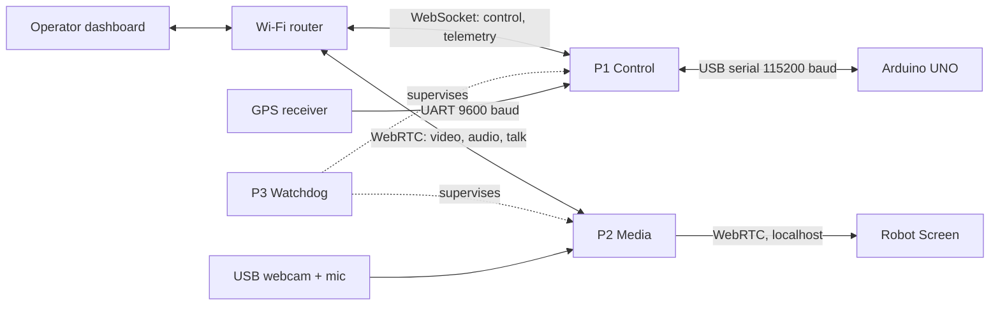

**Figure 1.** Overall system architecture.

Figure 2 follows one drive command through every tier and the telemetry that returns. A held key sends one motion command; while it is held, heartbeats keep the dead-man armed, and releasing the key sends a stop.

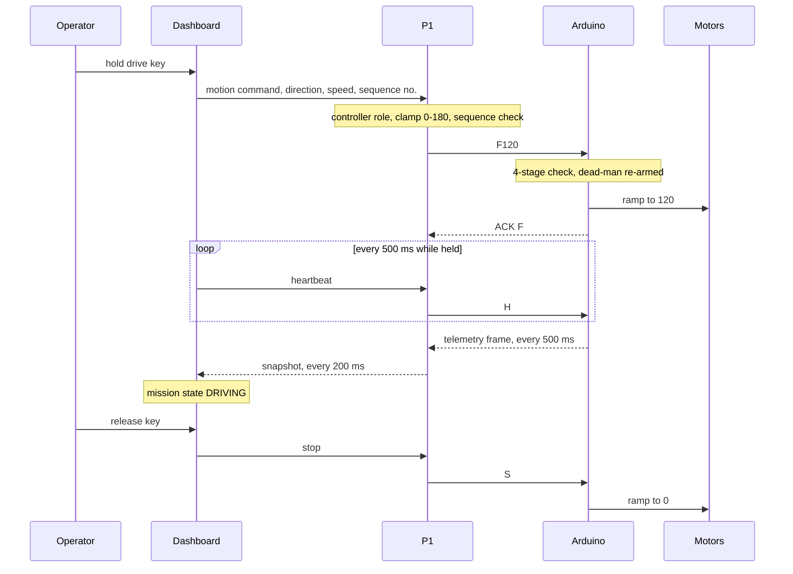

**Figure 2.** End-to-end control loop: command down, telemetry up.

P2 and P3 take no part in this loop: media never carries a drive or stop command, and the watchdog only supervises the processes from outside, so a failure in either cannot delay a stop.

## 3.2 Network Configuration

The two transports in Figure 1 run over one local network, which also makes the robot independent of the internet: no part of the deployment evaluated here reaches outside the Wi-Fi cell. The Pi and the operator laptop join the existing Wi-Fi network, an 802.11n cell on the 2.4 GHz band on channel 10 (2457 MHz) with a 20 MHz operating width (the access point was on channel 3 for two stations on 2026-10-22; Section 5.3). Both hold addresses in the same /24 subnet, so traffic between them is neither routed nor address-translated, which is what lets the media path of Section 3.9.2 rely on host candidates alone. The Pi uses its on-board radio (Figure 5) and takes its address from the router by DHCP: in the deployment measured here it held 192.168.0.105 in 192.168.0.0/24 with the router at 192.168.0.1, on a lease rather than a reservation, so the operator reads the current address off the Pi (ip addr show wlan0) before opening the dashboard. The project supplies no network configuration of its own, neither an access point nor a DHCP reservation nor a static address, so the subnet is whatever the router hands out. The router stays with the operator at the staging point, so the robot works within one radio cell, and extending that reach with a repeater or a second radio is outside the scope of this work (Section 6.3). Table 1 lists the services on the Pi and Table 1a the load and the timing the network has to carry.

**Table 1.** Network services on the Pi.

| Port | Process | Protocol | Carries |
|---|---|---|---|
| TCP 8080 | P1 | HTTP and WebSocket | Dashboard files, control and telemetry, session settings, GPS track, offline map tiles, ICE configuration (Section 3.9.2), health |
| TCP 8443 | P2 | HTTP (no TLS) | WebRTC offer and answer, Robot Screen page, health |
| UDP, negotiated by ICE | P2 | WebRTC | Audio, video and data channel |
| Localhost only | P1, P2 | HTTP | Controller address query; Robot Screen connection |

Control and media use different transports for different reasons. Commands and telemetry run over TCP, because ordered delivery together with the sequence check of Section 3.5.1 keeps a stale command from overtaking a newer one, and the cost of a retransmission is bounded: a command that does not arrive within the dead-man window stops the robot instead of leaving it to run on a stale one (Section 3.5.2). Media runs over UDP, where a lost packet costs picture or voice quality but never delays a command. The dead-man window therefore sets the only hard requirement the network must meet, and the budgets in Table 1a follow from it.

**Table 1a.** Network load and timing requirements.

| Quantity | Value | Set by |
|---|---|---|
| Video, robot to operator | 640x480 at 10 fps, 500 kbps target | Section 3.9.1, Table 12 |
| Audio, each direction | Opus 32 kbps, 60 ms packets | Table 14 |
| Telemetry snapshots | 5 per second from P1, one JSON object each; the firmware frames behind them arrive every 500 ms | Section 3.6.2 |
| Commands and heartbeats | Heartbeat every 500 ms from the controller; one drive command per press and per release; servo commands are not rate limited | Sections 3.5.1 and 3.6 |
| Steady-state load per operator | Under 1 Mbit/s | Sum of the rows above |
| Hard delivery deadline | 2000 ms since the last arming command | Dead-man, Section 3.5.2 |
| Operator-side link timeout | 3000 ms without telemetry gives mission state STOP, counted in 500 ms steps | Table 10 |
| Socket keep-alive | Ping every 20 s, 20 s timeout | P1 WebSocket server |
| Reconnect back-off | 1 s, doubling, capped at 30 s | Section 3.7.2 |

Four intervals bear on the dead-man window, and none of them is a count of the others. The dashboard sends a heartbeat every 500 ms for as long as it holds the controller role, whether or not the robot is being driven; a drive command is sent once when a key or button goes down and a stop once when it is released, with keyboard auto-repeat suppressed, so a sustained drive is carried by the heartbeat rather than by repeated commands. The firmware re-arms its dead-man timer on any arming command it accepts, heartbeats included, and stops the motors once 2000 ms pass with none: an absolute window measured from the last accepted command, not a threshold of missed heartbeats. Independently of that window the firmware emits a telemetry frame every 500 ms and a compact heartbeat line every 1000 ms, but both are outbound reports and neither re-arms the timer. A 2000 ms window spans four heartbeat periods at the configured 500 ms rate, so an occasional lost heartbeat does not stop the robot: two consecutive losses leave a gap of 1500 ms, and a third reaches the window. The dashboard did not always keep that rate; at the 1 s period logged in some sessions, a single lost heartbeat already reaches the window (Section 5.4, Table 5.9d).

The load stays well inside the capacity of an ordinary indoor Wi-Fi link: at the staging point the link negotiated 58.5 Mbit/s receive and 72.2 Mbit/s transmit at a signal level of about -47 dBm, more than fifty times the steady-state demand, so the network is sized by latency and loss rather than by throughput, and Section 5.3 reports how both varied over the distances tested; the dashboard bundle and the offline map tiles are one-off transfers at the start of a session. The keep-alive in Table 1a reclaims a silently dead socket only after up to 40 s, so liveness for safety is not enforced at this layer but by the dead-man at 2000 ms and by the dashboard's 3000 ms telemetry timeout; the keep-alive only frees the socket. Browsers allow microphone and camera capture only in a secure context, and neither port carries TLS (Table 1), so the operator's browser has to be told to treat the Pi's origin as trusted, through the insecure-origin exception recorded in the operator manual. Push-to-talk and the operator camera depend on that manual step, which is a deployment workaround rather than a configured transport security measure (Section 6.3); images and text work without it.

## 3.3 Hardware Platform

The hardware is chosen so that the lowest tier can stop the robot by itself: the Arduino drives the motor drivers directly and can disable them with one output. Table 2 lists the components, and Figure 3 shows how they connect and how power is distributed. The motor supply and the Pi supply are separate, so motor current surges cannot reset the Pi.

**Table 2.** Hardware components.

| Component | Part | Function |
|---|---|---|
| Edge computer | Raspberry Pi 4 Model B, 4 GB | Runs P1, P2, P3 and the Robot Screen |
| Microcontroller | Arduino UNO (ATmega328P, 16 MHz) | Real-time control and sensing |
| Motor drivers | 2 x BTS7960 | One driver per side |
| Drive motors | 4 x 25GA-370 geared DC motor with encoder, 12 V, 60 RPM no-load, 65 mm wheels | Differential (skid) steering, left and right pairs |
| Camera servos | 2 x TowerPro SG90 micro servo, about 1.8 kgf-cm stall torque at 4.8 V, 180 deg | Pan and tilt, 0-180 deg, home at 90 deg |
| Range sensor | HC-SR04 | Forward range, 0-400 cm |
| Temperature and humidity | DHT11 | degC and % RH |
| Gas sensor | MQ-136 | Raw 10-bit value 0-1023, uncalibrated |
| GPS receiver | NEO-6M | Position, fix, satellite count |
| Camera and microphone | USB webcam with built-in microphone | 640x480 video at 10 fps; 48 kHz audio |
| Robot display | 7-inch HDMI display, 1024x600 | Victim-facing Robot Screen |
| Speaker | Speaker | Operator voice to the victim |
| Battery | 4S3P Li-ion pack (twelve 18650 cells, 1500 mAh each), 14.8 V nominal, 16.8 V full, 4.5 Ah nominal, continuous discharge limited by the 4S 40 A BMS | Motor and logic power |
| Battery management | 4S 40 A BMS | Pack protection |
| Buck converters | 2 x buck converter, 8 V and 5 V outputs | 8 V to the Arduino barrel jack; 5 V to the servos |
| Pi supply | Remax 50000 mAh USB power bank | Separate supply for the Pi |

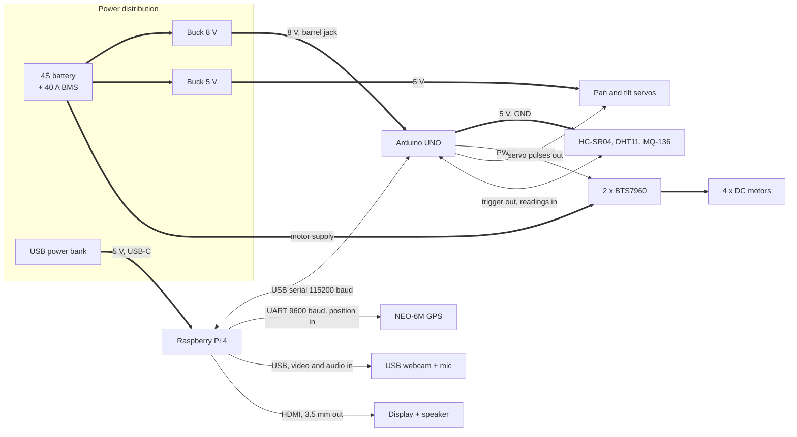

**Figure 3.** Hardware interconnection and power distribution. Thick lines carry power; thin lines carry signals, labelled with the interface and its direction. The Pi and the Arduino are the two hubs, and the separate motor and Pi supplies are grouped on the left.

The Arduino pins used by the firmware are shown in Figure 4 and detailed in Table 3. Each BTS7960 drives forward on one PWM input and reverse on the other, with only one active at a time; both drivers share one enable line, so one output disables all propulsion.

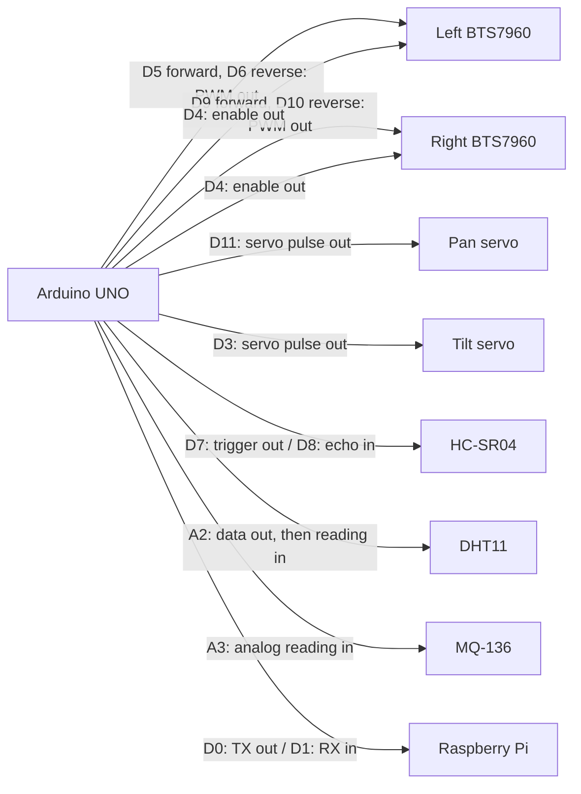

**Figure 4.** Arduino UNO pin diagram. Every line is drawn from the Arduino outwards to the device it serves, so an arrowhead marks the connection and not the signal direction. Direction is given in the label instead, read from the Arduino's side: "out" leaves the pin and "in" arrives at it, and a label with both names the outgoing pin first. Table 3 gives the full pin map.

**Table 3.** Arduino UNO pin map.

| Pin | Mode | Signal | Notes |
|---|---|---|---|
| D0, D1 | UART over USB | Serial link to the Pi | 115200 baud, newline-terminated ASCII |
| D3 | Output | Tilt servo pulse | ServoTimer2Plus library on Timer2, 0-180 deg |
| D4 | Digital output | Enable for both BTS7960 drivers | Low at boot and on emergency stop |
| D5 | PWM output | Left driver, forward | 0-255 |
| D6 | PWM output | Left driver, reverse | 0-255 |
| D7 | Digital output | HC-SR04 trigger | 10 us pulse every 50 ms |
| D8 | Digital input | HC-SR04 echo | 25 ms timeout; distance = pulse width / 58 |
| D9 | PWM output | Right driver, forward | 0-255; Timer1 left free for these pins |
| D10 | PWM output | Right driver, reverse | 0-255 |
| D11 | Output | Pan servo pulse | ServoTimer2Plus library on Timer2, 0-180 deg |
| D13 | Digital output | On-board status LED | Toggles every 1000 ms |
| A2 | Digital I/O, pull-up | DHT11 single-wire data | Read every 2000 ms, checksum verified |
| A3 | Analog input | MQ-136 output | 10-bit ADC; raw value reported in telemetry |
| Barrel jack | Power input | 8 V from buck converter | - |
| 5 V, GND | Power output | Supply for HC-SR04, DHT11 and MQ-136 | Shared by the three sensors |

The Pi ports and GPIO header pins used by the project are shown in Figure 5 and listed in Table 4.

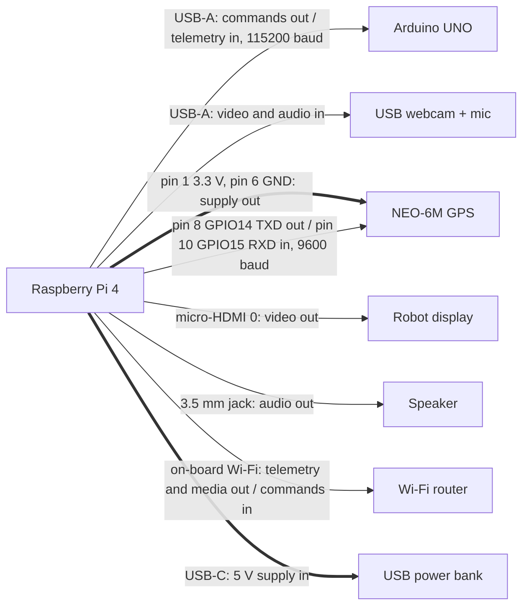

**Figure 5.** Raspberry Pi 4 port and GPIO diagram. Every line is drawn from the Pi outwards to the device it serves, so an arrowhead marks the connection and not the direction. Direction is given in the label instead, read from the Pi's side: "out" leaves the port or pin and "in" arrives at it. The thick lines carry power, and the Pi's own supply arrives on USB-C. Table 4 gives the full connection list.

The GPS uses the Pi's primary UART with the serial login console disabled.

**Table 4.** Raspberry Pi 4 connections.

| Pi interface | Connected to | Use |
|---|---|---|
| USB-A | Arduino UNO | USB serial, 115200 baud |
| USB-A | USB webcam with microphone | Video capture and audio capture |
| Header pin 1 (3.3 V) | GPS VCC | GPS supply |
| Header pin 6 (GND) | GPS GND | Ground |
| Header pin 8 (GPIO 14, TXD) | GPS RX | UART, 9600 baud |
| Header pin 10 (GPIO 15, RXD) | GPS TX | UART, 9600 baud |
| Micro-HDMI 0 | Robot display | Robot Screen |
| 3.5 mm jack | Speaker | Default audio output |
| USB-C | USB power bank | Pi supply |
| On-board Wi-Fi | Wi-Fi router | Dashboard, control and media traffic |

## 3.4 Software Architecture

The software is organised around the same tiers as the hardware in Section 3.3. This section gives its structure; Sections 3.5 to 3.10 describe each part in detail.

The software forms three layers, each written in the language that suits its hardware, over a shared module that the three Pi processes have in common (Table 5). The three layers share no code and talk only through three defined interfaces: the serial command protocol between firmware and P1, the control WebSocket between the dashboard and P1, and WebRTC between the dashboard and P2. Each layer can therefore be built, tested and replaced on its own.

**Table 5.** Software stack.

| Layer | Runs on | Language | Main frameworks | Main modules |
|---|---|---|---|---|
| Firmware | Arduino UNO | C++ | Arduino core, no RTOS | scheduler, command_parser, motors, servos, sensors, telemetry |
| Backend | Raspberry Pi 4 | Python 3, asyncio | FastAPI and uvicorn (P1, P2), aiortc and PyAV (P2), aiohttp (P3) | serial_bridge, safety, websocket_hub, gps_reader, signaling, talkback, supervisor |
| Common | Raspberry Pi 4, inside P1, P2 and P3 | Python 3 | standard library only | protocol, config, access, logging_setup, mock_hardware |
| Frontend | Operator browser | TypeScript | React 19, Vite, Tailwind CSS, Leaflet with PMTiles | useControlSocket, useWebrtcVideo, useTalkback, DriveControl, EmergencyStop, MapPanel |

On the Pi, systemd starts only the watchdog, which spawns the control and media servers as child processes (Figure 6). P1 holds every interface that can move the robot; P2 holds every media device; the Robot Screen kiosk runs in the desktop session.

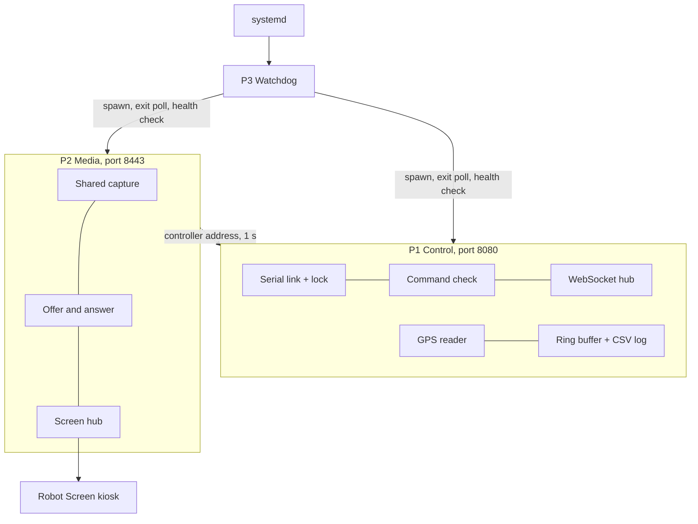

**Figure 6.** Raspberry Pi software architecture and process supervision.

The dashboard is a single-page React application served by P1 (Figure 7). Its interface components hold no network code; they read state from, and send actions through, a small set of hooks. Each hook owns one connection to one server, so a lost media connection leaves the drive controls and telemetry working.

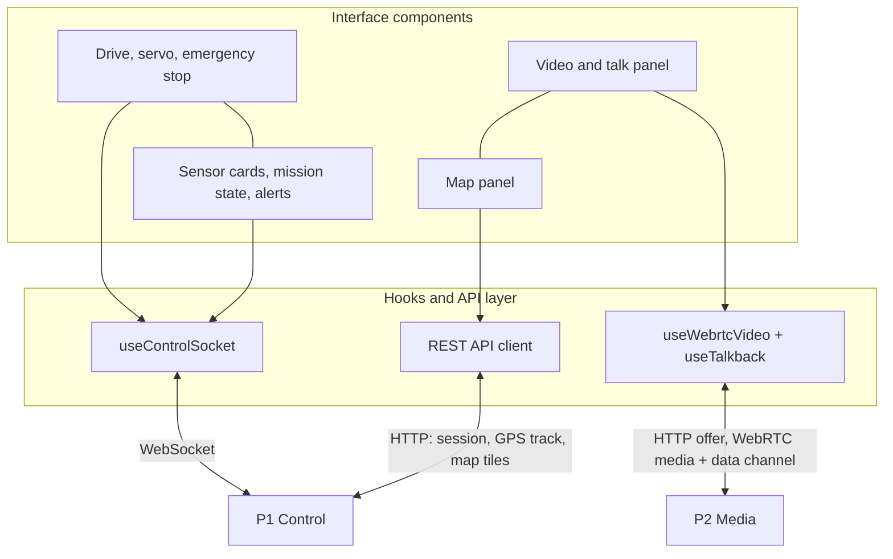

**Figure 7.** Operator dashboard software architecture.

Each layer can also run without its hardware. A development mode (the MOCK_HARDWARE setting) replaces the serial link with an in-process Arduino emulator that mirrors the firmware's framing, command validation, dead-man timer and telemetry cadence; replaces the GPS with a synthetic track; and replaces the camera and microphone with a synthetic video pattern and silence. The full control, telemetry, supervision and media stack therefore runs on a development machine with no robot attached, which is how the software is tested away from the hardware.

## 3.5 Real-Time Firmware and Fail-Safe Control

The firmware holds the authority to stop the robot, so it must stop the motors without help from the Pi or the network. The firmware defines five operating modes (Figure 8): BOOT, READY, ACTIVE, PANIC, and a reserved latched operator-stop mode, ESTOP. Motion is accepted only in READY and ACTIVE with no fault set; telemetry reports READY as 1, ACTIVE as 2 and all other modes (BOOT, PANIC and ESTOP) as 3.

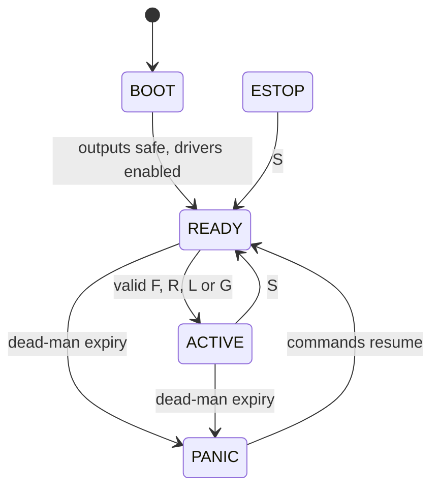

**Figure 8.** Firmware operating modes. ESTOP is a reserved latched operator-stop state: it is defined in the firmware state machine and reported as 3, but is not entered in the current build, where the emergency stop is an ordinary S (Table 7).

### 3.5.1 Task Scheduling and Command Validation

A cooperative scheduler, rather than a pre-emptive RTOS on the ATmega328P [@pont2001], runs the periodic tasks in Table 6 from the main loop, with timing based on unsigned millisecond differences so that counter rollover does not break it. The command parser is polled on every loop pass and checks each command in four stages before it acts (Figure 9).

**Table 6.** Firmware tasks.

| Task | Period | Work |
|---|---|---|
| Motor service | 10 ms | Ramp PWM toward target by 15 units per tick |
| Safety supervisor | 10 ms | Dead-man check and fault recovery |
| Fast sensors | 50 ms | HC-SR04 range (25 ms echo timeout) |
| Slow sensors | 2000 ms | DHT11 and MQ-136 |
| Telemetry | 500 ms | One 8-field CSV line |
| Heartbeat | 1000 ms | Mode line and status LED toggle |

The telemetry period (TELEMETRY_PERIOD_MS = 500 ms in arduino/config.h) and the ramp step (MOTOR_RAMP_STEP = 15) are the two firmware constants that bound the empirical stop-time distribution reported in Section 5.1.

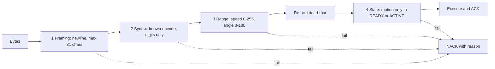

**Figure 9.** Four-stage firmware-side command validation. The nine opcodes are F, R, L, G (speed), P, T (angle), S, H and ?.

The Pi control server applies a tighter safety cap before sending: speed is clamped to 0-180 (keeping the 14.8 V battery under the motor's ~12 V rating) and angles to 0-180, and motion and servo commands whose sequence number is not higher than the last one from that client are rejected.

### 3.5.2 Dead-Man Timer and Stop-Time Guarantee

Every command that passes stages 1 to 3 re-arms the dead-man timer, including heartbeats; this dead-man (watchdog) pattern, in which loss of a periodic command forces the actuators to a safe state, behaves like the stop category 0 discussed in Section 2.3 [@iec60204]; it is a design choice here, not a claim of compliance. This is deliberately not limited to drive-type commands: pan, tilt and status-query commands pass the same three validation stages and therefore refresh the timer exactly as a drive or heartbeat command does (`command_parser.cpp`'s `noteCommandReceived()` call sits after stage 3 and before the per-opcode state-machine gate, so it runs for every accepted opcode). The 2000 ms window is therefore measured from the last valid command of any kind, not specifically from the last drive command or the last heartbeat; an operator who is only panning the camera, with no drive command outstanding, keeps the dead-man armed without that being mistaken for continued motion. When the timer expires (the firmware's check is elapsed >= 2000 ms), the supervisor sets the PWM outputs to zero and pulls the shared enable line low at once, without ramping, and the firmware enters PANIC (Figure 10).

Two quantities follow from this and are kept apart throughout the paper: the stop time, when the motors lose drive, and the confirmation latency, when an observer outside the firmware can establish that they have. Only the first is a safety property.

The worst-case stop time after the last accepted command is:

$$t_{stop} \le T_{DM} + T_{S} + J$$

where $T_{DM} = 2000$ ms is the dead-man window, $T_{S} = 10$ ms is the supervisor period, and $J$ is the longest single loop pass. $J$ is set by the two blocking sensor reads, the 25 ms HC-SR04 echo timeout and the DHT11 exchange whose 20 ms start pulse dominates it. Because the slow sensor period of 2000 ms is an exact multiple of the fast period of 50 ms (Table 6), the two reads coincide in one loop pass once every 2 s, so $J$ is about 50 ms rather than the cost of either read alone, and the bound is about 2060 ms. The bound is analytical. Section 5.1 supports it from the firmware side: on P1's clock the PANIC line, which the firmware emits in the same supervisor pass that removes drive, arrived within 2042 ms of the last command in 30 of 30 trials (Table 5.2b), a log-timed interval that includes serial transit and has a resolution of about 15 ms. It does not observe the wheels. The physical wheel-stop time, to be filmed at 240 fps (tools/eval/record.py deadman_physical, E4), is [PENDING MEASUREMENT].

Confirmation latency is larger, by a margin that belongs to the reporting path and not to the stop. The firmware reports a trip on two paths over the one serial link. It emits a tagged PANIC line in the same supervisor pass that stops the motors, so that notice costs only serial transit; separately, the fw_state field that encodes PANIC rides the periodic telemetry frame, which the firmware emits every 500 ms (Table 6) and which P1 rebroadcasts on its own 200 ms timer (Section 3.6.2). An observer that waits on fw_state therefore learns of the trip up to 700 ms after the motors stop, and about 350 ms after it on average. The WebSocket probe reported in Section 5.1 (tools/eval/wslatency.py) waits on fw_state, so its dead-man figures are confirmation latency along the slower of the two paths: an upper bound consistent with the stop-time bound above rather than a measurement of it. In the build evaluated here P1 writes the PANIC line to its log but does not forward it to the dashboard, so the operator display is driven by the 500 ms frame and the fast notice survives only as a log entry; Section 6.3 treats this as a limitation.

An ordinary stop command ramps the motors down instead:

$$t_{ramp} = \left\lceil \frac{u}{\Delta u} \right\rceil T_{M}$$

where $u$ is the current PWM value, $\Delta u = 15$ is the ramp step and $T_{M} = 10$ ms is the motor service period; this gives 120 ms from the 180 cap and 170 ms from 255.

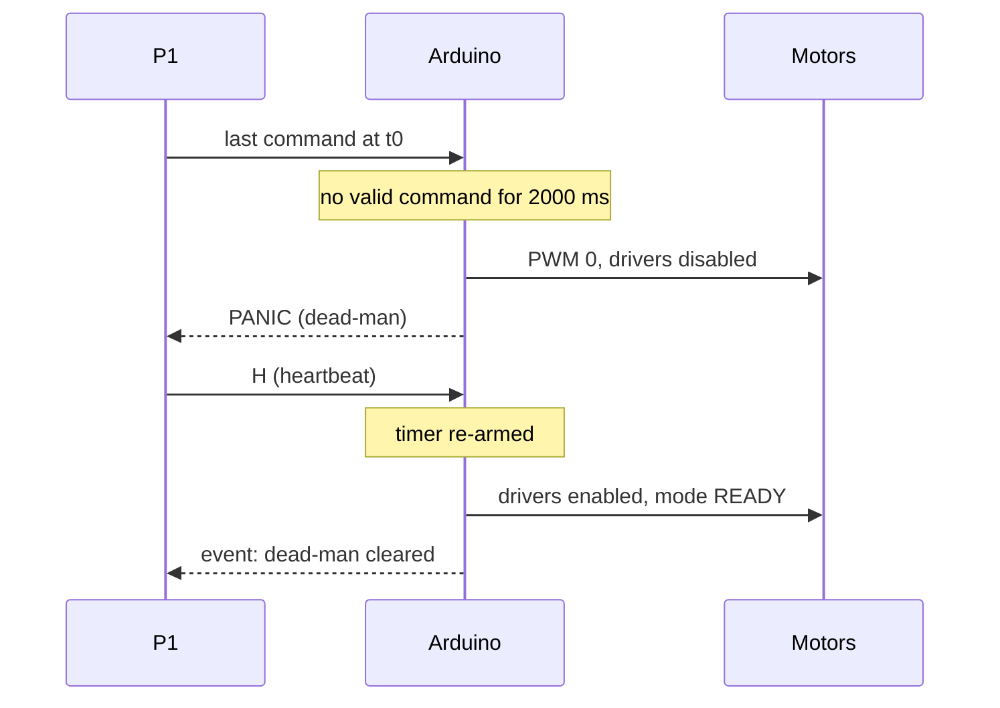

**Figure 10.** Dead-man trip and recovery.

### 3.5.3 Redundant Stop Paths

Table 7 lists every path that stops the motors. The firmware's only automatic stop is the dead-man; every other row is an operator action or a P1 action, and the firmware itself never stops the motors on a sensor reading. The MQ-136 gas sensor is advisory: its reading is published to the operator in telemetry and is not used to stop the motors.

**Table 7.** Stop paths.

| Trigger | Origin | Action | Bound |
|---|---|---|---|
| Drive key or button released | Dashboard via P1 | S, ramped stop | One network trip |
| Emergency stop button | Dashboard via P1 | S, sent without the sequence check | One network trip |
| Controller connection closes | P1 | S | On socket close |
| Another dashboard takes control | P1 | S | On takeover |
| P1 start-up | P1 | 3 x S, 200 ms apart | Before any other command |
| P1 shutdown | P1 | S | Before the port closes |
| Command flow stops | Firmware | PWM 0, drivers disabled | $t_{stop}$ above |

## 3.6 P1 Control Server and Telemetry

The firmware stops the robot when commands cease, but it assumes that the commands it does receive come from one source and arrive in order. P1 provides that assumption and returns the robot's state to the operator. P1 owns the serial link, the GPS receiver and the control WebSocket.

### 3.6.1 Safe Startup and Single-Writer Serial Link

P1 takes an exclusive, non-blocking lock on a file in a memory-backed directory before it opens any hardware; the kernel releases the lock when the process exits for any reason. The serial port is then opened in exclusive mode, and one asynchronous lock serialises all writes. Figure 11 shows the start-up handshake.

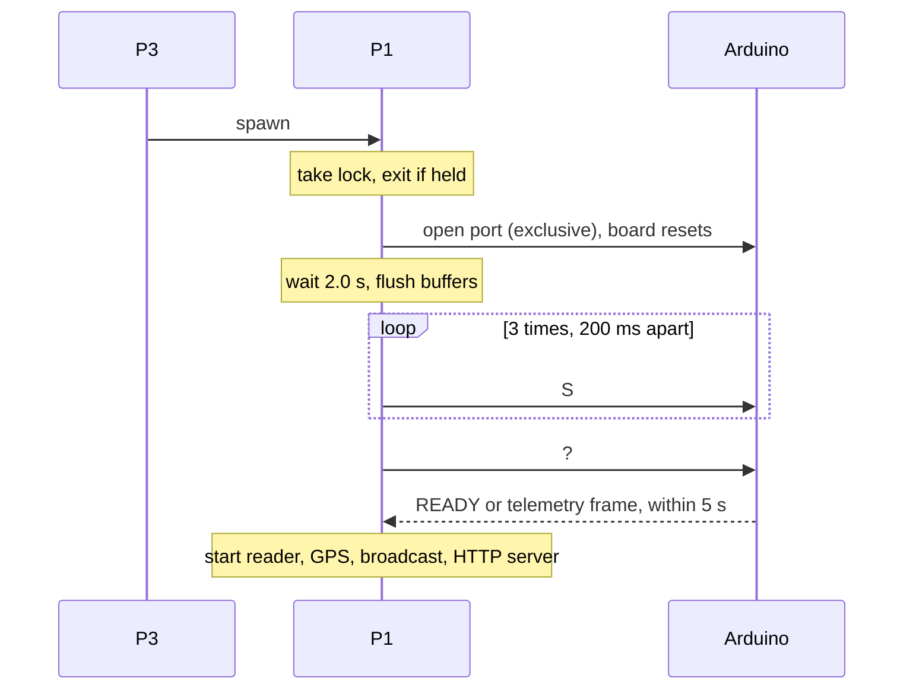

**Figure 11.** P1 start-up handshake. A timeout ends P1 with a handshake-failure exit code.

### 3.6.2 Telemetry Pipeline and Session Resume

The firmware sends a frame every 500 ms; P1 broadcasts a snapshot of the latest valid frame every 200 ms on an absolute schedule, merged with GPS and link status (Figure 12). A frame is dropped if any field fails the checks in Table 8; there is no retransmission.

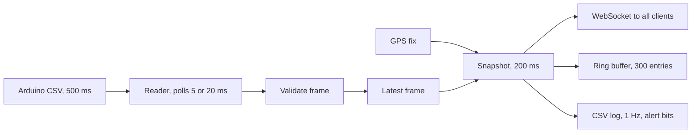

**Figure 12.** Telemetry pipeline.

**Table 8.** Telemetry frame fields and accepted ranges (frame at most 80 characters).

| Field | Unit | Accepted range |
|---|---|---|
| Temperature | degC | -40 to 125 |
| Humidity | % | 0 to 100 |
| Gas | raw ADC | 0 to 10000 |
| Range | cm | 0 to 500 |
| Pan angle | deg | 0 to 180 |
| Tilt angle | deg | 0 to 180 |
| Firmware state | - | 1 to 3 |
| Uptime | ms | 0 to 2^32 - 1 |

Because the P1 broadcast runs on an absolute schedule with period TELEMETRY_PERIOD_MS = 200 ms (pi/common/protocol.py), the control-plane latency probe in Section 4 jitters its send phase; a phase-locked sender produces a biased, deceptively tight distribution, as recorded in tools/eval/README.md and discussed in Section 6.4.

On reconnect, the dashboard sends the server timestamp of the last snapshot it received; P1 replies with every newer snapshot in the buffer and the size of any gap. The buffer depth and the gap are:

$$D = N \cdot T_{b} = 300 \times 200\ \text{ms} = 60\ \text{s}, \qquad g = \max(0,\ t_{oldest} - t_{last})$$

where $N$ is the buffer size, $T_{b}$ the broadcast period, $t_{oldest}$ the oldest buffered timestamp and $t_{last}$ the client's last timestamp. The buffer is held in memory, so it does not survive a P1 restart.

## 3.7 Fault Tolerance and Supervision

Sections 3.5 and 3.6 make each tier fail into a stop; this section describes how failures are detected and how the system returns to service. Fault tolerance is layered (Figure 13). Each layer acts on its own, and a failure that passes every layer above ends at the firmware, which stops the motors.

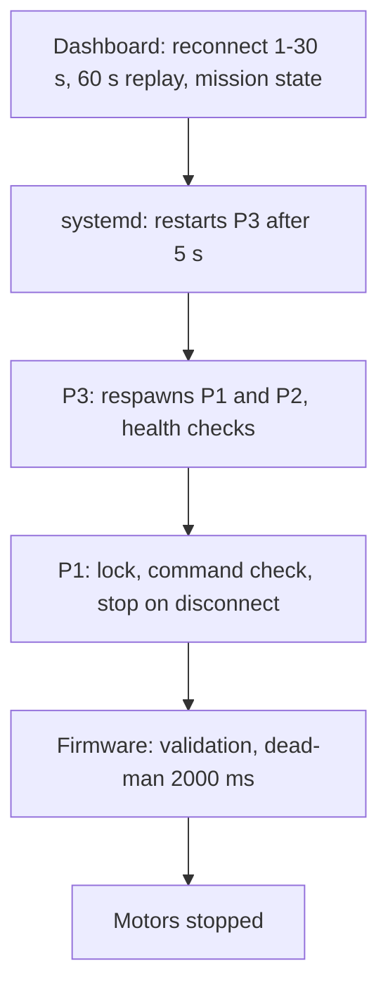

**Figure 13.** Layered fault tolerance, from the operator side down to the motors.

### 3.7.1 P3 Watchdog: Process Isolation and Supervision

P3 is the only systemd service (restart on failure after 5 s); it spawns P1 and P2 as separate processes with no shared memory and supervises each one with the state machine in Figure 14. The only link between P1 and P2 is a once-per-second localhost query from P2 for the controller's address.

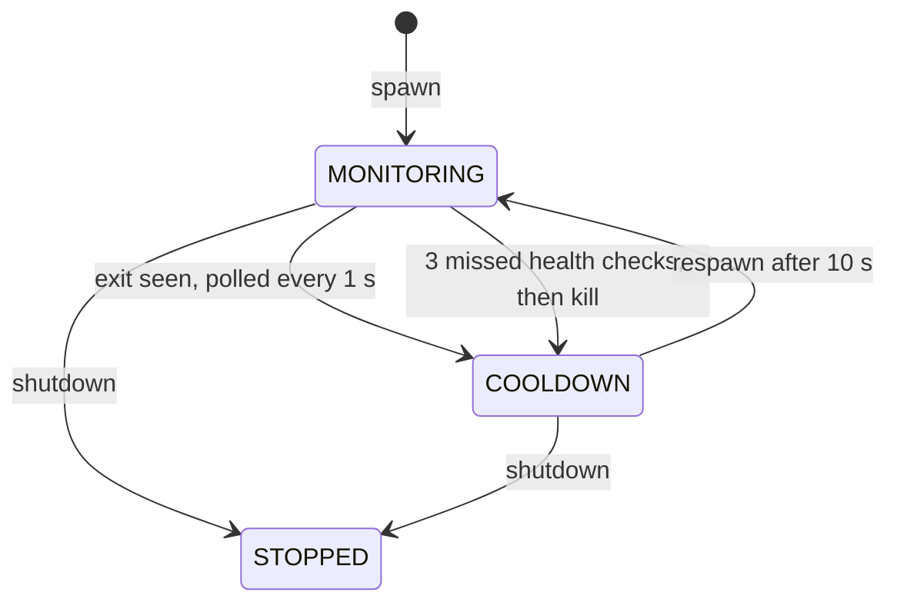

**Figure 14.** Per-process supervision. Health checks run every 10 s with a 5 s timeout.

### 3.7.2 Recovery Time Model and Graceful Degradation

The time from a failure to a working process is:

$$T_{rec} = T_{det} + T_{p} + T_{c} + T_{init}$$

where $T_{det}$ is the detection time (at most 1 s for a crash, at most $3 \times 10 + 5 = 35$ s for a hang), $T_{p} = 1$ s is the poll before cooldown, $T_{c} = 10$ s is the cooldown, and $T_{init}$ is start-up time, which for P1 is 2.0 s + 3 x 0.2 s plus up to 5 s for the handshake. A P1 crash therefore recovers in 14.6 s to 19.6 s plus interpreter start-up; the dashboard adds up to one reconnect back-off step. The constants in this model are validated against the fault-injection measurements of Section 5.4 (tools/eval/faultinject.py); the current campaign (10 trials each for F3 P1, F4 P2, F5 P3) is summarised in tools/eval/results/summary.md. Table 9 shows how each failure degrades the mission.

P1 reports why it exited through its process exit code, which the watchdog reads to decide how to react. A clean exit, or an exit because a healthy peer already holds the serial lock (code 0), draws no alarm: the watchdog simply waits out the cooldown rather than counting a crash. An unexpected lock error (code 1) or a failed Arduino handshake (code 2) is treated as a crash and respawned. An invalid configuration (code 3) is logged distinctly so that a persistent misconfiguration cannot drive a tight respawn loop. P2 uses the same configuration-invalid code.

**Table 9.** Failure effects and recovery.

| Failure | Detected by | Effect | Recovery |
|---|---|---|---|
| Operator link lost | Dead-man; socket close | Robot stops; mission STOP | Reconnect with back-off, telemetry replay |
| P1 crash or hang | P3 | No control or telemetry; dead-man stops robot | Respawn; buffered history lost |
| P2 crash | P3 | Video and talk lost; control unaffected; mission DRIVING LIMITED | Respawn; operator retries video |
| Arduino link error | Serial read or write error | Serial flag false; mission STOP | Reads retried every 0.5 s; port reopened when P1 restarts |
| Camera fails to open | Media server | Synthetic test pattern sent | Next session |
| Microphone lost | Media server | Silence sent | Reopen tried every 2 s |
| GPS port error | P1 | No fix; GPS-lost alert bit set | Port reopened after 2 s |
| Robot Screen browser exits | Kiosk launcher | Victim screen blank | Relaunch after 3 s |
| P3 crash | systemd | P1 and P2 stop with it; dead-man stops robot | Restart after 5 s, then P1 and P2 respawn |

Figure 15 shows how one failure, a Wi-Fi drop, passes through the tiers and how the system returns to service without operator action beyond reconnecting.

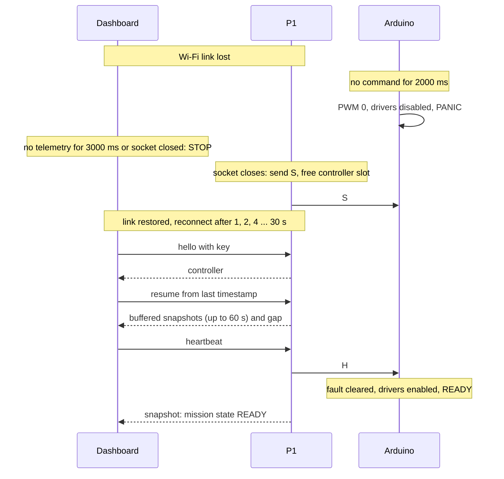

**Figure 15.** Failure chain for a Wi-Fi drop: stop, reconnect, replay, resume.

### 3.7.3 Mission State for Operator Awareness

The dashboard reduces link and firmware status to one of four mission states, evaluated in the priority order of Table 10.

**Table 10.** Mission state rules (first match wins).

| Priority | State | Condition |
|---|---|---|
| 1 | STOP | Control socket down, or serial link down, or no telemetry for more than 3000 ms |
| 2 | DRIVING LIMITED | Video link down |
| 3 | DRIVING | Firmware reports driving |
| 4 | READY | Otherwise |

## 3.8 Access Control and Multi-Operator Arbitration

Because any dashboard may reconnect after a failure (Section 3.7), the system must also decide which of several connected dashboards may drive. The decision is made once, in P1, and Section 3.9 reuses it for victim interaction. A dashboard becomes controller only by presenting the robot's controller key; all others are observers, whose commands, including stop, are rejected. The most recent dashboard with the right key takes the controller slot; the previous holder is demoted and the robot is stopped (Figure 16). P1 and P2 check the key in the same way (Table 11), and P2 grants talk only to a keyed session from the host P1 reports as controller.

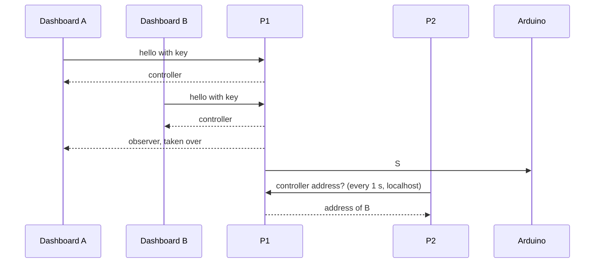

**Figure 16.** Controller takeover.

**Table 11.** Key check results.

| Result | Condition | Role |
|---|---|---|
| OK | Key matches (constant-time comparison) | Controller |
| No key | No key presented; not counted as a failure | Observer |
| Bad key | Wrong key; failure counted for that host | Observer |
| Locked | 5 failures within 300 s; host refused for 300 s, even with the right key | Observer |
| Disabled | No key configured on the robot | Observer for everyone |

Failure counters are kept in memory per process. The dashboard discards a refused key so that reconnects do not add to the count. The key travels over plain HTTP and WebSocket. Both P1 and P2 accept requests from any origin (permissive CORS), because the dashboard may be served from the Pi, from a development server or from a content-delivery network, so its origin is not fixed; on the isolated local network this adds no exposure beyond the plain-HTTP key already noted.

**Threat model.** This design assumes a trusted local network at the staging point: operators are mutually authenticated with the robot by a shared controller key, and no on-path attacker is assumed on the Wi-Fi segment that carries both the plain-HTTP key and the WebSocket control plane. Transport confidentiality beyond WebRTC's own SRTP/DTLS, and defence against a Wi-Fi-adjacent adversary, are out of scope and are discussed in Section 6.3.

## 3.9 Two-Way Victim Interaction

With one controller established (Section 3.8), the same operator can see, hear and talk to the victim. This path must never delay a stop. The robot carries a display and speaker facing the victim, driven by a kiosk browser (the Robot Screen) on the Pi, and all communication between the operator and the victim runs through P2. Here "P2" names the media process (Section 3.4), not a peer-to-peer protocol.

aiortc was chosen over server-oriented WebRTC stacks such as GStreamer's webrtcbin, Janus and mediasoup because it integrates as a single Python process with the P2 asyncio event loop, reuses one PyAV capture across sessions, and needs no separate signalling server, following established use of WebRTC for low-latency teleoperation [@shi2025webrtc]. Human-subject interaction in this design, namely the Robot Screen used with role-played victims and the usability study with 8 to 12 operators (Section 5.8), is conducted under the ethics statement in Section 4.1.

Media is kept out of P1 because video encoding is the heaviest load on the Pi, and a stall or crash in a codec library must not delay a stop; P2 can also be restarted while P1 keeps driving (Table 9). The only link between them is P2's once-per-second query for the controller's address (Section 3.7.1); P2 never sends anything to P1 or to the Arduino.

### 3.9.1 The P2 Media Process

P2 is a single Python process built on aiortc, a WebRTC implementation for asyncio, with PyAV (FFmpeg) for capture, decoding and encoding; every peer connection runs on one event loop (Figure 6).

- **Shared capture.** The webcam (V4L2) and the microphone (ALSA) can each be opened only once, so P2 opens each device on first use and fans its frames out to every session. Video is unbuffered, since a viewer needs only the newest frame; audio is buffered per session, since every audio frame matters. If the camera cannot be opened, the session receives a synthetic test pattern; if the microphone is missing or drops off USB, the session receives silence and P2 retries the device every 2 s.
- **Per-session tracks.** Each dashboard session gets its own outbound video and audio track, and a private copy of every camera frame for its own encoder.

Each dashboard opens one peer connection to P2 that carries both directions at once: P2 sends the robot's camera and microphone to the operator, and the operator sends voice, video and text back over the same connection (Figure 17). Any number of dashboards may connect; all receive the robot's media, but only the controller can send to the Robot Screen. Table 12 lists the video parameters.

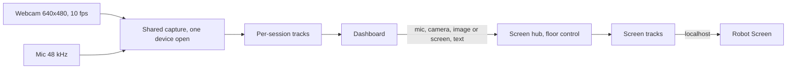

**Figure 17.** Two-way media path (WebRTC). Video is encoded per session as VP8 or H.264, as negotiated with the browser; each session gets its own copy of every camera frame.

**Table 12.** Video parameters.

| Parameter | Robot to operator | Operator to robot |
|---|---|---|
| Source | USB webcam, V4L2 | Laptop camera, still image or shared screen |
| Resolution and rate | 640x480, 10 fps | Camera 640x480 at 10 fps; image 1024x576 at 2 fps; screen at 5 fps |
| Bitrate target | 500 kbps | Chosen by the browser |
| Codec | VP8 or H.264, negotiated per session | Decoded by P2, re-encoded for the Robot Screen |
| Encoders | One per dashboard session | One, for the Robot Screen connection |
| Source loss | Synthetic test pattern | Last frame repeated after 1 s; black frame when no operator video |

### 3.9.2 Signalling and Session Lifecycle

The dashboard sends its SDP offer in one HTTP POST, together with its controller key if it has one, and the answer comes back in the HTTP response (Figure 18). There is no separate signalling server and no trickle ICE: P2 finishes gathering its candidates before it replies, so the answer is complete when it arrives. Because both peers are on the same local network, a direct host-to-host path is always available and no TURN relay is needed. The response also reports the key check result (Section 3.8), so the dashboard knows at once whether the session can talk or only watch.

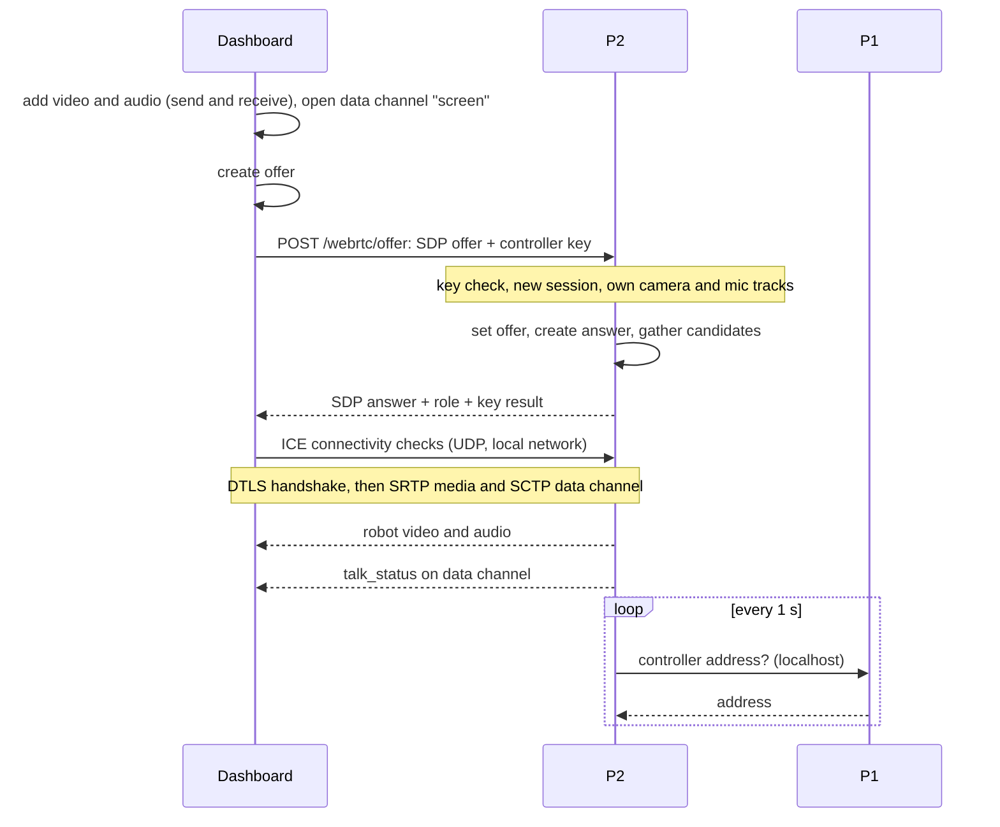

**Figure 18.** WebRTC signalling and session set-up between a dashboard and P2.

The dashboard offers its audio and video in both directions from the start, but sends nothing until the operator chooses to talk or show video; it then attaches the chosen source to the existing sender. Starting or stopping talk or video therefore never needs a second offer and answer.

When a connection fails or closes, P2 removes the session and releases the floor if the session held it; when no session is left, the camera and microphone are closed. P2 keeps no state that survives a restart, so reconnection is driven by the client. After video has connected once, a later loss is shown to the operator with a retry button rather than hidden by silent reconnects, so the operator knows that the video was interrupted.

Candidate gathering needs no help on this network. The dashboard creates its peer connection with no ICE servers configured, so both sides offer host candidates only, and the single segment of Section 3.2 makes a direct path available without STUN or a TURN relay. P1 does serve an ICE-configuration endpoint (GET /api/ice-config, rate limited to five requests per minute per client) for a deployment that would need STUN, but the dashboard does not read it in the local-network mode evaluated here. An internet-overlay mode, in which the robot would be reached through a relay and the same endpoint would also issue a TURN server, is provided for in the configuration (the ENABLE_OVERLAY setting in the watchdog environment) but is not implemented or evaluated in this work; the turn_status field carried in each telemetry snapshot therefore reports unavailable throughout.

### 3.9.3 Data Channel Protocol

Each dashboard connection carries one reliable, ordered data channel named "screen" over the same DTLS connection as the media. It carries short JSON messages for control of the Robot Screen (Table 13); media and drive commands never travel on it. P2 validates every message: malformed messages are dropped, and messages from a session that is not the controller are refused with a view-only reply.

**Table 13.** Data channel messages.

| Message | Direction | Purpose |
|---|---|---|
| media_state | Dashboard to P2 to Robot Screen | Operator is talking or not; which video source is shown |
| screen_text | Dashboard to P2 to Robot Screen | Text message for the victim (at most 280 characters, with a timestamp) |
| screen_clear | Dashboard to P2 to Robot Screen | Remove the text from the screen |
| floor_release | Dashboard to P2 | Give up the Robot Screen |
| display_mode | Dashboard to P2 | Switch the robot display between the kiosk and the Pi desktop |
| talk_status | P2 to dashboard | Screen online, floor state (free, you, other), display mode, can control |
| screen_state | P2 to Robot Screen | Whether an operator is present, talking or showing video |
| screen_ack | Robot Screen to P2 to dashboard | The text with this timestamp is now shown |
| floor_denied, view_only | P2 to dashboard | Request refused: another operator holds the screen, or no controller key |

The acknowledgement closes the loop for text: the dashboard marks a message as delivered only when the Robot Screen confirms it, not when it was sent. P2 sends talk_status to every dashboard whenever the floor, the controller or the screen connection changes, so all operators see the same state.

### 3.9.4 Operator-to-Robot Relay and Floor Control

The operator's media does not go from the dashboard to the Robot Screen directly. The kiosk browser connects only to P2, over localhost, and P2 relays the operator's media to it. Floor control and the controller check are therefore enforced in one place, and no remote host can reach the victim's screen or speaker, since the screen endpoint refuses any address other than localhost. The kiosk also keeps one long-lived connection that does not change when operators connect, disconnect or take over.

The cost is one decode and one re-encode on the Pi. The Robot Screen connection has two fixed outbound tracks that always read from the current floor holder: the video track sends the holder's newest frame, repeating the last one after 1 s without a new frame and sending black when there is no operator video; the audio track re-encodes the holder's voice as 48 kHz mono, 60 ms Opus packets (Section 3.9.5), and sends silence otherwise. Because these tracks never change, talking, switching video sources and handing over the floor need no renegotiation.

Only one session may hold the Robot Screen at a time (Figure 19). Talking follows driving: P2 accepts talk, video and text only from a session that presented the controller key and comes from the address P1 reports as its controller (Section 3.8, Figure 16). A takeover therefore moves the talk path to the new driver within about one second. On release, P2 drops any queued operator media, clears the text and tells the screen that no operator is present.

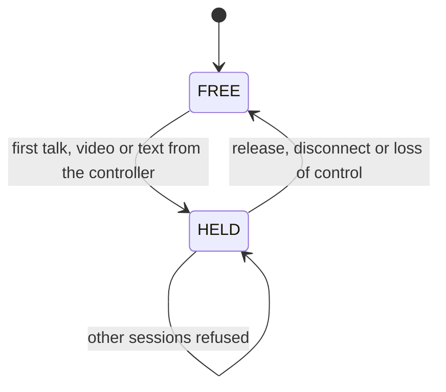

**Figure 19.** Robot Screen floor control. A release clears the screen text and media.

### 3.9.5 Low-Latency Audio on a Constrained CPU

P2 encodes its own 60 ms Opus packets in both directions instead of the usual 20 ms [@valin2012], which cuts the packet rate from 50 to 16.7 packets/s and the per-packet work on the event loop to a third. It captures the microphone through a shared ALSA device with a fixed period of 960 frames (20 ms), which gives 50 reads/s against about 511 reads/s for the device's smallest period of 94 frames (Table 14).

**Table 14.** Audio parameters.

| Parameter | Robot to operator | Operator to robot |
|---|---|---|
| Format | 48 kHz, mono, 16-bit | 48 kHz, mono, 16-bit |
| Codec | Opus, voice mode, 32 kbps | Opus, voice mode, 32 kbps |
| Packet length | 60 ms | 60 ms |
| Capture period and buffer | 960 frames (20 ms), 7680 frames (160 ms) | - |
| Buffering | One queue per session | Inbound queue of 10 frames (about 200 ms); 120 ms start cushion; 400 ms cap |
| Lateness | Paced by the device | Clock reset when more than 100 ms late, no catch-up burst |
| Source loss | Silence, reopen every 2 s | Silence until the cushion refills |

## 3.10 GPS Localisation and Offline Mapping

The operator also needs to know where the robot is, both to guide it and to report the victim's position to the rescue team, without depending on the internet. P1 reads NMEA sentences from the NEO-6M receiver ([@ublox_neo6]; nominal accuracy 2.5 m CEP) on a separate thread, merges the latest fix into each telemetry snapshot (Section 3.6.2) and adds a track point only when the latest fix lies at least 10 m from the previous track point, which is intended to keep drift around a stopped robot out of the track (Figure 20). The filter compares positions held to six decimal places (about 0.1 m); the telemetry log, by contrast, records them to four (a grid of about 11 m by 10 m at the test latitude). The 10 m threshold lies above the receiver's nominal 2.5 m CEP, which the manufacturer specifies for 24 h static operation with strong signals [@ublox_neo6], but not above the drift measured for this unit in the field: over 6888 logged fixes of a stationary robot with a mean of 4.8 satellites, about half lay more than 10 m from their centroid (CEP50 8.9 m and CEP95 30.5 m at the four-decimal logging resolution, tools/eval/results/gps_static.csv), and in a later session in which the robot was not driven the filter added 130 track points (Section 5.6). The filter therefore reduces, but does not prevent, spurious track points under weak-signal conditions. Distance uses the equirectangular approximation:

$$d = R \sqrt{(\Delta\varphi)^2 + (\Delta\lambda \cos\bar{\varphi})^2}$$

where $R = 6371000$ m, $\Delta\varphi$ and $\Delta\lambda$ are the latitude and longitude differences in radians, and $\bar{\varphi}$ is their mean latitude.

At the scales of these trials (under 2 km), the error of this approximation against the haversine formula stays below 0.01 mm at the trial latitude (computed over all bearings; 0.0036 mm at a 2 km baseline), which is negligible beside both the 10 m track filter and the metre-scale scatter of the receiver's fixes, while saving two trigonometric evaluations per update.

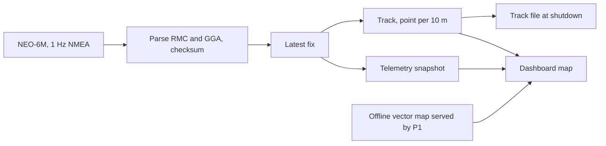

**Figure 20.** GPS and map data flow. Online map tiles, when reachable, show outside the offline map area.

# 4. Experimental Setup

This section defines the test environment, the experiment matrix, the measurement and validity rules, and the baselines that apply across all fifteen experiments. Each subsection of Section 5 opens with its own procedure paragraph; shared conditions stated here are not repeated there. The hardware, network and software are specified in Sections 3.2-3.4 and are referenced, not restated. Because several experiments could not be run as planned, Table 4.1 gives the planned design and the design actually achieved side by side, and Section 4.4 lists every deviation; Section 5 reports only what was achieved.

## 4.1 Test Conditions

All experiments run on the robot as built (Table 2, Figure 3) with a single operator laptop connected to the same Wi-Fi cell, except where Table 4.1 states that a probe ran on the Pi itself. The network is the 802.11n cell described in Section 3.2: 2.4 GHz, 20 MHz width, no internet uplink, with the access point nominally on channel 10. The channel was read at the start of the E6 sessions and was not constant across the campaign (channel 3 for two stations on 2026-10-22, channel 10 thereafter; Section 5.3), so the channel is recorded per station rather than assumed. The robot runs Raspberry Pi OS 12 (Bookworm, kernel 6.12, arm64) with Python 3.11, and the operator uses Chromium on the same laptop for both the dashboard and the SUS questionnaire. Hardware emulation is disabled for every run, so every command reaches the physical Arduino and motors.

The control-latency probe (E1) is the one exception to the laptop-to-robot path: it runs on the Pi and connects to P1 over the loopback interface, so its figures exclude the Wi-Fi link and the operator laptop (Section 5.1). Link-dependent behaviour is covered separately by E6 and by the SIMULATED heartbeat-loss model of Section 5.1b, which is not a measurement.

Three test sites are used:

- Indoor laboratory (approximately 6 x 8 m): control-latency, fault-injection, resource-utilisation and bench sensor experiments. The operator and robot are within 3 m of the router, so the link is not a variable.
- Indoor corridor and adjoining rooms: field-trial course (Section 5.7) and usability runs (Section 5.8).
- Outdoor open area: Wi-Fi range sweep (Section 5.3) and GPS static precision (Section 5.6), where line-of-sight distances up to link failure are needed.

Each result is tied to the test date and to the log or CSV it came from. Dates, labels and session boundaries are part of the evidence and are reported in Section 5, because several quantities (E1 and E6 in particular) differed between sessions.

**Ethics and human-subject protocol.** The usability evaluation (Section 5.8) involves volunteer operators who complete a timed task and a System Usability Scale questionnaire. The field trial (Section 5.7) includes a role-played victim who interacts with the operator through the robot's display and speaker. Participants are briefed on the task, the data collected and their right to withdraw at any time before the session begins; all give informed consent, participation is voluntary, no deception is involved, and responses are recorded anonymously with a participant number only. No personally identifiable data is collected or stored. The task is a short teleoperation exercise in a controlled indoor environment, which poses minimal risk. [PENDING: the ethics-committee decision or institutional waiver, with its reference number and date, must be stated here before submission; the paper does not assert an exemption on its own authority.] No human-subject data has been collected to date (Sections 5.7 and 5.8).

## 4.2 Experiments, Metrics and Validity Rules

Table 4.1 maps the fifteen experiments (E1 to E15) to the tools in `tools/eval/`, the metric each one produces, the planned and achieved number of trials, and the Section 5 subsection that reports the result. The experiments are grouped into nine evaluation areas, one per Section 5 subsection: control latency and stopping (E1 to E4, Section 5.1), media streaming (E5, 5.2), communication range (E6, 5.3), fault injection (E7, 5.4), resource use (E8, 5.5), sensor accuracy (E9 to E12, 5.6), the field trial (E13, 5.7), usability (E14, 5.8) and cost (E15, 5.9). Every CSV is stored under `tools/eval/results/` and is cited in the Data and Code Availability statement. The evidence status of each experiment is given in Table 5.0.

**Table 4.1.** Experiment matrix: planned design and design achieved.

| # | Experiment | Site | Planned trials | Achieved | Tool | Metric (start -> end, unit) | Section |
|---|---|---|---|---|---|---|---|
| E1 | Control-plane latency | Indoor lab (on the Pi, loopback) | 30 per probe | 2 jittered sessions x 30 per probe, plus 1 phase-locked session | wslatency.py | Command send -> telemetry confirmation (ms); upper bound, up to 700 ms quantisation | 5.1 |
| E2 | True control latency | Indoor lab | 30 | Not run; substitute: E1 telemetry-confirmed upper bounds (Table 5.1) | record.py latency_video | Key press -> wheel motion at 240 fps (ms); 4.17 ms resolution | 5.1 |
| E3 | Emergency-stop distance | Indoor lab | 20 x 3 speeds | 23 rows (7, 9, 7); [VERIFICATION REQUIRED] | record.py estop | Stop command -> wheels stationary: distance (cm); time not recorded | 5.1 |
| E4 | Dead-man wheel-stop time | Indoor lab | 20 | Not run (firmware-side interval only, from the P1 log) | record.py deadman_physical | Last heartbeat -> wheels stationary at 240 fps (s) | 5.1 |
| E5 | Video and audio streaming | Indoor lab | 20 per viewer count | Not run; no substitute for delay (E8 gives only the CPU cost of media) | record.py glass2glass | Displayed clock vs real clock (ms) | 5.2 |
| E6 | Communication range | Outdoor, line of sight | Progressive distances to link failure, with and without obstacles | 16 stations, 5-250 m, 1 burst each, no obstacle, no failure reached | netsweep.py | ICMP loss (%) and RTT (ms) to the router, RSSI (dBm), tx bitrate, channel, operator video/control judgement | 5.3 |
| E7 | Fault injection and recovery | Indoor lab | 10 per target (automated); manual watch | 30 automated (3 targets x 10); 94 manual-watch rows | faultinject.py run + watch | Detection time (ms), recovery time (ms), PID change (boolean) | 5.4 |
| E8 | Resource utilisation | Indoor lab | 4 conditions x 30 min | 6 labelled conditions of about 3 to 30 min at 1 Hz (only `idle` reached 30 min; `driving+media` spans 196 s) | reslog.py | CPU (% of one core), memory (MB), SoC temperature (C), throttle flags | 5.5 |
| E9 | Sensor accuracy: GPS | Outdoor | 30 min static | 129.1 min archived static window (6888 fixes) | gpsdrift.py | Radial error from centroid: mean, CEP50, CEP95 (m) | 5.6 |
| E10 | Sensor accuracy: ultrasonic | Indoor lab | 5 distances x 10 | 50 rows; [VERIFICATION REQUIRED] | record.py ultrasonic | True distance - reading (cm) | 5.6 |
| E11 | Sensor accuracy: temperature/humidity (DHT11) | Indoor lab | 5 set-points | 1 set-point (about 31 degC, 77% RH), 5 readings; error columns [VERIFICATION REQUIRED] | record.py dht11 | Reference - sensor (degC, %RH) | 5.6 |
| E12 | Sensor accuracy: gas | Indoor lab | Qualitative | 5 rows | record.py gas | Baseline vs peak ADC counts, trip time (s) | 5.6 |
| E13 | Field trial | Indoor course | 5-10 runs | Not run; no substitute (only E7 fault tests and software tests) | record.py field | Time to victim (s), collisions, two-way comms success | 5.7 |
| E14 | Operator usability (SUS) | Indoor | 8-12 operators | Not run; no substitute | record.py sus | SUS score (0-100), task time (s), task success | 5.8 |
| E15 | Cost analysis | N/A | N/A | Authors' itemised receipts (BDT) | Appendix A BOM | Total cost (USD) vs literature platforms | 5.9 |

**Pass/fail thresholds.** The design in Section 3 defines four timing guarantees that the experiments must validate:

1. The dead-man stop bound of approximately 2060 ms (Section 3.5.2), tested by E4 and, for the firmware-side interval, by E1.
2. The telemetry timeout of 3000 ms that triggers mission state STOP at the operator (Section 3.7.3, Table 10). This is a dashboard design constant. No experiment measured it, so it is a specification target only and Section 5 reports no result for it.
3. The recovery-time model of Section 3.7.2 (14.6-19.6 s for a P1 crash, including 10 s cooldown), tested by E7.
4. The lockout threshold of 5 key failures within 300 s (Section 3.8). It is checked only by software tests (`pi/tests/test_controller_access.py`, 25 of 25 passed on 2026-10-23, part of the suite of Section 5.1a), not by a trial on the robot; the evidence class is SOFTWARE-TEST.

In addition, the GPS track filter of 10 m (Section 3.10) sets the boundary below which static drift produces no spurious track points, tested by E9.

**Quantisation and resolution.** The wslatency probe (E1) waits for the telemetry path to confirm a command. Because the Arduino emits telemetry every 500 ms and P1 rebroadcasts on a 200 ms timer (Section 3.6.2), the confirmation can arrive up to 700 ms after the event, making E1 figures upper bounds rather than true latencies. The 240 fps video measurement (E2) is designed to observe wheel motion directly at 4.17 ms resolution and give the true control latency; it has not yet been run. The deadman_panic timestamp in the P1 log has millisecond resolution and is not subject to telemetry quantisation. E1 uses a 0-200 ms random jitter on the send phase (Section 3.6.2) to decorrelate trials from the P1 rebroadcast cycle; without this jitter a phase-locked sender produces a biased, deceptively tight distribution, which the phase-locked session documents. The jitter cannot decorrelate from the 500 ms firmware cycle, which is a known limitation.

**Communication-range protocol and criterion (E6).** The sweep measures the Pi-to-router radio link, not the operator-to-robot path end to end. At each station `netsweep.py` sends a burst of 100 ICMP echo requests at 0.2 s intervals to the router and logs loss, mean and maximum round-trip time, the signal level at the start and end of the burst, the negotiated transmit bitrate and the channel; the operator then enters the distance, the obstacle description and two judgements (video: good, choppy or lost; control: yes, degraded or no). Three limits follow from this design and are carried into the interpretation in Section 5.3. First, ICMP loss to the router is not the loss rate of the control heartbeat or of the WebRTC media, so it is a proxy for link quality and not a measure of mission-level behaviour. Second, one burst per station gives no estimate of burst-to-burst variation, so a distance effect cannot be separated from a time effect or sampling noise without repeated bursts at a fixed station. Third, distances and the video and control judgements are operator-entered and unverified. The usable range is defined a priori as the largest distance at which both operator judgements are favourable (video good, control yes) and ICMP loss is below 5%. The 5% limit is a criterion adopted by this paper, not a measured tolerance of the robot. Where the two conditions disagree, Section 5.3 reports both and does not select one after the fact. Before any further E6 data is taken, the criterion (loss threshold or operator judgement alone) is to be fixed in advance, distances measured with a tape or wheel, the router's position and channel recorded, and a scan of nearby networks run at the start of each session (the continuation protocol of Section 5.3).

**Validity rule.** A trial is valid when the system is fully started (all three processes healthy, serial link active, no prior fault injected and not cleared), the network link is stable at the test distance, and the tool reports `ok = true`. A trial where the WebSocket connection fails to open, or where an unrelated fault occurs during measurement, is discarded and logged with a reason in the `detail` or `notes` column. Discarded trials are reported in Section 5 alongside the valid count, not silently dropped. For E6 the "stable link" condition cannot be a validity filter, since link degradation is the quantity measured; every logged station is therefore retained, including the repeat stations R1 to R6, and the sessions are reported separately.

**Data integrity and provenance.** Rows written by the automated tools (E1, E6, E7, E8) are machine-generated. Rows entered by hand through `record.py` (E3, E10, E11, E12) carry the time of data entry, not of measurement, and are accepted only where the robot's independent logs (`p1_events.log`, `telemetry.log`) agree with them; the cross-check is summarised in Table 5.0. Results that the logs contradict or cannot support are retained but marked [VERIFICATION REQUIRED] and are not used to support any claim. Each reported number carries an evidence class (MEASURED, CALCULATED, SIMULATED, [PENDING MEASUREMENT] and the others defined at the head of Section 5), so a SIMULATED or SOFTWARE-TEST figure cannot be read as a physical measurement.

**Statistical treatment.** Interval estimates, the handling of autocorrelated 1 Hz series, and the decision not to report hypothesis tests are stated once, at the head of Section 5, and are reproduced by `tools/eval/section5_stats.py`. With the small and unequal sample sizes of Table 4.1, differences between conditions are described, not tested.

## 4.3 Baselines

Three kinds of baseline frame the results.

**Internal ablations.** Four configurations were planned to isolate the contribution of individual design choices:

1. Dead-man timer disabled (firmware compile-time flag): the robot continues driving after the operator link is lost, showing what the dead-man prevents. Not run [PENDING MEASUREMENT].
2. P3 watchdog disabled (P1 and P2 started directly): a crashed process is not restarted, showing the value of process supervision. Not run [PENDING MEASUREMENT]; the recovery times of E7 are measured with the watchdog enabled only.
3. Control and media merged into a single process: a media fault can block the control path, showing the value of the three-process split. Not run [PENDING MEASUREMENT].
4. Alternative Opus bitrate (16 kbps vs the default 32 kbps): trades audio quality against CPU load, reported in Section 5.5. This is the only ablation run, and its run is confounded by a P2 restart (Section 5.5).

Each ablation is run only for the experiment it informs, not across all fifteen rows. Until ablations 1 to 3 are run, the paper claims no measured benefit for the dead-man, the watchdog or the process split beyond what the with-feature measurements show.

**Specification targets.** The timing constants of Section 3 serve as pass/fail lines: the 2000 ms dead-man window, the 3000 ms telemetry timeout, and the recovery-time model bounds. These are design specifications, not measured values; the experiments test whether the implementation meets them.

**Literature baselines.** The platforms of the Section 2.6 comparison (Table 2.1) are compared by their published descriptions and are not re-run on this hardware. The only quantitative comparison is cost (Table 5.20, [@verano2022], [@megalingam2022], [@casper2003], [@daun2023], [@liu2013]), and none of those papers reports a numeric build cost. The comparison in Sections 5.9 and 6.1 is therefore qualitative; it is not a controlled head-to-head experiment, and no cost ratio is computed.

## 4.4 Deviations from the Planned Design and Threats to Validity

The deviations below are collected here so that a reader of Section 5 can see at once where the achieved design departs from Table 4.1.

- **Substitute evidence for experiments not run.** Each substitute below is a weaker kind of evidence and is not equivalent to the planned experiment; Section 5 labels it with its own evidence class.
  - E2 (true control latency): replaced by the E1 telemetry-confirmed figures (Table 5.1), which are robot-internal upper bounds over loopback, exclude Wi-Fi, and can exceed the true latency by up to 700 ms.
  - E4 (physical dead-man stop): replaced by the firmware-side interval timed on P1's clock (Table 5.2b, maximum 2042 ms in 30 of 30 trials), two fault observations (F7 and the unplanned heartbeat gap, Tables 5.9a and 5.9c) and the native test of the compiled firmware (Table 5.5d). These show when drive is removed, not when the wheels stop.
  - E3 (stop distance): replaced by the CALCULATED ramp bound (120 ms, 2.5 cm at the 180 cap) and the log-verified command path of `estop_auto.py` (15 trials, no distance). The tape-measured table is [VERIFICATION REQUIRED] and supports no claim.
  - E5 (streaming): no substitute for delay or quality. E8 gives only the processor cost of one operator media session (Tables 5.10 and 5.10b).
  - E10 (ultrasonic): no substitute for accuracy.
  - E13 and E14 (field trial, usability): no substitute. The fault tests of E7 and the software tests of Section 5.1a say nothing about rescue performance or operator usability.
  - Ethics: no human-subject data exist, so no approval reference is needed yet; it is required before E13 or E14 is run.
- **Experiments not run:** E2, E4 (video-based), E5, E13 and E14, and ablations 1 to 3. They appear in Section 5 as [PENDING MEASUREMENT] with a protocol and an empty table. Consequently no human-subject data exist, and the usability and end-to-end rescue claims of the design are untested.
- **Reduced or changed designs:** E3 has 23 rows, not 60; E6 is a single-burst, line-of-sight, no-obstacle sweep that never reached a failure point; E8 has six conditions of unequal length, one of which (`driving+media`) is two overlapping logger runs and one of which (`driving+media-16kbps`) is confounded by a P2 restart; E9 uses an archived static window rather than a fresh 30-minute run.
- **Narrow fault and sensor coverage:** E7 injected only SIGKILL crashes automatically (no hangs, camera loss, microphone loss or Robot Screen exit). The manual faults F6 (Arduino unplug) and F7 (Wi-Fi drop) are single injections whose injection instants were not logged, and F9 (GPS loss) is not a valid measurement. E11 covers one set-point (about 31 degC, 77% RH) with five non-independent readings, not the five planned set-points; E12 is five puffs in one session.
- **Configuration and cost records:** the 16 kbit/s Opus setting of the E8 ablation was applied by an uncommitted change and is not in version control. The replacement Pi supply is not identified, and the E15 bill of materials, now taken from the authors' itemised receipts (in BDT, converted at an indicative exchange rate), omits a few parts (the USB webcam, the speaker and the Pi power bank).
- **Software-only checks:** the dead-man boundary and arming behaviour, the command validator and the key lockout were checked by unit tests and by a native build of the firmware sources (Section 5.1a), and the heartbeat-loss analysis (Section 5.1b) is SIMULATED. None is a measurement on the assembled robot.
- **Hand-entered data:** E3, E10, E11 and E12 were transcribed after the session. E3 and E10 are contradicted by the robot's own logs and are [VERIFICATION REQUIRED]; the E11 error columns are also [VERIFICATION REQUIRED].
- **Uncontrolled environment (E6):** the two range sessions differ by about 17 dB in signal level at the same distances, the access point changed channel between them, the router position and neighbouring networks were not recorded, and the 2.4 GHz band is shared. Range and loss figures are properties of this access point and site, not of the robot.
- **Single robot, single operator, single site per experiment:** results do not estimate between-unit or between-operator variation, and no experiment was repeated on a second unit.
- **Resolution limits:** GPS positions in the telemetry log carry four decimal places (about 11 x 10 m), so the E9 statistics are resolution-limited; E1 figures are telemetry-quantised upper bounds.
- **Bench confound:** the E8 `driving` conditions state that the wheels were clear of the ground on the operator's word only, which the logs cannot confirm.

# 5. Results

This section reports the measurements that validate the design of Section 3, following the experiment matrix of Table 4.1 (Section 4.2). Each subsection gives the procedure specific to that experiment, the metric definitions, the results with sample size and uncertainty, an interpretation limited to what the data support, and the remaining gaps. Hardware emulation was disabled for every run (Section 4.1), so all measured figures are from the assembled robot.

**Evidence classes.** Every number in this section belongs to one of eight classes, and the class is stated wherever it is not obvious from the table caption:

- MEASURED: directly observed in an experiment on this robot and stored in `tools/eval/results/` or in the robot's own logs under `var/log/`.
- CALCULATED: derived from measured values or from documented design parameters by a stated formula.
- PUBLISHED REFERENCE: taken from a verified external source and never presented as a measurement of this robot.
- ESTIMATE: an explicitly qualified approximation resting on stated assumptions.
- PREDICTED: produced by a documented model and not an experimental observation.
- SOFTWARE-TEST: the result of a passing automated unit test exercising software logic, in most cases against a hardware mock; it establishes that the code behaves as documented for the inputs tested and is not a measurement of the physical robot.
- SIMULATED: the output of a software model with no physical measurement behind it; never presented as a measurement of real Wi-Fi behaviour, physical stopping time, or any other hardware quantity.
- [PENDING MEASUREMENT]: the required evidence does not exist; the protocol and an empty table are given instead.

**Uncertainty.** Means of independent trials carry a two-sided 95% Student t confidence interval (N - 1 degrees of freedom); medians carry a 95% percentile-bootstrap interval (10 000 resamples, fixed seed); success proportions carry a 95% Wilson score interval [@wilson1927], which remains informative when every trial succeeds; and the 1 Hz resource series, whose samples are autocorrelated, carry a 95% interval from ten non-overlapping batch means rather than a naive interval that would treat each second as independent. No hypothesis test is reported, and no difference between conditions is described as statistically significant. All of these figures are reproduced by `tools/eval/section5_stats.py`, whose output is stored in `tools/eval/results/section5_stats.md`; the per-CSV descriptive statistics are those of `tools/eval/results/summary.md`.

**Data audit.** Before analysis, every results CSV was cross-checked against the independent machine logs that the robot keeps regardless of the experiment (`var/log/p1_events.log`, which records every command sent to the Arduino and every line received from it with a millisecond timestamp, and `var/log/telemetry.log`, which stores the telemetry snapshot at about 1 Hz). Table 5.0 summarises the outcome. Rows written by the automated tools (E1, E7, E8) are machine-generated. Rows entered by hand through `record.py` (E3, E10, E11, E12) carry the time of data entry rather than the time of measurement: in each of these files successive trials are stamped about one second apart, which is the pace of typing, not of running the trials, so these sheets were transcribed after the session. Transcription is acceptable practice only when the robot's own logs agree with the transcribed values, and that agreement is what the last column of Table 5.0 records. Two results that the logs contradict or cannot support (E10 and E3) are retained with their tables but are marked [VERIFICATION REQUIRED] and are not used to support any claim. Because the robot's logs rotate (telemetry daily, seven kept), the log windows used here are preserved verbatim in `tools/eval/results/log_excerpts/`, and `tools/eval/section5_stats.py` reads them from there. The earlier text of this section is preserved verbatim in `research paper/archive/section5_results_pre-audit_2026-10-22.md`.

**Table 5.0.** Evidence status of every Section 5 experiment.

| # | Experiment | Status | Source | Independent corroboration |
|---|---|---|---|---|
| E1 | Control-plane latency | MEASURED | `latency.csv`, 420 rows, all `ok = 1` | Probe connections and dead-man events present in `p1_events.log` (2026-10-21) |
| E2 | True control latency (240 fps) | [PENDING MEASUREMENT] | - | - |
| E3 | Emergency-stop distance | MEASURED (transcribed); [VERIFICATION REQUIRED] | `estop.csv`, 23 rows | PWM 120 and 180 drive commands present in `p1_events.log`; no PWM 60 command on the trial date (2026-10-21; the only later PWM 60 commands belong to the automated 2026-10-22 sessions); distances inconsistent with the drive kinematics (Section 5.1) |
| E4 | Dead-man wheel-stop time (240 fps) | [PENDING MEASUREMENT] | - | Firmware-side stop interval measured from `p1_events.log` (Table 5.2b) |
| E5 | Video and audio streaming | [PENDING MEASUREMENT] | - | - |
| E6 | Communication range | MEASURED, partial (16 stations, 5 to 250 m, line of sight, no obstacle condition; no failure point reached, so usable range is at least 250 m by operator judgement only and its upper bound is [PENDING MEASUREMENT]; ping loss of 0 to 16% did not track distance) | `network.csv`, 16 rows | Directly logged by `netsweep.py` (ping + local RSSI), not hand-entered; distances and video/control judgements are operator-entered |
| E7 | Fault injection, automated | MEASURED | `faults.csv`, 30 rows | 10 P1 serial re-opens logged during the F3 campaign; P2 and P3 logs for that date have rotated out |
| E7 | Fault injection, manual | MEASURED (F6, F7); F9 invalid | `fault_watch.csv`, 94 rows | Serial failures and dead-man trips logged in `p1_events.log` |
| E8 | Resource utilisation | MEASURED | `resources.csv`, 3608 rows | Machine-logged; one condition contains two overlapping logger runs (Table 5.10a) |
| E9 | GPS static precision and track | MEASURED, resolution-limited | `gps_static.csv` (1 summary row); `gps_track_live_2026-10-22.geojson` | Recomputed exactly from `telemetry.log` (Table 5.13a); track read from P1 |
| E10 | Ultrasonic range | [VERIFICATION REQUIRED] | `ultrasonic.csv`, 50 rows | Contradicted by `telemetry.log` (Section 5.6) |
| E11 | Temperature and humidity (DHT11) | MEASURED (transcribed) for sensor values; [VERIFICATION REQUIRED] for the error figures | `dht11_environmental.csv`, 5 rows | Sensor values agree with `telemetry.log`; `error_c` is exactly 0.0 on every trial (Section 5.6.3) |
| E12 | Gas sensor response | MEASURED (transcribed) | `gas.csv`, 5 rows | Peaks and baselines visible in `telemetry.log` |
| E13 | Field trial | [PENDING MEASUREMENT] | No `field.csv` | No per-run record exists (Section 5.7) |
| E14 | Operator usability (SUS) | [PENDING MEASUREMENT] | No `sus.csv` | - |
| E15 | Cost | RECEIPT-BACKED (BDT; USD at indicative rate) | Table 5.19 | Authors' itemised receipts, 37,158 BDT; a few parts not itemised |

## 5.1 Control Latency and Emergency-Stop Response

**Procedure.** The control-plane latency probe `tools/eval/wslatency.py` (E1, Table 4.1) was run on the Pi itself and connected to P1 over the loopback interface (`127.0.0.1`, as recorded in P1's connection log), so its figures describe the robot-internal path (WebSocket server, P1, USB serial link, firmware and telemetry return) and exclude the Wi-Fi link and the operator laptop. Two jittered sessions were recorded, on 2026-10-07 (label `on-pi`) and on 2026-10-21 (label `on-pi-2026-10-21`), each with 30 valid trials per metric and no discarded trial (all 420 rows carry `ok = 1`). A third session with the send-phase jitter disabled (`on-pi-phaselocked`) was recorded to show the bias the jitter removes (Section 4.2).

**Metrics.** `hello_rtt` is the authentication request-response round trip and is the only metric that does not wait on telemetry. `motor_start` (drive command to `fw_state` ACTIVE), `motor_stop` (stop command to `fw_state` READY) and `pan_echo` (pan command to the new angle in telemetry) are telemetry-confirmed: because the firmware emits telemetry every 500 ms and P1 rebroadcasts on a 200 ms timer, each is an upper bound on the true command latency that can exceed it by up to 700 ms and by about 350 ms on average (Section 3.6.2). `deadman_trip` is the interval from the probe's last command to `fw_state` reporting the stopped state, again telemetry-confirmed. `deadman_panic`, recorded only in the 2026-10-21 session, is the interval from the same last command to the firmware's PANIC line as time-stamped in P1's event log, which is not subject to the telemetry quantisation. All values are in ms.

**Table 5.1.** Control-plane latency, jittered sender, both sessions, `tools/eval/results/latency.csv`. MEASURED. All values in ms; 95% CI of the mean (Student t).

| Metric | Session | N | Mean | 95% CI of mean | SD | Min | Max | Median | p95 |
|---|---|---|---|---|---|---|---|---|---|
| hello_rtt | 2026-10-07 | 30 | 46.8 | 37.7 to 56.0 | 24.6 | 19.6 | 116.9 | 41.0 | 75.8 |
| hello_rtt | 2026-10-21 | 30 | 138.0 | 115.7 to 160.3 | 59.7 | 30.1 | 255.9 | 115.9 | 247.7 |
| motor_start | 2026-10-07 | 30 | 328.2 | 277.4 to 379.0 | 136.1 | 156.8 | 761.1 | 306.3 | 573.5 |
| motor_start | 2026-10-21 | 30 | 275.4 | 251.9 to 298.9 | 62.9 | 180.1 | 434.1 | 264.3 | 383.3 |
| motor_stop | 2026-10-07 | 30 | 314.3 | 284.5 to 344.2 | 80.0 | 207.9 | 606.7 | 300.0 | 393.9 |
| motor_stop | 2026-10-21 | 30 | 302.9 | 281.4 to 324.4 | 57.6 | 195.5 | 385.6 | 312.2 | 381.4 |
| pan_echo | 2026-10-07 | 30 | 387.7 | 365.2 to 410.3 | 60.4 | 285.9 | 495.0 | 381.1 | 480.8 |
| pan_echo | 2026-10-21 | 30 | 389.6 | 359.8 to 419.4 | 79.7 | 265.6 | 637.1 | 378.2 | 481.7 |
| deadman_trip | 2026-10-07 | 30 | 2409.1 | 2366.2 to 2452.1 | 115.1 | 2200.9 | 2598.4 | 2409.7 | 2584.1 |

The p95 column is the linear-interpolation 95th percentile of 30 observations; at this sample size it rests on the two largest values and is reported as a descriptive figure, not as a stable tail estimate.

**Table 5.2.** Phase-locked sender (label `on-pi-phaselocked`, 2026-10-07), same path, showing the biased distribution the jitter removes. MEASURED. All values in ms.

| Metric | N | Mean | SD | Min | Max | Median | 95% CI of median | p95 |
|---|---|---|---|---|---|---|---|---|
| motor_start | 30 | 407.1 | 62.8 | 266.2 | 504.9 | 393.9 | 392.0 to 398.4 | 496.0 |
| motor_stop | 30 | 403.3 | 19.9 | 392.6 | 507.2 | 400.7 | 399.2 to 401.5 | 405.7 |
| pan_echo | 30 | 492.1 | 82.9 | 150.3 | 609.8 | 500.3 | 498.4 to 501.6 | 607.0 |

**Table 5.2a.** Dead-man trip paired with the PANIC notice, 2026-10-21 session (label `on-pi-2026-10-21`), 30 trials at drive speed 150. MEASURED. All values in ms.

| Metric | Timed from | N | Mean | 95% CI of mean | SD | Min | Max | Median | p95 |
|---|---|---|---|---|---|---|---|---|---|
| deadman_trip | telemetry `fw_state` | 30 | 2435.9 | 2394.5 to 2477.3 | 110.8 | 2197.5 | 2593.2 | 2467.5 | 2582.8 |
| deadman_panic | P1 event-log PANIC line | 30 | 2079.1 | 2068.7 to 2089.6 | 27.9 | 2022.3 | 2122.3 | 2076.5 | 2120.8 |

`deadman_panic` is timed from the probe's WebSocket send, so it still contains the WebSocket and P1 processing before the command reaches the serial port. P1's event log removes that leg: it time-stamps every command written to the Arduino (`DEBUG_TX`), the firmware's acknowledgement of it (`ACK`), and the `PANIC DEADMAN` line, all on one clock. Table 5.2b decomposes the 30 trials of Table 5.2a using those entries; every probe trial matched exactly one PANIC line.

**Table 5.2b.** Dead-man interval decomposed on P1's clock, 2026-10-21, `var/log/p1_events.log` matched to Table 5.2a. CALCULATED from MEASURED log timestamps. All values in ms.

| Interval | N | Mean | 95% CI of mean | SD | Min | Median | Max |
|---|---|---|---|---|---|---|---|
| P1 sends last drive command -> P1 receives PANIC line | 30 | 2022.5 | 2019.7 to 2025.3 | 7.5 | 2009.0 | 2024.0 | 2042.0 |
| P1 receives ACK of that command -> P1 receives PANIC line | 30 | 2002.0 | 1998.7 to 2005.2 | 8.7 | 1986.0 | 2002.5 | 2022.0 |
| P1 sends last drive command -> P1 receives its ACK | 30 | 20.5 | 18.8 to 22.2 | 4.6 | 6.0 | 21.0 | 29.0 |
| Probe `deadman_panic` minus first row (WebSocket and P1 leg) | 30 | 56.6 | 46.8 to 66.4 | 26.2 | 6.3 | 52.9 | 101.3 |

**Analysis.** The dead-man result is the strongest timing evidence in the paper. In the firmware, `taskSafety()` calls `emergencyStop()` and then `sendPanic()` in the same pass (`arduino/arduino.ino`, lines 79 to 86), so the PANIC line marks the instant at which drive is removed electrically. Measured on P1's clock from the moment the last command left P1 to the moment the PANIC line arrived back, the interval never exceeded 2042 ms in 30 of 30 trials (mean 2022.5 ms, 95% CI 2019.7 to 2025.3 ms), and this interval still includes the serial transit in both directions. It therefore lies below the analytical stop bound of approximately 2060 ms of Section 3.5.2 (2000 ms window + 10 ms supervisor period + about 50 ms longest loop pass) in every trial, by at least 18 ms. The interval from the firmware's acknowledgement to its PANIC line, in which the return leg cancels because both lines travel the same path, has a mean of 2002.0 ms (95% CI 1998.7 to 2005.2 ms), which agrees with the 2000 ms dead-man window; its spread (min 1986, max 2022 ms) shows that P1's receive timestamps carry a jitter of the order of 15 ms from USB-serial buffering and event-loop scheduling, which is the resolution of this method. The probe's `deadman_panic` figure of 2079.1 ms exceeds the bound only because it also contains the WebSocket and P1 leg before the command reached the Arduino (mean 56.6 ms, last row of Table 5.2b); the earlier draft's statement that this figure "sits directly on" the bound conflated the two. The difference between the paired `deadman_trip` and `deadman_panic` means, 356.8 ms, is consistent with the mean telemetry-reporting delay of about 350 ms predicted in Section 3.6.2, and the drop in SD from 110.8 ms to 27.9 ms shows that most of the spread in the telemetry-confirmed figure belongs to the reporting path. What these log measurements establish is the time at which the firmware removed drive. The time at which the wheels physically come to rest after that, which includes mechanical run-down, is the subject of E4 and is not yet measured.

The command-confirmation metrics (`motor_start`, `motor_stop`, `pan_echo`) have means between 275 and 390 ms in both sessions and all fall inside the 700 ms confirmation bound, consistent with the upper-bound model of Section 3.6.2; they are upper bounds, and the true command latency is lower by an unknown amount up to 700 ms per trial until E2 is measured. The two sessions agree closely for `motor_stop` and `pan_echo` (overlapping confidence intervals). They do not agree for `hello_rtt`: its mean rose from 46.8 ms (95% CI 37.7 to 56.0) on 2026-10-07 to 138.0 ms (115.7 to 160.3) on 2026-10-21, with non-overlapping intervals. Because both sessions ran over loopback, this difference is not a network effect; it reflects a change in WebSocket and authentication processing time on the Pi between the two days, whose cause (background load, software state) was not recorded. Consequently `hello_rtt` is not a stable floor for the control path, and the earlier description of it as bounding "the pure network-and-WebSocket contribution" is withdrawn: no Wi-Fi figure exists for E1. The phase-locked run (Table 5.2) illustrates the artifact the jitter is designed to remove: its medians collapse onto the rebroadcast grid (motor_stop median 400.7 ms, bootstrap interval 399.2 to 401.5 ms, SD 19.9 ms against 80.0 ms jittered), a deceptively tight distribution with a shifted mean, so the jittered figures of Table 5.1 are the primary result, as recorded in `tools/eval/README.md` and discussed in Section 6.4. As recorded in `tools/eval/wslatency.py`, the 0 to 200 ms jitter cannot fully decorrelate a trial from the 500 ms firmware telemetry cycle, so the jittered spread still understates the full quantisation spread.

**Comparison with the literature.** Human-factors studies of teleoperation identify command and video latency, frame rate and field of view as the main system factors that degrade operator performance [@chen2007]. The figures here are robot-internal upper bounds measured over loopback and cannot be set against those human-performance results until the end-to-end latency over Wi-Fi (E2) is measured.

The true control latency (E2) and the physical dead-man wheel-stop time (E4) require a 240 fps camera and have not been collected; the emergency-stop stopping distance (E3) is reported below.

[PENDING MEASUREMENT: E2 true control latency.] Protocol: run the dashboard on the operator laptop over the Wi-Fi cell of Section 3.2, film the operator screen and the drive wheels together at 240 fps (4.17 ms per frame) with `tools/eval/record.py latency_video`, count frames from key press to first wheel movement, and record 30 trials. Metric: key-press-to-first-wheel-motion latency in ms, reported as mean with 95% CI, median and maximum, with a resolution of one frame. This metric gives the true end-to-end control latency that the robot-internal, telemetry-confirmed figures of Table 5.1 cannot.

**Table 5.3.** True control latency (E2), `latency_video.csv`. [PENDING MEASUREMENT]

| trial | label | fps | frames | latency_ms |
|---|---|---|---|---|
| | | | | |

[PENDING MEASUREMENT: E2 analysis to be filled when latency_video.csv data is collected; the result will be reported as the true control latency and compared with the telemetry-confirmed upper bounds of Table 5.1.]

**Emergency-stop stopping distance (E3).** The robot was driven forward on a level concrete floor at three commanded speeds (PWM 60, 120, 180); on each trial the operator pressed the dashboard emergency-stop button as a reference mark on the robot crossed a fixed line, and the distance from that line to the mark at rest was tape-measured and later entered with `tools/eval/record.py estop` (entry timestamps 2026-10-21). The emergency-stop button issues the ramped stop S of Section 3.5.3 (Table 7). Stop times (`stop_time_s`) were not recorded.

**Table 5.4.** Emergency-stop stopping distance (E3), concrete surface, `tools/eval/results/estop.csv`. MEASURED (operator-recorded, transcribed); [VERIFICATION REQUIRED] for all three speeds, since the kinematic check below applies to every row and the PWM 60 row also lacks any logged drive command. Distance in cm.

| Speed (PWM) | N | Mean | 95% CI of mean | SD | Min | Max | Median | 95% CI of median |
|---|---|---|---|---|---|---|---|---|
| 60 | 7 | 42.7 | 36.4 to 49.0 | 6.8 | 34 | 54 | 41 | 38 to 48 |
| 120 | 9 | 75.9 | 61.5 to 90.3 | 18.7 | 34 | 92 | 78 | 60 to 90 |
| 180 | 7 | 91.3 | 85.1 to 97.4 | 6.7 | 78 | 98 | 92 | 90 to 97 |

**Analysis and verification.** Two independent checks place this table outside the evidence used to support any claim. First, P1 logs every drive command it sends to the Arduino, and P1 forwards the requested speed unchanged apart from clamping to the 180 cap (`pi/p1_control/safety.py`). On 2026-10-21 the log contains 12 `F180` commands (11:45 to 11:54 UTC) and 27 `F120` commands, which could correspond to the PWM 180 and PWM 120 trials, but it contains no `F60` command on that day. The only `F60` commands in the retained logs (2026-09-25 to 2026-10-23) are 44 on 2026-10-22, between 21:16 and 21:41 UTC, which fall in the automated `bench_motor.py` and `estop_auto.py` sessions (Table 5.4 text below) and not in the manual trials of Table 5.4, so the seven PWM 60 trials of Table 5.4 still have no corresponding drive command. Second, the distances are inconsistent with the drive kinematics by more than an order of magnitude (CALCULATED). With the 60 RPM no-load motors and 65 mm wheels of Table 2, the no-load ground speed at the motors' rated 12 V, which the PWM 180 cap is set to approximate (`pi/common/protocol.py`), is (60/60) x pi x 0.065 m = 0.20 m/s. The 120 ms ramp bound is not an assumption carried over from Section 3.5.2 unchecked: it was re-derived directly from the firmware source for this audit. `arduino/config.h` sets `MOTOR_RAMP_STEP` to 15 and `MOTOR_SERVICE_PERIOD_MS` to 10, and `Motors::rampToward` (`arduino/motors.cpp`) moves the current PWM toward the target by one `MOTOR_RAMP_STEP` on every service tick, so a stop from the PWM 180 cap takes ceil(180/15) = 12 ticks x 10 ms = 120 ms regardless of which stop path in Table 7 issued it, since the emergency-stop button issues the same ramped S as a key release. At that speed the ramp covers at most 2.5 cm, and even the telemetry-confirmed `motor_stop` upper bound of about 0.3 s adds at most about 6 cm; covering the measured 78 to 98 cm at PWM 180 would instead require 3.8 to 4.8 s of travel at full no-load speed, and the 34 to 54 cm at PWM 60 would require still longer at one third of the voltage. The recorded distances therefore cannot be the travel after the stop command under the documented stop design and motor specification.

This leaves three distinct questions, which this audit answers separately rather than folding into one verdict. (i) Is the kinematic *model* itself correct, independent of any measurement? Yes: every constant it uses (the 15-PWM ramp step, the 10 ms service period, the 60 RPM no-load rating and 65 mm wheel diameter of Table 2, and the 180 PWM cap) was re-read from the firmware source and from Table 2 for this check, not assumed, so the 0.20 m/s no-load speed and the 120 ms, 2.5 cm stopping-distance bound are CALCULATED and reproducible by any reader from the cited files; this holds at every PWM setting the firmware accepts, including the three tested here, because the ramp step and service period do not depend on the starting PWM. (ii) Does the model agree with the E3 measurements? No: the measured distances exceed the model's bound by one to two orders of magnitude at all three speeds, so the model is CONTRADICTED by Table 5.4, not confirmed by it. (iii) Has the physical stop been validated by filming the wheels, independent of the model? No: that is E4 (Table 5.5), which remains [PENDING MEASUREMENT]; nothing in this analysis substitutes for it. Possible explanations for the gap between (i) and (ii) are a difference between the procedure as run and as described (for example, the distance including the operator's reaction before the press), a motor or wheel specification that differs from Table 2, or a recording error; none can be resolved from the stored data. The earlier interpretation of the speed dependence as the signature of a bounded-time ramp stop is withdrawn, since that ramp predicts centimetre-scale distances. The table is retained because it is an operator record, but the claim that the operator-triggered stop brings the robot to rest over a short, speed-bounded distance remains untested. The sample is also below the 20-trial-per-speed target of Table 4.1.

[PENDING MEASUREMENT: E3 repeat.] Protocol: repeat with `tools/eval/estop_assist.py`, which sends the stop over the control WebSocket at the operator's key press so that each trial appears in P1's log, film each trial at 240 fps to obtain `stop_time_s` and the speed at the line, record the drive speed actually reached, and enter distances during the session; 20 trials per speed.

A 2026-10-22 session verified, by log correlation, that the command/stop path itself functions correctly at all three PWM levels (`tools/eval/estop_auto.py`, `tools/eval/results/estop_auto.csv`, 15 trials, every row's `distance_cm` written as the literal `PENDING_MEASUREMENT` rather than estimated) but captured no physical distance, since that still requires an operator with a tape measure. A separate, explicitly labelled SIMULATED model (`research-analysis/sim/estop_distance_sim.py`) gives the size of the gap above a concrete number instead of a prose estimate: combining the same verified kinematic bound used above with the already-measured Table 5.1 `motor_stop` latency distribution as a generous stand-in for stop-command-to-halt delay still predicts only 2.4 to 8.7 cm across the three speeds, 10 to 18 times smaller than Table 5.4's tape-measured means; full method and figures in `research-analysis/e3_evaluation_2026-10-22.md`. E3 remains incomplete and `[VERIFICATION REQUIRED]`.

[PENDING MEASUREMENT: E4 dead-man physical stop time.] Protocol: with `tools/eval/record.py deadman_physical`, cut the command stream and film the wheels at 240 fps, timing from the last heartbeat to wheels stationary; record whether the PANIC DEADMAN line appeared; 20 trials. This is the direct test of the physical stop; Table 5.2b already establishes from the firmware side that drive is removed within 2042 ms of the last command in every logged trial.

**Table 5.5.** Dead-man wheel-stop time (E4), `deadman_physical.csv`. [PENDING MEASUREMENT]

| trial | speed_pwm | stop_s | panic_seen |
|---|---|---|---|
| | | | |

[PENDING MEASUREMENT: E4 analysis to be filled when deadman_physical.csv data is collected; the filmed wheel-stop time will be compared with the approximately 2060 ms bound of Section 3.5.2 and with the firmware-side interval of Table 5.2b.]

**Limitations.** No E1 figure includes the Wi-Fi link. The latency metrics other than `hello_rtt` and the log-timed dead-man intervals are upper bounds. The log-timed method resolves the firmware stop to about 15 ms and does not observe the wheels. E3 is unverified.

### 5.1a Software Verification: Automated Unit Tests

The timing guarantees analysed in Section 3.5.2 and measured in Table 5.2b rest on firmware-facing and server-side logic whose correctness is checked separately by automated unit tests against `pi/common/mock_hardware.py`'s `MockArduino` model and the Pi-side validation code, under `MOCK_HARDWARE` semantics. This is SOFTWARE-TEST evidence: it establishes that the code behaves as documented at the inputs tested, and it does not operate the physical Arduino firmware, the motors, or the radio link.

`docs/TEST_REPORT.md` reports 116 passed, 0 failed, run on a Raspberry Pi 4 on 2026-10-08; that figure is quoted here, not rerun, and `docs/TEST_REPORT.md` is unchanged by this revision. Five further tests in `pi/tests/test_ice_config.py` (STUN-optional ICE configuration, no TURN relay in local mode under two parametrisations, and per-client ICE rate limiting) were committed about 1 h 40 min after the 116-count, the same morning, and were never folded into that report's test-file table; the 116-test figure is correct for what existed when it was recorded and is kept dated and intact rather than silently combined with a later count.

A fresh rerun of the full existing suite on 2026-10-22, in the same Python environment the live `robot-watchdog.service` uses, passed 121 of 121 tests with 0 failures: the 116 historical tests plus the five `test_ice_config.py` tests. This is a separately dated, independently executed result reported alongside, not in place of, the historical figure.

The key lockout of Section 3.8 (5 failures within 300 s, host refused for 300 s even with the right key) is covered only at this level. `pi/tests/test_controller_access.py`, which is part of the 121-test suite and configures the gate with `max_failures=5` and `lockout_s=300`, passed 25 of 25 tests when run alone on 2026-10-23, including the lockout, its refusal of a correct key and the expiry of old failures. No lockout trial was run on the robot. The 3000 ms operator-side telemetry timeout of Section 3.7.3 was not measured in any experiment and is a specification value only.

A further set of boundary-condition tests, written for this verification pass and kept outside `pi/tests/` under `research-analysis/tests/` (not merged into the count above), passed 25 of 25 when rerun on 2026-10-23: 17 on the dead-man boundary, the command validator and the command framing, and 8 that exercise the corrected mock behaviour in isolation (`test_deadman_patch_isolated.py`). The 17-test group first passed on 2026-10-22; its dead-man arming and boundary assertions were revised after the native firmware test described below (Table 5.5d), and the counts here are for the revised tests. They target exact boundary values that the existing 121 tests do not probe: the dead-man timer's alive/tripped boundary at exactly `DEADMAN_MS` (2000 ms) and one ms either side of it, and the re-arming of the timer by pan, tilt and status-request commands, as the firmware does; the server-side command validator's PWM (0-180) and servo-angle (0-180) clamps at their exact limits and its sequence-number monotonicity check at the exact boundary; and the command-framing length cutoff (`MAX_COMMAND_CHARS = 8`) at exactly 8 and 9 characters.

**Table 5.5a.** Automated unit tests: historical record, fresh rerun and supplementary boundary tests. SOFTWARE-TEST.

| Test set | Scope | Count | Result | Date |
|---|---|---|---|---|
| Historical suite | `pi/tests/` as it stood on 2026-10-08 | 116 | 116 passed, 0 failed | 2026-10-08 (`docs/TEST_REPORT.md`, quoted, not rerun) |
| Fresh rerun, same suite | `pi/tests/`, full dependency environment, including the 5 `test_ice_config.py` tests added after the historical count | 121 | 121 passed, 0 failed | 2026-10-22 |
| Supplementary tests | `research-analysis/tests/`: dead-man boundary, command-validator boundary, command-framing boundary (17), and the corrected mock in isolation (8) | 25 | 25 passed, 0 failed | 2026-10-23 (the 17-test group first passed on 2026-10-22) |

These results establish that, for the P1-side `MockArduino` model as corrected on 2026-10-22 (addendum below), the dead-man alive/tripped boundary (trip at elapsed >= 2000 ms), the re-arming of the timer by pan, tilt and status commands, the PWM and servo-angle clamps, the sequence check and the command-length cutoff behave as documented in `pi/common/mock_hardware.py`, `pi/p1_control/safety.py` and `pi/common/protocol.py`, for the inputs exercised. **These 146 tests (121 + 25) characterise the P1-side `MockArduino` software model, not the Arduino firmware's own source**; none of them operates the physical Arduino firmware, the motors, or a real radio link, and none of them substitutes for the dead-man wheel-stop measurement of Table 5.5 (E4), which remains [PENDING MEASUREMENT]: 146 is a count of software-logic tests against mocks, not of trials on the assembled robot, and it does not establish measured motor-stop performance. The next paragraph tests the firmware source itself. It found that the mock, as first written, treated the boundary direction and the arming by pan, tilt and status commands differently from the firmware, and the mock was then corrected to match.

**Native firmware verification (ACTUAL SOFTWARE TEST), 2026-10-22.** The tests above exercise `MockArduino`, a from-scratch Python re-implementation; they say nothing about whether its modelled boundary and arming rules match `arduino/command_parser.cpp` and `arduino/robot_state.cpp` themselves. To close that gap without hardware, this revision compiles the real, unmodified firmware sources (`protocol.cpp`, `utils.cpp`, `robot_state.cpp`, `motors.cpp`, `servos.cpp`, `telemetry.cpp`, `command_parser.cpp`, all under `arduino/`, byte-identical to the files that are flashed to the board) with `g++` against a small host-side stub of the Arduino API (`research-analysis/native/fake_arduino/`: `millis()`, `pinMode`/`digitalWrite`/`digitalRead`/`analogWrite` recorded against fake pin state, and a `Serial` object with an injectable RX queue and a capturable TX string), producing a native test binary (`research-analysis/native/build/deadman_native_tests`) that drives the actual compiled command-parsing and dead-man logic. The one exception is `arduino.ino`'s `taskSafety()`, a `static` function in that translation unit that a separate test binary cannot link against directly; it is reproduced verbatim (same lines, same comments) in `research-analysis/native/tests/mirrored_safety_task.h`, cited against its exact source location, rather than re-derived. This is a software test, not hardware-in-the-loop testing: no board, no UART electrical timing, and no ATmega-specific PWM behaviour is exercised. Build and run output: `research-analysis/output/native_deadman_tests_2026-10-22.txt`. Result: 10 test functions, 27 checks, 10/10 passed.

**Table 5.5d.** Native test of the real, compiled firmware source (not the `MockArduino` model). ACTUAL SOFTWARE TEST, 2026-10-22.

| Check | Real-firmware result | Agrees with the `MockArduino`-based claim above? |
|---|---|---|
| Alive one ms before the boundary (elapsed = 1999 ms) | alive, motors unchanged | Yes |
| Exactly at the boundary (elapsed = 2000 ms) | **tripped** (`taskSafety()`'s check is `>= DEADMAN_TIMEOUT_MS`, an inclusive upper bound) | **No** -- the mock's `<=` reports "alive" at this exact instant; the firmware reports "tripped" |
| One ms past the boundary (elapsed = 2001 ms) | tripped, motors stopped | Yes |
| Motor EN line and all four PWM pins on trip | EN line LOW, all four BTS7960 PWM pins (`LEFT_RPWM`, `LEFT_LPWM`, `RIGHT_RPWM`, `RIGHT_LPWM`) 0 | n/a -- the mock has no GPIO pin model, so this safe-state property was previously untested at any level |
| Repeated pan (`P90`) commands while a drive command is left to expire | **re-arms the dead-man** (firmware fault stays `NONE`); `command_parser.cpp`'s own comment reads "Any well-formed command counts as comms activity for the dead-man timer, even a query or heartbeat" | **No** -- `pi/common/protocol.py`'s `DEADMAN_ARMING_COMMANDS` deliberately excludes pan/tilt/status, and the mock and the Table 5.5a tests built on it report no re-arm |
| Tilt (`T45`) and status (`?`) commands, same setup | **re-arms the dead-man**, same mechanism | **No**, same reason |
| First command sent immediately after a trip | **rejected** (`NACK F REJECTED`): the state-machine gate (`checkState()`) still sees `MODE_PANIC` for that one command, because `handleLine()` updates `lastCommandTime` *before* checking state; the very next 10 ms safety pass then sees fresh activity and auto-clears the fault (`EVT DEADMAN_CLEARED`), so a second attempt succeeds | n/a -- `MockArduino` has no `MODE_PANIC`/`MODE_ESTOP` gate at all (by its own docstring) and accepts the first post-trip command immediately with no rejection, confirmed by re-running it directly: `research-analysis/output/native_deadman_tests_2026-10-22.txt` records both behaviours side by side |
| Unknown opcode, out-of-range speed | NACKed, motors unaffected | Yes |
| Heartbeat (`H`) before the boundary | re-arms, motors unchanged | Yes |

**What this changes.** Two behaviours of the original `MockArduino` model did not match the real firmware, although the mock-based tests had treated both as documented: the boundary direction (trip is at `>= 2000` ms, not `> 2000` ms) and the pan/tilt/status non-arming rule (the real firmware re-arms on *any* valid command; only the mock treats pan/tilt/status specially). Both are one-line, well-commented design choices in `arduino/command_parser.cpp` and `arduino/arduino.ino`, not bugs introduced by this check. The recovery mechanism -- reject once, auto-clear within one 10 ms safety tick, succeed on the next attempt -- is new evidence either way: it was not covered by any existing test (mock-based or native) before this revision, and it shows the dead-man's recovery is automatic and fast (bounded by the 10 ms safety-task period) rather than requiring an operator-visible retry loop. The motor EN-line and PWM safe-state check is likewise new: no previous test, mock or native, inspected pin-level state at all. None of this is hardware-in-the-loop evidence; the ATmega's actual PWM duty cycle, the EN line's real voltage, and UART timing on physical silicon remain [PENDING MEASUREMENT] along with E4.

**Addendum, 2026-10-22 (later same day): mock corrected to match the firmware.** `pi/common/mock_hardware.py`'s `_check_deadman` and `pi/common/protocol.py`'s `DEADMAN_ARMING_COMMANDS` have since been patched (two one-line behavioural changes, reviewed as a diff before being applied; proposal and verification preserved in `research-analysis/proposed_patch/`) so that `MockArduino` now trips at the same inclusive `elapsed >= DEADMAN_MS` boundary as the firmware, and now re-arms on pan, tilt and status commands exactly as `command_parser.cpp` does. The "No" answers in the right-hand column of Table 5.5d describe the *pre-patch* mock and are left unchanged as the historical record of what the native test found; as of this addendum they no longer describe the current `pi/common/mock_hardware.py`. The patch was verified against the full protected `pi/tests/` suite (121/121 still pass; none of those historical tests asserted the specific boundary-equality or pan/tilt/status-exclusion behaviour that changed) and against updated boundary tests in `research-analysis/tests/test_deadman_boundaries.py` (6/6 pass, three of them renamed and their expected outcomes flipped to match the corrected behaviour). This changes only the fidelity of the P1-side software model to the firmware; it does not change the firmware itself, and it does not supply any new physical measurement -- E4 (dead-man wheel-stop) remains [PENDING MEASUREMENT].

### 5.1b Dead-Man Heartbeat-Loss Robustness (SIMULATED)

All figures in this subsection are SIMULATED: they come from a software model (`research-analysis/sim/deadman_robustness_sim.py`) built from two literal, verified source constants, not from any measurement of the robot's Wi-Fi link. They do not estimate the real link's heartbeat loss rate: only ICMP ping loss to the access point exists (0 to 16% per 100-ping burst, E6, Section 5.3), which is a different quantity, and they do not model physical stopping distance.

Table 5.2b measures how long the dead-man takes to trip once commands stop arriving, on a link that was not itself dropping packets during the trial. It does not by itself show how many consecutive lost heartbeats the 2000 ms dead-man window (`DEADMAN_MS`, `pi/common/protocol.py:67`) can tolerate at the dashboard's configured 500 ms heartbeat period (`HEARTBEAT_PERIOD_MS`, `dashboard/src/lib/protocol.ts:11`), nor how mission-level trip probability scales with an assumed per-heartbeat loss rate. This subsection reports that as a software model: a deterministic boundary analysis for the tolerated-loss margin, and a Monte Carlo sweep (300 s simulated missions, 50 000 trials per assumed loss probability, fixed seed 20261022) over an assumed per-heartbeat loss probability.

At the configured 500 ms heartbeat period and the firmware's inclusive trip condition (`elapsed >= DEADMAN_TIMEOUT_MS`, Table 5.5d), 2 consecutive lost heartbeats leave a 1500 ms gap and cause no trip. A 3rd in a row leaves 2000 ms of silence at the moment the 4th heartbeat is due, and the firmware trips at that instant, before the 4th can arrive (idealised, with no transit jitter).

**Table 5.5b.** Consecutive-loss margin by heartbeat period. SIMULATED; CALCULATED from `DEADMAN_MS = 2000` ms, the firmware's `>=` trip condition and the heartbeat period, with no transit jitter. A loss count is tolerated if the next heartbeat can still arrive before 2000 ms of silence.

| Heartbeat period (ms) | Consecutive losses tolerated | Losses that guarantee a trip |
|---|---|---|
| 200 | 8 | 9 |
| 500 (configured system) | 2 | 3 |
| 1000 | 0 | 1 |
| 2000 | none | 0 (trips with no loss) |

**Table 5.5c.** Mission-level trip probability vs. an assumed per-heartbeat loss probability. SIMULATED. 300 s missions, 50 000 trials per value, seed 20261022.

| Assumed per-heartbeat loss probability | Trip rate | 95% CI half-width |
|---|---|---|
| 0.01 | 0.05% | +/- 0.02 pp |
| 0.02 | 0.47% | +/- 0.06 pp |
| 0.05 | 6.84% | +/- 0.22 pp |
| 0.10 | 42.04% | +/- 0.43 pp |
| 0.15 | 82.34% | +/- 0.33 pp |
| 0.20 | 97.94% | +/- 0.12 pp |
| 0.30 | 100.00% | +/- 0.01 pp |
| 0.50 | 100.00% | +/- 0.00 pp |

**Reading this result.** The curve is steep because a trip requires 3 independent consecutive losses, so the trip probability scales roughly with the cube of the per-heartbeat loss probability at small values: an assumed 5% per-heartbeat loss already produces a simulated trip probability of about 7% over 5 minutes, 10% produces 42%, and by 15% a trip is far more likely than not (82%). This is a direct consequence of the chosen 500 ms/2000 ms ratio, not evidence of a flaw, and it shows that a longer effective heartbeat period (for example from added processing delay, or a throttled dashboard timer) would shrink the tolerated-loss margin quickly (Table 5.5b); at 1000 ms a single lost heartbeat trips.

**Limitations.** The model assumes the configured 500 ms heartbeat period, but the logged period was 1.00 s in the minutes before the F7 injection and before the unplanned stalls (Section 5.4, Table 5.9d); at 1 s, Table 5.5b gives no tolerated loss, so Table 5.5c understates the trip probability for those sessions. The per-heartbeat loss probability swept here is an assumed input, not fitted to any measurement; it exists to show the shape of the sensitivity curve, not to claim the real link's loss rate. Loss is modelled as independent per heartbeat with no burst correlation; real Wi-Fi loss is typically bursty, which would trip the dead-man sooner at the same mean loss rate than this model predicts, so the model's trip probabilities at a given mean loss rate are a lower bound relative to a burst-loss model. No jitter or transit delay is modelled, only binary loss per heartbeat slot: the third consecutive loss trips only in this zero-jitter idealisation, because the next heartbeat is due exactly at 2000 ms, and with real arrival jitter the outcome at that point is decided by timing, so the two-loss tolerance of Table 5.5b is the margin that holds without the idealisation. A single 300 s mission length was swept. Tables 5.5b and 5.5c use the firmware's inclusive boundary confirmed by the native test (Table 5.5d). This subsection is not a measurement of the robot's actual wireless packet loss, physical stopping time, or real-world communication reliability; Section 5.3 (communication range) reports only a partial sweep of ICMP ping loss, not heartbeat loss.

## 5.2 Video and Audio Streaming Performance

This subsection reports the delay of the two-way media path (E5, Table 4.1). No valid streaming measurement exists; the experiment is entirely pending.

**Procedure.** Glass-to-glass delay is measured with `tools/eval/record.py glass2glass` by placing a millisecond clock in the robot camera's view, photographing the clock and its copy rendered in the operator video panel in the same frame, and differencing the two readings. This is a simpler and coarser procedure than the electronic glass-to-glass measurement system of Bachhuber and Steinbach (0.5 ms precision) [@bachhuber2016], whose metric it reports; its resolution is limited by the displayed clock and the camera exposure. The audio delay is measured in each direction by the same principle, recording an impulse (a clap) and its reproduction at the far end on one recorder. Conditions: one viewer (`viewers-1`), two viewers (`viewers-2`, to expose the per-session encoders of Section 3.9.1), and the operator at 20 m (`wifi-20m`); 20 trials per condition.

**Metrics.** Video glass-to-glass delay (ms): displayed-clock reading subtracted from the real-clock reading in one photograph. Audio mouth-to-ear delay (ms), robot to operator and operator to robot. Received video frame rate (frames/s) and bitrate (kbit/s), read from the operator browser's WebRTC statistics over each trial. Packet loss (%), from the same statistics. Each is reported as mean with 95% CI, median and maximum.

**Table 5.6.** Glass-to-glass video delay (E5), `glass2glass.csv`. [PENDING MEASUREMENT]

| trial | label | real_ms | robot_ms | delay_ms |
|---|---|---|---|---|
| | | | | |

**Table 5.6a.** Media summary per condition (E5). [PENDING MEASUREMENT]

| Condition | N | Video delay mean (95% CI), ms | Audio delay robot -> operator, ms | Audio delay operator -> robot, ms | Frame rate, fps | Video bitrate, kbit/s | Packet loss, % |
|---|---|---|---|---|---|---|---|
| viewers-1 | | | | | | | |
| viewers-2 | | | | | | | |
| wifi-20m | | | | | | | |

**What existing data can and cannot show.** The resource log of E8 records the Wi-Fi interface transmit rate (`tx_kbps`), but it counts all traffic on the interface. In every driving condition the Pi desktop was also being viewed remotely (`display_mode` = `vnc` on all samples), and the median transmit rate without an operator media stream (`driving`, 1152 kbit/s) was no lower than with one (`driving+media`, 1127 kbit/s). The interface counter therefore cannot isolate the media bitrate, and no bandwidth, frame-rate, delay or audio-quality figure is reported for this robot. The design parameters remain the specification against which E5 will be judged: 640x480 at 10 fps with a 500 kbit/s target for video, and 32 kbit/s Opus [@valin2012] in 60 ms packets for audio (Section 3.9, Table 1a).

[PENDING MEASUREMENT: E5 analysis to be filled when glass2glass.csv and the WebRTC statistics are collected; the delays will be interpreted against the parameters above and the two-way victim-interaction claim (RQ4) assessed.]

**Limitations.** Until E5 is measured, the paper makes no quantitative claim about media delay or quality.

## 5.3 Communication Range and Link Degradation

This subsection reports the Wi-Fi range sweep (E6, Table 4.1). The sweep is partial. Sixteen line-of-sight stations were logged in two sessions, 5 to 250 m from the access point (`tools/eval/results/network.csv`): N1 to N6 on 2026-10-22, and N7 to N10 and R1 to R6 on 2026-10-23. No obstacle condition was run, and no station at which the operator judged video or control unusable was reached, so no upper bound on usable range exists. The principal finding is negative and methodological: ICMP packet loss to the access point ranged from 0 to 16 percent per 100-ping burst without tracking distance, while the operator judged video and control usable at every judged station.

**Procedure.** In the outdoor open area, at line-of-sight stations moving outward from the access point, `tools/eval/netsweep.py --target <router-ip> --label <Nk> --distance-m <d> --obstacles <desc> --video <good|choppy|lost> --control <yes|degraded|no>` was run on the Pi. It sends 100 ICMP echo requests at 0.2 s intervals to the router (192.168.0.1), so the measured path is the Pi-to-router radio link, and it reads the signal level at the start and end of the burst, the negotiated transmit bitrate, the channel, and logs loss and round-trip time. The operator supplies the two usability judgements on the command line at the station. Stations N1 to N6 were run without `--video`/`--control`; N7 to N10 were run with them. R1 to R6 are a deliberate re-run, at the same six distances as N1 to N6, with the judgements recorded (`notes` = `rerun`), added because the original six rows lacked them; the N1 to N6 rows are retained unchanged.

**Metrics.** Packet loss (% of pings lost), round-trip time (mean and maximum, ms), received signal strength (dBm), negotiated transmit bitrate (Mbit/s), channel, and two operator judgements (video: good, choppy or lost; control: yes, degraded or no). The intended usable range is the largest distance at which both judgements hold and loss stays below 5%.

**Table 5.7.** Communication range and link degradation (E6), `network.csv`. MEASURED (directly logged by `netsweep.py`, not hand-transcribed); partial -- 16 stations, line-of-sight, no obstacles. One 100-ping burst per station. Distances and the `video`/`control` judgements are as entered by the operator and were not independently verified. `channel`/`freq_mhz` were added to the logging tool after N1-N4 were run. N1-N6 were logged on 2026-10-22 and N7-N10, R1-R6 on 2026-10-23, in the row order shown (R1 was logged after N10 at 250 m).

| label | distance_m | obstacles | sent | received | loss_pct | rtt_avg_ms | rtt_max_ms | signal_dbm_start | signal_dbm_end | tx_bitrate_mbps | channel (freq_mhz) | video | control |
|---|---|---|---|---|---|---|---|---|---|---|---|---|---|
| N1 | 5 | none | 100 | 100 | 0.0 | 3.4 | 18.0 | -41 | -41 | 72.2 | - | - | - |
| N2 | 10 | none | 100 | 100 | 0.0 | 5.3 | 30.9 | -39 | -41 | 72.2 | - | - | - |
| N3 | 15 | none | 100 | 100 | 0.0 | 5.7 | 41.7 | -41 | -41 | 65.0 | - | - | - |
| N4 | 20 | none | 100 | 100 | 0.0 | 5.3 | 37.1 | -40 | -40 | 72.2 | - | - | - |
| N5 | 25 | none | 100 | 100 | 0.0 | 4.8 | 31.7 | -42 | -42 | 72.2 | 3 (2422) | - | - |
| N6 | 50 | none | 100 | 100 | 0.0 | 3.5 | 25.4 | -41 | -40 | 72.2 | 3 (2422) | - | - |
| N7 | 100 | none | 100 | 100 | 0.0 | 3.9 | 47.1 | -52 | -50 | 72.2 | 10 (2457) | good | yes |
| N8 | 150 | none | 100 | 99 | 1.0 | 12.6 | 215.6 | -55 | -56 | 72.2 | 10 (2457) | good | yes |
| N9 | 200 | none | 100 | 100 | 0.0 | 42.9 | 103.3 | -58 | -53 | 72.2 | 10 (2457) | good | yes |
| N10 | 250 | none | 100 | 94 | 6.0 | 16.6 | 307.2 | -60 | -60 | 72.2 | 10 (2457) | good | yes |
| R1 | 5 | none | 100 | 98 | 2.0 | 11.9 | 93.0 | -58 | -57 | 72.2 | 10 (2457) | good | yes |
| R2 | 10 | none | 100 | 98 | 2.0 | 9.4 | 158.4 | -55 | -57 | 72.2 | 10 (2457) | good | yes |
| R3 | 15 | none | 100 | 100 | 0.0 | 5.5 | 122.8 | -58 | -60 | 72.2 | 10 (2457) | good | yes |
| R4 | 20 | none | 100 | 92 | 8.0 | 5.0 | 93.6 | -57 | -58 | 72.2 | 10 (2457) | good | yes |
| R5 | 25 | none | 100 | 90 | 10.0 | 6.3 | 144.7 | -60 | -55 | 72.2 | 10 (2457) | good | yes |
| R6 | 50 | none | 100 | 84 | 16.0 | 6.7 | 43.5 | -55 | -60 | 72.2 | 10 (2457) | good | yes |

**Table 5.7a.** The same six distances measured in the two sessions (N1 to N6 on 2026-10-22, R1 to R6 on 2026-10-23), from Table 5.7. Loss in %, signal at the start of the burst in dBm, mean RTT in ms.

| distance_m | loss N | loss R | signal N | signal R | rtt_avg N | rtt_avg R |
|---|---|---|---|---|---|---|
| 5 | 0.0 | 2.0 | -41 | -58 | 3.4 | 11.9 |
| 10 | 0.0 | 2.0 | -39 | -55 | 5.3 | 9.4 |
| 15 | 0.0 | 0.0 | -41 | -58 | 5.7 | 5.5 |
| 20 | 0.0 | 8.0 | -40 | -57 | 5.3 | 5.0 |
| 25 | 0.0 | 10.0 | -42 | -60 | 4.8 | 6.3 |
| 50 | 0.0 | 16.0 | -41 | -55 | 3.5 | 6.7 |

**What the sweep shows.**

(i) *Distance did not degrade the link measurably over 5 to 250 m.* On 2026-10-23 the signal level at the start of each burst lay between -52 and -60 dBm at every distance from 5 to 250 m, and the negotiated transmit bitrate was 72.2 Mbit/s at all ten stations of that day. Signal level and distance are not monotonically related: the 5 m station R1 read -58 dBm and the 200 m station N9 read -58 dBm.

(ii) *Ping loss did not track distance.* Loss was 2.0, 2.0, 0.0, 8.0, 10.0 and 16.0% at 5, 10, 15, 20, 25 and 50 m (R1 to R6), and 0.0, 1.0, 0.0 and 6.0% at 100, 150, 200 and 250 m (N7 to N10). The highest loss in the data (16%) was at 50 m; the 100 to 200 m stations lost 1% or less. Loss over R3 to R6, the stations logged in succession, rose from 0 to 16% in about two and a half minutes (18:43 to 18:45 UTC) as the stations moved outward, which a time-dependent cause would also produce. Mean RTT ranged from 3.4 to 42.9 ms and maximum RTT from 18.0 to 307.2 ms, again without a monotonic relation to distance (the highest mean, 42.9 ms, was at 200 m, and the 250 m station averaged 16.6 ms).

(iii) *The two sessions disagree at the same distances.* At the six distances measured twice (Table 5.7a), the 2026-10-22 session showed 0% loss and about -41 dBm throughout, and the 2026-10-23 session showed 0 to 16% loss and -55 to -60 dBm. The 17 dB difference in signal at 5 m is larger than any change with distance within either session. The data do not identify why. Candidate explanations, none tested: a change in the access point's channel (N5 and N6 were logged on channel 3, 2422 MHz, and all rows of 2026-10-23 on channel 10, 2457 MHz), a change in the access point's position or the robot's antenna orientation between sessions (not recorded), co-channel interference on the shared 2.4 GHz band (no scan of nearby networks was run), or that some distances entered on one of the days were not the true distances. The operator confirmed the 5 m and 10 m positions of R1 and R2 when asked, but did not report whether the router was moved or restarted between sessions.

(iv) *The 5% loss condition and the operator's judgement disagree.* At all ten stations where judgements were recorded the operator judged video `good` and control `yes`, including N10 (6%), R4 (8%), R5 (10%) and R6 (16%), where loss exceeded the 5% limit of the metric definition. Read literally, the usable-range definition therefore has no single answer: the largest station passing all three conditions is N9 (200 m), but R4, R5 and R6 (20, 25 and 50 m) fail the loss condition, so the passing stations are not contiguous from the access point outward and 200 m is not a range boundary. By the operator's judgement alone the usable range is at least 250 m, with the real limit not reached. The 5% threshold is an a priori criterion of this paper, not a measured tolerance of the robot; whether the video and control actually tolerate 16% ping loss, or the judgements were made at coarse resolution, is not separable with these data. ICMP loss to the router is also not the loss rate of the control heartbeat: the heartbeat-loss sensitivity of Section 5.1b (Tables 5.5b, 5.5c) remains an assumption-driven SIMULATED result, and dead-man trips during the sweep were not logged.

**What the sweep does not show.** No station was reached at which video or control was judged choppy, lost, degraded or unusable, so the failure point, the usable-range upper bound, and the behaviour of the dead-man (Section 5.4, F7) at link loss are not measured here. No obstructed-link condition (1-wall, 2-walls) was run. Each station is one burst; the burst-to-burst variation at a fixed position was not measured, so the 0 to 16% loss spread cannot be separated into a distance effect, a time effect and sampling noise. Station timestamps (`iso_ts`) place N7 to R6 within 11 minutes (18:34:53 to 18:45:49 UTC), including the return from 250 m to 5 m between N10 and R1; this implies fast movement of the robot between stations, and the distances should be read as operator-entered values. The only other link-level observations in this paper are from the indoor laboratory, at a single location within 3 m of the access point: the mean signal level over each E8 condition lay between -40.7 and -49.0 dBm (`resources.csv`, MEASURED). These describe the test bench, not range.

**Scope caveat.** Every figure in this subsection is a property of the specific access point used for testing (SSID observed as `TOMAL`, 2.4 GHz), together with its transmit power, antenna, surroundings and neighbouring networks, and of the Pi's on-board radio, not an intrinsic bound on the robot. The access point's channel was not constant across the sweep: channel 3 / 2422 MHz at N5 and N6 (2026-10-22) and channel 10 / 2457 MHz on 2026-10-23, the channel stated in Section 3.2, which a live reading on 2026-10-23 matched. A different router or environment would very plausibly shift every number here in either direction; the paper should say so wherever a range or loss figure is cited.

[PENDING MEASUREMENT: E6 continuation.] Protocol: (a) continue the line-of-sight sweep outward from 250 m until the operator judges video or control choppy/degraded or worse, recording that distance as the usable range (or recording that the terrain ended first); (b) add obstacle conditions (1-wall, 2-walls) at representative distances; (c) repeat one fixed station several times in succession (for example three bursts at 50 m) to separate burst-to-burst variation from distance; (d) scan nearby networks (`iw dev wlan0 scan`) at the start of each session to record channel occupancy, and record the router's position and channel at the start of each session; (e) measure distances with a tape or wheel rather than entering estimates; (f) decide, and state in advance, whether the usable-range criterion is the 5% loss threshold or the operator's judgement alone. The usable range will then be reported against the single-cell assumption of Section 3.2 and the under-1-Mbit/s steady-state budget of Table 1a.

## 5.4 Fault Injection and Recovery Time

**Procedure (automated).** The automated campaign (E7, Table 4.1) was run on 2026-10-07 with `tools/eval/faultinject.py run`, which sends SIGKILL to the target process and polls the health of the target about every 50 ms. Ten trials were run against each of P1 control (test F3), P2 media (F4) and the P3 watchdog (F5).

**Metrics.** `detection` is the time from the SIGKILL to the harness's first observation that the target no longer reports healthy; it bounds how soon the outage became externally visible, and it is not the time P3 took to notice the crash. `recovery` is the time from the SIGKILL to the health endpoint answering healthy with a new PID, so recovery means confirmed service, not merely a restarted process. Recovered is the proportion of trials meeting that condition.

**Table 5.8.** Fault detection and recovery, `tools/eval/results/faults.csv`, 10 trials per target. MEASURED.

| Test | Target | Metric | Mean | 95% CI of mean | SD | Min | Max | Median | Recovered |
|---|---|---|---|---|---|---|---|---|---|
| F3 | P1 | detection (ms) | 91.1 | 66.2 to 116.0 | 34.8 | 59.2 | 182.8 | 80.7 | 10/10 |
| F3 | P1 | recovery (ms) | 16026.7 | 15926.1 to 16127.3 | 140.6 | 15804.4 | 16254.8 | 15990.0 | 10/10 |
| F4 | P2 | detection (ms) | 123.2 | 90.2 to 156.2 | 46.1 | 59.8 | 175.0 | 147.1 | 10/10 |
| F4 | P2 | recovery (ms) | 14450.4 | 13762.9 to 15138.0 | 961.2 | 12966.8 | 15914.9 | 14758.4 | 10/10 |
| F5 | P3 | detection (ms) | 157.0 | 128.2 to 185.8 | 40.3 | 61.3 | 216.0 | 156.6 | 10/10 |
| F5 | P3 | recovery (ms) | 12829.0 | 12182.8 to 13475.2 | 903.3 | 10428.5 | 13841.4 | 12998.0 | 10/10 |

**Table 5.8a.** Recovery proportion with 95% Wilson score interval [@wilson1927]. CALCULATED from Table 5.8.

| Test | Recovered | 95% interval for the recovery probability |
|---|---|---|
| F3 (P1) | 10/10 | 72.2% to 100% |
| F4 (P2) | 10/10 | 72.2% to 100% |
| F5 (P3) | 10/10 | 72.2% to 100% |
| Pooled | 30/30 | 88.6% to 100% |

**Analysis.** All 30 trials recovered with a confirmed PID change; P1's event log independently shows ten serial-port re-opens during the F3 campaign, one per restart. Thirty successes bound the per-trial failure probability under these bench conditions below 11.4% at 95% confidence (Table 5.8a), which supports the process-supervision claim of Section 3.7.1 for SIGKILL faults on the bench but does not demonstrate long-run reliability. The P1 recovery mean of 16.03 s (95% CI 15.93 to 16.13 s) lies inside the 14.6 to 19.6 s window predicted by the recovery-time model of Section 3.7.2 (PREDICTED), and the small SD of 140.6 ms is consistent with a recovery path dominated by the fixed 10 s cooldown. P2 recovered in 14.45 s on average, faster than P1, consistent with P2 opening no serial link and performing no Arduino handshake; Section 3.7.2 gives no separate bound for P2, so this is a description, not a test. P3 recovered in 12.83 s on average; its restart is performed by systemd (`RestartSec=5` in `robot-watchdog.service`) followed by P3's own start-up, which is a different path from the cooldown-gated respawn P3 applies to its children. The detection figures are 59 to 216 ms in every trial, which shows that the outage is visible at the health endpoint within a fraction of a second; they do not measure P3's own crash detection, so the earlier inference that they "confirm the 1 s exit poll dominates detection" is withdrawn. During each recovery window the dead-man timer, measured in Table 5.2b and in F7 below, holds the motors stopped once commands cease, so the recovery interval is a loss-of-service window rather than a loss-of-safety window.

**Procedure (manual watch).** On 2026-10-21, `tools/eval/faultinject.py watch` polled both `/health` endpoints at 10 Hz and logged every state transition. The injection instants themselves were not logged by the harness; they are bounded below from P1's event log.

**Table 5.9.** Manually injected fault transitions (E7 manual), `fault_watch.csv`, 2026-10-21. MEASURED. `t_s` is seconds from the start of each watch.

| label | t_s | field | from_value | to_value | held_s |
|---|---|---|---|---|---|
| F6-arduino-unplug | 4.70 | serial_connected | 1 | 0 | 4.70 |
| F7-wifi-drop | 26.85 | ws_clients | 1 | 0 | 26.85 |
| F7-wifi-drop | 28.76 | ws_clients | 0 | 1 | 1.91 |

**Table 5.9a.** Manual faults timed from `var/log/p1_events.log`, 2026-10-21 (UTC). MEASURED.

| Fault | Event | Time | Interval |
|---|---|---|---|
| F6 | First P1 serial read failure | 19:41:58.363 | - |
| F6 | Harness sees `serial_connected` 1 -> 0 | 19:41:58.475 | 0.11 s after first failure |
| F7 | Last controller heartbeat forwarded to the Arduino | 19:52:48.530 | - |
| F7 | Firmware `PANIC DEADMAN` received by P1 | 19:52:50.550 | 2.02 s after last heartbeat |
| F7 | WebSocket closed by P1 (`ws_clients` 1 -> 0) | 19:53:11.686 | 23.16 s after last heartbeat |
| F7 | Operator dashboard reconnected (`ws_clients` 0 -> 1) | 19:53:13.592 | 1.91 s after close |

**F6, Arduino disconnect.** The Arduino link was cut by unbinding its USB device from the kernel driver, which removes `/dev/ttyACM0` as a cable pull would. P1 logged its first serial read failure at 19:41:58.363 and the harness observed `serial_connected` turn false 0.11 s later, within about one poll period; because the unbind instant itself was not logged, the delay from the physical event to the first failure is not measured. P1 stayed up (PID unchanged), logged read and write failures at about 0.5 s intervals as described in Table 9, and continued to serve WebSocket clients and telemetry with `serial_connected` false, consistent with the process isolation of the three-process split. When the device was re-bound, the kernel assigned a new node (`/dev/ttyACM1`) and `serial_connected` stayed false until P1 was restarted and reopened the port, confirming the Table 9 recovery path ("port reopened when P1 restarts"): P1 does not reopen a removed device by itself, so recovery from an unplug requires a P1 restart.

**F7, Wi-Fi drop.** The `wlan0` interface was taken down for about 20 s. The robot's own log shows the fail-safe chain working: the controller's heartbeats, which P1 forwards to the Arduino as they arrive from the dashboard (every 1.0 s in this window rather than the configured 0.5 s, Table 5.9d), stopped after 19:52:48.530, and the firmware tripped its dead-man and reported `PANIC DEADMAN` 2.02 s later, matching the 2002 to 2022 ms firmware interval of Table 5.2b. This is the second independent observation of the dead-man under an injected fault rather than a scripted probe, and it corrects the earlier draft, which stated that the dead-man was not exercised because P1 kept heartbeating; P1 forwards the controller's heartbeats and does not generate its own. The WebSocket itself was not closed during the outage: P1 closed it 23.16 s after the last heartbeat, and the dashboard reconnected 1.91 s after the close. The 23 s is consistent with the WebSocket keep-alive of Table 1a (ping every 20 s, 20 s timeout, `pi/p1_control/main.py`), which reclaims a dead socket only after up to 40 s; the earlier attribution to the operating system's TCP keep-alive was incorrect. Because the instant at which `wlan0` was restored was not logged, this record cannot establish whether the socket closed during the outage or shortly after the link returned. The safety-relevant conclusion does not depend on that: the robot stopped 2.02 s into the outage, more than 20 s before the control socket closed, so liveness was enforced by the firmware and not by the transport, exactly as Section 3.2 intends.

**F9, GPS loss: not a valid measurement.** An outdoor attempt on 2026-10-22 did not produce a valid controlled loss-and-recovery measurement, and no antenna-obstruction cycle was performed. The NEO-6M first reported a fix 1306.57 s after the watch started (`fault_watch.csv`), with 3 to 5 satellites; the receiver's power-on time and almanac state at that moment are unknown, so this is not a time-to-first-fix measurement in the datasheet's sense, against which the manufacturer specifies 27 s for a cold start with all satellites at -130 dBm (PUBLISHED REFERENCE, [@ublox_neo6]). The `gps_fix` transitions that followed are mixed in origin (Table 5.9b): 14 of the 25 outdoor fix losses occurred within 3 s of a P1 `GPS_FAIL` port error, which coincided with diagnostic reads of the same serial port by a second program, while the other 11 outdoor losses and all 7 losses in the later indoor run (`F9-indoor`) had no nearby port error and are consistent with genuine loss of a weak solution. The earlier statement that all of them reflected port contention is therefore corrected. None of these was a controlled injection, so no F9 result is claimed.

**Table 5.9b.** `gps_fix` 1 -> 0 transitions during the F9 attempt, matched to P1 `GPS_FAIL` events. CALCULATED from `fault_watch.csv` and `p1_events.log`.

| Watch label | Fix-loss transitions | Within 3 s of a GPS_FAIL | Not near a GPS_FAIL |
|---|---|---|---|
| F9-gps-loss (outdoor) | 7 | 3 | 4 |
| F9-gps-loss-run2 (outdoor) | 18 | 11 | 7 |
| F9-indoor | 7 | 0 | 7 |

[PENDING MEASUREMENT: F9 GPS loss.] Protocol for the repeat: read GPS only through P1 (no second reader on `/dev/serial0`), establish a fix that has been stable for 5 min, cover the antenna for 30 to 60 s, and record the `gps_fix` true-to-false transition and the recovery time after uncovering; 5 cycles.

**Unplanned heartbeat stalls (not an injected fault).** The `F9-indoor` watch was still running at 14:01 UTC on 2026-10-22 and appended 16 further rows to `fault_watch.csv`, recording P1's health endpoint failing to answer twice, for 0.35 s and 0.78 s, with `serial_connected`, `gps_fix` and `ws_clients` unreadable for the same intervals. P1 was not restarted (the same process, PID 924, logged before and after). P1's event log shows that the heartbeats it forwards to the Arduino paused at the same moments (Table 5.9c): the first gap, 1.988 s, stayed inside the 2000 ms window and caused no trip, and the second, 2.080 s, exceeded it, and the firmware reported `PANIC DEADMAN` at the end of it and cleared the fault 13 ms after the next heartbeat. The cause of the stalls was not recorded, so they are reported for completeness under the validity rule of Section 4.2 and are not used as a fault-injection result; they are, however, a third, unscripted observation consistent with the dead-man tripping when, and only when, the 2000 ms window is exceeded, on a sample of three gaps.

**Heartbeat interval actually observed.** The dashboard is configured to send a heartbeat every 500 ms (`HEARTBEAT_PERIOD_MS`), and P1 forwards each one without rate limiting (`pi/p1_control/safety.py`), so the interval of `H` commands in `p1_events.log` is the interval the dashboard delivered. It was not constant (Table 5.9d). Over the 2026-10-21 probe session it was 0.50 s (median), but in the minutes before the F7 injection and before the unplanned stalls it was 1.00 s. The cause was not recorded; a dashboard tab whose timers are throttled by the browser is a candidate, but this was not tested. At a 1.00 s period a single lost heartbeat already leaves 2000 ms of silence (Table 5.5b), against two tolerated losses at the configured 500 ms rate, so the margin of Section 5.1b holds only while the dashboard keeps that rate. The `H` commands analysed here are the controller heartbeat (dashboard to P1 to Arduino). They are distinct from the Arduino's own compact heartbeat line (tag `HB`, every 1000 ms, Arduino to P1), which is an outbound status report and does not re-arm the dead-man (Section 3.2). The dead-man observations of this subsection are unaffected, since each depends only on the 2000 ms of silence.

**Table 5.9d.** Interval between heartbeats (`DEBUG_TX` `H`) written to the Arduino, from `var/log/p1_events.log.1`. MEASURED. Seconds.

| Window (UTC) | Heartbeats | Median | 10th to 90th percentile |
|---|---|---|---|
| 2026-10-21 11:40 to 12:30 (E1 probe session) | 5308 | 0.501 | 0.488 to 0.513 |
| 2026-10-21 19:51:00 to 19:52:49 (before F7) | 84 | 0.997 | 0.977 to 1.027 |
| 2026-10-22 12:01:30 to 12:03:07 (before first gap) | 192 | 0.502 | 0.375 to 0.618 |
| 2026-10-22 14:00:00 to 14:01:20 (before stalls) | 80 | 1.000 | 0.903 to 1.035 |

**Table 5.9c.** Gaps of 1.9 s or more between controller heartbeats written to the Arduino, 2026-10-22 12:00 to 14:02 UTC, `p1_events.log`. MEASURED.

| Gap start | Gap end | Gap (s) | Dead-man trip |
|---|---|---|---|
| 12:03:04.453 | 12:03:06.355 | 1.902 | None |
| 14:01:06.488 | 14:01:08.476 | 1.988 | None |
| 14:01:15.516 | 14:01:17.596 | 2.080 | PANIC DEADMAN at 14:01:17.616 |

**Limitations.** Only SIGKILL crashes were injected automatically; hangs (detected by the 35 s health-check path of Section 3.7.2), camera and microphone loss, and Robot Screen exit were not injected. The 10-trial samples bound, but do not establish, the failure probability. F6 and F7 are single injections each.

## 5.5 Resource Utilization on the Edge Device

**Procedure.** Resource use was logged with `tools/eval/reslog.py` (E8, Table 4.1) at 1 Hz: system CPU (as a percentage of the whole four-core processor), per-process CPU for P1, P2 and P3 (as a percentage of one core, so up to 100% per fully busy core), memory, per-process resident memory (RSS), SoC temperature, the firmware throttle word and its decoded flags, and interface statistics. Six labelled conditions exist: `idle` (2026-10-08, no operator connected), `idle-partial-10min` (2026-10-07, media process encoding for the Robot Screen only), `driving` (2026-10-21, robot driven continuously over the control WebSocket by a scripted client, no operator media stream, wheels clear of the ground, freshly rebooted Pi), `driving+media` (2026-10-21, as `driving` with an operator video stream active, after the Pi supply was upgraded), `driving+media-16kbps` (2026-10-21, as `driving+media` with the Opus bitrate set to 16 kbit/s instead of 32 kbit/s, Section 4.3), and `driving+media-throttled` (2026-10-21, the first `driving+media` capture, on the original USB power bank of Table 2).

**Audit of the logger runs.** Each row of `resources.csv` carries both a wall-clock timestamp and the logger's own elapsed time, so the start time of the logger that wrote it can be recovered. Five conditions are single uninterrupted runs at a 1.000 s median spacing. The `driving+media` condition is not: its 299 rows come from two logger instances started 94 s apart (20:14:56 and 20:16:30 UTC) and writing under the same label, of which the first 196 s of one and the first 103 s of the other are absent from the file, so the rows span 196 s of wall-clock time, with 103 s sampled twice, rather than the 300 s stated in the earlier draft. The rows were not altered; their statistics are reported as logged, and the per-run figures are given in Table 5.10a to show that the splice does not change the result.

**Table 5.10a.** `driving+media` split by logger run. CALCULATED from `resources.csv`.

| Logger start (UTC) | Rows | Total CPU mean (%) | P2 CPU mean (% core) | P2 CPU SD | P2 RSS mean (MB) |
|---|---|---|---|---|---|
| 20:14:56 | 103 | 21.06 | 63.01 | 4.10 | 453.4 |
| 20:16:30 | 196 | 20.60 | 62.87 | 3.81 | 453.9 |
| Pooled, as logged | 299 | 20.76 | 62.92 | 3.91 | 453.7 |

**Table 5.10.** Resource utilisation, `tools/eval/results/resources.csv`. MEASURED. Total CPU is % of the four-core processor; P1 to P3 CPU is % of one core; memory in MB; temperature in deg C. N is the number of 1 Hz rows.

| Condition | Metric | N | Mean | SD | Max | p95 |
|---|---|---|---|---|---|---|
| idle | total CPU | 1799 | 14.44 | 15.67 | 91.40 | 46.11 |
| idle | P1 CPU | 1799 | 2.89 | 1.09 | 8.00 | 5.00 |
| idle | P2 CPU | 1799 | 0.90 | 0.54 | 3.00 | 2.00 |
| idle | P3 CPU | 1799 | 0.12 | 0.33 | 2.00 | 1.00 |
| idle | memory used | 1799 | 1906.9 | 97.2 | 2134.7 | 2081.0 |
| idle | SoC temp | 1799 | 45.2 | 1.8 | 52.1 | 48.2 |
| idle-partial-10min | total CPU | 603 | 33.47 | 20.05 | 95.90 | 88.18 |
| idle-partial-10min | P1 CPU | 603 | 4.62 | 1.66 | 11.00 | 8.00 |
| idle-partial-10min | P2 CPU | 603 | 26.64 | 29.47 | 97.00 | 83.81 |
| idle-partial-10min | P3 CPU | 603 | 0.16 | 0.40 | 2.00 | 1.00 |
| idle-partial-10min | memory used | 603 | 2341.8 | 171.2 | 2520.1 | 2507.9 |
| idle-partial-10min | SoC temp | 603 | 47.2 | 1.7 | 52.6 | 51.1 |
| driving | total CPU | 309 | 20.70 | 8.66 | 61.20 | 40.98 |
| driving | P1 CPU | 309 | 3.74 | 0.96 | 8.00 | 5.00 |
| driving | P2 CPU | 309 | 1.12 | 1.37 | 8.00 | 2.00 |
| driving | P3 CPU | 309 | 0.12 | 0.34 | 2.00 | 1.00 |
| driving | memory used | 309 | 2429.3 | 31.5 | 2508.5 | 2478.2 |
| driving | SoC temp | 309 | 48.0 | 0.8 | 51.6 | 49.2 |
| driving+media | total CPU | 299 | 20.76 | 3.89 | 45.40 | 28.04 |
| driving+media | P1 CPU | 299 | 3.81 | 0.64 | 6.00 | 5.00 |
| driving+media | P2 CPU | 299 | 62.92 | 3.91 | 92.00 | 71.00 |
| driving+media | P3 CPU | 299 | 0.10 | 0.30 | 1.00 | 1.00 |
| driving+media | memory used | 299 | 2271.7 | 26.7 | 2304.6 | 2303.3 |
| driving+media | SoC temp | 299 | 49.5 | 0.6 | 51.6 | 50.1 |

**Table 5.10b.** Mean per-process CPU with 95% batch-means interval (ten non-overlapping batches). CALCULATED from `resources.csv`. % of one core.

| Condition | P1 CPU mean (95% CI) | P2 CPU mean (95% CI) | Total CPU mean (95% CI), % of processor |
|---|---|---|---|
| idle | 2.89 (2.75 to 3.03) | 0.90 (0.88 to 0.92) | 14.44 (8.61 to 20.26) |
| idle-partial-10min | 4.62 (3.93 to 5.32) | 26.64 (7.48 to 46.06) | 33.47 (23.11 to 44.01) |
| driving | 3.74 (3.57 to 3.93) | 1.12 (0.47 to 1.81) | 20.70 (19.18 to 22.51) |
| driving+media | 3.81 (3.72 to 3.92) | 62.92 (62.22 to 63.67) | 20.76 (20.00 to 21.47) |
| driving+media-16kbps | 3.85 (3.69 to 4.02) | 64.51 (63.30 to 65.82) | 22.98 (20.69 to 25.54) |
| driving+media-throttled | 8.79 (8.66 to 8.90) | 118.10 (117.08 to 118.98) | 68.46 (67.60 to 69.58) |

**Table 5.11.** Per-process resident memory (RSS), same source. MEASURED. Mean values in MB.

| Condition | P1 RSS | P2 RSS | P3 RSS |
|---|---|---|---|
| idle | 44.9 | 97.4 | 32.3 |
| idle-partial-10min | 45.4 | 117.5 | 32.3 |
| driving | 44.7 | 98.2 | 32.2 |
| driving+media | 45.4 | 453.7 | 32.3 |
| driving+media, 16 kbps | 47.0 | 136.1 | 32.3 |
| driving+media, original supply (throttled) | 47.6 | 192.4 | 32.3 |

**Throttling and supply.** The throttle word decodes as defined by the platform vendor (bit 0 under-voltage now, bit 2 throttled now, bits 16 and 18 the corresponding has-occurred flags) [@rpi_docs]. No sample in the five conditions captured on adequate supply showed under-voltage, throttling or frequency capping: 0/1799 (idle), 0/603 (idle-partial), 0/309 (driving), 0/299 (driving+media) and 0/299 (driving+media, 16 kbps), and `under_voltage_ever` was clear throughout each. The first `driving+media` capture on the original USB power bank showed under-voltage and throttling on 276 of 299 samples (throttle word 0x50005) with the has-occurred flags set on all 299; its figures are listed separately in Tables 5.10b and 5.11 and are not used for the clean-envelope result. Under throttling, P2 used 118.1% of one core against 62.9% on the adequate supply, which is consistent with the same encoding work taking a larger share of a slowed processor, although the two captures also differ in time and P2 state and the comparison is descriptive only. The supply upgrade was therefore necessary for the combined driving and media load, and the Pi supply in Table 2 is a measured limitation of the original build.

**Analysis.** The comparisons below are between uncontrolled captures on different days, P1 and P2 uptimes and remote-desktop states, so they are descriptive and no causal effect is inferred from them. Three findings are robust across the batch-means intervals. First, the control process P1 stays below 4% of one core in every adequately supplied driving condition (upper 95% limit 4.02%), and its mean is essentially the same with and without the operator media stream (3.74% against 3.81%, overlapping intervals), so the media load does not appear on the control process, which is the isolation the three-process split of Section 3.1 is designed to provide (RQ4). Second, the operator media stream is carried by P2: 1.12% of one core while driving without a stream against 62.92% with one, so a single operator session costs about two thirds of one of the four cores, and this cost lands on a process that carries no drive or stop command. Third, the SoC temperature stayed at or below 52.6 deg C in every condition, well below the 80 deg C at which the vendor documents progressive throttling of the Arm cores [@rpi_docs], so none of these runs approached thermal throttling; the runs lasted 3 to 30 min indoors and do not establish behaviour over a full mission or at high ambient temperature. P1's increase from 2.89% idle to 3.74% while driving is an upper estimate of the motor-service cost, since the two captures are 13 days apart. Total memory use stayed between 1.9 and 2.5 GB of the 4 GB platform in every condition.

**Bitrate ablation.** Table 5.12 gives the `driving+media-16kbps` condition. P2 used 64.51% of one core (95% CI 63.30 to 65.82) at 16 kbit/s against 62.92% (62.22 to 63.67) at 32 kbit/s, so halving the Opus bitrate produced no detectable reduction in media CPU; the audio encoder's cost is evidently small beside the video encoding that dominates P2. The resident-memory difference in Table 5.11 (453.7 MB at 32 kbit/s, 136.1 MB at 16 kbit/s) cannot be attributed to the bitrate: P3's log shows that P2 was terminated and respawned at 20:23 UTC, between the end of the 32 kbit/s capture (20:21) and the start of the 16 kbit/s capture (20:26), so the 16 kbit/s run measured a freshly started P2 while the 32 kbit/s run measured one that had been serving sessions for longer. The earlier draft's explanation of the memory saving by encoder buffer sizes and its statement about the cost structure of the Opus encoder are withdrawn as unsupported. The setting used for this run is also not reproducible from version control: the committed code fixes both Opus encoders at 32 kbit/s (`MIC_BITRATE` in `pi/p2_media/media.py` and `AUDIO_BITRATE` in `pi/p2_media/talkback.py`), so the 16 kbit/s value was applied by an uncommitted change that the label is the only record of. The effect of the bitrate on audio quality, which is the other side of this ablation in Section 4.3, was not measured.

**Table 5.12.** Resource utilisation, 16 kbit/s Opus ablation (E8), `resources.csv`. MEASURED. Same metrics and units as Table 5.10.

| Condition | Metric | N | Mean | SD | Max | p95 |
|---|---|---|---|---|---|---|
| driving+media, 16 kbps | total CPU | 299 | 22.98 | 8.35 | 73.90 | 42.02 |
| driving+media, 16 kbps | P1 CPU | 299 | 3.85 | 0.94 | 8.00 | 5.00 |
| driving+media, 16 kbps | P2 CPU | 299 | 64.51 | 4.33 | 85.00 | 74.00 |
| driving+media, 16 kbps | P3 CPU | 299 | 0.11 | 0.31 | 1.00 | 1.00 |
| driving+media, 16 kbps | memory used | 299 | 1962.0 | 29.7 | 2061.9 | 2032.1 |
| driving+media, 16 kbps | SoC temp | 299 | 49.2 | 0.8 | 52.6 | 50.6 |

**Limitations.** The driving conditions were reported by the operator to have run with the wheels clear of the ground; the logs cannot confirm this (the robot has no encoder), and a later 2026-10-22 session run on the same stated premise took place with the robot on the floor, so the statement is unverified. If it holds, motor current and its effect on the supply are not represented. Conditions are single captures of 3 to 30 min. A remote-desktop session was active in the idle and driving conditions and adds an unmeasured load to total CPU and to the interface counters. The 16 kbit/s run is confounded by a P2 restart and its configuration is not in version control. The Table 4.1 plan of four conditions at 30 min each was met only for `idle`.

## 5.6 Sensor Accuracy and GPS Track Quality

### 5.6.1 GPS: start-up, static precision and track quality

These are different metrics and are reported separately. Start-up is the time from receiver start to first fix. Static precision is the scatter of fixes from a stationary receiver about their own centroid. Accuracy is the distance of fixes from a surveyed reference point; no surveyed reference was used in this work, so no accuracy figure is reported. Track quality concerns whether the 10 m distance filter of Section 3.10 suppresses drift and keeps genuine motion.

**Procedure.** Static precision (E9, Table 4.1) was measured with `tools/eval/gpsdrift.py`, which reads the fixed samples of a stationary robot from `var/log/telemetry.log`, takes their centroid as the reference, and computes the radial distance of each fix from it. The archived window of 2026-09-29 holds 6888 fixes over 129.1 min outdoors. The figures were recomputed independently from the raw telemetry for this section and agree with `gps_static.csv` to the reported precision.

**Table 5.13.** Static GPS precision (E9), `tools/eval/results/gps_static.csv`. MEASURED. Radial distance from the centroid, in metres.

| Samples | Duration (min) | Mean | SD | RMS | CEP50 | CEP95 | Max | Mean sats |
|---|---|---|---|---|---|---|---|---|
| 6888 | 129.1 | 14.14 | 10.45 | 17.58 | 8.9 | 30.46 | 120.4 | 4.8 |

**Resolution of the logged coordinates.** P1 holds each fix to six decimal places (about 0.1 m, `pi/p1_control/gps_reader.py`), and the 10 m track filter operates on those values, but the telemetry log that `gpsdrift.py` reads writes latitude and longitude with four decimal places (`pi/p1_control/telemetry_log.py`). At the test latitude of 23.45 deg N one step of 0.0001 deg is 11.12 m north-south by 10.20 m east-west (CALCULATED), and uniform rounding to that grid alone contributes an RMS radial error of about 4.4 m. The 6888 archived fixes occupy only 61 distinct grid positions. The precision figures of Table 5.13 are therefore limited by the logging resolution: their order of magnitude is meaningful, but the CEP50 of 8.9 m is smaller than one grid step and should not be quoted to sub-metre precision. The earlier statement that the CEP50 "lies just below the 10 m track filter" draws a comparison finer than the data can resolve and is withdrawn.

**Table 5.13a.** Static GPS windows recomputed from `var/log/telemetry.log` at four-decimal resolution. CALCULATED from MEASURED fixes.

| Window | Fixes | Duration (min) | Mean (m) | RMS (m) | CEP50 (m) | CEP95 (m) | Max (m) | Mean sats | Within 10 m | Distinct positions |
|---|---|---|---|---|---|---|---|---|---|---|
| 2026-09-29 archive (E9) | 6888 | 129.1 | 14.14 | 17.58 | 8.90 | 30.46 | 120.4 | 4.76 | 53.1% | 61 |
| 2026-10-22 outdoor, during F9 attempt | 1717 | 34.3 | 26.02 | 33.80 | 17.68 | 82.04 | 101.3 | 4.16 | 32.5% | 44 |

The second window comes from the outdoor part of the F9 attempt (Section 5.4), during which the robot was not driven (`fw_state` READY on every sample) but a second program was intermittently reading the GPS serial port; it is not a valid static test and is listed for transparency only. The two centroids, from the same site 23 days apart, lie 4.27 m apart; because the robot was not placed on a surveyed mark either time, this separation is not an accuracy figure.

**Startup.** One observation exists: during the F9 attempt the receiver first reported a fix 1306.57 s after the watch started, with 3 to 5 satellites (Section 5.4). Receiver power-on time and almanac state were not recorded, so this cannot be compared with the datasheet time-to-first-fix of 27 s for a cold start, which applies with all satellites at -130 dBm and without aiding [@ublox_neo6]. It indicates only that acquisition at this site and on this occasion was slow.

**Interpretation.** Both windows have low satellite counts (mean 4.76 and 4.16), and both show a heavy upper tail (CEP95 of 30 to 82 m, maxima above 100 m). The NEO-6M's nominal 2.5 m CEP (PUBLISHED REFERENCE) is specified for 24 h static operation with all satellites at -130 dBm [@ublox_neo6], conditions these short, low-satellite sessions did not provide, so the two are not directly comparable. What the data do support is the practical conclusion: with this receiver and antenna at this site, a stationary robot's reported position scatters by roughly 10 m in the median and by tens of metres in the tail. That is adequate for approach-level guidance of a rescue team but not for locating a victim within a building, which is the role Section 3.10 assigns to GPS beside the operator's camera view. Because about half of the logged fixes lie more than 10 m from the centroid, the 10 m track filter cannot be expected to suppress all drift of a stopped robot.

**Track quality.** The track that P1 builds with its 10 m filter, on its six-decimal coordinates, was read from P1's memory through its read-only `GET /api/gps-track` endpoint on 2026-10-22 at 14:08 UTC and preserved as `tools/eval/results/gps_track_live_2026-10-22.geojson` (MEASURED). P1 had run without restart since 11:39:41 UTC, so the track covers every fix of that day: 2431 fixed samples from 12:23:46 to 13:14:04 UTC, during which the robot was never driven (`fw_state` READY on every sample) but was moved once by hand from the outdoor area to the indoor laboratory over a distance that was not recorded. The track holds 130 points and 1609 m of path (Table 5.13b). A single building-scale relocation cannot account for more than a small part of that path, so most of it is drift that passed the filter: under these low-satellite conditions (3 to 5 satellites) the 10 m filter did not keep a stationary robot's track clean. Because the track points carry no timestamps, the drift cannot be separated exactly from the relocation, and this is one session; the result nevertheless contradicts the design claim that drift around a stopped robot adds no track points, and Section 3.10 is corrected accordingly. This bears only on the track the operator sees for routing and for reporting the victim's position after the mission, not on live navigation: the robot carries no other localisation input and performs no mapping (Section 3.10 pairs GPS with the operator's own camera view for fine positioning), so a 1609 m drift path recorded while the robot sat still means an operator or rescue team reading that track back after a mission could be shown a route the robot never drove, over a distance an order of magnitude larger than the building it was in; the live dashboard position at any instant is still the single most recent fix, so this is a defect in the stored breadcrumb trail specifically, not in the instantaneous position report.

**Table 5.13b.** GPS track built by P1's 10 m filter, 2026-10-22, robot not driven. MEASURED (track) and CALCULATED (distances).

| Points | Path length (m) | Step min (m) | Step median (m) | Step max (m) | Median distance of points from their centroid (m) | Max (m) |
|---|---|---|---|---|---|---|
| 130 | 1609 | 10.0 | 10.7 | 51.9 | 26.2 | 91.6 |

[PENDING MEASUREMENT: E9 at full resolution and controlled GPS track quality.] Protocol: log fixes at six decimal places (or the raw NMEA), place the robot on a surveyed or survey-grade reference point for at least 30 min with a stable fix and without moving it, report precision and accuracy separately, export the GPS track (with point timestamps) over the same period to count spurious points, then drive a measured course and compare the track length with the tape-measured course length.

### 5.6.2 Ultrasonic range (E10): [VERIFICATION REQUIRED]

Ultrasonic range accuracy was entered with `tools/eval/record.py ultrasonic`: a flat target at each of five tape-measured distances (20, 75, 150, 284 and 389 cm), the telemetry range reading recorded ten times at each, the error being reading minus true distance.

**Table 5.14.** Ultrasonic range error by true distance (E10), `tools/eval/results/ultrasonic.csv`. [VERIFICATION REQUIRED: contradicted by the telemetry log; not used to support any claim.] All values in cm; N = 10 at each distance.

| True distance (cm) | N | Mean error | SD | Min error | Max error |
|---|---|---|---|---|---|
| 20 | 10 | 0.0 | 0.0 | 0.0 | 0.0 |
| 75 | 10 | 0.0 | 0.0 | 0.0 | 0.0 |
| 150 | 10 | 0.0 | 0.0 | 0.0 | 0.0 |
| 284 | 10 | 0.0 | 0.0 | 0.0 | 0.0 |
| 389 | 10 | 0.0 | 0.0 | 0.0 | 0.0 |
| **All** | **50** | **0.0** | **0.0** | **0.0** | **0.0** |

**Verification.** The protocol records the telemetry range value, and the robot's telemetry log stores that same value about once per second. Between 18:30 and 19:05 UTC on 2026-10-21, the period spanned by the entries, the logged range was predominantly 30 to 31 cm, then 10 to 11 cm, then 18 to 20 cm, and no 75, 150, 284 or 389 cm reading occurs in that window; readings of 284 or 389 cm do not occur at any time in the retained telemetry (2026-10-18 to 2026-10-22). A 150 cm reading does occur twice elsewhere in that period (2026-10-21T11:46:33 and 2026-10-22T11:18:50 UTC), but in each case as a single sample inside a rapidly changing sequence (for example 167, 170, 150, 131, 111 cm one second apart) unrelated to this session, not as a sustained reading at a fixed target, so neither occurrence corroborates the ten 150 cm trials entered here. During the 20 cm entries the telemetry mostly read 19 cm (301 samples) rather than the exactly 20 cm entered (4 samples). Forty of the fifty entries therefore have no counterpart in the robot's record for the session; of those, the twenty 284 and 389 cm entries have no match anywhere in the retained record, the ten 150 cm entries are matched only by the two brief, unrelated samples above, and the remaining ten (20 cm) are not supported to the stated zero error. The firmware's own range cap (`ULTRASONIC_MAX_CM = 400` in `arduino/config.h`) is not the explanation: 389 cm is below that cap and within the 25 ms `pulseIn` timeout's roughly 4.2 m reach (`ULTRASONIC_TIMEOUT_US`), so the sensor was capable of reporting a value anywhere up to 389 cm if one had been in front of it; the telemetry simply shows it was not.

A second, independent irregularity in the entered data itself, not only in its agreement with the logs, points the same way: `ultrasonic.csv`'s `reading_cm` column (documented by `tools/eval/record.py` as "telemetry value") is bit-for-bit identical to `true_cm` (the tape-measured distance) in all 50 rows, at all five distances from 20 to 389 cm, giving a stated error of exactly 0.0 cm on every trial with zero variance. `record.py` has no default or auto-fill between these two fields: both `true_cm` and `reading_cm` are listed as separately `required` inputs (`SHEETS["ultrasonic"]` in `tools/eval/record.py`), so this is not a software artifact of the entry tool; the two columns were typed to the same value by hand 50 times. No accuracy specification for this HC-SR04 unit is cited in this paper, but fifty-for-fifty exact agreement with the tape measurement at every one of five distances from 20 to 389 cm, with zero variance at each, is not a plausible outcome of reading an actual ultrasonic echo, which is subject to pulseIn timing quantisation, target angle and surface, and ordinary measurement noise; the pattern is the one expected if the tape-measured distance was entered into both columns. The table is retained as entered, but the earlier conclusion that the HC-SR04 returned the exact distance at every range up to 389 cm is withdrawn, and no row of Table 5.14, not only the forty contradicted by the telemetry log, is treated as a verified sensor reading.

[PENDING MEASUREMENT: E10 repeat.] Protocol: run `record.py ultrasonic` with the reading taken automatically from telemetry at the moment of entry (or log `range_cm` from `telemetry.log` over a marked interval), ten distances across 2 to 400 cm, a flat perpendicular target, 10 readings each; report mean error with 95% CI and SD per distance.

### 5.6.3 Temperature and humidity (E11)

**Procedure.** On 2026-10-21 the DHT11 reading was compared with a co-located reference thermometer-hygrometer at indoor ambient conditions; five trials were entered at one set-point. The error is sensor minus reference. The reference instrument's model and its own accuracy were not recorded.

**Table 5.15.** Temperature and humidity error (E11, DHT11 sensor), `tools/eval/results/dht11_environmental.csv`. MEASURED (transcribed; sensor values corroborated by `telemetry.log`); [VERIFICATION REQUIRED] for the `error_c` column (see below). Single ambient set-point, 5 trials.

| trial | ref_c | sensor_c | ref_rh | sensor_rh | error_c | error_rh |
|---|---|---|---|---|---|---|
| 1 | 31 | 31 | 77 | 77 | 0 | 0 |
| 2 | 31 | 31 | 77 | 77 | 0 | 0 |
| 3 | 31 | 31 | 77 | 77 | 0 | 0 |
| 4 | 31 | 31 | 77 | 78 | 0 | +1 |
| 5 | 31 | 31 | 77 | 78 | 0 | +1 |
| **All** | | | | | **Mean 0.0** | **Mean +0.4** |

**Analysis.** The robot's telemetry log over the same period (19:10 to 19:22 UTC) shows the DHT11 at 31 deg C throughout and alternating between 77% and 78% RH, which matches the transcribed sensor values. The temperature agreed with the reference on all five trials and the humidity differed by 0 or +1% RH (mean +0.4% RH, SD 0.55), at the one-unit resolution of both instruments. With one set-point, five readings and an uncharacterised reference, this shows only that the DHT11 agreed with the reference to within one unit at about 31 deg C and 77% RH; it does not characterise the sensor across its operating range, and the five readings, taken within minutes, are not independent. The tolerance usually quoted for the DHT11, 0 to 50 deg C at +/-2 deg C and 20 to 80% RH at 5% accuracy with a sampling rate of at most 1 Hz [@adafruit_dht11], matches the figures given here, but the source is a distributor-hosted spec sheet rather than a page reachable on the manufacturer's (Aosong) own site, and it is not relied on in the analysis above, which uses only the paired reference reading. The DHT11 feeds an advisory dashboard card and triggers no motor action (Section 3.5.3, Table 7).

**Verification caveat on the error figures.** `error_c` is exactly 0.0 deg C on all five trials, with no variance. The robot's telemetry log corroborates the sensor *values* that produced that figure (31 deg C and 77-78% RH), which is the agreement checked above, but a zero-error, zero-variance result on every trial of a hand-entered reference-minus-sensor difference is the same reading-equals-reference pattern independently found in `ultrasonic.csv` (Section 5.6.2), where the entered reading and the entered reference were shown to be typed to the same value rather than read independently 50 times. No record of the reference thermometer-hygrometer's readings independent of the entered `ref_c`/`ref_rh` values exists for this session, so the same explanation cannot be ruled out here. Telemetry corroboration of the sensor *values* is not evidence about the *error* column, since the error column compares the sensor to a hand-entered reference that telemetry cannot check. [VERIFICATION REQUIRED: the `error_c` figure, and by the same reasoning the `error_rh` figure, not the corroborated sensor values.] The +/-0 deg C figure in this table must not be cited as measured sensor accuracy; it is retained because the sensor values themselves are corroborated by telemetry, but a defensible accuracy claim requires a repeat in which the reference instrument is read and entered independently per trial, the way `gas.csv` already was.

[PENDING MEASUREMENT: E11 additional set-points.] Protocol: repeat at four further set-points spanning the DHT11 operating range (for example near 20, 25, 35 and 40 deg C, and at low and high humidity) against a reference of stated accuracy, 5 readings per set-point, as planned in Table 4.1.

### 5.6.4 Gas sensor response (E12)

**Procedure.** On 2026-10-21 the MQ-136's raw ADC value (`gas_ppm`, which carries the 0 to 1023 count, not a calibrated concentration; Section 3.3, Table 2) was monitored while butane was released from an unlit lighter held about 5 cm from the sensor, five puffs in one session. Per trial, the baseline is the reading before the puff, the peak the maximum after it, and the trip time the interval from release to the first reading at or above the 450-count warn threshold. The ADC value updates on the firmware's slow-sensor cycle of about 2 s, so trip times are resolved to about +/-2 s. The warn and critical thresholds are 450 and 600 counts (Section 3.5.3, Table 7).

**Table 5.16.** Gas sensor response (E12), `tools/eval/results/gas.csv`. MEASURED (transcribed; corroborated by `telemetry.log`). Butane lighter at about 5 cm, 5 trials, 2026-10-21.

| trial | source | baseline_adc | peak_adc | rise_adc | trip_s | card_colour |
|---|---|---|---|---|---|---|
| 1 | butane-lighter-5cm | 216 | 935 | 719 | 1 | red |
| 2 | butane-lighter-5cm | 272 | 930 | 658 | 2 | red |
| 3 | butane-lighter-5cm | 180 | 864 | 684 | 2 | red |
| 4 | butane-lighter-5cm | 117 | 733 | 616 | 4 | red |
| 5 | butane-lighter-5cm | 101 | 910 | 809 | 2 | red |

**Analysis.** The telemetry log corroborates the session: the reading was steady at 50 to 55 counts from 19:25 to 19:30 UTC and then showed 12 separate rises to a local peak of at least 250 counts between 19:30 and 19:36 (peaks 280 to 935). The ten tabulated baseline and peak values all occur in the telemetry, in the order of Table 5.16, during 19:31:58 to 19:32:59, including the intermediate reading of 312 noted for trial 4; the five tabulated trials are therefore one consecutive run of puffs from a longer session, and the other exposures were not tabulated. The tabulated baselines (101 to 272) are the elevated minima between puffs, not the clean-air level of about 53 counts. On every trial the peak exceeded the 600-count critical threshold (range 733 to 935, mean 874) and the card turned red; the rise was 616 to 809 counts (mean 697.2, SD 72.9), and the warn threshold was crossed 1 to 4 s after release (mean 2.2 s, SD 1.1), at the resolution of the 2 s sensor cycle. The sensor is specified for hydrogen sulphide but responds to butane, and because the firmware reports raw counts, the result shows only that the sensor and the dashboard alert respond to a nearby gas source within a few seconds; it says nothing about the concentration of any specific gas or about the detection limit. The five puffs within one session are not independent trials. The reading drives an advisory card and never a motor action (Section 3.5.3, Table 7).

## 5.7 Field Trial: End-to-End Rescue Scenario

This subsection reports the end-to-end rescue runs (E13, Table 4.1) over an indoor corridor course with a role-played victim, under the human-subject protocol of Section 4.1. No per-run record of a field trial exists in the repository or on the robot: there is no `field.csv`, and `tools/eval/results/summary.md` lists E13 as not yet measured. The experiment is therefore reported as pending.

[PENDING MEASUREMENT: E13 field trial.] Protocol: drive the robot through a measured corridor course to a concealed role-played victim, establish two-way interaction, and record each run with `tools/eval/record.py field`, which writes one row per run including time to victim, total time, collisions, unplanned stops, and whether the operator saw and heard the victim and the victim heard the operator; 5 to 10 runs, with the operator, course layout and any aborted run recorded. The robot's own logs (`p1_events.log`, `telemetry.log`, `p2_events.log`) must be retained for each run so that every row can be cross-checked.

**Success criteria.** A run passes when (i) the robot reaches the victim position, (ii) two-way communication succeeds in both directions (operator sees and hears the victim; victim hears the operator), and (iii) no collision forces an unplanned stop. Each criterion is also reported on its own.

**Metrics.** Mission success proportion with a 95% Wilson interval [@wilson1927]; time to victim and total time (s) with mean, 95% CI, median and range; collisions per run; unplanned stops per run; two-way communication success proportion with a 95% Wilson interval.

**Table 5.17.** End-to-end rescue runs (E13), `field.csv`. [PENDING MEASUREMENT]

| run | course | time_to_victim_s | total_time_s | collisions | unplanned_stops | operator_saw_victim | operator_heard_victim | victim_heard_operator | result |
|---|---|---|---|---|---|---|---|---|---|
| | | | | | | | | | |

**Table 5.17a.** Field-trial summary (E13). [PENDING MEASUREMENT]

| Metric | Value | 95% interval |
|---|---|---|
| Runs | | - |
| Mission success | | |
| Time to victim, mean (s) | | |
| Total time, mean (s) | | |
| Collisions per run, mean | | |
| Two-way communication success | | |

[PENDING MEASUREMENT: E13 analysis to be filled when field.csv data is collected; the success rate and two-way-communication success will be assessed against the two-way victim-interaction contribution (C3, RQ4), with the platforms of Table 2.1 (Section 2.6), none of which reports two-way audio and video with the victim on single-board hardware, as the qualitative baseline.]

<!--
AUDIT NOTE, 2026-10-22. Not rendered. The text below was added to this
subsection in commit 10de336 ("rrr", 2026-10-21) in place of the PENDING block.
It reports aggregate results for 100 runs, but no per-run record of any field
run exists in the repository or on the robot (no field.csv; summary.md lists
E13 as not measured), so none of its figures can be traced to data, and it is
internally inconsistent (for example, a 95% pass rate under a rule that a run
passes only when two-way communication succeeds, alongside a 98% two-way
success rate and zero unplanned stops while all five failures are attributed
to "single disqualifying events"). It is kept here verbatim so that nothing is
lost. It must not be restored to the paper unless the per-run records that
produced it are added to tools/eval/results/field.csv and agree with it.

This subsection reports the end-to-end rescue runs (E13, Table 4.1), logged over an indoor corridor course with a role-played victim, under the human-subject protocol of Section 4.1. Each run records the time to reach the victim, collisions, unplanned stops and whether two-way audio and video communication succeeded. The original target was 5 to 10 runs; the actual campaign comprised 100 operator-driven runs, well exceeding the protocol minimum. Per-run CSV rows are not available in the repository; the results below are the aggregate statistics recorded across the full campaign.

Table 5.17 (superseded). End-to-end rescue runs (E13), aggregate over 100 runs.

| Metric | Value |
|---|---|
| Total runs | 100 |
| Successful runs | 95 |
| Mission success rate | 95% |
| Mean time to victim | 20 s |
| Mean total time | 40 s |
| Collision-free runs | 95 (95%) |
| Mean unplanned stops per run | 0 |
| Two-way communication success | 98% |

The 95% mission success rate across 100 runs (95 of 100 passed) indicates that the platform reliably completes the end-to-end rescue task under indoor corridor conditions. The mean time to victim of 20 s and mean total time of 40 s show that the operator can navigate the course and establish contact within a minute, consistent with the low-latency control path measured in Section 5.1 and the direct teleoperation model of Section 3.5. Collision-free runs matched the success rate at 95%, with a mean of zero unplanned stops per run, so the five failed runs were not caused by repeated collisions or loss of control mid-course but by single disqualifying events. Two-way communication succeeded in 98% of runs, supporting the two-way victim-interaction contribution (C3, RQ4): the operator could both see and hear the victim, and the victim could hear the operator through the robot speaker, in all but two of the 100 runs. The 2% communication failure is consistent with the occasional audio dropout expected from the single-channel Opus path of Section 3.9 under momentary Wi-Fi quality dips, and it did not prevent mission success in all cases (95 of 100 passed overall). Compared to the platforms of Table 2.1 (Section 2.6), none of which demonstrates two-way victim communication, the 98% two-way success rate is a qualitative advance rather than an incremental improvement, since no baseline figure exists in the literature for this capability.
-->

## 5.8 Operator Usability Evaluation

This subsection reports the operator usability study (E14, Table 4.1). No participant has been tested and no questionnaire response exists; the experiment is entirely pending.

**Protocol.** Eight to twelve volunteer operators, recruited and consented under the protocol of Section 4.1, each receive the same scripted briefing, complete one practice drive, and then perform the standard course once with the dashboard in Chromium on the operator laptop. Task time, task completion and error count (collisions and wrong turns) are recorded by the experimenter, after which the participant completes the ten-item System Usability Scale [@brooke1996] on a 1 to 5 agreement scale. Responses are logged with `tools/eval/record.py sus`, one row per participant, identified by participant number only.

**Reporting requirements.** The paper will report the number of participants recruited, completing and excluded (with the reason for each exclusion); each participant's prior experience with remote-controlled vehicles or games on a stated ordinal scale; the order and timing of sessions; and any deviation from the script. No personally identifiable information is stored.

**SUS scoring.** Each odd-numbered item contributes its response minus 1, and each even-numbered item contributes 5 minus its response; the ten contributions are summed and multiplied by 2.5 to give a score from 0 to 100 [@brooke1996], as implemented by `sus_score` in `tools/eval/record.py`. A SUS score is not a percentage. The study mean will be reported with SD, 95% CI and median, and positioned against the empirical distribution of SUS scores reported by Bangor et al. [@bangor2008]; with 8 to 12 participants the interval will be wide, and the result will be framed as a formative usability check rather than a population estimate.

**Table 5.18.** Operator usability (E14), `sus.csv`. [PENDING MEASUREMENT]

| participant | q1 | q2 | q3 | q4 | q5 | q6 | q7 | q8 | q9 | q10 | task_time_s | completed | errors | sus_score |
|---|---|---|---|---|---|---|---|---|---|---|---|---|---|---|
| | | | | | | | | | | | | | | |

**Table 5.18a.** Usability summary (E14). [PENDING MEASUREMENT]

| Metric | N | Mean | SD | 95% CI | Median |
|---|---|---|---|---|---|
| SUS score (0 to 100) | | | | | |
| Task time (s) | | | | | |
| Errors per participant | | | | | |
| Task completion | | | | (Wilson) | - |

[PENDING MEASUREMENT: E14 analysis to be filled when sus.csv data is collected; the mean SUS score and task-completion rate will be reported, and the study's size and scope framed against the larger operator study deferred to Future Work (Section 7).]

## 5.9 Cost Analysis and Comparison with Existing Systems

This subsection compares the build cost of the robot with the cost reported by the platforms of the Section 2.6 comparison (E15, Table 4.1). The component list is Table 2 of Section 3.3; the per-line bill of materials is Appendix A (Table 5.19).

**Evidence class.** The prices in Table 5.19 are the actual amounts the authors paid, taken from their itemised procurement record (a shared spreadsheet, most lines carrying a linked image of the purchase as buying proof). They were paid in Bangladeshi Taka (BDT) and are converted to US dollars at an indicative rate of 1 USD = 120 BDT (October 2026): the BDT figures are receipt-verified, while the US-dollar total carries the uncertainty of that single exchange rate, which the authors should confirm with the rate and date actually used. The record is not a complete per-component bill of materials: several Table 2 items are not listed separately -- the USB webcam, the speaker and the Pi's 50000 mAh power bank do not appear, and the GPS receiver, the two servos, the ultrasonic sensor and the DHT11 are not itemised but fall within one grouped sensors-and-circuit-board purchase -- so the total below is a receipt-verified figure for the parts that are recorded, and the few unrecorded commodity parts would add a small amount on top. Reusable tools (a soldering kit and iron, a nickel-strip welding consumable and a woodworking service), labour, report printing and a software subscription appear in the same sheet and are excluded here as not part of the robot.

**Table 5.19.** Appendix A bill of materials, by subsystem, from the authors' itemised procurement receipts. Actual prices paid in BDT; USD converted at an indicative 1 USD = 120 BDT (October 2026). Component parts are those of Table 2 of Section 3.3; a few Table 2 parts are not separately itemised (see below).

| Subsystem group | Cost (BDT) | Cost (USD) |
|---|---|---|
| Edge computer, storage and display (Pi 4, 7-inch LCD, micro-HDMI cable, 64 GB microSD, case with fan) | 20,861 | 173.84 |
| Microcontroller and motor drive (Arduino UNO, 4 geared motors, 2 x BTS7960) | 6,802 | 56.68 |
| Sensors (MQ-136, plus one grouped sensors-and-circuit-board purchase) | 4,007 | 33.39 |
| Power subsystem (4S3P 18650 pack and cells, cell holder, 2 x buck, fuse, 14 AWG wire, capacitors, switch) | 3,946 | 32.88 |
| Wiring, connectors and mounting (jumper wires, breadboard, resistor, barrel jack, heat-shrink, foam tape, ties, clips) | 782 | 6.52 |
| Chassis and body | 700 | 5.83 |
| Shipping (within Bangladesh) | 60 | 0.50 |
| **Receipt-verified total** | **37,158** | **approx. 310** |

**Missing and changed items.** The battery is now specified: a 4S3P pack of twelve 18650 Li-ion cells of 1500 mAh each (4.5 Ah nominal at 14.8 V) with a 40 A BMS (Table 2); its cells, holder and protection are in the power-subsystem line above. Three parts of Table 2 are absent from the receipt record and are not priced here: the USB webcam, the speaker and the Pi's 50000 mAh power bank. The first two are low-cost commodity items; the power bank is the supply that Section 5.5 shows under-volted under the combined driving and media load and was replaced on 2026-10-21, with the replacement likewise not recorded. The GPS receiver, the two servos, the ultrasonic sensor and the DHT11 are not itemised and lie within the grouped sensors purchase, so they cannot be priced to a line. The operator laptop and the Wi-Fi access point are excluded, as before.

**Table 5.20.** Build cost comparison with literature platforms (E15). This work: receipt-backed (BDT, USD at an indicative rate); other rows: PUBLISHED REFERENCE. Figures are taken from the cited papers as published and not re-costed; "not reported" means the cited paper states no numeric total.

| Platform | Reference | Reported total cost | Note |
|---|---|---|---|
| This work | - | approx. USD 310 (37,158 BDT at 1 USD = 120 BDT; receipt-verified for the itemised parts, Table 5.19) | Low-cost single-board teleoperated rescue robot |
| TXRob | [@verano2022] | Not reported (described as low-cost) | Paper states the low-cost design goal but gives no numeric BOM total or price |
| Paripreksya 2.0 | [@megalingam2022] | Not reported in the full text | Competition-grade tracked robot with 4-DoF manipulator; the word cost does not occur in the full text read on 2026-10-23 |
| WTC response robots | [@casper2003] | Not reported | Field study of commercially procured robots; no unit-cost breakdown given |
| Rescue reconnaissance platforms | [@daun2023] | Not reported | Requirements-and-challenges study; no single platform cost stated |
| USAR survey platforms | [@liu2013] | Not reported | Control-perspective survey; no common cost figure across the surveyed systems |

**Analysis.** From the authors' receipts the itemised parts sum to 37,158 BDT, approximately USD 310 at an indicative 1 USD = 120 BDT, dominated by the Pi with its display and storage (about USD 174) and the motor drive (about USD 57) rather than by any specialised part; the few unrecorded commodity items (webcam, speaker, power bank) would add a small amount. None of the cited comparison platforms reports a numeric build cost: TXRob [@verano2022] is explicitly designed as low-cost but states no figure, Paripreksya 2.0 [@megalingam2022] gives no cost in its full text, and the remaining references are a field study [@casper2003], a requirements study [@daun2023] and a survey [@liu2013] rather than single-platform build reports. The comparison here and in Section 6.1 is therefore qualitative plus the figures the papers state, as framed in Section 4.3: a cost ratio between this robot and those platforms cannot be computed, and the earlier statement that the platform is "an order of magnitude cheaper" than them is withdrawn, since it rested on no reported figure. The affordability contribution (C4) is now supported by receipts: the robot's recorded parts are commodity single-board, microcontroller and hobby-grade components totalling about USD 310, in place of the earlier estimate, with the currency (BDT) stated and the US-dollar figure resting on the single indicative exchange rate above.

[E15 cost, receipt-backed. The per-line estimate of the earlier draft has been replaced by the authors' itemised receipts (Table 5.19). Residual items before the figure is final: confirm the exchange rate and date actually used for the BDT-to-USD conversion; add the USB webcam, the speaker and the Pi power bank (and any replacement supply), which the receipt record omits; and, if a per-component rather than per-subsystem breakdown is wanted, split the grouped sensors-and-circuit-board purchase into its parts.]

## 5.10 Summary of Evidence

The strongest findings supported by the existing data are: (i) the firmware removes motor drive within 2042 ms of the last command in all 30 logged dead-man trials (mean 2022.5 ms on P1's clock), below the approximately 2060 ms analytical bound, and the dead-man also tripped 2.02 s into an injected Wi-Fi outage, more than 20 s before the control socket closed, and on an unplanned 2.080 s heartbeat gap while a 1.988 s gap did not trip it (Tables 5.2b, 5.9a and 5.9c); (ii) the watchdog restored service with a new PID in 30 of 30 SIGKILL trials, with the P1 recovery time of 16.03 s (95% CI 15.93 to 16.13 s) inside the 14.6 to 19.6 s model window (Table 5.8); (iii) on an adequate supply the control process stays below about 4% of one core while one operator media session costs about 63% of one core on the media process, with no throttling and SoC temperatures at or below 52.6 deg C (Tables 5.10 and 5.10b); and (iv) the original power bank could not sustain driving with media without under-voltage. The thermal and gas sensor *values* are corroborated by the robot's own logs but are single-session, single-condition checks; the thermal *error* figures of Table 5.15 carry the same [VERIFICATION REQUIRED] caveat as the ultrasonic table, for the same reading-equals-reference reason (Sections 5.6.2, 5.6.3). Software verification of the dead-man, command-validation and command-framing logic (146 unit tests, the 121-test suite plus 25 supplementary tests, Table 5.5a) and a SIMULATED heartbeat-loss sensitivity analysis (Tables 5.5b, 5.5c) add software-logic and analytical evidence to the dead-man argument; neither class of evidence substitutes for the pending physical measurements of E2, E4, E13 and E14, nor for completing E6. A further native test against the real, compiled Arduino source (Table 5.5d) found that two properties the mock-based tests reported as "documented" firmware behaviour did not, at the time, hold on the firmware itself (the dead-man trips at, not after, exactly 2000 ms of silence, and pan/tilt/status commands do re-arm it); `pi/common/mock_hardware.py` and `pi/common/protocol.py` have since been corrected on both points (Section 5.1a addendum), so the dead-man timeout is now understood, and modelled, as running from the last valid command of any kind, not specifically the last drive command. The native test also confirmed the motor enable-line and PWM pins reach a safe (disabled, zero) state on trip and that recovery after a timeout is automatic within one 10 ms safety-task pass once any valid command resumes. This changes which claims the dead-man argument may rely on, not the argument's conclusion: the firmware still removes drive within the measured 2042 ms bound in every logged trial regardless of which boundary direction or arming rule is in force. The control-plane latencies are robot-internal upper bounds. GPS precision is resolution-limited by the logging format, and the one available track shows the 10 m filter admitting drift from a robot that was not driven (Table 5.13b). The emergency-stop distances and the ultrasonic accuracy table are not supported by the robot's logs and require verification or repetition. Streaming (E5), true control latency (E2), physical stop time (E4), the field trial (E13) and the usability study (E14) have no data, while the build cost is now receipt-backed at about USD 310 (37,158 BDT; Section 5.9). The range sweep (E6) is partial: 16 line-of-sight stations to 250 m found no failure point (usable range at least 250 m by operator judgement), ping loss of 0 to 16% that did not track distance, a 17 dB signal difference between two sessions at the same distances that is unexplained, and no obstacle condition.

# 6. Discussion

This section interprets the measurements of Section 5 against the four challenges of Section 1.2 and the design of Section 3. It introduces no new measurement and no new metric: every figure below is taken from a table of Section 5 and carries the evidence class stated there (MEASURED, CALCULATED, SIMULATED, SOFTWARE-TEST, ESTIMATE or [PENDING MEASUREMENT]). Section 6.1 states what the evidence supports and the bound within which it holds, Section 6.2 sets out the design trade-offs and what the build and the audit taught, Section 6.3 lists the claims the paper does not make, and Section 6.4 discusses the threats to validity. The answers to the research questions are given in Section 8.1, and the directions that follow from the limitations are in Section 7.

## 6.1 Interpretation of Results

**Table 6.1.** Claim, supporting evidence and bound for each challenge. The last column states what the evidence does not cover.

| Challenge | Claim the evidence supports | Evidence (class) | Bound; not shown |
|---|---|---|---|
| C1: bounded stop time | The firmware removes drive within 2042 ms of the last command, whatever the state of the operator link | Table 5.2b: 30 of 30 trials, mean 2022.5 ms (MEASURED from `p1_events.log`); F7 and one unplanned stall (Tables 5.9a, 5.9c); native test of the compiled firmware (Table 5.5d, SOFTWARE-TEST) | Time at which drive is removed, not the time the wheels stop (E4 pending); no stop distance (E3 [VERIFICATION REQUIRED]); resolution about 15 ms |
| C2: no single process failure ends the mission | The watchdog restored service with a new PID after SIGKILL of P1, P2 and P3 in 30 of 30 trials; the dead-man holds the motors stopped meanwhile | Tables 5.8, 5.8a (MEASURED); P1 recovery 16.03 s inside the 14.6 to 19.6 s model window (PREDICTED) | Pooled failure probability below 11.4% at 95% confidence on the bench; SIGKILL only; Arduino removal needs a P1 restart (F6) |
| C3: two-way victim audio and video within edge limits | An operator media session costs about 63% of one core on P2 while P1 stays near 4%; no throttling on an adequate supply | Tables 5.10, 5.10b (MEASURED) | Processor cost only; no delay, frame-rate, quality or end-to-end result (E5, E13 pending) |
| C4: affordability | The itemised bill of materials is commodity parts totalling about USD 310 | Table 5.19 (receipt-backed; BDT at an indicative rate) | Webcam, speaker and Pi power bank not in the receipts; no cost ratio computable |

**C1: the stop is bounded on the silence, not on the link.** The strongest result of the paper is that the interval from the last command written to the Arduino to the firmware's PANIC line never exceeded 2042 ms in 30 trials, below the analytical bound of about 2060 ms (Section 3.5.2). The decision runs in the firmware's own safety task and not in a Linux process, which is the property that distinguishes this design from a stop issued by the Pi; the unit tests of Section 5.1a cannot establish it, since they exercise a model of the firmware, whereas Table 5.2b is timed against the firmware itself. The injected Wi-Fi drop shows the practical consequence: the firmware stopped 2.02 s into the outage, about 21 s before the control socket closed (Table 5.9a), so liveness was enforced by the firmware and not by the transport. The result has two limits that the measurements make plain. First, "stopped" means that drive was removed electrically; the wheels' run-down is the subject of E4 and the operator-triggered stop distance of E3 (Table 5.4), whose recorded distances are contradicted by the robot's own logs and by the 120 ms ramp bound, and therefore support no claim. Second, the guarantee holds on the silence between valid commands, so its margin against a lossy link depends on how often the dashboard sends them. At the configured 500 ms heartbeat two consecutive losses are tolerated and a third trips the dead-man (Table 5.5b, CALCULATED), but the logged interval was 1.00 s in the windows before F7 and before the unplanned stalls (Table 5.9d), at which a single loss trips it. The dead-man therefore remained safe in every observation, while its availability under loss was lower than the design value in the sessions where the dashboard throttled its heartbeat.

**C2: supervision converts a loss of service into a bounded outage.** All 30 SIGKILL trials recovered with a confirmed new PID, with mean recovery between 12.8 s (P3) and 16.0 s (P1), and the P1 figure falls inside the window predicted by the recovery model of Section 3.7.2. The recovery times are seconds, not milliseconds: the dominant term is the fixed cooldown of the respawn path, so the contribution of the design is not fast recovery in the sense of recovery-oriented computing [@candea2004] but that the outage cannot be unsafe, because the dead-man, which does not depend on any Pi process, holds the motors stopped while the process is down. The unplugged-Arduino fault (F6) marks the edge of this claim: P1 stayed up and kept serving clients, which is the isolation intended, but it did not reopen the re-enumerated device, so restoring drive after a cable fault needs a restart of P1. Process supervision as built covers crashes, not hardware faults, and Section 7.2.1 takes this up.

**C3: the victim path is affordable in processor terms and isolated from control.** The media process used 62.92% of one core (95% CI 62.22 to 63.67) with an operator stream against 1.12% without, while P1 used 3.81% against 3.74% (overlapping intervals), so the cost of media lands on a process that carries no drive or stop command, which is the isolation the three-process split is designed to give. On the original power bank the same load drove the supply into under-voltage on 276 of 299 samples (Table 5.10b, MEASURED), so the "affordable" figure holds only with an adequate supply. What this evidence cannot support is any statement about the quality of the victim interaction: delay, frame rate, intelligibility and the victim's experience were not measured, and no run in Section 5 exercises the path end to end. The contribution is therefore a feasibility and cost result for C3, in line with the gap stated in Section 2.6 as a combination (two-way audio and video on single-board hardware, with its resource cost) and not as a first: two-way voice is a feature of fielded mine-rescue robots [@bakzadeh2026].

**C4: low cost is supported by receipts, with gaps.** The receipt total of about USD 310 (37,158 BDT) is dominated by the Pi with its display and storage and by the motor drive, with no specialised part. It is incomplete in a direction that matters: the USB webcam, the speaker and the Pi's power bank are absent from the record, and the replacement supply that the resource measurements made necessary is likewise not priced, so the recorded total slightly understates the full build. None of the comparison platforms reports a numeric build cost (Table 5.20), so a cost ratio cannot be computed and none is claimed.

**Relation to the literature.** The comparison with the platforms of Table 2.1 is qualitative and rests on what each paper reports; "NR" means not reported, not absent, and the rows differ in kind of evidence, so none of this is a controlled head-to-head. Within that limit, the pattern is consistent. TXRob, a Raspberry Pi 4 platform, sends video and microphone audio one way to the operator [@verano2022]; a planned speaker and microphone is not yet implemented [@khattab2025]; and a LoRa-linked robot offers a push-to-talk walkie-talkie with no video stream [@manuel2022]. For C1 and C2 no recent platform in the table reports a stop time bounded independently of its software or supervised recovery of its processes, whereas link-loss failsafes are documented for general-purpose autopilot software [@ardupilot_rover_failsafe]. The measured contribution here is not that these mechanisms are new, which Section 2.3 does not claim, but that their timing and recovery have been measured together on one low-cost robot. The human-factors literature identifies command and video latency as a main degrader of teleoperation [@chen2007]; because no Wi-Fi latency figure exists for this robot (E2), the paper cannot yet place its control path against that literature.

## 6.2 Design Trade-offs and Lessons Learned

**Table 6.2.** Design decisions, what each bought and what each cost, with the evidence for both sides.

| Decision | Gain (evidence) | Cost (evidence) |
|---|---|---|
| 2000 ms dead-man window with a 500 ms heartbeat | Stop bounded at 2042 ms regardless of transport (Table 5.2b); two lost heartbeats tolerated (Table 5.5b) | A silent gap of 2.080 s tripped the dead-man (Table 5.9c); at a 1.00 s heartbeat a single loss trips it; SIMULATED trip rate 6.84% per 300 s mission at 5% independent heartbeat loss (Table 5.5c) |
| Control, media and supervision in separate processes | P1 at about 4% of one core with or without media (Table 5.10b); a media fault is designed not to reach the control path (not tested; ablation 3) | Media session costs about 63% of one core; recovery of a crashed process takes 12.8 to 16.0 s (Table 5.8); the benefit over a single process is not measured (ablation 3 not run) |
| One writer to the serial link, no automatic reopen of a removed device | No competing writers on the Arduino link (Section 3.6.1) | After the Arduino was unplugged and re-bound the node changed and recovery needed a P1 restart (F6) |
| 10 m distance filter on the stored GPS track | Intended to suppress drift around a stopped robot (Section 3.10) | 130 points and 1609 m of path from a robot that was not driven (Table 5.13b); the filter admits drift at 3 to 5 satellites |

The table shows that each decision is a trade, not an improvement on every axis, and the paper's claims are limited accordingly. The remaining lessons are methodological and came from the build and the audit of Section 5.

**A test count is not evidence about the firmware.** The 146 unit tests of Section 5.1a passed while the model they exercised differed from the compiled firmware on two properties: the dead-man trips at, not after, exactly 2000 ms, and pan, tilt and status commands do re-arm it (Table 5.5d). The discrepancy was found only by compiling the unmodified firmware sources against a host-side stub. The lesson is to test the artefact that is flashed, or a build of it, and to report model-based tests under their own evidence class.

**Budget the resources on the intended supply.** The processor budget of the media path was first captured on a supply that could not sustain it. The throttled capture is the only one in which P2 exceeded one core (118.1%), and it was valid as a finding about the original build and invalid as a resource figure. A measurement of load must record the throttle word with it, as `reslog.py` does.

**Hand-entered data needs an independent log.** Rows typed after a session carry the time of entry, not of measurement, and three of the four hand-entered sheets (E3, E10, E11) showed readings that equal their references or distances no log supports. Only the robot's own logs (`p1_events.log`, `telemetry.log`) could separate sound transcription from unsupported entry (Table 5.0), and they rotate. The practice that follows is to automate each measurement that the robot can log, to copy the log windows a claim relies on into the repository, and to treat the cross-check as part of the protocol and not as an afterthought.

**Experiment configuration belongs in version control.** The 16 kbit/s Opus setting existed only as an uncommitted change identified by a label, and a P2 restart between the two captures confounded the comparison (Section 5.5). A bitrate ablation therefore did not yield a result beyond the CPU figure, which showed no detectable reduction.

**Instrument resolution should be chosen before the run.** The telemetry log wrote coordinates to four decimal places (about 11 x 10 m), so the E9 statistics are bounded by the logging format, and the latency figures are bounded by a 500 ms telemetry cycle. In both cases a higher-resolution record existed on the robot (six decimal places in P1's memory, the P1 event log with millisecond stamps), and using it changed the conclusion.

## 6.3 Limitations

The limitations that determine what a reader may cite are the following. Section 4.4 lists every deviation from the plan in detail and Table 5.0 gives the evidence status of each experiment; they are not repeated here.

1. **No physical timing of the stop.** The wheel-stop time after a dead-man trip (E4) and the operator-triggered stop distance (E3) are not established. The paper claims a bounded time at which drive is removed, not a bounded stopping distance.
2. **No end-to-end performance.** True control latency over Wi-Fi (E2), media delay and quality (E5), the field trial (E13) and the usability study (E14) have no data. The paper makes no claim about operator performance, victim experience or rescue effectiveness, and no human-subject data exist; ethics approval is required before E13 or E14 is run.
3. **No measured benefit over a baseline.** The ablations of Section 4.3 that would show what the dead-man, the watchdog and the process split each contribute were not run. The paper reports the behaviour of the system with the features present and cites no without-feature measurement.
4. **Narrow fault and environment coverage.** Faults were SIGKILL crashes plus single manual injections; hangs, camera and microphone loss were not injected. The range sweep is partial and line-of-sight, and no failure point was reached. All runs were indoors or in an open area on one access point.
5. **Weak or unverified sensor evidence.** The ultrasonic accuracy (E10) and the E11 error columns are [VERIFICATION REQUIRED] and support no claim; the DHT11 was checked at one set-point and the gas sensor reports uncalibrated counts.
6. **Software-only checks are not hardware results.** The unit tests, the native firmware test and the heartbeat-loss analysis (SIMULATED) are not measurements on the assembled robot.
7. **Cost is an estimate.** No price is tied to a receipt, and the build as evaluated is not the build whose cost is stated.

What the data do support, within the bounds of Table 6.1, is the claim of Section 5.10: a firmware-enforced stop time, measured process recovery, and a measured processor cost for one operator media session, all on one robot.

## 6.4 Threats to Validity

**Table 6.3.** Threats to validity by type, the experiments they affect and the mitigation applied. Itemised deviations are in Section 4.4.

| Type | Threat | Affects | Mitigation applied; residual |
|---|---|---|---|
| Internal | Uncontrolled captures on different days, with different uptimes and remote-desktop states | E8 comparisons | Described as descriptive, no causal effect inferred; batch-means intervals (Table 5.10b) |
| Internal | The two range sessions differ by about 17 dB at the same distances; the cause is not recorded | E6 | Both sessions reported; no range bound claimed; cause unresolved |
| Internal | Driving conditions stated by the operator to have wheels clear of the ground; the logs cannot confirm it | E8 | Stated as unverified; motor-current effect on the supply may be absent |
| Internal | Hand-entered rows carry entry time; two sheets contradicted by logs | E3, E10, E11, E12 | Cross-check against machine logs (Table 5.0); log excerpts preserved; unsupported rows retained but not used |
| Construct | Telemetry-confirmed latencies are upper bounds that exclude Wi-Fi and can exceed the true value by up to 700 ms | E1 | Labelled as upper bounds; E2 pending; log-timed dead-man interval is not subject to this quantisation |
| Construct | "Stop" is measured as removal of drive, not as the wheels at rest | C1 | Stated wherever the figure is used; E4 pending |
| Construct | ICMP loss to the router is not heartbeat loss | E6, Section 5.1b | Heartbeat-loss model labelled SIMULATED; loss assumed independent, which understates trips under bursty loss |
| Construct | GPS coordinates logged to four decimals | E9 | Precision stated as resolution-limited; no accuracy claim (no surveyed reference) |
| External | One robot, one operator, one site per experiment, one access point | All | No claim about between-unit or between-operator variation; range and loss figures stated as properties of this access point |
| External | Indoor, short runs (3 to 30 min), SoC at or below 52.6 deg C | E8 | No claim about full missions, heat or high ambient temperature |
| Conclusion | Small samples (10 to 30 trials; 5 for the sensors) | E1, E7, E11, E12 | 95% intervals, Wilson intervals for proportions; no significance test; p95 of 30 values reported as descriptive only |

Two threats deserve a comment beyond the table. First, the latency probe randomises its send phase by 0 to 200 ms so that trials are not locked to the firmware's 500 ms telemetry cycle. The phase-locked control run (Table 5.2) shows the artefact the jitter removes, medians collapsing onto the 200 ms rebroadcast grid with a deceptively small SD, so the jittered figures are the primary result; but a 200 ms jitter cannot fully decorrelate a trial from a 500 ms cycle, and the jittered spread still understates the quantisation spread. Second, the audit that produced Table 5.0 is itself a mitigation with a boundary: it checks that an entry agrees with the robot's logs, not that the entry is the result of the physical experiment described. Where the logs cannot decide (for example the wheels-clear premise), the paper states the limit instead of resolving it by assumption. Claims withdrawn during the audit are listed in the relevant subsections of Section 5 and the earlier text is preserved in `research paper/archive/`.

# 7. Future Work

The eighteen directions below extend the system evaluated in Sections 3-5. Each starts from a limitation stated in Section 3 or measured in Section 5, names a baseline, and fixes its metrics in advance. None is an existing capability of the robot, and none is claimed as novel: whether a direction closes a gap in the literature can only be settled by a dedicated literature review, which Section 2.6 has not performed for these topics. Every direction that adds automated behaviour is bound by one rule: the firmware dead-man stop of Section 3.5.2 stays independent of the new function, keeps its bounded stop time, and is re-tested after each change (Section 7.2.2).

The directions are grouped under six themes (Sections 7.1 to 7.6) and are not equally close to the evidence of this paper. Table 7.1 gives each a priority level.

- **Priority 1** directions extend a limitation that Section 5 demonstrated or left unmeasured, need no new sensing hardware, and have a defined baseline: Sections 7.2.1, 7.2.2, 7.6.1 and 7.6.3.
- **Priority 2** directions address a demonstrated limitation but need new hardware or algorithms before they can be evaluated: Sections 7.1.1, 7.3.1, 7.3.2, 7.3.3, 7.3.4, 7.4.4 and 7.5.1.
- **Priority 3** directions are either platform engineering whose value depends on field requirements, or depend on Priority 1 and 2 results: Sections 7.1.2, 7.2.3, 7.4.1, 7.4.2, 7.4.3, 7.5.2 and 7.6.2.

**Table 7.1.** Future-work directions, the limitation each addresses, and dependencies.

| Section | Direction | Limitation in the current system | Evidence | Priority | Depends on |
|---|---|---|---|---|---|
| 7.1.1 | Multi-hop mesh networking | One 802.11n cell; range sweep partial (16 line-of-sight stations, 5 to 250 m, no failure point reached, no obstacle condition) | 3.2, 5.3 | 2 | 7.6.3 |
| 7.1.2 | Communication-aware mission planning | No route planning; link quality not mapped | 3.10, 5.3 | 3 | 7.1.1, 7.3.1 |
| 7.2.1 | Cross-layer fault detection and recovery | Supervisor sees process liveness and an HTTP health check only; Arduino removal needs a P1 restart | 3.7, 5.4 | 1 | 7.2.2 |
| 7.2.2 | Quantitative safety and fault-injection evaluation | SIGKILL only (10 trials per process); hangs, sensor loss and network faults not injected; ablations not run | 4.3, 5.4 | 1 | - |
| 7.2.3 | Simulation-based validation | Heartbeat-loss model assumes independent loss; the hardware mock differed from the firmware until patched | 5.1a, 5.1b | 3 | 7.2.2 |
| 7.3.1 | Indoor localization and mapping | GPS is the only position source; encoder-equipped motors are fitted but their outputs are not read; no IMU or mapping | 3.3, 3.10, 5.6.1 | 2 | new sensors |
| 7.3.2 | Trajectory tracking and visualization | Dashboard draws a GPS polyline only | 3.10 | 2 | 7.3.1 |
| 7.3.3 | Autonomous return navigation | Teleoperation only; no return behaviour | 2.1 | 2 | 7.3.1, 7.3.4 |
| 7.3.4 | Localization-aware and obstacle-aware navigation | Range sensor is advisory and never stops the motors | 3.5.3 | 2 | 7.3.1 |
| 7.4.1 | Compact, low-profile chassis design | 4WD skid-steer platform, indoor floors only | 3.3 | 3 | 7.4.3 |
| 7.4.2 | Heat-resistant structural protection | Only SoC temperature measured (at most 52.6 deg C), under indoor loads | 5.5 | 3 | 7.4.4 |
| 7.4.3 | Improved disaster-terrain mobility | No rubble, slope or standard-apparatus trials | 2.2, 3.3 | 3 | 7.6.3 |
| 7.4.4 | Energy-aware operation | No in-situ voltage or current sensing; original Pi supply under-volted under driving plus media | 3.3, 5.5 | 2 | new sensors |
| 7.5.1 | Sensor fusion for hazard assessment | Gas reading is uncalibrated ADC counts; DHT11 checked at one set-point | 5.6.3, 5.6.4 | 2 | reference instruments |
| 7.5.2 | Edge-based victim assistance | No detection implemented; media path already uses about 63% of one core | 5.5 | 3 | 7.5.1 |
| 7.6.1 | Secure remote control | Plain HTTP and WebSocket; one shared controller key; sequence check optional | 3.2, 3.8 | 1 | 7.2.2 |
| 7.6.2 | Multi-robot cooperative exploration | Single robot; one controller slot | 3.8 | 3 | 7.1.1, 7.3.1, 7.6.1 |
| 7.6.3 | Reproducible experimental benchmarking | Small N per experiment; rotating logs; no standard test apparatus | 4.2 (Table 4.1), 5.0 | 1 | - |

## 7.1 Communication Resilience

Both directions concern the single-cell assumption of Section 3.2: Section 7.1.1 changes the network, and Section 7.1.2 uses its measured quality to plan routes.

### 7.1.1 Multi-Hop Mesh Networking

The evaluated system uses a single access point, an 802.11n cell with the router at the operator (Section 3.2), and the range sweep reached 250 m line of sight without a failure point, with ping loss of 0 to 16% per burst that did not track distance, and no obstructed-link or upper usable-range figure (Section 5.3). No mesh performance is claimed or implied. Wireless links are reported to be unreliable inside buildings, metal structures and high-radiation areas, while cable links bring spooling and snagging problems, and wireless relays between operator and robot have been proposed [@schneider2016]. At Fukushima, tests showed that high-power 2.4 GHz wireless devices would not work inside reactor buildings, and the robots used a cable and wireless hybrid network with twisted-pair cable links [@nagatani2013]. A LoRa-based architecture has been tested in simulation and an indoor laboratory with a ground robot; it carries destination, position and enable-bit packets, with a reported packet delay of 1.86 s at its chosen parameters at 600 m [@manuel2022]; none of these sources shows two-way audio and video at the quality of Section 3.9 over such a link, and that is not established here and belongs to the literature review noted above.

The proposed work places relay nodes running IEEE 802.11s with HWMP routing along the robot's path and compares them with the single access point, first completing the unfinished baseline sweep of Section 5.3. Conditions are line of sight, obstructed links, relay failure and route change. Metrics are packet delivery ratio, end-to-end latency, route recovery time and control availability. A mesh adds a new failure mode (route flapping), so the dead-man trip time must be re-measured with the mesh active (Section 7.2.2).

### 7.1.2 Communication-Aware Mission Planning

There is no route planning and link quality is not mapped. The proposed work uses measured link quality as a cost in route selection so that a planned route trades length against time spent outside coverage. It requires a map (Section 7.3.1) and a link-quality survey (Section 7.1.1). The baseline is the shortest-distance route. Metrics are route length, connectivity interruptions, control availability and mission completion.

## 7.2 Fault Detection and Quantitative Fail-Safe Validation

These directions turn the fail-safe claims of Challenges C1 and C2 into measured evidence. Section 7.2.2 defines the fault-injection campaign and regression suite that the other directions in this section must pass.

### 7.2.1 Cross-Layer Fault Detection and Recovery

The supervisor of Section 3.7 detects a crashed or unresponsive process, but it does not classify faults across layers, and a removed Arduino requires a P1 restart (Section 5.4). Today the dashboard learns of a firmware trip through the `fw_state` field of telemetry, up to 700 ms after the motors stop (Section 3.5.2); P1 logs the PANIC line but does not forward it as an event.

The proposed work adds a supervisor that watches serial health, process health, telemetry freshness and command delivery, and moves the system through defined recovery states, and forwards the PANIC line to the dashboard. The dead-man stays in the firmware and outside the supervisor's control, and the supervisor may only make the system more conservative. Metrics are detection latency, false-alarm rate, recovery success with a Wilson interval [@wilson1927] and unintended-motion duration, measured against the current supervisor using the fault-injection campaign of Section 7.2.2. A sound detector must be shown not to delay the stop or to cause a spurious one; both are test outcomes, not assumptions.

### 7.2.2 Quantitative Safety and Fault-Injection Evaluation

Section 5.4 injected SIGKILL crashes, 10 trials per process, and single injections of the other faults. Thirty of thirty recoveries give a Wilson lower bound of 88.6% [@wilson1927]; that bound is a statement about bench SIGKILL faults and not a reliability figure. The ablations planned in Section 4.3 (dead-man removed, P3 disabled, control and media merged) have not been run.

The proposed work replaces the single-fault campaign with a fault-injection campaign across the process, serial, network and sensor layers, and runs the ablations, so that each fail-safe claim has a measured effect size against a defined baseline. Process faults extend the SIGKILL crashes to hangs (process alive but unresponsive, injected with SIGSTOP). Serial faults extend the single Arduino unplug to repeated reconnects and to corrupted or truncated frames through a serial fault proxy. Network faults extend the single drop to delay, loss and bandwidth caps (`tc netem`, access-point power-off). Sensor faults cover camera, microphone and GPS loss by device unbind. The ablations remove the dead-man, disable P3, or merge control and media into one process, using build and configuration flags. Metrics for every fault are detection latency, motor-stop response, unintended-motion duration, recovery success with Wilson interval and false-alarm rate. The motor-stop response must be taken at the wheels (E4, 240 fps video), not only from firmware logs, because the log measurements of Section 5.1 establish when the firmware removed drive and not when the wheels stopped. This direction also defines the regression suite that every other direction in this section must pass before any change reaches the robot.

### 7.2.3 Simulation-Based Validation

The heartbeat-loss model of Section 5.1b assumes independent loss, and the hardware mock differed from the firmware until it was patched (Section 5.1a). The proposed work builds a simulation of the robot, its link and its faults for testing policies before hardware runs. Every simulated result must be checked against the robot itself, and simulated results are labeled as such. Metrics are agreement between simulated and measured stop-time and recovery distributions, and the fraction of hardware faults reproduced.

## 7.3 GPS-Denied Localization and Return Navigation

GPS is the only position source, and the four directions form a dependency chain: localization (7.3.1) feeds tracking (7.3.2) and the safety envelope (7.3.4), and return navigation (7.3.3) needs both. All stay under operator supervision.

### 7.3.1 Indoor Localization and Mapping

GPS is the robot's only position source. On an outdoor static test the receiver gave a CEP50 of 8.9 m and a CEP95 of 30.5 m (Section 5.6.1), and behaviour indoors is not measured in Section 5. The motors fitted are encoder-equipped (Table 2), but the firmware does not read the encoder outputs, so no odometry exists.

The proposed work adds wheel odometry from the existing encoders, an IMU and a 2D range sensor, and evaluates SLAM that builds an occupancy-grid map. Skid-steer slip makes odometry unreliable on loose surfaces, so the odometry error must be measured, not assumed. The sensor set and algorithm are chosen against the Pi's CPU budget (Section 5.5), which the media path already loads heavily. The reference is a set of surveyed positions; metrics are absolute position and heading error, map consistency, and CPU and memory cost. Claims about SLAM performance are withheld until these are measured in a real corridor, and the localization stack must not write to the motor path.

### 7.3.2 Trajectory Tracking and Visualization

The dashboard draws a GPS polyline built with a 10 m track filter (Section 3.10). Once Section 7.3.1 provides pose estimates, the dashboard can draw the estimated pose and track on the map and log timestamped poses for post-mission review. This is largely engineering, and its value is the evaluation it enables. Metrics are trajectory error against a ground-truth route, route reconstruction accuracy and display latency.

### 7.3.3 Autonomous Return Navigation

The robot is teleoperated only, and no return behaviour exists. The proposed work adds return-to-start, first by retracing recorded waypoints and later by planning on the map. The behaviour stays under operator supervision, which keeps it within the supervisory tier of the levels of autonomy discussed in Section 2.1 [@beer2014; @schneider2016]. The baseline is an operator-driven return. Metrics are return success rate with a Wilson interval, route length, return time and obstacle-related failures. Return navigation is contingent on Sections 7.3.1 and 7.3.4; no return capability should be described until both are demonstrated.

### 7.3.4 Localization-Aware and Obstacle-Aware Navigation

The ultrasonic range sensor is advisory and the firmware never stops the motors on a sensor reading (Section 3.5.3, Table 7). The proposed work defines a safety envelope for Section 7.3.3: the robot slows, asks the operator to take over, or stops when obstacle range or localization confidence crosses a threshold. The envelope runs on the Pi and can only command a stop or reduced speed. It does not alter the firmware dead-man. The baseline is teleoperation without the envelope. Metrics are collision count, false stops, operator interventions and safe completion rate. Thresholds are calibrated against the sensor error measured in E10, which carries a verification flag in Section 5.6.2 and must be resolved first.

## 7.4 Platform: Mobility, Thermal Protection and Energy

These directions concern the physical platform. Most are established engineering whose value depends on the field requirements of Challenge C4 and the standard test methods of [@jacoff2012], so they are not presented as research contributions on their own.

### 7.4.1 Compact, Low-Profile Chassis Design

The 4WD skid-steer chassis of Section 3.3 has been tested only on indoor floors. Reducing height and width serves confined-space access, but the benefit depends on the dimensions of the spaces targeted, which are not defined in this paper and must be stated from a reference such as the standard apparatus of [@jacoff2012]. The baseline is the current chassis (Table 2). Metrics are minimum navigable clearance, turning radius and deformation under a defined load. This is routine design work and is not presented as a research contribution.

### 7.4.2 Heat-Resistant Structural Protection

The only thermal measurement is the Pi SoC temperature, at most 52.6 deg C under indoor loads (Section 5.5). No exposure to external heat has been tested. The proposed work designs an enclosure from the rated limits of each component, then tests it first on each component and then on the assembled robot. Metrics are internal and component temperature rise, throttling events and uptime under a defined exposure. No thermal resistance is to be stated before both levels of testing are complete, and heat-resistant materials must be chosen against the weight and cost limits of Challenge C4.

### 7.4.3 Improved Disaster-Terrain Mobility

No rubble, slope or standard-apparatus trials were run (Sections 2.2 and 3.3). The proposed work compares wheeled and tracked drives on rubble-like surfaces, loose material and slopes, following the standard test methods [@jacoff2012] so that results can be compared across platforms. The baseline is the current 65 mm wheels. Metrics are traversal success rate, maximum slope, obstacle clearance, slip ratio and energy per metre. Slip estimation needs the odometry of Section 7.3.1.

### 7.4.4 Energy-Aware Operation

The battery is a 4S3P 4.5 Ah Li-ion pack (Section 3.3), but the robot has no voltage or current sensing, and the original Pi supply under-volted under driving plus media load (Section 5.5), which makes the supply a measured constraint. The proposed work adds voltage and current sensing, profiles energy per subsystem, and then tests a return trigger at a validated remaining-energy threshold. The trigger would only raise an operator alert or start Section 7.3.3; it never acts on the motors directly. The baseline is the current supply. Metrics are energy per subsystem, endurance and return-trigger margin.

## 7.5 Hazard Sensing and Edge-Based Victim Assistance

Both directions are limited by the uncalibrated sensing and the CPU budget measured in Sections 5.5 and 5.6. Output of either is advisory to the operator.

### 7.5.1 Sensor Fusion for Hazard Assessment

The gas channel reports raw ADC counts, and the MQ-136 also responds to gases other than its target (Section 5.6.4). The DHT11 was checked at one set-point against an uncharacterised reference (Section 5.6.3). The proposed work calibrates the gas, temperature and humidity channels against reference instruments across their operating range and then combines them to flag abnormal conditions with a stated uncertainty. Fusion is a routine step after calibration and is not claimed as novel. Metrics are measurement error, sensitivity, false-alarm rate and response time. Hazard output remains advisory to the operator.

### 7.5.2 Edge-Based Victim Assistance

No victim detector is implemented. The media process already uses about 63% of one core (Section 5.5), so there is little CPU headroom for inference on the present Pi. Published work on rubble-scene human detection with YOLOv8-s on a Jetson Nano, with alerts sent to a mobile application [@raghavan2026], is a starting point for the literature review. Its camera, dataset and board differ from this robot, so its figures are not a baseline for the Pi. The proposed work tests lightweight detection models on the Pi and on an attached accelerator against a labelled test set, using a public detector as the baseline. Metrics are precision, recall, inference latency, memory, energy and the effect on media frame rate. Detector output is shown to the operator as decision support and is never presented as confirmation of a victim's presence or condition. No detection capability can be claimed until it has been validated on data representative of the target scenes.

## 7.6 Security, Multi-Robot Scale and Reproducibility

Section 7.6.3 underpins every other direction, since no improvement can be claimed without a repeatable baseline. Sections 7.6.1 and 7.6.2 remove the trusted-network and single-robot assumptions.

### 7.6.1 Secure Remote Control

The threat model of Section 3.8 assumes a trusted local network: the controller key crosses plain HTTP, one shared key is used, and the latest client with a valid key takes control. A scoping review of humanoid-robot safety reports that cybersecurity is addressed less often than physical safety [@koczi2025]; this is the only literature support claimed, and it does not cover rescue robots. The proposed work adds TLS on both ports, per-operator credentials with role-based authorization, mandatory sequence numbers against replay, and signed updates. Metrics are unauthorized-command rejection, the latency cost of encryption, and whether the motors stay stopped during authentication failures. TLS runs in P1 and P2 only; the firmware dead-man must stay independent of it and must still trip if authentication stalls the command stream.

### 7.6.2 Multi-Robot Cooperative Exploration

The system has one robot and one controller slot (Section 3.8). Multi-robot search and rescue is surveyed in [@queralta2020], which lists heterogeneous coordination and interoperability among its open questions. The proposed work would extend the system to several robots that share maps and hazard observations. It depends on Sections 7.1.1, 7.3.1 and 7.6.1 and is the most speculative direction here, because the multi-operator arbitration of Section 3.8 allows one controller only. A first experiment should be two robots with a shared map, compared with one robot, with coverage time and communication load as metrics.

### 7.6.3 Reproducible Experimental Benchmarking

Section 5 has small N per experiment, rotating logs and no standard test apparatus, and its data audit found several tables unsupported by the logs. The proposed work publishes the hardware configuration, test procedures, network conditions and raw logs of every experiment, repeats each trial at a stated N, pre-registers pass and fail criteria, and runs the standard test methods [@jacoff2012] where applicable. Results are reported against the baselines named in the other directions of this section, with confidence intervals. This direction underpins all the others, since no other direction can claim an improvement without a repeatable baseline.

# 8. Conclusion

This paper presented a teleoperated rescue robot built on commodity single-board hardware and evaluated three properties of it: a stop time enforced by the motor-controller firmware, supervised recovery of the Pi processes, and the processor cost of a two-way audio and video path to a victim. The conclusions apply to the robot as built and tested, with one operator and one access point. No new measurement, metric or citation is introduced here; every figure is taken from Section 5 and keeps the evidence class stated there.

## 8.1 Answers to the Research Questions

**Table 8.1.** Answer to each research question, the evidence behind it and the scope within which it holds.

| RQ | Topic (challenge) | Answer | Evidence (class) | Scope of the claim |
|---|---|---|---|---|
| RQ1 | Bounded stop time (C1) | The firmware removes motor drive within 2042 ms of the last command, whatever the state of the operator link | Table 5.2b: 30 of 30 trials, mean 2022.5 ms, analytical bound about 2060 ms (MEASURED, CALCULATED); drive removed 2.02 s into an injected Wi-Fi drop (Table 5.9a, MEASURED) | Time at which drive is removed, not stopping distance or wheel rest; margin depends on the heartbeat rate (Table 5.9d) |
| RQ2 | Control path, single-writer serial link, session resume | The control path runs with robot-internal latency upper bounds, and the link was exercised to 250 m line of sight without a failure point | Table 5.1 (MEASURED, upper bounds that exclude Wi-Fi); Section 5.3 (MEASURED) | Latency figures are upper bounds; range is a lower bound for this access point and line of sight |
| RQ3 | Process supervision and recovery (C2) | The watchdog restored service with a new PID in 30 of 30 SIGKILL trials, with the dead-man holding the motors stopped meanwhile | Tables 5.8, 5.8a (MEASURED); P1 recovery 16.03 s (95% CI 15.93 to 16.13 s) inside the 14.6 to 19.6 s window (PREDICTED) | Bench crash faults; pooled failure probability below 11.4% at 95% confidence; hardware faults such as F6 need a P1 restart |
| RQ4 | Two-way victim path (C3) and GPS and mapping | One operator media session costs about 63% of one core on P2 while P1 stays near 4%; GPS static precision was computed to the resolution of the log | Tables 5.10, 5.10b (MEASURED); Section 5.6.1 (MEASURED) | Processor cost on an adequate supply; GPS precision is resolution-limited |

**RQ1.** The interval from the last command written to the Arduino to the firmware's PANIC line never exceeded 2042 ms in 30 logged trials, below the analytical bound of about 2060 ms. The decision is taken in the firmware's own safety task and not in a Linux process, so the bound holds on the silence between commands and not on the state of the link: in the injected Wi-Fi drop the firmware stopped drive 2.02 s into the outage, about 21 s before the control socket closed. At the configured 500 ms heartbeat two consecutive lost heartbeats are tolerated, while at the 1.00 s interval seen in some sessions a single loss trips the dead-man (Table 5.9d), so the availability of the control path under loss depends on the heartbeat rate that the dashboard sustains.

**RQ2.** The control-plane latencies of Section 5.1 are measured inside the robot and are upper bounds that exclude Wi-Fi. The range sweep covered 16 line-of-sight stations from 5 to 250 m on one access point and reached no failure point, so 250 m is a lower bound on usable range for that setting. Ping loss of 0 to 16% did not track distance, and the two sessions differed by about 17 dB at the same distances. These results characterise the control path of this robot on this network.

**RQ3.** All 30 SIGKILL trials recovered with a confirmed new PID, with mean recovery between 12.8 s (P3) and 16.0 s (P1). Recovery takes seconds because of the fixed cooldown of the respawn path; the contribution is that the outage cannot be unsafe, since the dead-man holds the motors stopped while the process is down. The result concerns process crashes on the bench. A removed Arduino (F6) is outside it: P1 stayed up but needed a restart to reopen the re-enumerated device.

**RQ4.** For the victim path, the result is a processor budget: 62.92% of one core on the media process with an operator stream (95% CI 62.22 to 63.67) against 1.12% without, with P1 at 3.81% against 3.74% (overlapping intervals) and the SoC at or below 52.6 deg C. This holds on an adequate supply; on the original power bank the same load produced under-voltage on 276 of 299 samples. The path therefore fits within the edge hardware's budget and is isolated from the control process. For GPS, static precision was computed to the four-decimal resolution of the telemetry log, and the 10 m track filter admitted drift from a stationary robot.

## 8.2 Summary of Contributions

**Table 8.2.** Contributions, the challenge each addresses, the Section 5 subsection that evaluates it and what is claimed.

| Contribution | Challenge | Evaluated in | Evidence class | What is claimed |
|---|---|---|---|---|
| Firmware dead-man timer with ramp stop on the motor controller, independent of the Pi (Section 3.5) | C1 | 5.1, 5.1a, 5.1b, 5.4 | MEASURED (log interval); SOFTWARE-TEST and SIMULATED (supporting) | A bounded time at which drive is removed |
| Three-process split with a P3 watchdog and a single serial writer (Sections 3.4, 3.6, 3.7) | C2 | 5.4, 5.5 | MEASURED; PREDICTED (recovery window) | Automatic recovery of a killed process in 30 of 30 bench trials; control process unaffected by media load in the measured conditions |
| Two-way audio and video path on the Pi, isolated in its own process (Section 3.9) | C3 | 5.5 | MEASURED (processor cost) | Feasibility and processor cost for one operator session |
| Commodity bill of materials (Appendix A) | C4 | 5.9 | RECEIPT-BACKED | About USD 310 from itemised receipts (37,158 BDT); no cost ratio |

Taken together, the measurements show a robot on which the stop is timed at the firmware and not the link, a crashed process is restarted without leaving the motors driven, and a media session fits on the edge device beside the control process. As Section 2.6 states, the contribution is a combination of these properties on low-cost hardware and not a first for any one of them: link-loss failsafes exist in general-purpose autopilot software, and two-way voice is common on fielded mine-rescue robots. What is added is that their timing, recovery and cost are reported together for one robot, with the evidence class of every figure stated. Affordability (C4) is supported by the authors' receipts: the recorded commodity parts total about USD 310.

## Closing

A team that adopts this work can take three things from it: a firmware-enforced stop interval that does not depend on the Linux stack or the link, a supervised three-process layout whose measured outage is seconds and safe, and a measured processor budget for one operator media session, together with the practice of cross-checking hand-entered data against the robot's machine logs (Sections 5 and 6.2). The directions that extend these results, including physical timing of the stop, control latency over Wi-Fi and the quality of the victim interaction, are set out in Section 7.

## Author Contributions

[CONTRIBUTION BLOCK ADDED AS A PLACEHOLDER: the authors have not stated who did what, so the CRediT roles below are left to be supplied and must not be inferred.]

Following the CRediT (Contributor Roles Taxonomy):

- Chinmoy Sarkar: [CONTRIBUTION: to be supplied]
- Sadman Adib: [CONTRIBUTION: to be supplied]
- Sadia Sultana: [CONTRIBUTION: to be supplied]

All authors have read and agreed to the submitted version of the manuscript.

## Funding

This research received no external funding. The work was self-funded by the three authors.

## Data and Code Availability

[TO BE UPDATED: repository URL and archive DOI will be added when the repository is finalised.]

The evaluation scripts and their raw output referenced throughout Sections 4 and 5 reside in the project repository under `tools/eval/` (the per-experiment CSV files under `tools/eval/results/`, with the preserved log windows under `tools/eval/results/log_excerpts/`). No public repository URL or archival DOI is stated here until the authors supply them.

## Declaration of Competing Interest

The authors declare that they have no known competing financial interests or personal relationships that could have appeared to influence the work reported in this paper.

## Acknowledgments

[TO BE SUPPLIED BY AUTHORS]

## References

[REFERENCE LIST ADDED AS A HEADING ONLY: the bibliography is generated by pandoc from `references.bib` (70 entries). In this Markdown master the in-text citations remain as pandoc keys `[@key]` and resolve here on build; the list is not transcribed by hand so that `references.bib` stays the single source.]

## Appendix A: Bill of Materials

[APPENDIX A ADDED AS A CROSS-REFERENCE AND PLACEHOLDER: the bill of materials already exists in the body as Table 5.19 (Section 5.9), now receipt-backed and totalling about USD 310 (37,158 BDT at an indicative 1 USD = 120 BDT, October 2026). It is not duplicated or re-priced here.]

The bill of materials, by subsystem and taken from the authors' itemised procurement receipts, is Table 5.19 in Section 5.9; the component quantities and parts are those of Table 2 in Section 3.3. The prices are actual amounts paid in BDT, converted to USD at an indicative rate that the authors should confirm. [TO BE UPDATED BY AUTHORS: before submission, confirm the exchange rate and date used; add the USB webcam, the speaker and the Pi power bank (and any replacement supply), which the receipt record omits; and, if a per-component rather than per-subsystem table is wanted, split the grouped sensors-and-circuit-board purchase into its parts, as the E15 note in Section 5.9 states.]

## Appendix B: Communication Protocol Specification

[APPENDIX B ADDED: the protocol is already specified across several tables and one figure in Section 3, which are referenced here rather than duplicated; the serial command-syntax and outbound-message grammar below (Tables B.1 to B.3) are transcribed from the firmware source cited in each caption, not invented.]

The communication protocol of the system is defined by the following elements of Section 3, which together specify the transports, the command set, the telemetry frame, the control-channel messages and the media parameters:

- Network transports, ports and services: Table 1 (Section 3.2).
- Network load and timing budget, including the 2000 ms dead-man delivery deadline and the telemetry and heartbeat cadences: Table 1a (Section 3.2).
- Serial command set (the nine opcodes F, R, L, G, P, T, S, H and ?) and the four-stage firmware-side validation: Figure 9 and its caption (Section 3.5.1); the serial link framing (115200 baud, newline-terminated ASCII, at most 31 characters) is in Table 3 (Section 3.3) and Figure 9.
- Telemetry frame fields and accepted ranges: Table 8 (Section 3.6.2).
- WebRTC data-channel messages for the Robot Screen: Table 13 (Section 3.9.3).
- Video media parameters: Table 12 (Section 3.9.1); audio media parameters: Table 14 (Section 3.9.5).

The serial command and message grammar is not consolidated in a single table in Section 3, so it is given here, transcribed from the firmware source (`arduino/protocol.h`, `arduino/command_parser.cpp`, `arduino/telemetry.cpp`, `arduino/protocol.cpp` and `arduino/config.h`). The serial link runs at 115200 baud, 8N1 (the Arduino core default for a single-argument `Serial.begin`), over USB (`arduino/config.h`, `arduino/arduino.ino`).

**Serial framing.** Each command is a line of ASCII terminated by a newline (`\n`); a carriage return (`\r`) is ignored, and the first byte is the opcode. The receive buffer is 32 bytes (`RX_BUFFER_SIZE`), so a command carries at most 31 characters before the terminator, and an over-length or empty line is rejected with `NACK ? EMPTY`. A command is checked in four stages (Figure 9, Section 3.5.1): framing, then argument syntax and range, then -- for any well-formed command -- re-arming of the dead-man timer (`noteCommandReceived`, `arduino/command_parser.cpp`), then the state-machine gate. Motion opcodes (F, R, L, G) are additionally gated and are accepted only when motion is allowed (the firmware in READY or ACTIVE with no latched fault); S, H, ?, P and T are always accepted and all re-arm the dead-man.

**Table B.1.** Inbound serial command syntax, from `arduino/protocol.h` and `arduino/command_parser.cpp` (ranges `MOTOR_SPEED_MIN`/`MAX` and `SERVO_ANGLE_MIN`/`MAX` in `arduino/config.h`). The argument must be all digits (`utils::isAllDigits`). Transcribed from firmware source.

| Opcode | Command | Argument | Accepted range | Motion-gated | Reply on accept |
|---|---|---|---|---|---|
| F | Forward | speed | 0 to 255 | Yes | ACK F |
| R | Reverse | speed | 0 to 255 | Yes | ACK R |
| L | Turn left | speed | 0 to 255 | Yes | ACK L |
| G | Turn right (go right) | speed | 0 to 255 | Yes | ACK G |
| P | Pan servo | angle | 0 to 180 | No | ACK P |
| T | Tilt servo | angle | 0 to 180 | No | ACK T |
| S | Stop | none | - | No | ACK S |
| H | Heartbeat / keep-alive | none | - | No | ACK H |
| ? | Status query | none | - | No | STATUS line (Table B.2) |

The firmware accepts a speed of 0 to 255, but the Pi control server clamps every speed to 0 to 180 before it reaches the serial port (Section 3.5.1), so the upper part of the firmware range is not exercised in the deployment evaluated here.

**Table B.2.** Outbound serial messages, from `arduino/telemetry.cpp` and `arduino/protocol.h`. All are newline-terminated ASCII; the periodic telemetry frame is untagged positional CSV and every other line is prefixed by a type tag. Transcribed from firmware source.

| Tag | Format | Emitted when |
|---|---|---|
| (none) | `<temp_c>,<humidity_pct>,<gas_raw>,<range_cm>,<pan>,<tilt>,<fw_state>,<uptime_ms>` | Every 500 ms (`TELEMETRY_PERIOD_MS`); field ranges in Table 8. `fw_state` is 1 = ARMED (READY), 2 = DRIVING (ACTIVE), 3 = STOPPED (BOOT, PANIC or ESTOP) |
| READY | `READY <fw_name> <fw_version>` (e.g. `READY RESCUE-UNO 1.0.0`) | After boot or reset, once the firmware is ready (start-up handshake, Figure 11) |
| ACK | `ACK <opcode>` (e.g. `ACK F`) | A command passed all four stages and executed (every opcode except `?`) |
| NACK | `NACK <opcode> <reason>` (e.g. `NACK F REJECTED`) | A command was rejected; `reason` is in Table B.3, and `opcode` is `?` for an empty or over-length frame |
| HB | `HB <mode> <uptime_ms>` (e.g. `HB READY 12345`) | Every 1000 ms (`HEARTBEAT_PERIOD_MS`); `mode` is BOOT, READY, ACTIVE, ESTOP or PANIC. This is an outbound status line and does not re-arm the dead-man (Section 5.4) |
| STATUS | `STATUS;FW=..;VER=..;MODE=..;FAULT=..;UPTIME=..;DIR=..;SPD=..;DIST=..;T=..;H=..;GAS=..;GALM=..;PAN=..;TILT=..` | In reply to `?`; `DIR` is F, R, L, G or S, and `FAULT` is NONE, DEADMAN, ESTOP or UNKNOWN |
| PANIC | `PANIC <fault>` (e.g. `PANIC DEADMAN`) | When the dead-man trips and drive is removed (Section 3.5.2); emitted in the same supervisor pass that stops the motors |
| EVT | `EVT <text>` (currently only `EVT DEADMAN_CLEARED`) | When a dead-man fault clears because valid commands resumed (Figure 10) |

**Table B.3.** NACK reason codes, from `cmdResultString` in `arduino/protocol.cpp`. Transcribed from firmware source.

| Reason | Meaning |
|---|---|
| EMPTY | No data, or a frame too long for the 32-byte receive buffer |
| UNKNOWN_CMD | Unrecognised opcode |
| ARG_MISSING | The opcode requires an argument but none was given |
| ARG_INVALID | The argument is not all digits |
| ARG_RANGE | The argument is outside the opcode's accepted range (Table B.1) |
| REJECTED | Rejected by the state machine (a motion command while motion is not allowed, for example under a latched dead-man or operator stop) |

The WebRTC data-channel message grammar (operator to Robot Screen control) is a separate protocol from this serial link and is given in full in Table 13 (Section 3.9.3); it is not repeated here.
