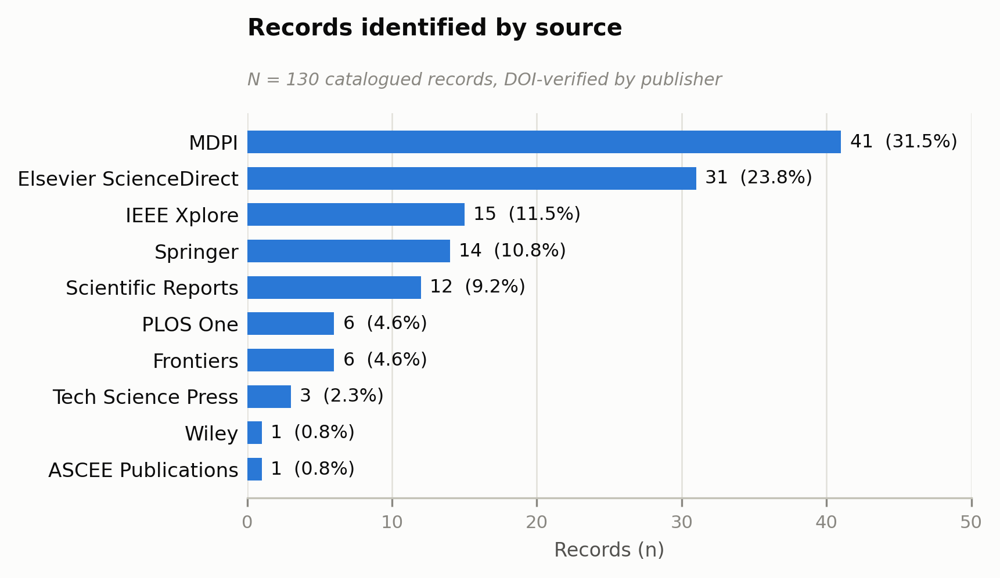
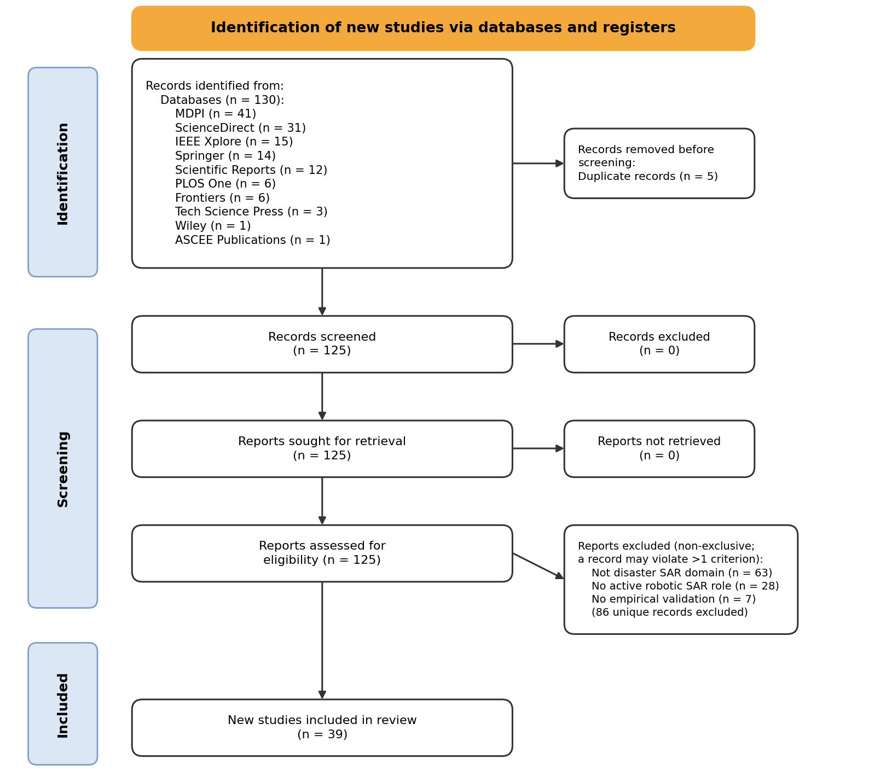
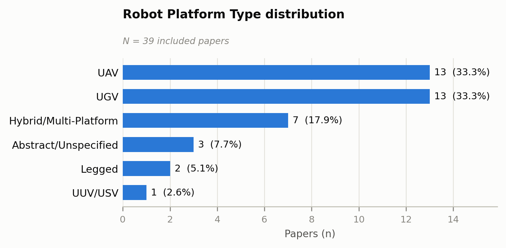
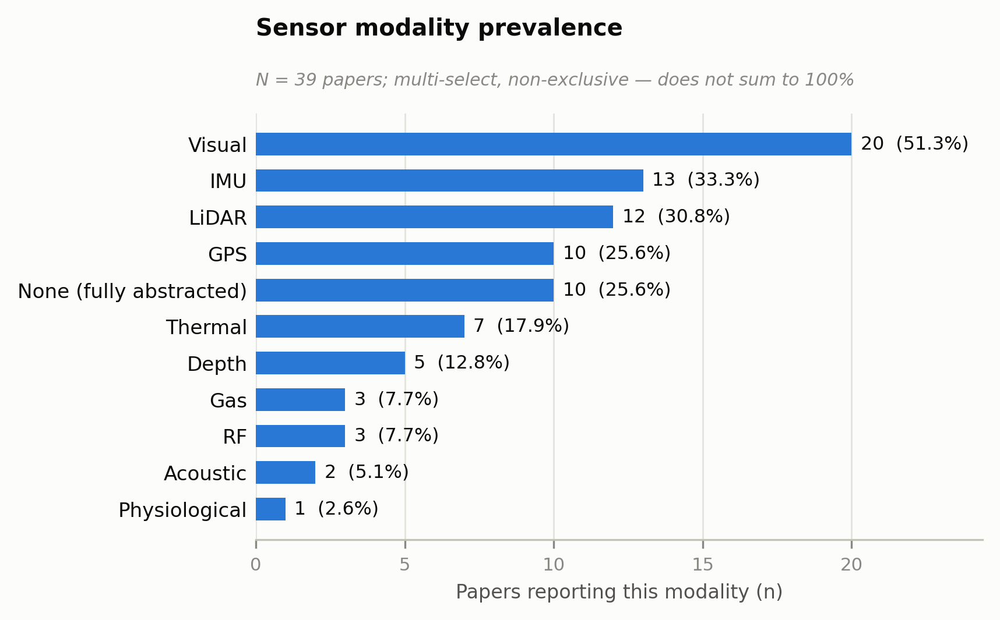
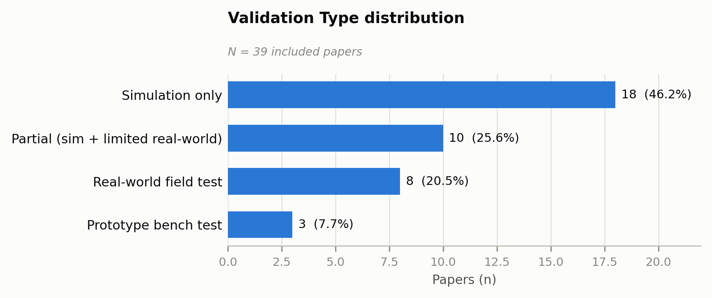
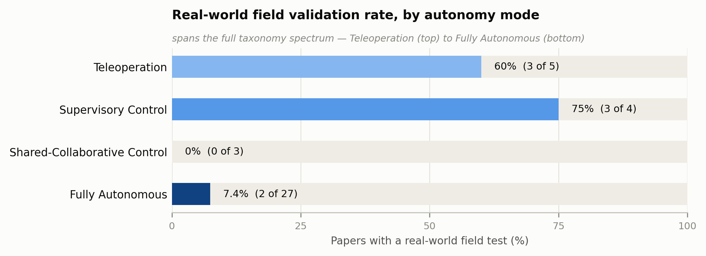
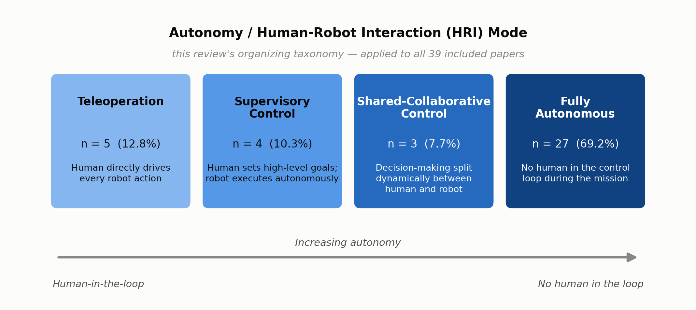

# Recent Advances in Robotic Systems for Disaster Search and Rescue: A Systematic Review of Teleoperation, Human-Robot Collaboration, and Autonomous Approaches

**Sadman Adib Avi\*, Sadia Sultana\*, and Chinmoy Sarker\***
\* Department of Computer Science and Engineering, Bangladesh Army International University of Science and Technology (BAIUST), Cumilla, Bangladesh

IEEE Access, Vol. XX, No. XX, 2026

> Source: converted from `review_paper_v34_final.pdf` (14 pages, LaTeX/pdfTeX-1.40.25, generated 2026-10-03). All text, tables, figures and references below are transcribed from that PDF. Figures are the original embedded raster images extracted from the PDF (not placeholders); see `review_paper_v34_figures/`.

---

## Abstract

Robotic Search and Rescue (RSAR) systems have become increasingly important for locating and assisting survivors in disaster environments too hazardous for human responders. This systematic review analyzes 39 papers published in 2025-2026, screened under PRISMA 2020 guidelines from an initial pool of 130 candidate records. Prior reviews of this literature organize their corpora by system architecture, platform type, or research method. This review instead classifies every included system along a four-way autonomy/human-robot interaction (HRI) taxonomy (Teleoperation, Supervisory Control, Shared-Collaborative Control, and Fully Autonomous), with every paper resolved to a single primary category under an explicit, precedent-based classification protocol. Fully Autonomous systems dominate the current literature (69.2% of the corpus), followed by Teleoperation (12.8%), Supervisory Control (10.3%), and Shared-Collaborative Control (7.7%). Cross-referencing autonomy mode against validation type reveals a gap: Fully Autonomous systems are field-tested in real-world conditions in only 7.4% of cases, compared with 60-75% for the more human-involved modes. A review organized around any axis other than autonomy would not surface this pattern, which has not been reported previously in this literature. A related platform-level mismatch emerges: UAV-based systems, the platform most associated with Fully Autonomous and Shared-Collaborative research, are field-tested in only 7.7% of cases, versus 57.1% for hybrid multi-platform systems. Separately, 89.7% of the corpus reports some form of environmental-realism limitation, whether the tested scenario names a specific hazard or a generic disaster environment. This review positions itself against the most recent structurally comparable prior review of this literature (a 2016-2024 corpus), covering the immediately following 2025-2026 period with zero temporal overlap, and grounds its gap analysis in the included papers' own reported limitations rather than a generic list of research challenges.

**Index Terms** -- Autonomous robots, disaster response, human-robot interaction, robot autonomy, search and rescue robots, systematic review, teleoperation, unmanned aerial vehicles (UAVs), unmanned ground vehicles (UGVs).

---

## I. Introduction

Natural hazards continue to impose a severe and persistent burden on human life and infrastructure worldwide. According to the Centre for Research on the Epidemiology of Disasters (CRED), 358 natural hazard-related disasters were recorded globally in 2025 alone, resulting in 16,607 fatalities, affecting 110.2 million people, and causing an estimated US$169.7 billion in economic losses [1]. These figures sit below the 2005-2024 annual average (377 disasters, 57,429 deaths, 169.0 million people affected, and US$215.0 billion in losses), a reduction CRED attributes to the absence of any single catastrophic "mega-disaster" during the year rather than to any broader decline in disaster risk; the cumulative burden of concurrent earthquakes, storms, and floods across 2025 remained consistent with that of a typical year. Asia bore a disproportionate share of this impact, accounting for 72.8% of global disaster-related deaths in 2025, driven in large part by two major earthquakes that illustrate why rapid, safe search and rescue (SAR) remains urgent and technically demanding.

The deadlier of the two struck Myanmar on March 28, 2025: a 7.7-magnitude earthquake centered near Mandalay, Naypyitaw, and Sagaing that caused at least 3,820 deaths and an estimated US$11 billion in economic losses [1]. Five months later, on August 31, a 6.0-magnitude earthquake struck the mountainous eastern Afghan provinces of Kunar, Nangarhar, Laghman, and Nuristan, killing an estimated 2,200 people. Both events exemplify a recurring pattern in disaster response: structural collapse concentrates casualties in confined, unstable, and often inaccessible spaces, where locating survivors quickly is simultaneously the most time-critical and the most physically dangerous task facing response teams. This combination of constraints has motivated the growing use of robotic systems in SAR operations.

Time-criticality drives much of this urgency. The existence of a "golden window" for locating survivors trapped under rubble or debris is well established in the SAR and disaster-robotics literature [2], with the probability of finding a survivor alive declining sharply, and non-linearly, in the hours and days following an event. The precise shape of this decline varies meaningfully depending on the source and disaster type consulted. Estimates of the proportion of survivors located alive by roughly the 72-hour mark range from just over 20% in some assessments to more than 90% in others, and expert commentary during real events (the 2023 Turkey-Syria earthquakes) has cited intermediate figures, closer to 74% at 24 hours falling to 22% by 72 hours [3]. Virtually all sources agree on the underlying shape, if not the exact numbers: survival probability falls steeply and continues falling for as long as a trapped person goes unlocated. This decline is compounded by direct physical risk to human rescue teams working in unstable, potentially collapsing structures. Robotic Search and Rescue (RSAR) systems respond to both constraints at once, entering spaces unsafe for human responders, searching faster and more systematically than manual methods allow, and reducing the number of people exposed to a hazardous environment in the process.

RSAR has consequently become an increasingly active area of both academic research and operational deployment over the past decade, with a correspondingly growing body of systematic reviews attempting to synthesize the field.

The most directly comparable prior work is Kareem et al. [4], a systematic review of 74 SAR robotics papers published between 2016 and 2024 in IEEE Access. That review proposes a five-layer system architecture (Human-Robot Interaction (HRI), Perception, Navigation, Control, and Robot layers) and discusses human-robot interaction across three modes: teleoperation, supervisory control, and collaborative control. It does not, however, isolate full autonomy as its own category, nor does it report how its 74 papers quantitatively distribute across the three HRI modes it does define. Sinha et al. [5] reviewed 190 papers on reconnaissance-oriented autonomous robotic systems for disaster management published between 2020 and 2025, but restrict their scope to unmanned ground vehicles specifically and organize their corpus by research-method type (algorithm development, simulation, experimental, hardware, and comparative studies) rather than by autonomy or HRI mode. Bakzadeh et al. [6], reviewing three decades of mine search-and-rescue robot platforms, explicitly exclude autonomy and control software from their stated scope, focusing instead on physical design requirements such as mobility, sensing, and communications hardware; an earlier paper by an overlapping author team [7] addresses interface-design guidelines for mining emergency robots but reports no built or empirically tested system. An earlier, narrower review by Tong et al. [8] compared UAV and UGV software approaches to SAR robotics in 2024, predating all four of the above; it is noted here as an immediate predecessor in framing rather than as a structurally comparable peer, since it falls outside both this review's 2025-2026 window and the 2016-2024 corpus in [4]. None of these reviews organizes its corpus primarily around how much autonomy a system's human-robot interaction affords, which is the organizing axis this review adopts.

Table I summarizes these differences directly.

Beyond scope alone, none of the reviewed prior works evaluate the relationship between autonomy level and validation rigor, that is, whether the more autonomous a reported system, the more or less likely it is to have been tested outside simulation. This review's four-way HRI/autonomy taxonomy, applied consistently across all 39 papers under an explicit, precedent-based classification protocol, makes exactly this comparison possible, and surfaces a pattern that a review organized by platform type, sensor modality, or system layer would not reveal: an inverse relationship between autonomy level and real-world validation rate.

In particular, the main contributions of this review can be summarized as follows:

1) A four-way taxonomy of autonomy/human-robot interaction modes (Teleoperation, Supervisory Control, Shared-Collaborative Control, and Fully Autonomous) applied consistently across all 39 included papers under an explicit, logged, precedent-based classification protocol that resolves every paper to a single primary label.
2) A systematic review of the 2025-2026 SAR robotics literature, the period immediately following, with zero temporal overlap, the most recent and most directly comparable prior review's own 2016-2024 corpus.
3) An empirical finding, not previously reported in prior SAR robotics reviews, that autonomy level and real-world validation rate are inversely related across the current literature: Fully Autonomous systems, the largest single category at 69.2% of the corpus, are real-world field-tested in only 7.4% of cases, compared with 60-75% for the more human-involved control modes.
4) A gap analysis grounded directly in the 39 included papers' own reported limitations rather than in a generic list, identifying a near-universal (89.7%) environmental-realism validation gap across the corpus and a platform-level mismatch in which the platform type receiving the most autonomy-forward research attention (UAVs) is simultaneously validated least often in the real world.

### TABLE I. Comparison with Directly Related Prior Reviews

| Prior Review | Scope | Corpus / Method | Primary Organizing Axis | Gap vs. This Review |
|---|---|---|---|---|
| Kareem et al. [4] | UAV/UGV/UUV, general SAR | 74 papers, 2016-2024, PRISMA | Five-layer system architecture (HRI/Perception/Navigation/Control/Robot) | HRI is one layer among five, split into 3 modes with no Fully Autonomous category; no quantitative per-paper mode distribution reported |
| Sinha et al. [5] | UGV only | 190 papers, 2020-2025, multi-database screening | Research-method type (algorithm development/simulation/experimental/hardware/comparative) | No HRI/autonomy-mode axis; single-platform-class only |
| Bakzadeh et al. [6] | Mine/underground rescue robots only, 15 platforms | Narrative platform review spanning three decades | Physical design-requirement categories (mobility, sensors, communications, permissibility) | Autonomy and control software explicitly excluded from scope; single hazard type |
| Bakzadeh et al. [7] | Mine rescue interface design | Narrative guideline synthesis, no built/tested system | HRI/interface-design principles | No empirical corpus |
| **This review** | UAV/UGV/legged/UUV, general SAR | 39 papers, 2025-2026, PRISMA 2020 | Four-way autonomy/HRI mode (Teleoperation/Supervisory Control/Shared-Collaborative Control/Fully Autonomous) | -- |

---

## II. Methodology

This section presents the systematic literature review (SLR) protocol used to identify, screen, and extract data from the current literature on robotic systems for disaster search and rescue (SAR). The review follows PRISMA 2020 reporting guidelines and was conducted between 18-19 July 2026.

### A. Research Questions

Four research questions guided the review, structured around its central organizing contribution, a four-way autonomy/human-robot interaction (HRI) taxonomy:

**RQ1:** What autonomy/HRI mode (Teleoperation, Supervisory Control, Shared-Collaborative Control, or Fully Autonomous) characterizes each robotic SAR system reported in the 2025-2026 literature, and how is this distributed across the corpus?

**RQ2:** What robot platform types are being deployed for disaster SAR in this period, and how do platform choices relate to autonomy mode?

**RQ3:** What perception/sensor configurations, computational architectures, and validation approaches (simulation vs. real-world) characterize current SAR robotic systems?

**RQ4:** What disaster scenarios are being modeled in current research, and to what extent does the literature target hazard-specific conditions versus generic disaster environments?

### B. Information Sources and Search Strategy

Candidate records were identified from ten sources, summarized in Table II and Fig. 1: MDPI, Elsevier ScienceDirect, IEEE Xplore, Springer, Scientific Reports, PLOS One, Frontiers, Wiley, Tech Science Press, and ASCEE Publications. This identification process, conducted independently by the three authors of this review, catalogued 130 records in total.

### C. Search Criteria

The search terms "rescue robot" and "disaster rescue robot" were applied across the sources listed in Table II, with "disaster rescue robot" used as the primary term for MDPI and "rescue robot" for the remaining sources. All queries were restricted to publications from 2025 onward at the query level, rather than applied as a separate post-hoc screening criterion, so that the identification stage itself already matched this review's stated 2025-2026 scope (Section II-A).

### D. Deduplication

Duplicate records were identified by DOI matching across the full catalogue, with byte-level full-text comparison applied as a secondary confirmation in two cases. Five duplicate pairs were found and the later-appearing copy of each removed prior to screening, leaving 125 unique records.

### E. Eligibility Criteria

Each record was required to satisfy all three of the following criteria to be included:

**C1 -- Disaster SAR Application Domain (Primary).** The paper must explicitly target disaster SAR as its primary stated application (post-earthquake rescue, urban SAR, flood response, wildfire rescue, collapsed-structure search, mine rescue, or maritime SAR) as the paper's primary framing rather than a cited example or future-work mention. Papers primarily addressing industrial, agricultural, medical, military, or general-IoT applications were excluded even where SAR was mentioned incidentally.

**C2 -- Robotic System with Active Operational Role.** The paper must present a robot, platform, or framework that actively performs or supports SAR operations, whether teleoperated, shared-autonomy, supervisory, or fully autonomous. The robot must be the operational agent, not merely a sensor platform, communication relay, or logistics tool.

**C3 -- Empirical Contribution.** The paper must present system design with testing, experimental results, simulation studies, prototype evaluation, or field deployment. Opinion pieces, conceptual frameworks without evaluation, other systematic reviews, and editorial commentaries were excluded. For example, needs-assessment studies synthesizing practitioner survey and interview data about robot usage, such as Rajashekhar and Prabhakar [9], which combines a literature review, public survey, and first-responder interviews on post-earthquake robot usage, were excluded under these criteria despite covering closely related subject matter, since they do not themselves present or empirically test a robotic system.

An initial fourth criterion restricting eligibility to papers published in 2025 or later was considered but not retained as a formal criterion, since the identification-stage search queries (Section II-C) already restricted every catalogued record to this window before screening began; no record was screened against and failed a publication-year test.

### F. Screening Process

Unlike protocols that screen first by title/abstract and only later assess a reduced subset by full text, every one of the 125 unique records in this review had its full text retrieved and read in its entirety (methodology, results, and conclusion, not the abstract alone) before a decision was reached. This single-pass, full-text approach was adopted because several exclusions only became apparent past the abstract: papers whose abstracts mention "search and rescue" once or twice in the introduction but whose tested content, methodology, and conclusion never revisit it, or papers whose title and keywords suggest SAR relevance while their entire empirical section evaluates something else, such as generic vehicle-routing logistics, industrial teleoperation, an abstract path-planning algorithm with no robot embodiment, or a subjective user-survey of a conceptual mockup, among other patterns encountered repeatedly across the corpus.

Screening was performed independently by the three authors of this review. Each author assessed every record against all three eligibility criteria in order, recording the specific textual evidence supporting the decision and, for exclusions, the precise criterion (or combination of criteria) violated. The three independent sets of decisions were then compared record by record; where all three authors agreed, the decision was finalized directly, and where they disagreed, the record was discussed jointly until a consensus decision was reached. Screening proceeded across 12 sequential batches of 9-11 records each, completed over two days (18-19 July 2026). No record was left unresolved as an ambiguous "maybe": every one reached a final include/exclude decision, and both inclusion and exclusion decisions were logged in full, since the exclusion log is as necessary as the inclusion log for the review's audit trail and for avoiding re-litigating a paper that resurfaces under a different search query.

### G. Data Extraction

For each of the 39 included papers, 18 fields were extracted (Table III), anchored on this review's central taxonomy dimension, Autonomy/HRI Mode, under which every paper's SAR robotic system was resolved to exactly one of four categories: Teleoperation, Supervisory Control, Shared-Collaborative Control, or Fully Autonomous. Extraction was carried out independently by the three authors of this review, and the resulting field values were cross-checked against one another, with disagreements resolved by joint discussion before compiling the final extraction table. Borderline classification decisions (for example, distinguishing a nominally "high-level" voice interface that in practice relays one atomic motion command at a time from a genuine goal-level supervisory interface, or separating a servo-loop stabilization layer from an independent decision-making layer with real authority over the robot's next action) were resolved against seven explicit classification precedents established and logged during extraction, so that later, structurally similar papers were classified consistently with earlier ones rather than each being judged in isolation.

Five further fields were reduced to clean bibliometric categories for quantitative reporting: Validation Type; Robot Platform Type (with an explicit rule bucketing any system combining two or more distinct platform classes, or two locomotion modes in one body, as "Hybrid/Multi-Platform"); Computational Architecture (classified by the platform's operational compute location at mission runtime rather than by where any underlying model was trained, to avoid the great majority of machine-learning-based papers defaulting to a "hybrid" label purely because training happened offline); Disaster Scenario Modeled; and Sensor Suite, which, because most papers reported several sensor modalities simultaneously, was represented as a non-mutually-exclusive multi-hot encoding across eleven sensor categories rather than forced into a single dominant category.

### TABLE II. Records Identified by Source

| Source | Records |
|---|---|
| MDPI | 41 |
| Elsevier ScienceDirect | 31 |
| IEEE Xplore | 15 |
| Springer | 14 |
| Scientific Reports (Springer Nature) | 12 |
| PLOS One | 6 |
| Frontiers | 6 |
| Tech Science Press | 3 |
| Wiley | 1 |
| ASCEE Publications | 1 |
| **Total** | **130** |

### TABLE III. Data Extraction Fields

| # | Field | # | Field |
|---|---|---|---|
| 1 | Paper ID | 10 | Perception/Detection Algorithm |
| 2 | Citation | 11 | Navigation/Path-Planning Method |
| 3 | Journal/Venue | 12 | Computational Architecture |
| 4 | DOI | 13 | Disaster Scenario Modeled |
| 5 | Robot Platform Type | 14 | Validation Type |
| 6 | Single- or Multi-Robot | 15 | Key Reported Metric/Result |
| 7 | **Autonomy/HRI Mode** | 16 | Reported Advantage(s) |
| 8 | HRI Interface/Modality | 17 | Reported Limitation(s)/Gap |
| 9 | Sensor Suite | 18 | Notes |

### TABLE IV. Exclusion Breakdown by Criterion (non-mutually-exclusive; a record violating more than one criterion is counted under each)

| Criterion violated | n |
|---|---|
| C1 -- not disaster SAR domain | 63 |
| C2 -- no active robotic SAR role | 28 |
| C3 -- no empirical validation | 7 |

**Fig. 1.** Records identified by source (N = 130 catalogued records, DOI-verified by publisher).

### H. PRISMA Results

Fig. 2 presents the PRISMA 2020 flow diagram for this review. Of the 130 records catalogued, 5 duplicates were removed, leaving 125 unique records for screening. All 125 had full text retrieved and were assessed for eligibility (no record was excluded prior to full-text retrieval, and no record was unretrievable). This yielded 39 included studies and 86 excluded records, broken down by violated criterion in Table IV; because 12 of the excluded records violated more than one criterion, the per-criterion counts in Table IV sum to more than 86.

The full-text eligibility assessment and data extraction described above were performed independently by the three authors of this review. The three authors' independent findings were then compared, and only findings on which all three agreed were retained and written up in this review; disagreements were resolved through joint discussion rather than by a single arbitrating author.

**Fig. 2.** PRISMA 2020 flow diagram for record identification, screening, and inclusion.

---

## III. Results

This section presents the bibliometric findings from the 39 included papers, addressing RQ1-RQ4 in turn. All percentages are of N = 39 unless otherwise noted; the Sensor Suite results (Section III-C) are a multi-select prevalence measure and intentionally do not sum to 100%.

### A. Autonomy/HRI Mode Distribution (RQ1)

Fully Autonomous is the dominant mode in the current corpus: 27 of 39 papers (69.2%) present robotic SAR systems operating with no human in the control loop during the mission itself. Teleoperation accounts for 5 papers (12.8%), Supervisory Control for 4 (10.3%), and Shared-Collaborative Control for 3 (7.7%), the smallest of the four categories (Table V).

Nearly seven in ten papers in this 2025-2026 corpus report systems with no human in the mission-time control loop, a departure from the predominantly human-supervised framings surveyed by the model reference paper's own three-mode HRI account [4].

### TABLE V. Autonomy/HRI Mode Distribution

| Mode | n | % |
|---|---|---|
| Fully Autonomous | 27 | 69.2% |
| Teleoperation | 5 | 12.8% |
| Supervisory Control | 4 | 10.3% |
| Shared-Collaborative Control | 3 | 7.7% |

### B. Robot Platform Type and Its Relationship to Autonomy Mode (RQ2)

UAV and UGV are equally represented at 13 papers each (33.3%), followed by Hybrid/Multi-Platform systems at 7 (17.9%), Abstract/Unspecified simulation studies at 3 (7.7%), Legged platforms at 2 (5.1%), and a single UUV/USV study (2.6%) (Table VI, Fig. 3).

Cross-referencing platform type against autonomy mode (Table VII) shows autonomy is not evenly distributed across platforms. All three Shared-Collaborative Control papers use UAV platforms exclusively; no UGV, legged, or hybrid system in this corpus reports this control mode. Teleoperation, conversely, never appears on a bare UAV platform: its 5 instances split between UGV (2) and Hybrid/Multi-Platform systems (3). Fully Autonomous is comparatively platform-agnostic, appearing across every category (UGV 9, UAV 9, Hybrid/Multi-Platform 3, Abstract/Unspecified 3, Legged 2, UUV/USV 1).

### TABLE VI. Robot Platform Type Distribution

| Platform | n | % |
|---|---|---|
| UAV | 13 | 33.3% |
| UGV | 13 | 33.3% |
| Hybrid/Multi-Platform | 7 | 17.9% |
| Abstract/Unspecified | 3 | 7.7% |
| Legged | 2 | 5.1% |
| UUV/USV | 1 | 2.6% |

**Fig. 3.** Robot Platform Type distribution across the 39 included papers.

### C. Sensor Suite and Computational Architecture (RQ3, part 1)

Visual sensing is the most prevalent modality, present in 20 of 39 papers (51.3%), followed by IMU/proprioceptive sensing (13, 33.3%) and LiDAR (12, 30.8%) (Table VIII). A notable quarter of the corpus (10 papers, 25.6%) models no physical sensor at all, relying on fully abstracted simulation environments instead (Fig. 4). This pairs with the Visual-sensor finding: alongside sensor-driven perception research, a substantial share of current work tests planning, coordination, or control questions in idealized, sensor-free settings.

On computational architecture (Table IX), PC/Offline is the single largest category (15 papers, 38.5%), followed closely by Onboard/Edge deployment (13, 33.3%). A quarter of papers (10, 25.6%) report a genuine runtime-hybrid architecture, with two or more compute locations both active during mission execution rather than an offline-trained, onboard-deployed pipeline. Only one paper (2.6%) relies on cloud computing as its primary architecture.

### D. Validation Type and the Autonomy-Validation Relationship (RQ3, continued)

Simulation-only validation is the most common approach across the corpus (18 papers, 46.2%), followed by Partial validation, simulation combined with limited real-world testing (10, 25.6%), and Real-world field tests (8, 20.5%); a small remainder (3, 7.7%) report prototype bench testing without a full mission-representative test (Table X).

Cross-referencing validation type against autonomy mode surfaces the clearest inverse pattern in this dataset (Table XI, Fig. 5). Among the 27 Fully Autonomous papers, only 2 (7.4%) report a genuine real-world field test, with the large majority (16, 59.3%) validated in simulation only. This reverses sharply for the two most human-involved modes: 3 of 4 Supervisory Control papers (75%) and 3 of 5 Teleoperation papers (60%) report real-world field testing. Shared-Collaborative Control, the smallest category, also skews toward simulation (2 of 3, 66.7%). The more autonomous a reported system in this corpus, the less likely it is to have been tested outside simulation. This should temper how the 69.2% Fully Autonomous figure (Section III-A) is read: as evidence of research-stage capability rather than field-ready capability. Fig. 6 presents this inverse relationship across the full four-way autonomy spectrum.

This pattern also interacts with platform type. UAV papers show the weakest real-world validation rate of any platform category (1 of 13, 7.7% real-world field test; 8 of 13, 61.5% simulation only), while Hybrid/Multi-Platform systems show the strongest (4 of 7, 57.1% real-world field test; only 1 of 7, 14.3% simulation only), the opposite of what their smaller sample size alone would suggest. This is addressed in the Discussion alongside the platform's 17.9% overall corpus share (Section III-B).

### TABLE VII. Autonomy Mode x Platform Type

| Mode | UAV | UGV | Legged | UUV/USV | Hybrid/Multi-Platform | Abstract/Unspecified | Total |
|---|---|---|---|---|---|---|---|
| Teleoperation | 0 | 2 | 0 | 0 | 3 | 0 | 5 |
| Supervisory Control | 1 | 2 | 0 | 0 | 1 | 0 | 4 |
| Shared-Collaborative Control | 3 | 0 | 0 | 0 | 0 | 0 | 3 |
| Fully Autonomous | 9 | 9 | 2 | 1 | 3 | 3 | 27 |
| **Total** | **13** | **13** | **2** | **1** | **7** | **3** | **39** |

**Fig. 4.** Sensor modality prevalence across the 39 included papers (multi-select, non-exclusive; percentages do not sum to 100%).

### TABLE VIII. Sensor Modality Prevalence (multi-select; N = 39, non-exclusive)

| Modality | n | % of papers |
|---|---|---|
| Visual | 20 | 51.3% |
| IMU | 13 | 33.3% |
| LiDAR | 12 | 30.8% |
| GPS | 10 | 25.6% |
| None (fully abstracted) | 10 | 25.6% |
| Thermal | 7 | 17.9% |
| Depth | 5 | 12.8% |
| Gas | 3 | 7.7% |
| RF | 3 | 7.7% |
| Acoustic | 2 | 5.1% |
| Physiological | 1 | 2.6% |

### TABLE IX. Computational Architecture Distribution

| Architecture | n | % |
|---|---|---|
| PC/Offline | 15 | 38.5% |
| Onboard/Edge | 13 | 33.3% |
| Hybrid | 10 | 25.6% |
| Cloud | 1 | 2.6% |

### TABLE X. Validation Type Distribution

| Validation | n | % |
|---|---|---|
| Simulation only | 18 | 46.2% |
| Partial (sim + limited real-world) | 10 | 25.6% |
| Real-world field test | 8 | 20.5% |
| Prototype bench test | 3 | 7.7% |

### E. Disaster Scenario Modeled (RQ4)

The single largest disaster-scenario category is Generic/Unspecified, with 21 of 39 papers (53.8%), where the tested environment is explicitly framed as disaster-representative in general rather than modeling a specific hazard type. Underground/Mine/Tunnel/Cave scenarios account for 6 papers (15.4%), Earthquake/Structural Collapse for 5 (12.8%), Wilderness/Mountain/Forest for 4 (10.3%), Maritime/Water for 1 (2.6%), and Wildfire/Fire and one other single-occurrence hazard for 1 paper each (2.6%) (Table XII).

This majority-generic pattern is not concentrated in any one autonomy mode: Generic/Unspecified scenarios span all four categories (16 Fully Autonomous, 3 Teleoperation, 1 Supervisory Control, 1 Shared-Collaborative Control), indicating a corpus-wide characteristic of the current literature rather than an artifact of one control paradigm being validated more loosely than others. One further pattern concerns the Discussion: none of the 6 Underground/Mine/Tunnel/Cave papers in this corpus report Teleoperation as their primary mode (4 Fully Autonomous, 2 Supervisory Control), a contrast that matters given that mine-rescue robotics literature outside this corpus [6] is predominantly teleoperation-oriented.

**Fig. 5.** Validation Type distribution across the 39 included papers.

### TABLE XI. Autonomy Mode x Validation Type

| Mode | Simulation only | Real-world field test | Partial | Prototype bench test | Total |
|---|---|---|---|---|---|
| Teleoperation | 0 | 3 | 1 | 1 | 5 |
| Supervisory Control | 0 | 3 | 1 | 0 | 4 |
| Shared-Collaborative Control | 2 | 0 | 1 | 0 | 3 |
| Fully Autonomous | 16 | 2 | 7 | 2 | 27 |
| **Total** | **18** | **8** | **10** | **3** | **39** |

### TABLE XII. Disaster Scenario Modeled Distribution

| Scenario | n | % |
|---|---|---|
| Generic/Unspecified | 21 | 53.8% |
| Underground/Mine/Tunnel/Cave | 6 | 15.4% |
| Earthquake/Structural Collapse | 5 | 12.8% |
| Wilderness/Mountain/Forest | 4 | 10.3% |
| Maritime/Water | 1 | 2.6% |
| Wildfire/Fire | 1 | 2.6% |
| Other (single-occurrence hazard) | 1 | 2.6% |

---

## IV. Taxonomy of Autonomy/HRI Approaches

This section synthesizes the 39 included papers by their resolved Autonomy/HRI Mode (Section III-A), the review's central organizing axis, elaborating the technical approaches, mechanisms, and reported trade-offs characterizing each of the four categories.

Fig. 7 summarizes this taxonomy's four modes, their corpus share, and their position along the underlying autonomy spectrum before the per-mode synthesis below.

**Fig. 6.** Real-world field-validation rate by Autonomy/HRI mode, spanning the full taxonomy spectrum from Teleoperation to Fully Autonomous, this review's clearest evidenced pattern (Section V-A).

**Fig. 7.** The four-way Autonomy/HRI Mode taxonomy applied across all 39 included papers, this review's structural counterpart to the model reference paper's five-layer system architecture [4].

### A. Teleoperation (n = 5)

Teleoperation in this corpus concentrates on mechanical and perceptual engineering rather than control autonomy itself: in every one of the five papers, locomotion remains entirely human-driven, and the paper's own contribution lies elsewhere. Three of the five ([10], [11], [12]) are Hybrid/Multi-Platform systems: a universal voice-controlled add-on controller tested on both a drone and a quadruped ([10]), a terrestrial-aerial UAV using a separation-cage structure to eliminate the camera/LiDAR occlusion problems of earlier single-cage caged-drone designs ([11]), and a 1,200 kg-payload wheeled-hexapod rescue platform ([12]) exceeding the payload capacity of comparable legged systems while a hierarchical control layer keeps its body attitude stable on uneven terrain. The remaining two are ground vehicles paired with strong perception pipelines: a YOLOv8-based occluded-victim detector reaching 93.1% mAP ([13]), and a multi-modal visual-thermal-audio fusion system explicitly reported as untested on the physical prototype itself, validated only against synthetic data ([14]). The pattern across all five is consistent: where autonomy is deliberately withheld, research investment shifts toward mechanical capability or perception accuracy, with navigation autonomy explicitly deferred as future work in three of the five ([14], [11], [12]).

### B. Supervisory Control (n = 4)

Supervisory Control papers split the decision layer cleanly: the human sets goals and monitors, while the robot autonomously executes navigation and perception beneath that goal. Two of the four ([15], [16]) were field-validated in genuinely hazardous underground environments: a coal-mine rescue robot combining direct point-cloud navigation with a digital-twin operator interface ([15]), and a sampling-based semantic-navigation planner spanning legged and wheeled platforms, tested live at the DARPA Subterranean Challenge finals ([16], though its planned aerial component was never actually deployed in the field). [17]'s semantics-based situational-awareness framework is the corpus's clearest evidence for what well-designed supervisory HRI delivers operationally: an interpretable, expert-tunable indicator layer, deliberately avoiding an opaque end-to-end deep-learning design, that a companion mock-up study associated with reduced operator reaction time and cognitive workload when switching autonomy level, and increased trust in the reported situational awareness. (Its headlined validation used autonomous waypoint navigation to hold trajectories constant across trials; a one-off manual repositioning step for a weak radiation source's short detection range does not change this primary classification.) [18]'s terrain-aware UAV search planner responds directly to a real operational constraint of wilderness SAR, that flights are routinely interrupted by weather, battery, or terrain before completing a planned search area, by strictly prioritizing high-probability regions first, so that an interrupted flight still captures most of the highest-value search area even without full coverage.

### C. Shared-Collaborative Control (n = 3)

All three Shared-Collaborative Control papers use UAV platforms (Table VII) and share a distinguishing feature not found in the Supervisory bucket: each treats the operator's own cognitive or psychological state as a first-class design and evaluation target, not merely task completion. [19] has a human directly teleoperate a primary search UAV while a structurally separate autonomous swarm infers the operator's cognitive/knowledge state from movement patterns alone, deliberately avoiding the need to transmit sensitive EEG or eye-tracking data, and adapts its own search strategy in response, though the authors report the underlying physiological correlations were only "weak." [20] uses an LLM-orchestrated multi-agent architecture to filter and prioritize what reaches the operator rather than presenting raw video, including a self-correcting feedback loop that catches inconsistent risk assessments before they reach the human, validated only in controlled lab settings against synthetic scenarios, with detection recall for occluded or partially buried victims as low as 2.6-26.4% mAP for the hardest occlusion classes. [21] uses a mixed-reality swarm interface in a simulated maritime risk-conflict scenario, reporting improved situational awareness and psychological-resilience measures (via heart-rate-variability indicators) alongside higher usability than a conventional 2D control interface, though tested on a small, largely SAR-inexperienced sample (N = 35, reduced to 27 after physiological data loss).

### D. Fully Autonomous (n = 27)

The Fully Autonomous category is both the largest (69.2% of the corpus, Section III-A) and the most internally diverse, spanning single- and multi-robot systems across every platform type (Table VII). Four thematic clusters organize the 27 papers by primary technical contribution, a grouping devised for this synthesis rather than a category drawn from the extraction table itself.

**Multi-robot/swarm coordination and task allocation** (12 papers: [22], [23], [24], [25], [26], [27], [28], [29], [30], [31], [32], [33]). The largest cluster, addressing how multiple autonomous agents divide search area, avoid redundant coverage, or allocate rescue tasks with little or no centralized control: via multi-agent reinforcement learning ([23], [24], [25], [28]), decentralized reward-shaping without explicit inter-agent communication ([26]), TAEMS-based task scheduling ([29]), RF-signal-guided exploration re-prioritization ([22]), air-ground complementary mapping ([30]), GNSS/cellular-constrained fleet mission planning ([32]), dynamic mid-mission task reallocation for multiple concurrent missing-person searches ([31]), and bid-prediction-based distributed task allocation ([33]). Only one of the twelve, [25]'s curriculum-learning multi-UGV policy, which specifically replaces a platform normally operated by teleoperation with an autonomous DRL controller, reports a successful sim-to-real transfer, and even there only with a single physical unit; the paper's own results note success rates degrade sharply as swarm size grows beyond that one validated unit, and its real-world LiDAR pipeline produced enough false positives from grass and wind to cause 3 of 10 physical collisions.

**Single-robot autonomous navigation and path planning** (7 papers: [34], [35], [36], [37], [38], [39], [40]). Addressing obstacle avoidance, SLAM/localization, and route planning for a single autonomous platform: dynamic-obstacle-anticipating MPC ([34]), energy-aware Q-learning coverage planning ([35]), a low-cost SubT-Challenge-style exploration quadcopter ([36]), improved-AMCL localization for Ackermann-steered ground vehicles ([37]), GPS-denied thermal-visual-inertial SLAM on commodity embedded hardware ([38]), volcanic-terrain heading estimation ([39]), and dynamic symmetrical path planning for coal-mine environments ([40]). Real-world validation is markedly thinner in this cluster than the corpus average: five of the seven report simulation-only or MATLAB-only validation, with real-world testing explicitly named as future work.

**Perception-driven detection and search optimization** (5 papers: [41], [42], [43], [44], [45]). Papers whose primary contribution is improving detection or search-strategy accuracy rather than platform mobility itself: dual-altitude thermal-then-visual UAV victim confirmation ([41]), next-best-view camera planning that recovered 5 of 7 fully canopy-occluded targets in real forest trials ([42]), a low-cost drowning-detection buoy validated only in a calm indoor pool ([43], n = 9 trials), flight-trajectory optimization that improves detection confidence without modifying the underlying detector ([44]), and a lightweight survivor-location-prediction-plus-path-planning framework that its own authors note performs best only in low-density rural settings ([45]).

**Novel autonomous platform/architecture design** (3 papers: [46], [47], [48]). The smallest cluster, centered on platform- or architecture-level innovation rather than a specific algorithmic contribution: a bio-inspired quadruped using material-aware semantic risk-mapping to cut slippage on unstable rubble ([46]); a modular, dual-LoRa/Wi-Fi hexapod with swappable terrain-specific legs ([48]); and [47]'s IMPACT-Agent, the corpus's clearest cautionary case for the Fully Autonomous label. Its multimodal-LLM-driven UGV achieves only a 40% path-planning success rate even with chain-of-thought prompting, a figure the authors themselves describe as inadequate for safety-critical deployment, and while their Discussion explicitly recommends a human-supervised architecture, with the MLLM acting as a high-level reasoner under a human operator "supervising high-level goals, validating critical decisions, and intervening when necessary," that safeguard was never implemented or tested in the reported experiments. [47] illustrates, at the level of one paper, the pattern the Results section identifies at scale (Section III-D): a Fully Autonomous label describes what was tested, not necessarily what a paper's own authors believe is ready for real deployment.

Read together, these four clusters reinforce the Results section's central caution about the 69.2% Fully Autonomous figure: the cluster with the most real-world testing (single-robot navigation) is still majority-simulation, the largest cluster (multi-robot coordination) has essentially one validated sim-to-real transfer among twelve papers, and the smallest cluster contains this corpus's most explicit authors'-own admission that full autonomy, as tested, is not yet deployment-ready.

### E. Synthesis: The Taxonomy as an Organizing Contribution

None of the four verified prior reviews resolve this literature along an autonomy/HRI axis with this degree of granularity (Section I). This four-way resolution, applied consistently across all 39 papers under a logged, precedent-based protocol (Section II-F), is this review's structural counterpart to the model reference paper's five-layer architecture [4]. It is also what makes the cross-cutting pattern in Section III-D visible at all: a review organized by platform type, sensor modality, or system layer, as all four verified prior reviews are, would not surface the inverse relationship between autonomy level and real-world validation rate that this taxonomy makes directly comparable across categories.

---

## V. Discussion

This section interprets the findings of Sections III and IV, identifies the gaps most directly evidenced by the 39 included papers' own reported limitations, and outlines directions for future work grounded in that evidence rather than in the model reference paper's generic gap list.

### A. The Validation Gap Behind the Fully Autonomous Majority

Section III-D's central finding, that Fully Autonomous papers in this corpus are real-world field-tested only 7.4% of the time (2 of 27), against 60-75% for Teleoperation and Supervisory Control, is not an artifact of a few weak papers pulling down an average. It holds up at the level of individual flagship examples.

[25]'s multi-agent curriculum-learning UGV policy is the corpus's one genuine sim-to-real success story in the largest Fully Autonomous cluster, and it illustrates the gap's texture rather than resolving it. In pure simulation, its shared-network policy achieved 95.83% success with 4 agents, degrading steadily to 84.50% (8 agents), 81.11% (12 agents), and 69.36% (24 agents), a 26.5-point drop as swarm size grew, with the paper's own analysis attributing most failures to agent-agent collisions rather than obstacle avoidance. Physical hardware testing was limited to a single robot (three teammates remained simulated) across 10 hybrid trials: all 10 successfully extinguished their fires, but 3 of 10 involved physical collisions, traced to the LiDAR pipeline misreading long grass as obstacles and wind-shaken foliage as false negatives. A further nuance the extraction table's short fields did not capture: the policy trained for stage two (navigation only) achieved only 77.92% success when applied directly to the stage three (firefighting) task, versus 99.67% after dedicated stage-three retraining, meaning that even within one paper's own curriculum, a capability demonstrated at one stage did not transfer to a related task without additional training. Read together, [25] is best described as evidence that sim-to-real transfer for multi-agent SAR systems is achievable in narrow, single-task, single-physical-unit conditions, not evidence that it generalizes.

Two papers in the corpus go further and explicitly state, in their own words, that their tested system is not ready for real deployment, a rare pattern (2 of 39, 5.1%). [47] (IMPACT-Agent) reports that even with chain-of-thought prompting, its MLLM-driven UGV path-planning success rate reached only 40%, which the authors themselves describe as "modest for safety-critical applications." Their own Discussion recommends that production systems use the MLLM as a high-level reasoner under human "Meaningful Human Control," rather than for direct control, but that architecture was never implemented in the reported RQ1/RQ2 experiments, which tested exactly the end-to-end autonomous control the authors go on to caution against. The same paper supplies a sharper distinction worth carrying forward: its perception task (survivor/hazard identification via 5-shot in-context learning) reached 86% mAP, while its control task (autonomous path generation for the same UGV) reached 40%. The gap between "Fully Autonomous" succeeding and failing in this corpus concentrates specifically in control and decision execution, not in perception. [20] (the AI-enhanced rescue drone with a cognitive-agentic architecture) states its limitation even more directly: "the current validation of the system has focused on demonstrating its technical feasibility... in a controlled laboratory environment. The system has not yet been tested in real disaster scenarios or with the direct involvement of emergency response personnel."

This has a direct bearing on how to read the three-mode HRI account in [4], which has no Fully Autonomous category at all. One plausible reading of that omission, consistent with what this review finds, is that a taxonomy that never isolates full autonomy as its own category also has no natural place to ask how rigorously it was validated as a category, the question this review's four-way resolution makes it possible to ask, and answer, directly.

### B. A Corpus-Wide Environmental-Realism Gap, Not a Generic-Scenario Problem

Section III-E's finding that 53.8% of the corpus (21 of 39) tests Generic/Unspecified disaster scenarios rather than a named hazard type invites an obvious hypothesis: that generic testing reflects thinner, less rigorously stress-tested validation than hazard-specific testing. This was checked directly against the extraction data before writing this section, and it does not hold in the expected direction. Papers using Generic/Unspecified scenarios self-report environmental or terrain-realism limitations (unmodeled weather, lighting, vegetation, dust, smoke, or similar) at a rate of 95.2% (20 of 21), slightly higher, not lower, than the 83.3% (15 of 18) rate among hazard-specific papers.

The more defensible reading of this data is broader and, in a sense, more concerning: 89.7% of the entire corpus (35 of 39), regardless of whether the tested scenario was generic or hazard-specific, self-reports some form of environmental-realism gap as a limitation. [25]'s grass-and-wind LiDAR failure (Section V-A) occurred in a hazard-specific firefighting scenario, not a generic one, a concrete illustration that naming a hazard type does not by itself guarantee the physical conditions that hazard implies (smoke, heat-distorted air, unstable rubble) were actually modeled. The generic-vs-specific distinction describes what a paper called its scenario, not how physically realistic that scenario's conditions were. This corpus-wide gap, present almost regardless of framing, is the more robust finding to carry into future-work recommendations than the generic-scenario framing this section originally set out to test.

### C. The Platform-Validation Mismatch

Section III-D's platform-level finding compounds rather than merely adds to Section V-A's concern: UAV papers are real-world field-tested only 7.7% of the time (1 of 13), the weakest of any platform category, while Hybrid/Multi-Platform systems are field-tested 57.1% of the time (4 of 7), the strongest. This is not an isolated statistic. Table VII shows UAV platforms account for 9 of the corpus's 27 Fully Autonomous papers, tied with UGV for the largest single platform-mode intersection, and UAV is the exclusive platform for all three Shared-Collaborative Control papers (Section IV-C). The platform receiving the most attention from the corpus's more autonomy-forward research is simultaneously the platform validated least often outside simulation. Whether this reflects the practical cost and regulatory burden of real UAV flight testing relative to ground-robot testing, or a research culture that treats UAV autonomy algorithms as more amenable to pure-simulation study, is not resolvable from this review's data alone, but the pattern itself, autonomy concentration and validation thinness co-occurring on the same platform type, is a direct, evidenced finding rather than a speculative connection.

### D. Limitations of This Review

Several methodological limitations of this review itself should be stated plainly, for the same reason the model reference paper states its own [4]:

- **No formal document-quality scoring.** Unlike the two-criterion (validation depth, methodological reproducibility) 1-6 quality score in [4], applied to their full corpus, this review did not apply a comparable formal quality-scoring instrument to the 39 included papers.
- **Deliberately narrow time window.** The corpus is restricted to 2025-2026 by construction (Section II-C). This is a considered scope choice rather than an oversight: it is precisely what allows this review to pick up immediately where the 2016-2024 corpus in [4] ends. It does mean that trend claims across a longer time span rely on the prior-reviews comparison (Section I) rather than on this review's own corpus alone.

### E. Future Research Directions

Directions below are drawn from patterns actually evidenced in the 39 papers' own reported limitations and the analysis above, not from a generic list:

1) Standardized real-world validation benchmarks specifically for Fully Autonomous SAR systems, given that this category is both the corpus's largest (69.2%) and its least real-world-tested (7.4%), the gap Section V-A documents.
2) Decomposed capability reporting for MLLM- and agent-based systems, separating perception performance from control/decision-execution performance rather than a single blended success metric, following the concrete precedent in [47] (86% mAP perception vs. 40% control success).
3) Task-generalization testing within multi-stage curricula, rather than reporting only a system's peak-stage capability, following [25]'s demonstration that a capability proven at one curriculum stage did not transfer to the next without dedicated retraining.
4) Physically realistic environmental conditions matched to whatever scenario is claimed, addressing the corpus-wide 89.7% environmental-realism gap identified in Section V-B, including in scenarios that already name a specific hazard, where a named hazard type does not by itself guarantee its physical conditions (as [25]'s hazard-specific grass/wind LiDAR failure shows).
5) Multi-robot coordination testing at realistic swarm scales, given the consistent degradation pattern with increasing agent count documented in both Section IV-D's multi-robot cluster synthesis and [25]'s specific scalability results.

---

## VI. Conclusion

This review systematically examined the current literature on robotic systems for disaster search and rescue (SAR), synthesizing 39 papers published between 2025 and 2026 under PRISMA 2020 guidelines. The review's central organizing contribution is a four-way taxonomy of autonomy and human-robot interaction (HRI) modes (Teleoperation, Supervisory Control, Shared-Collaborative Control, and Fully Autonomous) applied consistently across the full corpus under a logged, precedent-based classification protocol, rather than the system-architecture, platform-type, or research-method organizing schemes used by the most directly comparable prior reviews of this literature.

The results demonstrate that Fully Autonomous systems dominate current SAR robotics research, accounting for 69.2% of the reviewed corpus, with UAV and UGV platforms equally represented as the most common physical form factors (33.3% each) and hybrid multi-platform systems constituting a further 17.9%. A central finding of this review is the inverse relationship between autonomy level and real-world validation rate: Fully Autonomous systems, despite their numerical dominance, are field-tested outside simulation in only 7.4% of cases, compared with 60-75% for Teleoperation and Supervisory Control. This pattern recurs at the platform level, where UAV-based systems, the platform most closely associated with Fully Autonomous and Shared-Collaborative research in this corpus, are field-tested in only 7.7% of cases, against 57.1% for hybrid multi-platform systems. A further, corpus-wide finding is that 89.7% of included papers report some form of environmental-realism limitation, regardless of whether their tested scenario names a specific disaster hazard or is framed generically, indicating that naming a specific hazard type does not by itself guarantee the physical conditions that hazard implies were actually modeled.

Taken together, these findings temper how the current literature's apparent shift toward full autonomy should be read: as evidence of active research interest and demonstrated capability under controlled or simulated conditions, rather than as evidence of field-ready deployment capability. This distinction is invisible to a review organized around platform type, sensor modality, or system architecture, and is made visible by the autonomy/HRI taxonomy this review applies.

Future work should prioritize standardized real-world validation benchmarks specifically for Fully Autonomous SAR systems; decomposed capability reporting that separates perception performance from control and decision-execution performance; task-generalization testing across multi-stage training curricula rather than single peak-capability figures; physically realistic environmental conditions matched to whatever disaster scenario is claimed; and multi-robot coordination testing at swarm scales representative of real deployment rather than small validated subsets. Addressing these gaps will be necessary before the field's growing emphasis on full autonomy can be matched by comparable confidence in its real-world reliability.

---

## References

[1] Delforge, D., Below, R., Wathelet, V., Tonnelier, M., Alonso, A., & Speybroeck, N. (2026). "2025 Disasters in Numbers." Brussels: Centre for Research on the Epidemiology of Disasters (CRED). https://files.emdat.be/reports/2025_EMDAT_report.pdf.

[2] Tabib, W., Stecklein, J., McDowell, C., Goel, K., Jonathan, F., Rathod, A., Kokoski, M., Burkholder, E., Wallace, B., Navarro-Serment, L.E., Bakshi, N.A., Gupta, T., Papernick, N., Guttendorf, D., Kahn, E.E., Kasemer, J., Holdaway, J., & Schneider, J. (2024). "Decentralized Uncertainty-Aware Active Search with a Team of Aerial Robots." arXiv:2410.08507.

[3] Godby, S., quoted in NBC News (2023). "Experts say survival window for those trapped is closing." NBC News live coverage, 2023 Turkey-Syria earthquakes.

[4] Kareem, A.A., Abid, A.J., Hammood, D.A., Al-Naji, A.A., & Chahl, J. (2026). "Safe Search and Rescue Operations Based on Autonomous Robots: A Systematic Review of the General System Architecture." IEEE Access, 14, 19157-19182. doi:10.1109/ACCESS.2026.3660002.

[5] Sinha, S., Lee, S., & Singh, S. (2026). "Survey on Reconnaissance Autonomous Robotic Systems for Disaster Management." Sensors, 26(5), 1659. doi:10.3390/s26051659.

[6] Bakzadeh, R., Androulakis, V., Khaniani, H., Shao, S., Hassanalian, M., & Roghanchi, P. (2026). "Robots in mine search and rescue operations: a review of platforms and design requirements." Frontiers in Robotics and AI, 13, 1857704. doi:10.3389/frobt.2026.1857704.

[7] Bakzadeh, R., Joao, K.M., Androulakis, V., Khaniani, H., Shao, S., Hassanalian, M., & Roghanchi, P. (2025). "Enhancing Emergency Response: The Critical Role of Interface Design in Mining Emergency Robots." Robotics, 14, 148. doi:10.3390/robotics14110148.

[8] Tong, K., Hu, Y., Dikic, B., Solmaz, S., Fraundorfer, F., & Watzenig, D. (2024). "Robots Saving Lives: A Literature Review About Search and Rescue (SAR) in Harsh Environments." 2024 IEEE Intelligent Vehicles Symposium (IV), 953-960. doi:10.1109/IV55156.2024.10588685.

[9] Rajashekhar V S, & Prabhakar, G. (2026). "From preparedness to action: Synthesising insights on robot usage in post-Earthquake search operations." Resilient Cities and Structures, 5, 60-70.

[10] Cafolla, D., Chaparro-Rico, B.D.M., & Xie, X. (2026). "Design and testing of a universal platform for search and rescue operation: Exploring indoor and outdoor potentials." Robotics and Autonomous Systems, 196, 105237. doi:10.1016/j.robot.2025.105237.

[11] Jia, C., Xing, Y., Li, Z., & Ge, X. (2025). "A Novel Amphibious Terrestrial-Aerial UAV Based on Separation Cage Structure for Search and Rescue Missions." Applied Sciences, 15(16), 8792. doi:10.3390/app15168792.

[12] Liu, S., Wang, J., Liu, D., & Zheng, H. (2026). "Mechanical structure design and locomotion control framework for a wheeled hexapod rescue device." Mechanism and Machine Theory, 225, 106472. doi:10.1016/j.mechmachtheory.2026.106472.

[13] Raghavan, A., Ramesh, Y., Shyam, H., Hency V, B., & Halgamuge, M.N. (2026). "Enhancing earthquake response with AI: Real-time human detection using deep learning and robotic systems." Results in Engineering, 30, 110608. doi:10.1016/j.rineng.2026.110608.

[14] Khattab, O., Saravana Balaji, B., Al-Kadri, M.O., Alsaeed, A., Alofaisan, A., Aboutamar, J., Alharbi, H., & Shikfa, A. (2025). "Design and implementation of a smart earthquake rescue robot to enhance rescue operations." Scientific Reports, 15, 42287. doi:10.1038/s41598-025-16003-7.

[15] You, S., Li, M., Wu, B., Wang, J., & Tang, C. (2026). "Digital Twin of Coal Mine Rescue Robot -- Research on Intelligence and Visualization." Sensors, 26(9), 2840. doi:10.3390/s26092840.

[16] Ahmad, S., & Humbert, J.S. (2025). "Sampling-Based Path Planning and Semantic Navigation for Complex Large-Scale Environments." Robotics, 14, 149. doi:10.3390/robotics14110149.

[17] Ruan, T., Ramesh, A., Wang, H., Johnstone-Morfoisse, A., Altindal, G., Norman, P., Nikolaou, G., Stolkin, R., & Chiou, M. (2025). "A framework for semantics-based situational awareness during mobile robot deployments." Frontiers in Robotics and AI, 12, 1694123. doi:10.3389/frobt.2025.1694123.

[18] Schomer, N.L., & Adams, J.A. (2026). "Terrain-Aware Probabilistic Search Planning for Uncrewed Aerial Vehicles." IEEE Transactions on Field Robotics, 3. doi:10.1109/TFR.2025.3641875.

[19] Bhattacharya, A., & Butail, S. (2025). "Robot movement based inference of teleoperator state for multi-robot search." Complex & Intelligent Systems, 11, 443. doi:10.1007/s40747-025-02055-9.

[20] Gaitan, N.C., Batinas, B.I., & Ursu, C. (2025). "AI-Enhanced Rescue Drone with Multi-Modal Vision and Cognitive Agentic Architecture." AI, 6, 272. doi:10.3390/ai6100272.

[21] You, F., Jiang, Y., Pan, S., Wang, Y., & Fu, Q. (2026). "Resilient MR-based human-swarm interaction for UAV search and rescue in risk-conflict scenarios." International Journal of Human-Computer Studies, 212, 103809. doi:10.1016/j.ijhcs.2026.103809.

[22] Maresca, F., Devoti, F., Encinas-Lago, G., Sciancalepore, V., Paradells, J., & Costa-Perez, X. (2026). "Localization-Driven Multi-Robot Exploration for Indoor Search and Rescue." IEEE Open Journal of the Communications Society, 7. doi:10.1109/OJCOMS.2026.3650890.

[23] Tan, L., & Zhao, H. (2026). "A multi-UAV rapid post-disaster search and rescue method based on deep reinforcement learning." Complex & Intelligent Systems, 12, 41. doi:10.1007/s40747-025-02166-3.

[24] Xue, Y., Tan, C.K., & Wong, W.P. (2026). "Energy-aware multi-robot exploration and coverage in fragmented unknown environments using collaborative reinforcement learning." Results in Engineering, 29, 109171. doi:10.1016/j.rineng.2026.109171.

[25] Mead, T., Wang, Z., Foo, E., Dong, J.S., Dong, N., Ko, R., Koay, A.M.Y., Nguyen, K., Xu, Y., Kim, J., Bornstein, S., & Hou, Z. (2026). "Multi-agent reinforcement curriculum learning for real unmanned ground vehicles." Engineering Applications of Artificial Intelligence, 167, 113780. doi:10.1016/j.engappai.2026.113780.

[26] Raza ur Rehman, H.M., Gul, M.J., Younas, R., Jhandir, M.Z., Alvarez, R.M., Miro, Y., & Ashraf, I. (2026). "End-to-end emergency response protocol for tunnel accidents augmentation with reinforcement learning." Scientific Reports, 16, 6226. doi:10.1038/s41598-026-37191-w.

[27] Kareem, A.A., Abid, A.J., Hammood, D.A., Alubady, R., Yaqoob, S.J., Almomani, O., & Rubanenko, O. (2026). "A bio-inspired swarm UAV framework integrating thermal sensing and optimization-based coordination for efficient search and rescue operations." Scientific Reports, 16, 3361. doi:10.1038/s41598-025-33223-z.

[28] Gao, L., Xiang, X., Zhao, H., Chen, H., & Xie, Y. (2026). "UAV swarm safe coverage path planning with deep reinforcement learning." Discover Computing, 29, 156. doi:10.1007/s10791-026-10052-w.

[29] Bedi, A., Zhang, S., & Chabot, E. (2025). "Information-Driven Team Collaboration in RoboCup Rescue." Information, 17(1), 8. doi:10.3390/info17010008.

[30] Tao, H., Zhao, W., Zhao, L., & Wang, J. (2025). "Research on Disaster Environment Map Fusion Construction and Reinforcement Learning Navigation Technology Based on Air-Ground Collaborative Multi-Heterogeneous Robot Systems." Sensors, 25(16), 4988. doi:10.3390/s25164988.

[31] Wang, Z., & Benhabib, B. (2025). "Concurrent Multi-Robot Search of Multiple Missing Persons in Urban Environments." Robotics, 14, 157. doi:10.3390/robotics14110157.

[32] Romero, A., Delgado, C., Baguer, J., Suarez, R., & Costa-Perez, X. (2026). "Enhancing cellular-enabled collaborative robots planning through GNSS data for SAR scenarios." Computer Communications, 247, 108376. doi:10.1016/j.comcom.2025.108376.

[33] Li, Y., Zhang, C., Fang, Q., Zhao, X., & Zhang, J. (2026). "Prediction-Based Dual-Stage Distributed Task Allocation for Maximizing Assignments in Search and Rescue Scenarios." IEEE Transactions on Network Science and Engineering, 13, 2981. doi:10.1109/TNSE.2025.3624250.

[34] Rado, K., Baglioni, M., & Jamshidnejad, A. (2025). "Enabling robots to autonomously search dynamic cluttered post-disaster environments." Scientific Reports, 15, 34778. doi:10.1038/s41598-025-18573-y.

[35] Xue, Y., Tan, C.K., & Wong, W.P. (2025). "An energy aware Q-learning framework for comprehensive coverage path planning in unknown complex environments." Scientific Reports, 15, 44724. doi:10.1038/s41598-025-28477-6.

[36] Allan, S., & Barczyk, M. (2025). "A Low-Cost Experimental Quadcopter Drone Design for Autonomous Search-and-Rescue Missions in GNSS-Denied Environments." Drones, 9, 523. doi:10.3390/drones9080523.

[37] Chen, H., Sun, S., Wang, Z., Shen, W., Yu, J., Nianga, J.-M., Peyrodie, L., & Wang, H. (2026). "Autonomous Navigation for Mobile Robots in Emergency Rescue." IEEE Sensors Journal, 26(9), 13775. doi:10.1109/JSEN.2026.3670485.

[38] Almalkawi, I.T., Shtaiwi, S., Alhowaide, A., & Guerrero Zapata, M. (2026). "AI-Enhanced Thermal-Visual-Inertial Odometry and Autonomous Planning for GPS-Denied Search-and-Rescue Robotics." Sensors, 26(8), 2462. doi:10.3390/s26082462.

[39] Yeoh, K., Sumaryo, S., & Susanto, E. (2026). "Navigation in a Search Pointer Robot for Victim Detection in Volcanic Eruption Using Hybrid GPS-Inertial Navigation System." International Journal of Robotics and Control Systems, 6(1), 79-91. doi:10.31763/ijrcs.v6i1.2156.

[40] Kozhubaev, Y., Novak, D., Ershov, R., Xu, W., & Cheng, H. (2025). "Research on Navigation and Dynamic Symmetrical Path Planning Methods for Automated Rescue Robots in Coal Mines." Symmetry, 17(6), 875. doi:10.3390/sym17060875.

[41] Kareem, A.A., Abid, A.J., Hammood, D.A., Alroobaea, R., & Yousef, A. (2026). "Enhancing search and rescue missions for victim detection using a coordinated bio-inspired dual-altitude UAV swarm framework." Engineering Science and Technology, an International Journal, 77, 102353. doi:10.1016/j.jestch.2026.102353.

[42] Strand, S.H., Wiedemann, T., Burczek, B., & Shutin, D. (2026). "Enhancing UAV Search Under Occlusion Using Next Best View Planning." IEEE Journal of Selected Topics in Applied Earth Observations and Remote Sensing, 19, 1085-1096. doi:10.1109/JSTARS.2025.3638881.

[43] Srijiranon, K., Varisthanist, N., Tardtong, T., Pumthurean, C., & Tanantong, T. (2025). "Towards Intelligent Water Safety: Robobuoy, a Deep Learning-Based Drowning Detection and Autonomous Surface Vehicle Rescue System." Applied System Innovation, 9(1), 12. doi:10.3390/asi9010012.

[44] He, S., Wang, K., Shi, Z., Qin, H., & Huang, G. (2026). "Improved Target Detection in Unmanned Aerial Vehicles Search and Rescue via V-Circular Trajectory Optimization." Journal of Field Robotics. doi:10.1002/rob.70191.

[45] Gowry Sailaja, V., Pramanik, S., Sidhanta, S., & Ghosh, N. (2026). "PB-PAPP: An Efficient Mechanism for Real-Time Survivor Detection in Disaster Regions." IEEE Transactions on Mobile Computing, 25(6), 8655. doi:10.1109/TMC.2025.3649563.

[46] Cruz Ulloa, C., Prieto Mateos, A., del Cerro, J., & Barrientos, A. (2026). "Bio-inspired risk-aware adaptive navigation for quadruped robots in search and rescue scenarios." Biomimetic Intelligence and Robotics. doi:10.1016/j.birob.2026.100330.

[47] Cho, T., You, H., & Choi, A.J. (2026). "IMPACT-Agent: Intelligent Multimodal Prompt-Driven Agent for Collaborative Teaming." IEEE Access, 14. doi:10.1109/ACCESS.2026.3674148.

[48] Vani, R., Lalitha, K., Prasanna Venkatesh, Priesnitz Filho, W., Camargo, M.E., & Sathiyanarayanan, M. (2026). "Hexapod robot for enhancing emergency response in disaster scenarios." Discover Applied Sciences, 8, 454. doi:10.1007/s42452-026-08418-2.
