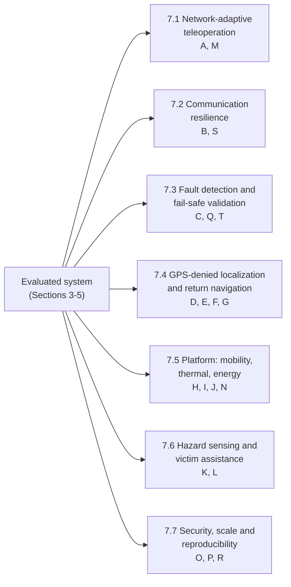

# 7. Future Work

The directions below extend the evaluated system of Sections 3-5. Each one starts from a limitation stated in Section 3 or measured in Section 5, names the baseline it will be compared with, and fixes its metrics in advance. None of them is an existing capability of the robot. Every direction that adds automated behaviour is constrained by one rule: the firmware dead-man stop of Section 3.5.2 stays independent of the new function and keeps its bounded stop time.

Figure 7.1 groups the twenty directions (A-T) into seven research themes, and Table 7.1 maps each direction to the limitation that motivates it.

**Figure 7.1.** Future-work themes and the directions they contain.

**Table 7.1.** Direction-to-limitation map.

| ID | Direction | Limitation in the current system | Evidence | Challenge |
|---|---|---|---|---|
| A | Safety-aware, network-adaptive teleoperation | Media parameters are fixed (640x480, 10 fps); the dashboard shows no link-quality indicator | 3.9.1, 5.2 | C3 |
| M | Two-way victim communication under degraded networks | Media delay and quality not yet measured (E5); audio quality at 16 kbit/s not measured | 5.2, 5.5 | C3 |
| B | Multi-hop mesh networking | One 802.11n cell; range sweep stopped at 50 m with no usable-range figure | 3.2, 5.3 | C2 |
| S | Communication-aware mission planning | No route planning; link quality is not mapped | 3.10, 5.3 | C2 |
| C | Cross-layer fault detection and recovery | P3 uses process liveness and an HTTP health check only; a removed Arduino needs a P1 restart; the PANIC notice is not forwarded to the dashboard | 3.5.2, 3.7, 5.4 | C1, C2 |
| Q | Quantitative fault-injection evaluation | Only SIGKILL injected automatically (10 trials per process); hangs, camera and microphone loss and network faults not injected; ablations not run | 4.3, 5.4 | C1, C2 |
| T | Digital-twin and simulation-based validation | Heartbeat-loss model assumes independent loss; the hardware mock differed from the firmware until patched | 5.1a, 5.1b | C1 |
| D | Indoor localization and SLAM | GPS only (CEP50 8.9 m, CEP95 30.5 m); no encoder, IMU or mapping | 3.10, 5.6.1 | - |
| E | Trajectory tracking and visualization | Dashboard draws a GPS polyline only | 3.10 | - |
| F | Autonomous return navigation | Teleoperation only; no return behaviour | 2.1 | - |
| G | Localization- and obstacle-aware navigation | The range sensor is advisory and never stops the motors | 3.5.3 | C1 |
| H | Compact, low-profile chassis | 4WD skid-steer platform tested only indoors | 3.3 | C4 |
| J | Mobility in disaster terrain | No rubble, slope or standard-apparatus trials | 2.2, 3.3 | C4 |
| I | Heat-resistant structural design | Thermal data limited to SoC temperature (at or below 52.6 deg C) under indoor loads | 5.5 | C4 |
| N | Energy-aware operation | Battery capacity unspecified; no voltage or current sensing; the original Pi supply under-volted under driving plus media | 3.3, 5.5 | C3, C4 |
| K | Sensor fusion for hazard assessment | Gas reading is uncalibrated ADC counts; DHT11 checked at one set-point | 5.6.3, 5.6.4 | - |
| L | Edge-based victim detection | No detection; the media process already uses about 63% of one core | 5.5 | C3 |
| O | Cybersecurity and secure remote control | Plain HTTP and WebSocket; one shared controller key; sequence check optional | 3.2, 3.8 | - |
| P | Multi-robot cooperative exploration | Single robot, single operator | 3.1 | - |
| R | Standardized benchmarking and reproducibility | Small N per experiment; rotating logs; no standard test apparatus | 2.2, Table 5.0 | C4 |

## 7.1 Network-Adaptive Teleoperation and Victim Communication (A, M)

The current media path runs at fixed parameters, and the operator has no view of link quality (Section 3.9.1). Direction A will add a policy that reads round-trip time, loss and jitter from the WebRTC statistics of each session, together with the telemetry age already tracked by P1 (Section 3.6.2), and lowers resolution, frame rate and bitrate as the link degrades. Control and media already run in separate processes (Section 3.4), so the policy acts only on P2. When control itself becomes unreliable, the policy does not try to recover it: the existing 2000 ms dead-man and 3000 ms telemetry timeout bring the robot to a stop. Direction M applies the same impairments to the victim side and asks whether the victim can still hear and be heard [@valin2012].

**Table 7.2.** Evaluation design for Theme 7.1.

| | A: Network-adaptive teleoperation | M: Victim communication |
|---|---|---|
| Conditions | Emulated delay, loss and bandwidth caps; distance sweep of Section 5.3 | Same impairments, plus intermittent links |
| Baseline | Fixed 640x480 at 10 fps | Fixed 32 kbit/s Opus |
| Metrics | Control latency, glass-to-glass delay [@bachhuber2016], frame rate, stall time, task completion | Speech intelligibility, interaction delay, video usability, operator assessment accuracy |
| Safety check | Dead-man trip time unchanged under every impairment | Same |

## 7.2 Communication Resilience (B, S)

The evaluated system covers one 802.11n cell, and the router stays with the operator (Section 3.2). Fielded systems have answered link loss with a tether [@nagatani2013] or with long-range low-bandwidth radio [@manuel2022]; neither carries two-way video. Direction B will place relay nodes running IEEE 802.11s with HWMP routing along the robot's path and compare the result with the single access point. Direction S then uses the measured link quality as a cost in route selection, so that a planned route trades length against time spent outside coverage. S depends on a map from Theme 7.4.

**Table 7.3.** Evaluation design for Theme 7.2.

| | B: Multi-hop mesh | S: Communication-aware planning |
|---|---|---|
| Conditions | Line of sight, obstructed links, node failure, route change | Mapped building with surveyed link quality |
| Baseline | Single access point (Section 3.2) | Shortest-distance route |
| Metrics | Packet delivery ratio, end-to-end latency, route recovery time, control availability | Route length, connectivity interruptions, control availability, mission completion |

## 7.3 Fault Detection and Quantitative Fail-Safe Validation (C, Q, T)

The supervisor of Section 3.7 detects a crashed or unresponsive process, but it does not classify faults across layers. Direction C will add a supervisor that watches serial health, process health, telemetry freshness and command delivery, and moves the system through defined recovery states. It will forward the firmware PANIC line to the dashboard, which removes the up to 700 ms confirmation lag of Section 3.5.2. The dead-man stays in the firmware and outside the supervisor's control.

Direction Q replaces the single-fault campaign of Section 5.4 with a fault-injection matrix (Table 7.4) and runs the ablations planned in Section 4.3. Thirty of thirty recoveries give a Wilson lower bound of 88.6% (Section 5.4) [@wilson1927]; a larger N per fault is needed before any reliability figure can be claimed. Direction T builds a simulation of the robot, its link and its faults for policy testing before hardware runs. The mock-firmware mismatch found in Section 5.1a shows why every simulated result must be checked against the robot itself.

**Table 7.4.** Fault-injection matrix for Direction Q.

| Layer | Fault | Injected in Section 5.4 | Method |
|---|---|---|---|
| Process | P1, P2 or P3 crash (SIGKILL) | Yes (10 each) | `faultinject.py` |
| Process | Hang (process alive, unresponsive) | No | SIGSTOP |
| Serial | Arduino unplug and reconnect | Single injection | USB device unbind |
| Serial | Corrupted or truncated frames | No | Serial fault proxy |
| Network | Wi-Fi drop, delay, loss, bandwidth cap | Single drop | `tc netem`, AP power-off |
| Sensor | Camera, microphone or GPS loss | No (GPS run invalid) | Device unbind |
| Ablation | Dead-man removed, P3 disabled, merged process | No | Build and config flags |

Metrics for every row: detection latency, motor-stop response, unintended-motion duration, recovery success with Wilson interval, and false-alarm rate.

## 7.4 GPS-Denied Localization and Return Navigation (D, E, F, G)

GPS is the robot's only position source, and it fails indoors (Section 5.6.1). Direction D will add wheel encoders, an IMU and a 2D LiDAR and run SLAM to build an occupancy-grid map. Direction E draws the estimated pose and track on that map and logs timestamped poses for post-mission review. Direction F then adds return-to-start, first by retracing recorded waypoints and then by planning on the map (for example, A*). Direction G sets the safety envelope for F: the robot slows down, asks the operator to take over, or stops when obstacle range or localization confidence crosses a set threshold. All four stay under operator supervision, which keeps the system within the supervisory tier of Section 2.1 [@beer2014; @schneider2016].

**Table 7.5.** Evaluation design for Theme 7.4.

| Direction | Reference or baseline | Metrics |
|---|---|---|
| D | Surveyed reference positions | Absolute position and heading error |
| E | Ground-truth route | Trajectory error, route reconstruction accuracy, display latency |
| F | Operator-driven return | Return success rate, route length, return time, obstacle-related failures |
| G | Teleoperation without the envelope | Collision count, false stops, operator interventions, safe completion rate |

## 7.5 Platform: Compact Chassis, Mobility, Thermal Protection and Energy (H, J, I, N)

The platform of Section 3.3 is a 4WD skid-steer base that has been tested only on indoor floors. Directions H and J will redesign the chassis for lower height and width and compare wheeled and tracked drives on rubble-like surfaces, loose material and slopes. Trials will follow standard test apparatus [@jacoff2012] so that results can be compared across platforms. Direction I adds an enclosure and heat-dissipation design based on the rated limits of each component; the only thermal figure measured so far is the SoC temperature. Direction N adds battery-voltage and current sensing, profiles energy per subsystem, and tests a return trigger at a validated remaining-energy threshold. The under-voltage events recorded in Section 5.5 make the supply a measured constraint, not a hypothetical one.

**Table 7.6.** Evaluation design for Theme 7.5.

| Direction | Baseline | Metrics |
|---|---|---|
| H | Current chassis (Table 2) | Minimum navigable clearance, turning radius, deformation under defined load |
| J | Current 65 mm wheels | Traversal success, maximum slope, obstacle clearance, slip ratio, energy per metre |
| I | Open frame | Internal and component temperature rise, throttling events, uptime under defined exposure |
| N | Current supply (Section 5.5) | Energy per subsystem, endurance, return-trigger margin |

## 7.6 Hazard Sensing and Edge-Based Victim Assistance (K, L)

The gas channel reports raw ADC counts, and the MQ-136 also responds to gases other than its target (Section 5.6.4). Direction K will calibrate the gas, temperature and humidity channels against reference instruments and fuse them with range data to flag abnormal conditions with stated uncertainty. Direction L will test lightweight victim-detection models on the Pi and on an attached accelerator, since the media path already uses about 63% of one core (Section 5.5). Published edge results give a reference point [@raghavan2026]. Detector output is shown to the operator as decision support and never stated as a confirmation of a victim's presence or condition.

**Table 7.7.** Evaluation design for Theme 7.6.

| Direction | Reference | Metrics |
|---|---|---|
| K | Calibrated reference instruments | Measurement error, detection sensitivity, false-alarm rate, response time |
| L | Labelled test set and published edge detectors | Precision, recall, inference latency, memory, energy, effect on media frame rate |

## 7.7 Security, Multi-Robot Scale and Reproducibility (O, P, R)

The threat model of Section 3.8 assumes a trusted local network: the controller key crosses plain HTTP, and the latest client with a valid key takes control. Direction O will add TLS on both ports, per-operator credentials with role-based authorization, mandatory sequence numbers against replay, and signed updates [@koczi2025]. Security experiments will measure unauthorized-command rejection, the latency cost of encryption, and whether the motors stay stopped during authentication failures. Direction P extends the system to several robots that share maps and hazard observations, an open problem named in recent reviews [@queralta2020; @kareem2026]. P depends on Themes 7.2 and 7.4. Direction R publishes the hardware configuration, test procedures, network conditions and raw logs of every experiment, repeats each trial at a stated N, and reports results against the baselines in Tables 7.2-7.7.

**Table 7.8.** Priority and dependencies.

| Priority | Directions | Depends on | Reason for priority |
|---|---|---|---|
| 1 | Q, C | - | Turns the fail-safe claims (C1, C2) into quantified evidence |
| 2 | A, M | - | Extends the two-way victim path (C3) to degraded links |
| 3 | B, O | - | Removes the single-cell and trusted-network assumptions |
| 4 | D, E, G, F | Encoders, IMU, LiDAR | Enables indoor operation and return-to-start |
| 5 | N, K, L | - | Energy, sensing and perception within the edge budget |
| 6 | H, J, I | - | Platform hardening for field conditions |
| 7 | S, T, P, R | B, D; C, Q | Planning, simulation and scale built on the above |
